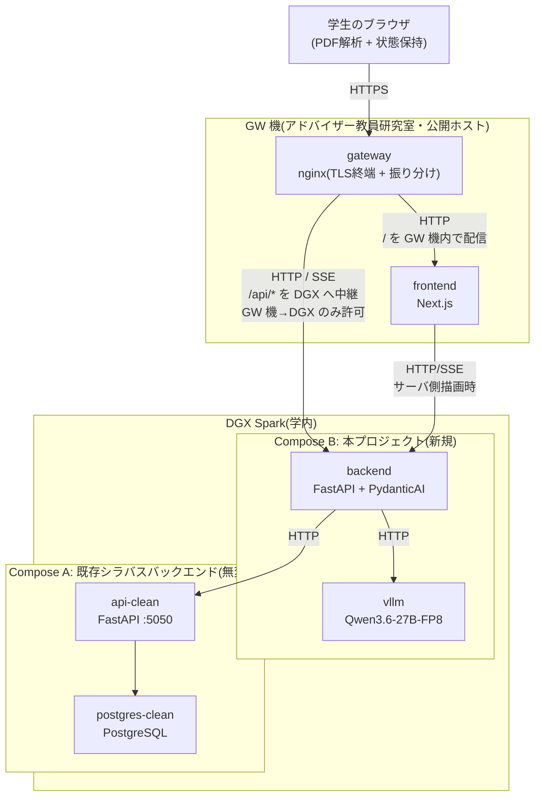
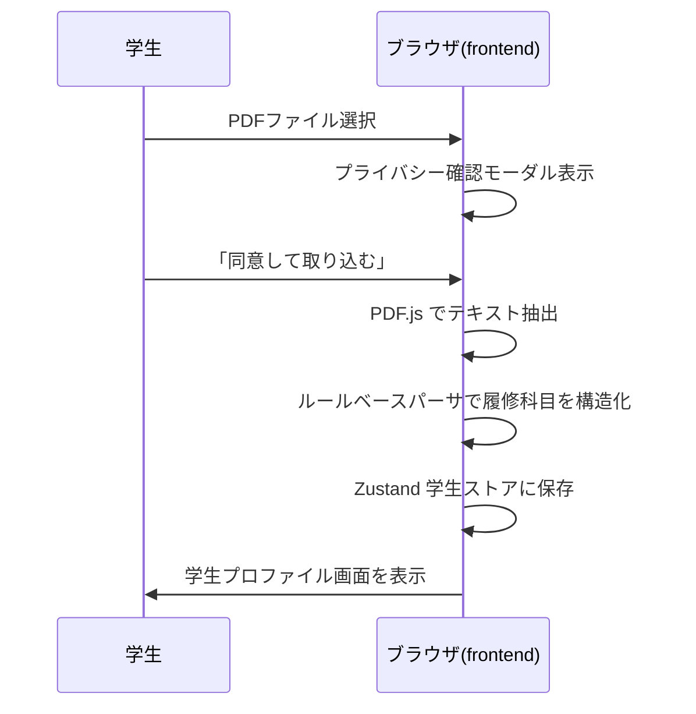
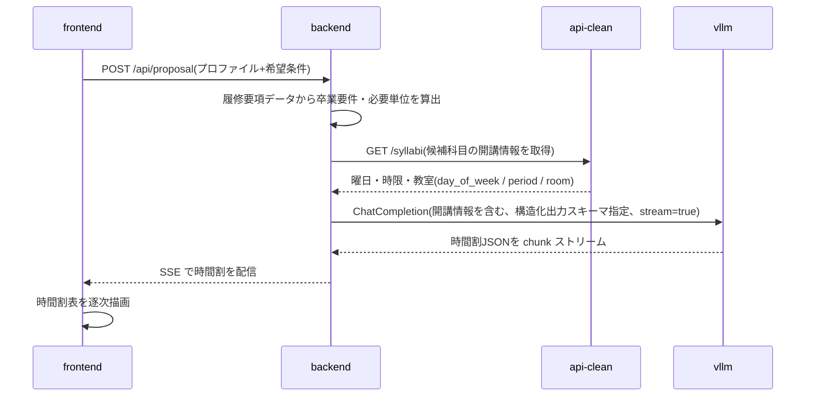
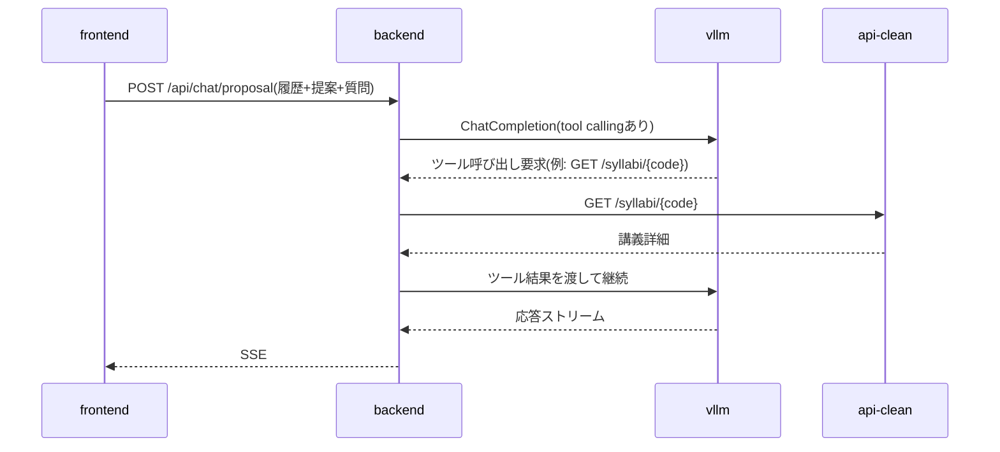
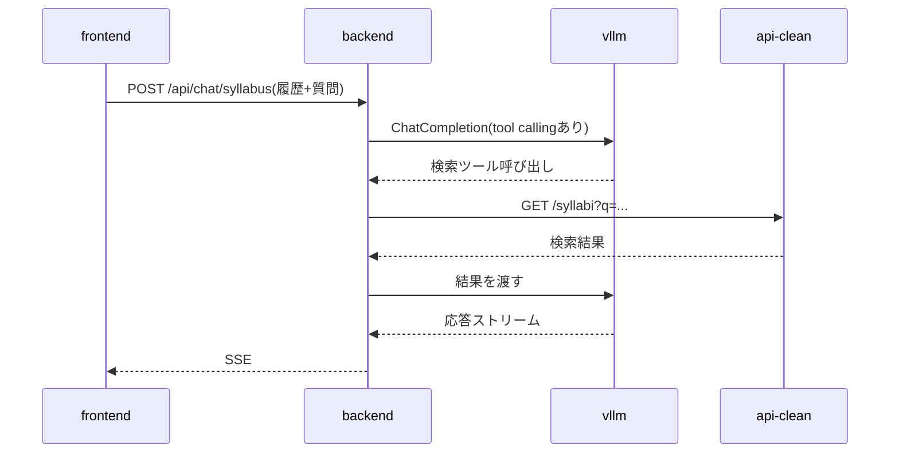

# 履修登録支援AIチャットボット 設計書(v0.8)

## 0. この文書について

### 0.1 本書の位置づけ

本書は、龍谷大学プロジェクトリサーチの活動として開発する「履修登録支援AIチャットボット」の設計書である。要件定義書(`requirements.md`)で示された「こういう機能がほしい」という要求を、「どの技術で、システムをどの部品に分け、どんなデータの形で、どんな順序で処理するか」という具体的な実装方針に落とし込むことを目的とする。

### 0.2 要件定義書との関係

本書は要件定義書を上位文書とし、要件定義書に反する記述は持たない。要件定義書の項番(§)を必要に応じて引用する。

---

## 1. システム全体構成

### 1.1 構成要素

サービスは以下の5つのコンテナで構成する。frontend / backend / vllm の3つを本プロジェクトで新規開発し、api-clean / postgres-clean は既存のシラバスバックエンドをそのまま利用する。

| 要素 | 役割 | 実装 | 新規/既存 |
|---|---|---|---|
| frontend | 学生が触れる Web UI | Next.js(React + TypeScript) | 新規 |
| backend | フロントと LLM/シラバスAPI を仲介し、履修提案ロジックを担う | FastAPI(Python)+ PydanticAI | 新規 |
| vllm | ローカル LLM 推論サーバ | vLLM、Qwen3.6-27B-FP8 | 新規 |
| api-clean | シラバス情報提供 API | FastAPI(既存) | 既存・無変更 |
| postgres-clean | シラバス DB | PostgreSQL(既存) | 既存・無変更 |

これらに加え、公開入口として gateway を新規に構築する。

| 要素 | 役割 | 実装 | 新規/既存 |
|---|---|---|---|
| gateway | 公開する唯一の入口(学外からのアクセスも受ける)。TLS 終端を行い、リクエストを同一ホスト上の frontend と DGX Spark の backend へ振り分ける | GW 機上の nginx | 新規(自前で構築・運用) |

これら6要素を2つのホストに分けて配置する。

| ホスト | 設置場所 | 稼働させる要素 |
|---|---|---|
| **GW 機** | アドバイザー教員研究室 | gateway、frontend |
| **DGX Spark** | 学内 | backend、vllm、api-clean、postgres-clean |

GW 機は、アドバイザー教員の研究室に設置するサーバである。本プロジェクトが GW 機で動かすのは gateway と frontend の2コンテナのみとする。学生のブラウザは DGX Spark へ直接アクセスせず、必ず GW 機を経由する。ブラウザに配信する画面(frontend)までを GW 機が担い、履修提案ロジック・LLM 推論・シラバス参照は DGX Spark 側で行う。

公開するホストを GW 機1台に限ることで、不特定多数の学生からアクセスされるポートを DGX Spark 自身に開けずに済む。DGX Spark は GW 機からの通信のみを受け付ける(ファイアウォールで送信元を GW 機に限定する)。DGX Spark は本プロジェクト以外の用途にも使われているため、外部公開の範囲を GW 機に閉じ込める意味もある。

学生のデータを処理する一連の機能(PDF 解析はブラウザ、提案・チャットは backend と vllm)は引き続き DGX Spark(およびブラウザ)上で完結する。frontend は静的な画面配信とブラウザ内処理のためのコードを配るのみで、成績データを受け取らない。gateway も通信を中継するのみでデータの処理・保存・記録を行わない(要件§3.1、§5.5)。

### 1.2 アーキテクチャ図



ゲートウェイは単一の公開オリジンとして振る舞い、`/` を同一ホスト上の frontend へ、`/api/*` を DGX Spark 上の backend へ振り分ける。frontend と backend が別ホストに分かれても、ブラウザから見た通信相手は常にゲートウェイの1オリジンに統一されるため、backend を別オリジンとして直接公開する必要がなく、CORS の考慮も不要になる。

### 1.3 データの流れ

要件§5.4のデータフロー図を各コンポーネントの責務に基づいて具体化する。ブラウザと DGX Spark の間の通信(下記2以降)はすべて GW 機上のゲートウェイを経由する。ゲートウェイは TLS 終端と振り分けのみを担い、リクエスト/レスポンスの内容を保存・記録しない。

1. 学生がブラウザで成績表PDFを選択 → frontend 内の PDF.js でテキスト抽出 → ブラウザのメモリ(Zustand store)に学生プロファイルとして保持
2. 履修提案要求 → backend が学生プロファイル + 履修要項データを組み立て、vllm に推論依頼 → PydanticAI が構造化出力(時間割形式)を強制
3. 提案表示後のチャット → backend が会話履歴 + 必要に応じて api-clean を tool calling で参照しつつ、vllm から応答を生成 → SSE で frontend へストリーミング
4. シラバスチャット → 同様に tool calling で api-clean を呼びながら、vllm から応答を生成

データ永続化は一切行わず、ブラウザを閉じれば消える(要件§5.2)。

---

## 2. 技術スタック

| レイヤ | 技術 | 補足 |
|---|---|---|
| 言語(フロント) | TypeScript | |
| 言語(バックエンド) | Python 3.12+ | |
| Webフレームワーク(フロント) | Next.js(App Router) | |
| Webフレームワーク(バックエンド) | FastAPI | |
| ASGI サーバ | Uvicorn | |
| UIライブラリ | Tailwind CSS + shadcn/ui | |
| クライアント状態管理 | Zustand | 永続化機能はオフ(要件§5.2) |
| サーバ通信 | TanStack Query | |
| PDF解析 | pdfjs-dist(PDF.js) | クライアント側で実行 |
| LLMオーケストレーション | PydanticAI | 構造化出力・ツール呼び出し |
| LLM推論サーバ | vLLM | OpenAI 互換 API を提供 |
| ストリーミング | SSE(Server-Sent Events) | vLLM のストリーミングをそのまま中継 |
| 履修要項データ管理 | YAML + Git 管理 | アプリ起動時にメモリへロード |
| コンテナ | Docker、docker compose | |

### 2.1 LLMモデル

- 暫定: Qwen3.6-27B-FP8(vLLM 経由)
- API形式: OpenAI 互換 ChatCompletion(`/v1/chat/completions`、stream 対応、tool calling 対応)
- モデルは確定次第、本節と§4.3を更新する

---

## 3. デプロイ構成

### 3.1 配置先

配置は2ホストに分かれる。

- **GW 機**(アドバイザー教員研究室) — gateway(nginx)と frontend。学外へ公開する唯一のホスト
- **DGX Spark**(学内) — backend / vllm、および既存シラバスバックエンド(api-clean / postgres-clean)

学生データを処理する一連の機能は、ブラウザと DGX Spark 上で完結する(要件§3.1)。GW 機は画面の配信と通信の中継のみを担い、成績データの処理・永続保存・記録を行わない。

公開する入口は GW 機に限定する。学生のブラウザは GW 機にのみアクセスし、DGX Spark へは直接到達しない。学外(自宅等)からのアクセスも RINS へのファイアウォール制限解除申請により許可する。これにより、不特定多数の学生がアクセスするポートを DGX Spark 自身に開けずに済む。なお、アクセス経路を学外に公開することと、学生データの処理を学外へ出さないこと(要件§3.1)は別概念であり、後者は引き続き担保する(成績データの処理・保存は DGX 上で完結し、学外クラウドへ送信しない)。

frontend を DGX Spark ではなく GW 機に置くのは、外部からアクセスされる資産(画面配信)を公開ホスト側にまとめ、DGX Spark 側で開けるポートを backend の1つだけに絞るためである。本プロジェクトが GW 機で動かすのは nginx と Next.js だけであり、高いスペックを要さない。一方、GPU を要する vllm と、それを呼ぶ backend は DGX Spark 側から動かせない。

### 3.2 docker compose 構成

frontend が GW 機、backend / vllm が DGX Spark と別ホストに分かれるため、compose ファイルも2つに分ける。既存のシラバスバックエンド(`docker-compose.clean.yml`)には一切手を加えない。

| ファイル | 実行ホスト | 定義するサービス |
|---|---|---|
| `docker-compose.gw.yml` | GW 機 | gateway、frontend |
| `docker-compose.dgx.yml` | DGX Spark | backend、vllm |

サービス間通信は以下のネットワークで成立する:

- **gw-net**(GW 機) — gateway ↔ frontend。`docker-compose.gw.yml` が自動作成
- **app-net**(DGX Spark) — backend ↔ vllm。`docker-compose.dgx.yml` が自動作成
- **syllabus-clean-net**(既存・DGX Spark) — backend が api-clean を呼ぶための共有ネットワーク。`external: true` で参照

backend のみ app-net と syllabus-clean-net の両方に参加し、橋渡しを担う。ホストをまたぐ通信(gateway → backend、frontend → backend)は Docker network では解決できないため、DGX Spark のアドレスとホスト公開ポート 8000 を環境変数で与える(§3.4)。

`docker-compose.gw.yml`(抜粋):

```yaml
services:
  gateway:
    image: nginx:alpine
    ports:
      - "80:80"                       # 証明書取得(HTTP-01)および HTTPS へのリダイレクト用
      - "443:443"
    volumes:
      - ./gateway/nginx.conf:/etc/nginx/conf.d/default.conf:ro
      - /etc/letsencrypt:/etc/letsencrypt:ro
    networks: [gw-net]
    depends_on: [frontend]

  frontend:
    build: ./frontend
    networks: [gw-net]
    environment:
      - BACKEND_ORIGIN=http://<DGX Spark のアドレス>:8000   # サーバ側描画から backend を呼ぶ際の宛先

networks:
  gw-net:
```

`docker-compose.dgx.yml`(抜粋):

```yaml
services:
  backend:
    build: ./backend
    ports:
      - "8000:8000"                  # GW 機から到達させるため公開(§3.4)
    networks:
      - app-net
      - syllabus-clean-net
    depends_on:
      vllm:
        condition: service_healthy   # モデルロード完了(数分)を待ってから起動

  vllm:
    image: vllm/vllm-openai:latest   # vLLM >= 0.19.0 が必須(Qwen3.6対応)。DGX 上の現行は 0.20.0
    networks: [app-net]
    ports:
      - "127.0.0.1:8001:8000"        # デバッグ用のみ。全公開を避け 127.0.0.1 バインド
    ipc: host                        # vLLM のマルチプロセス共有メモリ用(または shm_size 指定)
    volumes:
      - /srv/qwen3.6/models/Qwen3.6-27B-FP8:/models:ro   # 事前DL済みモデルを読み取り専用で渡す
    deploy:
      resources:
        reservations:
          devices:
            - driver: nvidia
              count: all
              capabilities: [gpu]
    healthcheck:
      test: ["CMD", "python3", "-c", "import urllib.request; urllib.request.urlopen('http://localhost:8000/health')"]
      interval: 30s
      timeout: 5s
      retries: 30
      start_period: 900s             # モデルロードに数分かかるため長めに
    command:
      - --model
      - /models                       # 事前DLしたローカルパス。起動時に HF からは取得しない
      - --served-model-name          # §6.3 の OpenAIChatModel(model=...) と一致させ 404 を防ぐ
      - qwen3.6-27b-fp8
      - --language-model-only         # テキスト専用。ビジョンを省きメモリを KV cache に回す
      - --reasoning-parser            # 思考モデルのため必須。無いと思考が本文に漏れ構造化出力が壊れる
      - qwen3
      - --enable-auto-tool-choice
      - --tool-call-parser            # hermes ではなく qwen3_coder(公式指定の出力書式)
      - qwen3_coder
      - --max-model-len               # 既定262144はメモリ過大。最低128K推奨に沿い131072。OOM時さらに削減
      - "131072"
      - --gpu-memory-utilization      # 同一GPUを共有する他ワークロードがある前提で 121GiB に収めるため 0.4(≒48GB)
      - "0.4"
      # 単GPU構成のため tensor-parallel は指定しない(=1)

networks:
  app-net:
  syllabus-clean-net:
    external: true
    name: syllabus_backend_syllabus-clean-net
```

vllm のモデルはイメージ内に持たず、ホストの `/srv/qwen3.6/models/Qwen3.6-27B-FP8` に**事前DL**したものを読み取り専用で bind mount する。コンテナ起動時に HuggingFace から取得しないため、Docker 名前付きボリュームは使わない。

### 3.3 起動順序

0. (初回のみ) vllm 用モデルを事前DL: `/srv/qwen3.6/models/Qwen3.6-27B-FP8` を作成し、`hf download Qwen/Qwen3.6-27B-FP8 --revision <commit SHA> --local-dir /srv/qwen3.6/models/Qwen3.6-27B-FP8`(§4.3)
1. (DGX Spark)シラバスバックエンド側で `bin/init_clean.sh`(初回のみデータ投入込み)、以降は `docker compose -f docker-compose.clean.yml up -d`
2. (DGX Spark)`docker compose -f docker-compose.dgx.yml up -d`
3. (GW 機)`docker compose -f docker-compose.gw.yml up -d`

GW 機側は DGX Spark 側の起動完了を待たずに立ち上がるが、backend が未起動の間は API 呼び出しが失敗するため、上記の順序で起動する。

### 3.4 ポート割り当て(暫定)

**GW 機**

| サービス | コンテナ内 | ホスト公開 |
|---|---|---|
| gateway | 80 / 443 | 80 / 443 |
| frontend | 3000 | 公開しない(gateway から gw-net 経由で参照) |

**DGX Spark**

| サービス | コンテナ内 | ホスト公開 |
|---|---|---|
| backend | 8000 | 8000 |
| vllm | 8000 | 8001 |
| api-clean(既存) | 5000 | 5050 |
| postgres-clean(既存) | 5432 | 5433 |

コンテナ内ポートは各サービスの標準値に従っている(Next.js は 3000、FastAPI/Uvicorn と vLLM は 8000、PostgreSQL は 5432、api-clean は既存設定の 5000)。ホスト公開ポートは、backend と vllm がコンテナ内で同じ 8000 を使うためホスト側で vllm を 8001 にずらしている。postgres-clean の 5433 は、ホスト上で別の PostgreSQL が動いている場合を想定した 5432 との衝突回避である(既存設定そのまま)。

同一ホスト内のコンテナ間通信はホスト公開ポートではなく Docker network 経由(サービス名:コンテナ内ポート、例: `http://vllm:8000`、`http://frontend:3000`)で行う。ホストをまたぐ通信(GW 機 → backend)のみ、DGX Spark のアドレスとホスト公開ポート 8000 を用いる。

学生のブラウザは DGX Spark のホスト公開ポートには直接アクセスしない。GW 機からの振り分け先となる backend(8000)のみ DGX Spark のホスト側に公開する。frontend が GW 機側に移ったため、DGX Spark 側で 3000 を公開する必要はない。残りの vllm(8001)・api-clean(5050)・postgres-clean(5433)のホスト公開は、ホストOS からのデバッグ用と位置付ける。

backend の 8000 は**ファイアウォールで送信元を GW 機に限定する**。`/api/chat/*` は認証なしで vllm を呼ぶ経路であり(要件§5.2)、8000 が学内に開いていると誰でも DGX Spark の GPU を回せてしまう。DGX Spark の GPU は本プロジェクト以外のワークロードとも共有しているため、濫用の影響は本サービスに留まらない。vllm(8001)を `127.0.0.1` バインドとしていても、backend が代理で呼ぶ以上 8000 を開ければ同じことになる。

限定は DGX Spark のホスト側ファイアウォールで行い、`DOCKER-USER` チェーンに記述する(理由と注意点は§3.5.3と同じ)。DGX Spark 自身から出た通信はこのチェーンを通らないため制限を受けず、ホスト上での動作確認は従来どおり行える。

GW 機側で外部に開けるのは gateway の 80 / 443 のみとする。frontend(3000)はホスト公開せず、gateway からコンテナネットワーク経由でのみ到達できるようにする。

公開入口は GW 機のゲートウェイに限定する。学外(自宅等)からのアクセスも RINS へのファイアウォール制限解除申請により許可する。一方、学生データの処理は DGX 上で完結させ学外クラウドへ送信しない(要件§3.1)。

### 3.5 アクセス制御

学生からのアクセスは、アドバイザー教員研究室に設置する GW 機上のリバースプロキシ(ゲートウェイ)を唯一の入口とする。学外(自宅等)からのアクセスも許可し、その公開は RINS へのファイアウォール制限解除申請により行う(§3.5.2)。データ処理の学外非送信は別途維持する(要件§3.1)。

#### 3.5.1 GW 機の役割

- nginx を構築し、HTTPS を終端する。`/` を同一ホスト上の frontend、`/api/*` を DGX Spark の backend へリバースプロキシする(§1.2)。
- SSE(ストリーミング)を中継できるよう、該当パスではバッファリングを無効化する(`proxy_buffering off` 等)。
- リクエスト/レスポンスのボディはログに記録しない(要件§5.5。詳細は§9)。
- frontend(Next.js)を同居させる。GW 機が担うのは公開入口と画面配信までであり、履修提案ロジック・LLM 推論・シラバス参照はすべて DGX Spark 側で行う。

#### 3.5.2 通信経路と必要な設定・申請

| 通信 | 方向 | 必須/要確認 | 対応 |
|---|---|---|---|
| 学生ブラウザ(学外含む) → GW 機(80/443) | インバウンド | **必須** | RINS へ **ファイアウォール制限解除申請**。申請はアドバイザー教員が代行する。443 用サーバ証明書と、内向け・外向け DNS への登録が前提。RINS には Web 公開用の専用申請区分(Web サーバ外部公開申請)も存在するため、本件がどちらに該当するかは要確認(§13) |
| GW 機 → DGX Spark(backend 8000) | 学内 | **要確認** | 同一セグメントであれば申請不要。セグメントをまたぐ場合のみ RINS に相談する。8000 は非標準ポートのため要注意 |
| GW 機 → DGX Spark を DGX 側で受ける | インバウンド | 申請不要 | DGX のファイアウォールで送信元を GW 機に限定して許可(自分たちで設定。§3.4) |
| GW 機のコンテナ → 上記以外の宛先 | アウトバウンド | 申請不要 | GW 機のファイアウォールで遮断する(§3.5.3) |
| 管理者 → GW 機(SSH 22) | インバウンド | 申請しない | 学内からのみ到達可能とし、学外には開けない |

補足: 「ファイアウォール制限解除申請」は主に**外部→内部**の通信を対象とする(内→外は原則許可済み)。本構成で外部→内部に当たるのは「学生ブラウザ → GW 機(80/443)」のみである。

#### 3.5.3 運用上の前提

- GW 機は RINS が提供する基盤ではなく研究室に自前で設置するサーバであるため、**OS 更新・脆弱性対応・稼働監視の責任は開発チーム側にある**。実務の構築・保守担当は **y240152** が担う。
- GW 機の公開ホスト名と DNS 登録は未確定(§13)。
- **管理(初期構築・nginx 設定・保守)は SSH** で行う。アカウントは学籍番号、認証は公開鍵とし、メンバー全員の鍵登録が済んだ時点でパスワード認証を無効化する。SSH は運用者側の管理経路であり、**学生がサービスを利用するのに SSH は不要**(学生はブラウザから HTTPS でアクセスするのみ)。
- 外部公開ホストとなるため、インバウンドは 443(および証明書取得に必要な範囲で 80)のみを許可し、他は遮断する。OS の自動セキュリティ更新を有効にする。
- **本プロジェクトのコンテナからの外向き通信(egress)は、DGX Spark の backend(8000)のみを許可し、他は遮断する**。GW 機は学外に公開する唯一のホストであり、gateway / frontend が侵害された場合に GW 機上の他の環境や研究室 LAN への足がかりとなることを防ぐ。

egress の遮断は本プロジェクトのコンテナに対するものであり、ホスト自身の通信(OS 更新、証明書取得、コンテナイメージの取得)や GW 機の他の用途は対象としない。この制限は docker compose では表現できず、ホスト側のファイアウォールに記述する。なお、Docker が扱う通信はホスト宛てではなく転送として処理されるため ufw の設定が効かない。Docker が管理者用に空けている `DOCKER-USER` チェーンに記述し、再起動後も残るよう永続化する。宛先は名前解決を要しない IP 指定とし、DNS の外向きを許可しなくて済むようにする。
- 龍谷祭期間を含む常時稼働が前提となるため、設置場所の電源と有線 LAN を確保する。
- 学外公開には DNS 登録(内向け・外向け)とサーバ証明書が前提となる。GW 機↔DGX Spark 間の疎通可否と、申請区分・開放ポートの詳細は RINS 担当教員に確認のうえ確定する(§13)。

#### 3.5.4 申請の段取りと確定状況

RINS への申請は**外部公開のためのファイアウォール制限解除申請1件**であり、アドバイザー教員が代行する。

**段取り**: GW 機を構築し、学内から gateway → frontend / backend の疎通と SSE 中継を確認 → 公開ホスト名の確定 → DNS 登録 → 証明書取得 → ファイアウォール制限解除申請 → 外部公開。申請以外の工程は申請の可否を待たずに進められる。

**申請(確定値)**

| 項目 | 内容 |
|---|---|
| 対象ホスト | GW 機(アドバイザー教員研究室に設置) |
| 開放ポート | 443/tcp(必須)、80/tcp(Let's Encrypt の HTTP-01 認証および HTTPS へのリダイレクトに使用。可否は要確認) |
| 利用目的 | 履修登録支援AIチャットボットの公開ゲートウェイ(nginx リバースプロキシ + 画面配信)。履修提案ロジックと LLM は DGX Spark 側 |
| 公開範囲 | 学外を含む(在学生が自宅からも利用するため) |
| 実務管理担当 | y240152(SSH で構築・保守) |
| 申請時の空欄 | 申請責任単位、責任者(=アドバイザー教員)の氏名・メール(先生側情報) |

**公開フェーズで確定する項目**

| 項目 | 内容 |
|---|---|
| 証明書 | **Let's Encrypt** を採用(無料・自動更新)。ドメイン認証方式(HTTP-01 / DNS-01)は DNS・ポートの段取り次第で決定 |
| 前提 | 公開ホスト名の確定、内向け・外向け DNS 登録 |
| ホスト名 | 公開フェーズで確定(後変更も可だが DNS・証明書・申請・告知物に波及するため公開前に確定が望ましい) |

---

## 4. コンポーネント設計

### 4.1 frontend(Next.js)

#### 4.1.1 ディレクトリ構成

```
frontend/
├── app/                       # Next.js App Router
│   ├── page.tsx               # / 学生情報入力
│   ├── proposal/page.tsx      # /proposal 履修提案
│   ├── syllabus/
│   │   ├── page.tsx           # /syllabus 一覧・検索
│   │   └── [code]/page.tsx    # /syllabus/[code] 講義詳細
│   ├── privacy/page.tsx       # /privacy プライバシーポリシー
│   └── layout.tsx
├── components/
│   ├── ui/                    # shadcn/ui で生成された部品
│   └── ...
├── lib/
│   ├── pdf/                   # PDF解析
│   │   └── parseGradeReport.ts
│   ├── api/                   # backend との通信
│   └── streaming/             # SSE処理
├── stores/                    # Zustand
│   ├── student.ts             # 学生プロファイル
│   └── chat.ts                # 対話履歴
└── package.json
```

#### 4.1.2 状態管理

- Zustand store 2本: 学生プロファイル(`student.ts`)、対話履歴(`chat.ts`)
- どちらも **永続化機能を意図的にオフ** にする(要件§5.2)。ページリロード・タブクローズで完全消失
- リセット機能(要件§4.8)は両 store の `reset()` を呼ぶだけで実現
- サーバから取得するデータ(シラバス検索結果、履修要項データ等)は TanStack Query でキャッシュ管理

#### 4.1.3 PDF解析(クライアント側)

- `pdfjs-dist` でテキストレイヤーを抽出
- 龍谷大学成績表レイアウト前提のルールベースパーサーを実装
- 評価記号(`T`/`N`/`G`/`D`/`J`/`M`)と数値スコアを認識し、合否を判定(要件§4.2)
- 学籍番号は意図的に抽出しない(要件§4.2)
- 解析失敗時は「読み取れませんでした、手入力に切り替えてください」とフォールバック

#### 4.1.4 ストリーミング表示

- backend からの SSE を `fetch` + `ReadableStream` で受信
- 受信した chunk を逐次 React state に反映、画面に追記表示

### 4.2 backend(FastAPI)

#### 4.2.1 ディレクトリ構成

```
backend/
├── app/
│   ├── main.py                # FastAPI app entry
│   ├── api/                   # ルーティング
│   │   ├── proposal.py        # 履修提案
│   │   ├── chat_proposal.py   # 提案チャット
│   │   ├── chat_syllabus.py   # シラバスチャット
│   │   └── syllabus.py        # シラバス検索・詳細・値マスタ(api-clean 中継 JSON)
│   ├── agents/                # PydanticAI エージェント定義
│   │   ├── proposal_agent.py
│   │   ├── chat_agent.py
│   │   └── tools.py           # シラバスAPI呼び出し等
│   ├── schemas/               # Pydantic スキーマ
│   │   ├── student.py
│   │   ├── curriculum.py
│   │   └── proposal.py
│   ├── curricula/             # 履修要項データのロード
│   │   ├── loader.py          # YAML 読み込みとバリデーション
│   │   └── merge.py           # 共通ファイル・他課程ファイルのマージ(§4.4.3)
│   └── settings.py
├── scripts/
│   └── build_offerings.py     # api-clean と名寄せして offerings/<年度>/ を生成(§5.1.4)
├── pyproject.toml
└── Dockerfile
```

#### 4.2.2 役割

- フロントからのリクエストを受け、必要に応じて履修要項データを参照し、PydanticAI で定義したエージェントに処理を委ねる
- エージェントは vllm を OpenAI 互換クライアント経由で呼び、必要に応じて api-clean を tool calling で叩く
- 応答は SSE でフロントへストリーミング

#### 4.2.3 学生データの取り扱い

- backend は学生プロファイル(学年・課程・既修得科目)をリクエスト本文で受け取り、推論用プロンプトの組み立てに使うが、**永続化しない**
- リクエスト処理完了後にメモリから破棄される
- ログにも記録しない(要件§5.5)

### 4.3 vllm(LLM 推論サーバ)

- vLLM を Docker(`vllm/vllm-openai:latest`)で起動。Qwen3.6 対応には **vLLM >= 0.19.0** が必要(DGX 上の現行イメージは 0.20.0 で対応済み、アーキ `Qwen3_5ForConditionalGeneration` をサポート確認済み)
- `--model /models`(暫定モデル Qwen3.6-27B-FP8 を事前DLしたローカルパスを指す。リポジトリ名は起動時に使わない)。FP8(e4m3)量子化済み、約 31GB
- このモデルは**ビジョンエンコーダ付き(画像/動画対応)**だが、本プロジェクトはテキスト用途のため **`--language-model-only`** を付け、ビジョンを無効化してメモリを KV cache に回す
- **`--reasoning-parser qwen3`** を指定(思考(reasoning)モデルのため必須。無いと思考トークンが本文に混ざり、PydanticAI の構造化出力が壊れる)
- tool calling は **`--enable-auto-tool-choice` + `--tool-call-parser qwen3_coder`** で対応(公式モデルカード指定。`hermes` ではこのモデルの出力書式と合わず、ツール呼び出しがエラーにならず**サイレントに無視される**。`--tool-call-parser` 自体がないと vLLM は起動時にエラーで停止する)
- **`--served-model-name qwen3.6-27b-fp8`** を指定し、§6.3 の `OpenAIChatModel('qwen3.6-27b-fp8', ...)` と一致させる(不一致だと 404)
- `--max-model-len 131072`(既定 262,144 はメモリ過大。公式は思考能力維持のため最低 128K の確保を推奨。OOM 時はさらに削減)
- DGX Spark は**単GPU**のため tensor parallel は使わない(=1)。`--gpu-memory-utilization` は同一GPUを共有する他ワークロードがある前提で 121GiB のユニファイドメモリに収めるため **0.4(≒48GB)** を起点とする(起動ログの KV cache サイズを見て余裕があれば 0.45 まで上げてよい)
- モデルは**事前に取得**して `/srv/qwen3.6/models/Qwen3.6-27B-FP8` に置き、`-v .../Qwen3.6-27B-FP8:/models:ro` で**読み取り専用 bind mount** する(`--model /models`)。取得は `hf download Qwen/Qwen3.6-27B-FP8 --revision <commit SHA> --local-dir ...` で**リビジョンを固定**する。`--model` がローカルパスを指すため起動時に HF から重みを取得せず、再現性を確保する(コンテナ起動時に都度DLしない。なお現状 `HF_HUB_OFFLINE` 等の環境変数までは設定していない)
- OpenAI 互換 API を `/v1/chat/completions` で公開
- backend からのみアクセス可能(`app-net` 内)、frontend からは直接呼ばない

### 4.4 履修要項データ層

#### 4.4.1 データ生成方針

- 龍谷大学公式サイトから閲覧できる履修要項を、**手動で YAML 形式に転記**する
- 出典ページの設置科目一覧・卒業要件表は画像形式で提供されるが、これらも転記対象とする(単位数・配当年次・開講クォーター・科目区分・区分別要件単位数)。画像にのみ掲載される科目(キャリア実習系・職業指導など)も記載する
- 先端理工学部6課程(2024年度入学)分を作成済み。第1フェーズで利用するのは知能情報メディア課程分のみで、他課程分は第2フェーズ以降に向けた先行整備という位置づけ
- 学修プログラムは構造が複雑なため現時点では転記しない。第2フェーズで扱いを確定した上でスキーマ・データに追加する
- 転記担当者がドラフトを作成 → Pull Request → アドバイザー教員のレビュー・承認(要件§8末尾)
- 第2フェーズ以降で他学年・他学部に対象を広げる際は、同じ手順で対象範囲のファイルを追加する

**入学年度で決まって変わらないデータと、開講年度ごとに変わるデータを分離する。** 履修要項(卒業要件・科目区分・設置科目)は、ある年度の入学生に対して入学時点で決まり、その学生が卒業するまで変わらない。したがって一度確定したら以後編集しない。一方シラバスコードは開講年度ごとに発行される値であり、毎年更新が要る。両者を同一ファイルに置くと、開講年度が進むたびに過去の入学年度のファイルまで書き換えることになり、確定済みの卒業要件を壊しかねない。したがって**履修要項ファイル(`curricula/`)にはシラバスコードを持たせず、開講年度ファイル(`offerings/`)に分離する**(§4.4.2)。両者は**科目名**で結合する。

**教養教育科目は全課程で共通のため、共通ファイル1本に切り出す。** 履修要項の「❶教養教育科目の教育目的および履修方法」は【2022年度以降入学生】として学部横断で規定されており、6課程で内容が完全に一致する。従来は6ファイルに同一内容(約130科目)を複製していたが、共通ファイル1本を各課程ファイルから参照する形に改める。課程固有の例外(例: 「生活の中の化学」は応用化学課程では履修不可)は課程ファイル側に `liberal_arts_exceptions` として記述する。教養教育科目の**卒業要件枠(`liberal.*` スロット)も課程ではなく学部で決まる**ため、設置科目一覧と併せて共通ファイルが唯一の定義元となる(§5.1.3)。課程ファイルは `liberal.*` スロットを持たない。

**専門関連科目は転記せず、同一入学年度の他課程ファイルから導出する。** 専門関連科目とは所属課程以外の課程が主体となって開講する専攻科目であり、その実体は他課程ファイルの `courses` そのものである。各課程ファイルに列挙すると同じ科目を課程数ぶん複製することになるため、`category: "専門関連科目"` を持つレコードは転記せず、ロード時に「同一入学年度の他課程ファイルに載る専攻科目」として解決する(§4.4.3)。ただし学修プログラム科目は転記対象外(前述)であり、この導出にも含まれない。

#### 4.4.2 ファイル配置と命名

```
curricula/
  common/
    liberal-arts-2022.yaml            # 教養教育科目(2022年度以降入学生・全課程共通)
  admission-2024/
    01-suri-joho-kagaku.yaml          # 数理・情報科学課程
    02-chinou-joho-media.yaml         # 知能情報メディア課程
    03-denshi-joho-tsushin.yaml       # 電子情報通信課程
    04-kikai-kogaku-robotics.yaml     # 機械工学・ロボティクス課程
    05-oyo-kagaku.yaml                # 応用化学課程
    06-kankyo-seitai-kogaku.yaml      # 環境生態工学課程
  admission-2026/
    01-suri-joho-kagaku.yaml          # 2026年度以降入学生は履修要項が改訂されている
    06-kankyo-kagaku.yaml             # 2025年度に環境科学課程へ改称
offerings/
  2026/
    common-liberal-arts.yaml
    01-suri-joho-kagaku.yaml
```

- 入学年度をディレクトリ、課程をファイルとする(旧 `<課程略称>_<入学年度>.yaml` から変更)。入学年度が第一階層になることで、新しい入学年度を追加するときに既存ディレクトリへ手を入れずに済む
- **ファイル名は `<課程コード2桁>-<課程名のローマ字表記>.yaml`。**
  - **課程コード**は大学が公表している番号で、科目ナンバリングの第2要素(`Y-01-MMA-1-01-P` の `01`)およびシラバスコード先頭4桁(`Y001` の `001`)と一致する。課程が改称されても変わらない(環境生態工学課程 → 環境科学課程の改称後も `Y006` のまま)ため、これを一次識別子とする
  - **ローマ字表記は課程名を省略せずすべて音写する。** 語の区切りはハイフン。末尾の「課程」と中黒(・)は書かない。旧命名(`chinou_media` は「情報」を、`kankyo_seitai` は「工学」を落としていた)は省略の基準が定まっておらず、課程名からファイル名を導出できなかった。省略しない規則にすることで一意に定まる
  - 対応表: 01 数理・情報科学 `suri-joho-kagaku` / 02 知能情報メディア `chinou-joho-media` / 03 電子情報通信 `denshi-joho-tsushin` / 04 機械工学・ロボティクス `kikai-kogaku-robotics` / 05 応用化学 `oyo-kagaku` / 06 環境生態工学 `kankyo-seitai-kogaku`(2025年度以降の入学年度は環境科学 `kankyo-kagaku`)
- 課程名は改称され得る。ファイル名のローマ字部分は**その入学年度時点の名称**に固定し、以後変更しない。改称の追跡は課程コードと `program.name_aliases` が担う
- 課程ファイルから共通ファイルへの参照(`liberal_arts`)は、**`curricula/` を起点とした相対パス**で書く(例: `common/liberal-arts-2022.yaml`)。ファイル自身からの相対パス(`../common/...`)ではない
- `offerings/<開講年度>/` は `curricula/` と同じファイル分割に対応させる。複数の入学年度ファイルが同一の開講年度コードを参照することは正常であり(入学年度が違っても同じ科目を履修する)、重複を排除しない

#### 4.4.3 ロード方式

- backend 起動時に `curricula/**/*.yaml` と `offerings/<運用対象年度>/*.yaml` を読み込み、Pydantic スキーマ(§5.1)で型付けしてメモリ上に保持する
- 課程ファイルは以下の順にマージし、課程ごとに1つの完全なオブジェクトを組み立てる:
  1. `liberal_arts` が指す共通ファイルの `requirement_slots` / `credit_caps` / `courses` を取り込む(教養教育科目の要件枠と設置科目は共通ファイルが唯一の定義元。§4.4.1)
  2. `liberal_arts_exceptions` を適用する(§5.1.5)
  3. 同一入学年度の他課程ファイルの `courses` を `category: "専門関連科目"` として取り込む(§4.4.1)。取り込んだ科目は `related` / `free.faculty` スロットの判定にのみ用い、当該課程の設置科目としては扱わない
- 起動時にスキーマバリデーションを実行し、不正があれば起動失敗(転記ミスを早期に検出)。型検査に加えて以下の整合性を検証する:
  - `type` が {必修, 選択必修, 選択, 随意} のいずれかであること。`category` / `subcategory` が §5.1.5 の列挙値のいずれかであること
  - `term` と `quarters` の整合(§5.1.5)
  - `kikan: true` の科目が `type: "選択必修"` であること(§5.1.5)
  - `constraints[].slot` および `constraints[].track_group` の参照先が存在すること(前者は `requirement_slots`、後者は `courses[].track_groups`)
  - `by_semester` の各要素が `max_credits_per_semester` と `max_credits_per_year` のどちらか一方のみを持つこと
  - 課程ファイルの `admission_year` が、`liberal_arts` の指す共通ファイルの `applies_from_admission_year` 以上であること
- 次の4件は**マージ後**のオブジェクトに対して検証する。共通ファイル単体では `liberal.elective` の `overflow_to` 先である `free.all` が解決できず、スロット単位の検算も成立しないため、ファイル単体では検査しない:
  - `requirement_slots[].key` が一意であること
  - `requirement_slots[].credits` の合計が `graduation.total_credits` に一致すること
  - `overflow_to` の参照先が `requirement_slots` に存在し、循環していないこと
  - `courses[].title` に重複がないこと。この検査の対象は当該課程の設置科目(共通ファイル由来の教養教育科目 + 課程ファイルの専攻科目)であり、上記3.で導出した専門関連科目は含めない(他課程に同名科目が存在し得るため)
- **`offerings` の `unresolved` が非空でも起動は継続し、警告ログを出す。** 当該科目はシラバスコード未解決として扱い、コードを要する処理(検索画面のタグ付け §6.1、開講情報の取得 §7.2)の対象外とする。`offerings` は api-clean から機械生成する値であり、上流の科目名変更ひとつで稼働中のサービスが起動不能になる事態は避ける。不整合の検出は PR 時の CI(§12.2)で行い、そこでマージをブロックする
- 任意フィールドは null / 省略を許容する。Pydantic では `Optional` として定義する
- 個々のリクエストでは、該当課程・該当入学年度のオブジェクトのみを参照する
- クライアントへ全量を返すことはせず、必要な部分のみを JSON で返却する

#### 4.4.4 更新運用

- **`curricula/` 配下の追加・変更は Pull Request 経由でアドバイザー教員のレビュー・承認を必須とする。** GitHub の CODEOWNERS で `curricula/` の承認者をアドバイザー教員に限定することを想定
- **`offerings/` はレビュー対象外とする。** 履修要項の転記物ではなく、api-clean から機械的に生成した名寄せ結果であるため。正しさは CI の api-clean 照合(§12.2)で担保する
- **`curricula/` は確定後は編集しない。** 誤記の修正を除いて手を入れない。履修要項が改訂された場合は既存ファイルを書き換えず、新しい `admission-<年度>/` を追加する
- **`offerings/` は毎年度シラバス公開後に新しいディレクトリを追加する。** backend が参照するのは運用対象年度の1ディレクトリのみだが、過去年度分は削除せず残す(名寄せ結果の変遷を追跡し、シラバスコードの年度不変性を検証するため。§5.1.4)

---

## 5. データ設計

### 5.1 履修要項データのスキーマ

実データの構造を以下に定義する。backend の Pydantic モデル(§4.4.3)はこの定義に従って実装する。「任意」と記したフィールドは省略または null があり得るため、`Optional` として定義する。

#### 5.1.1 ファイル種別

| 種別 | 配置 | 内容 | 新しく作り直す条件 |
|---|---|---|---|
| 課程ファイル | `curricula/admission-<年度>/` | 専攻科目・フリーゾーンの要件枠、専攻科目の設置科目一覧、課程固有の規定 | 入学年度が変わったとき |
| 教養教育科目共通ファイル | `curricula/common/` | 教養教育科目の要件枠(`liberal.*`)と設置科目一覧(全課程共通) | 履修要項が改訂されたとき(現行は2022年度〜) |
| 開講年度ファイル | `offerings/<年度>/` | 科目名 → シラバスコードの対応 | 毎年度 |

課程ファイルと共通ファイルは**シラバスコードを持たない**。開講年度ファイルとは**科目名**で結合する(§4.4.1)。

卒業要件の枠(`requirement_slots`)は課程ファイルと共通ファイルに分かれて定義され、**同じ `key` を二重に定義しない**。合計単位数の検算と `overflow_to` の解決は、両者をマージしたあとのオブジェクトに対して行う(§4.4.3)。

#### 5.1.2 課程ファイル

```yaml
program:
  code: "01"                        # 課程コード2桁(§4.4.2)。課程の一次識別子
  name: "数理・情報科学課程"
  name_aliases: []                  # 任意。改称前後の名称・履修要項側の表記ゆれ
  degree: "学士(理学)"
admission_year: 2024                # この履修要項が適用される入学年度
liberal_arts: "common/liberal-arts-2022.yaml"   # 共通ファイルへの参照(curricula/ 起点。§5.1.3)

graduation:
  total_credits: 124                # 卒業所要総単位数
  excluded_types: ["随意"]          # 卒業要件単位に算入しない type
  notes: "..."                      # 任意。卒業要件の補足

requirement_slots:                  # 専攻科目・フリーゾーンの要件枠。liberal.* は持たない(以下は抜粋)
  - key: "basic.required"           # マージ後に一意
    credits: 9
    accepts: {category: "専門基礎科目", type: "必修"}
  - key: "basic.elective"
    credits: 0
    accepts: {category: "専門基礎科目", type: ["選択必修", "選択"]}
    overflow_to: "free.faculty"               # 履修要項 注記B
    notes: "..."                              # 任意
  - key: "applied.required_elective"
    credits: 22
    accepts: {category: "専門応用科目", type: "選択必修"}
    overflow_to: "applied.elective"           # 注記C
  - key: "related"
    credits: 0
    accepts: {category: "専門関連科目"}       # 他課程ファイルから導出される(§4.4.3)
    overflow_to: "free.faculty"               # 注記D
  - key: "free.faculty"
    credits: 6
    accepts: {category: ["専門基礎科目", "専門応用科目", "専門関連科目"]}   # 注記E 教養教育科目は不可
    overflow_to: "free.all"
  - key: "free.all"
    credits: 10
    accepts: {category: "any"}                # 注記F 区分を問わない

tracks:                             # 任意。課程内コース区分(存在する課程のみ)
  - key: "math"                     # ファイル内で一意
    name: "数学系コース"
    constraints:                    # 履修要項の「コース毎の履修要件」別表から転記する
      - {slot: "<requirement_slots の key>", track_group: "<科目群名>", pool: 0, min: 0}
  - key: "sogo"
    name: "総合コース"
    constraints: []                 # 内訳の下限を持たないコースは空リスト。別表の空欄セルはこの形で表す

prerequisites:                      # 任意。先修要件(専攻科目)
  - course_title: "..."
    grade: 3                        # 配当年次
    term: "前期"                    # 任意
    quarters: ["1Q"]                # 任意
    conditions: "卒業要件総修得単位数52単位以上"
grade_up_requirements:              # 任意。進級要件
  - to_grade: 4
    conditions: null                # 条件なしは null
    notes: "..."                    # 任意

registration_limits:                # 履修登録制限単位数(CAP制)
  by_semester:
    - semesters: [1, 2, 3, 4]       # 対象セメスター(通算)
      max_credits_per_semester: 22  # 学期あたり上限
    - semesters: [7, 8]
      max_credits_per_year: 48      # 年間上限。per_semester とはどちらか一方のみを持つ
      notes: "..."                  # 任意
  notes: |                          # 任意。通年・クォーター科目の算入規則、CAP 対象外科目など
    ...
  gpa_exception: "..."              # 任意。GPA による制限緩和の規定

credit_caps:                        # 任意。課程固有の算入上限(以下は応用化学課程の例。§5.1.5)
  - titles: ["キャリア実習Ⅰ", "キャリア実習Ⅱ"]
    max_credits: 4
    overflow_to: null
    notes: "インターンシップ系の卒業要件算入上限は4単位(他課程は2単位)"

liberal_arts_exceptions:            # 任意。共通ファイルの courses に対する課程固有の上書き
  - title: "生活の中の化学"
    available: false
    notes: "応用化学課程では履修不可(履修要項 設置科目 注4)"

courses:                            # 専攻科目のみ。教養教育科目は共通ファイルが持つ
  - title: "微積分及び演習Ⅱ"        # 科目名(マージ後も一意)
    category: "専門応用科目"        # 専門基礎科目 / 専門応用科目
    type: "選択必修"                # 必修 / 選択必修 / 選択 / 随意
    track_groups: ["数学系"]        # 任意。tracks[].constraints が参照する科目群。通常1要素
    credits: 3
    grade: 1                        # 配当年次(§5.1.5)
    term: "後期"                    # 前期 / 後期 / 通年
    quarters: ["3Q", "4Q"]          # §5.1.5
    notes: "..."                    # 任意
```

例示中の具体値は構造を示すためのものであり、**転記時は履修要項および別表を正とする**。とりわけ `tracks[].constraints` の `pool` / `min` は履修要項の「コース毎の履修要件」別表からそのまま転記すること。

`category` / `type` / `track_groups` は**直交する3軸**として扱う。旧スキーマの `subcategory: "選択(数学系)"` のように `type` と `track_group` を1つの文字列に畳み込むと、コース要件の判定に文字列解析が必要になるため分離する。`track_groups` を配列にしているのは、1科目が複数の科目群から履修可能な場合(別表で複数行に現れる科目)を表現するためで、通常は1要素である。

数理・情報科学課程(2024年度入学)は、共通ファイル由来の6枠と課程ファイルの8枠を合わせて以下の14枠となる。合計単位数の検算はこのマージ後の一覧に対して行う(§4.4.3)。

| key | 単位 | `overflow_to` | 定義元 |
|---|---:|---|---|
| `liberal.buddhism` | 4 | — | 共通 |
| `liberal.language.english` | 6 | `liberal.elective` | 共通 |
| `liberal.general.humanities` | 2 | `liberal.elective` | 共通 |
| `liberal.general.social` | 2 | `liberal.elective` | 共通 |
| `liberal.general.sports` | 2 | — | 共通 |
| `liberal.elective` | 12 | `free.all` | 共通 |
| `basic.required` | 9 | — | 課程 |
| `basic.elective` | 0 | `free.faculty` | 課程 |
| `applied.required` | 18 | — | 課程 |
| `applied.required_elective` | 22 | `applied.elective` | 課程 |
| `applied.elective` | 31 | `free.faculty` | 課程 |
| `related` | 0 | `free.faculty` | 課程 |
| `free.faculty` | 6 | `free.all` | 課程 |
| `free.all` | 10 | — | 課程 |
| **合計** | **124** | | |

`credits: 0` は「卒業要件としての枠を持たず、修得単位は `overflow_to` 先に計上される」ことを表す(専門基礎科目の選択・専門関連科目が該当。履修要項 注記B・注記D)。

#### 5.1.3 教養教育科目共通ファイル

```yaml
applies_from_admission_year: 2022   # この版が適用される最も古い入学年度(【2022年度以降入学生】)
applies_to: ["先端理工学部"]

requirement_slots:                  # liberal.* スロットの唯一の定義元。課程ファイルは持たない
  - key: "liberal.buddhism"
    credits: 4
    accepts: {subcategory: "「仏教の思想」科目", type: "必修"}
  - key: "liberal.language.english"
    credits: 6
    accepts: {subcategory: "必修外国語科目"}
    overflow_to: "liberal.elective"           # 履修要項 注記A
  - key: "liberal.general.humanities"
    credits: 2
    accepts: {subcategory: "人文科学系科目", kikan: true}
    overflow_to: "liberal.elective"
  - key: "liberal.general.social"
    credits: 2
    accepts: {subcategory: "社会科学系科目", kikan: true}
    overflow_to: "liberal.elective"
  - key: "liberal.general.sports"
    credits: 2
    accepts: {subcategory: "スポーツ科学系科目", type: "必修"}
  - key: "liberal.elective"
    credits: 12
    accepts: {category: "教養教育科目"}       # 上位枠に収まらない教養教育科目の受け皿
    overflow_to: "free.all"

credit_caps:                        # 卒業要件への算入上限(超過分はフリーゾーンにも計上されない)
  - titles: ["教養教育科目特別講義"]
    max_credits: 2
    overflow_to: null               # null＝どこにも計上されない(履修要項 設置科目 注5・注10)

courses:
  - title: "仏教の思想A"
    category: "教養教育科目"
    subcategory: "「仏教の思想」科目"    # §5.1.5
    type: "必修"
    credits: 2
    grade: 1
    term: "前期"
    quarters: ["1Q", "2Q"]
  - title: "哲学入門"
    category: "教養教育科目"
    subcategory: "人文科学系科目"
    type: "選択必修"
    kikan: true                     # 基幹科目(設置科目表の●印)。§5.1.5
    credits: 2
    grade: 1
  - title: "ドイツ語ⅠA"
    category: "教養教育科目"
    subcategory: "選択外国語科目"
    type: "選択"
    credits: 1
    grade: 1
    prerequisite_of: "ドイツ語ⅡA"   # 任意。教養側の先修制は選択外国語のみ
  - title: "教養教育科目特別講義"
    category: "教養教育科目"
    subcategory: "教養特別講義科目"  # 上位枠を持たず liberal.elective に計上される
    type: "選択"
    credits: 2
    grade: 1
```

`requirement_slots` の `accepts` は履修要項「❶教養教育科目の教育目的および履修方法」の記述を機械可読にしたものであり、**内容の確定はアドバイザー教員の監修による**(§5.1 末尾)。

#### 5.1.4 開講年度ファイル

```yaml
offering_year: 2026
program_code: "01"                  # 対応する課程ファイルの program.code。共通ファイル対応版は "common"
resolved:                           # 名寄せ成功かつ当年度開講。キーは科目名、値はシラバスコード(1:N)
  微積分及び演習Ⅱ: ["Y001006010"]
  仏教の思想A: ["G260110004", "G260110005", "G260110017"]
not_offered:                        # 当年度不開講と確認できた科目
  - {title: "機械学習Ⅰ", reason: "2026年度不開講(履修要項の開講年度表記)"}
unresolved: []                      # どちらとも確定できなかった科目
  # - {title: "...", reason: "api-clean に一致候補なし"}
```

このファイルは `curricula/` の科目名一覧と api-clean の当該開講年度データから、生成スクリプト(`backend/scripts/build_offerings.py`、§4.2.1)で作成する。振り分けは次の基準による。

1. 正規化(§5.1.5)後の科目名が api-clean の当該開講年度に一致する → `resolved`
2. 一致しないが、当年度不開講であることを履修要項または教務課の情報で確認できた → `not_offered`(根拠を `reason` に書く)
3. どちらとも確定できない → `unresolved`(調査状況を `reason` に書く)

**`unresolved` は「まだ判断がついていないもの」であり、`not_offered` の受け皿ではない。** 根拠を書けないものを `not_offered` に入れてはならない。この区別が崩れると、名寄せの取りこぼしが「不開講」として恒久的に隠れる。

`resolved` のキー、および `not_offered` / `unresolved` の `title` は、対応する `curricula/` 側の `title` と**1文字も違わない原表記**を用いる。正規化は名寄せ処理の内部にとどめ、このファイルには持ち込まない(§5.1.5)。こうすることで `curricula` との突合が単純な文字列一致になる。

`resolved` / `not_offered` / `unresolved` の3分割により、**「不開講」と「名寄せ失敗」を区別する**。前者は正常な状態(履修要項に載っているが今年度は開かれない科目)、後者はデータ不整合であり検出されなければならない。単に「コードが無い」とだけ表現すると両者が混ざる。ただし `unresolved` の検出は CI(§12.2)でマージをブロックする形で行い、backend の起動は妨げない(§4.4.3)。

**シラバスコードの年度不変性は、専攻科目についてのみ検証済みである。**

- 専攻科目(`Y...`): api-clean に2025・2026両年度のデータが存在し、両年度で照合した結果、**コード先頭7桁が科目の恒久 ID として機能する**ことを確認した(数理・情報科学課程の282科目で7桁プレフィックスの衝突ゼロ。科目名で突合して年度間一致62件・差分3件、差分はいずれも下3桁のクラス枝番のみ)。先頭4桁は主開講課程を表す(`Y001`=数理・情報科学、`Y002`=知能情報メディア、`Y003`=電子情報通信、`Y004`=機械工学・ロボティクス、`Y005`=応用化学、`Y006`=環境科学、`Y000`=学部共通)
- 教養教育科目(`G...`): **api-clean には2026年度分の613件のみが登録されており、2025年度分は0件である。** したがって年度間比較ができず、コードが年度不変かを検証できていない。`G26...` の `26` が開講年度を表す可能性があるが未確認(§13)

検証できていないことは§4.4.1のファイル分割方針を変えない。コードが年度不変であったとしても `offerings/` を年度ごとに置くこと自体は無害であり、不変でなかった場合に初めて必要になる構造だからである。分割しておけば、教養教育科目の年度不変性がどちらに転んでも設計を変えずに済む。

#### 5.1.5 フィールドの規約

- **`grade`(配当年次)** は「この年次**から**履修可能」を意味する。特定年次に限る等の例外は `notes` に記す。
- **`type`** は {必修, 選択必修, 選択, 随意} の4値。`随意` は卒業要件単位に算入されない(多くは CAP 対象外。詳細は各科目の `notes` に従う)。
- **`term` と `quarters`** は整合する: `前期` ⇔ `quarters ⊆ {1Q, 2Q}`、`後期` ⇔ `quarters ⊆ {3Q, 4Q}`、`通年` ⇔ `quarters` を持たない。設置科目一覧画像では、単一クォーター科目はセル中央・セメスター科目は2クォーター境界上・通年科目は前期|後期境界上のマークで表される。
- **`credits`** は全科目必須とする。
- **`category`** は `教養教育科目` / `専門基礎科目` / `専門応用科目` / `専門関連科目` の4値。ただし `専門関連科目` は転記せず、ロード時に他課程ファイルから導出した科目に付与される値であり、YAML に直接書くことはない(§4.4.1)。
- **`subcategory`(教養教育科目)** は次の8値。履修要項の公式区分は「「仏教の思想」科目 / 言語科目 / 教養科目」の3区分で、人文科学系〜スポーツ科学系は「教養科目」の下位にあたるが、**「教養科目全体で○単位」という要件が履修要項に存在しない**ため中間層は設けずフラットに保持する。専攻科目は `subcategory` を持たない。
  - `「仏教の思想」科目` / `必修外国語科目` / `選択外国語科目` / `人文科学系科目` / `社会科学系科目` / `自然科学系科目` / `スポーツ科学系科目` / `教養特別講義科目`
  - 旧スキーマの `言語科目` は `必修外国語科目`(英語総合6単位) と `選択外国語科目`(独・仏・中・コリア語ほか)に分割する。分割の理由は2つあり、(1) 教養教育科目で先修制が設定されるのは選択外国語のみ、(2) 英語6単位の超過分が教養選択に計上される規定は必修外国語にのみ適用される。1値のままではどちらも表現できない。
  - `教養特別講義科目`(「教養教育科目特別講義」)は専用の要件枠を持たず `liberal.elective` に計上されるが、`credit_caps` による算入上限が課される唯一の区分であるため、独立した値として保持する。
- **`accepts`(`requirement_slots[].accepts`)** は「このスロットが受け入れる科目の条件」を表す。記法は次のとおり。
  - キーは `category` / `subcategory` / `type` / `kikan` のいずれか。**複数キーは AND** で結合する。
  - 値が配列のときは**その中のいずれかに一致(OR)**を意味する(例: `type: ["選択必修", "選択"]`)。
  - `category: "any"` は区分を問わないことを表す予約値(オールフリーゾーン)。`any` という名前の区分は存在しない。
  - どのスロットにも受け入れられない科目が生じないよう、区分ごとに必ず受け皿となるスロットを用意する。
- **`tracks[].constraints`** は履修要項の「コース毎の履修要件」別表の1セルに対応する。`slot` はどの要件枠の中での話かを、`track_group` はどの科目群かを指し、`pool` はその科目群に設置されている単位数(別表の母数)、`min` はコース選択者が最低限修得すべき単位数を表す。別表で下限が示されていないセルは制約を書かない(そのコースの `constraints` が空リストになることもある)。`pool` は原理的には `courses` から算出できるが、別表の母数と設置科目一覧の齟齬を検出するために別表の値をそのまま転記する。
- **`credit_caps`** は特定科目群の卒業要件算入上限を表し、共通ファイルと課程ファイルの双方が持てる。`max_credits` を超えた分は `overflow_to` 先に計上し、`overflow_to: null` のときはどこにも計上しない。`requirement_slots[].overflow_to` の省略(＝上位スロットへ流れない)とは意味が異なる。
- **`liberal_arts_exceptions`** は共通ファイルの `courses` に対する課程固有の上書きで、`title` で対象を特定する。`available: false` の科目は**マージ後の `courses` から除外**し、以後どのスロットの判定にも用いない。`title` / `available` 以外のフィールドを書いた場合は該当フィールドを上書きする。参照先の `title` が共通ファイルに存在しない場合は起動時バリデーションエラーとする。
- **`kikan`(基幹科目)** は設置科目表の●印に対応する真偽値(省略時は false)。人文科学系・社会科学系の選択必修は「基幹科目に指定された科目から各1科目(2単位)以上」であり、`subcategory` だけでは選択必修か否かが決まらない。現行の履修要項では `type: 選択必修` と外延が一致するが、**基幹科目の指定は年度改訂で変わり得る**ため独立フィールドとする(`type` に畳み込むと、指定変更が「科目の性質の変化」と区別できなくなる)。両者は独立に持ちつつ、`kikan: true` ならば `type: "選択必修"` であることを起動時バリデーションで強制する(§4.4.3)。判定に用いるのは `accepts` が参照する側のフィールドであり、両者が食い違う YAML はバリデーションで弾かれるため、優先順位を定める必要はない。
- **`requirement_slots[].overflow_to`** は履修要項の余剰計上規定(注記A〜F)を表す。カスケードは `教養選択必修 → 教養選択 → オールフリー` / `専門応用選択必修 → 専門応用選択 → 学部フリー` / `専門基礎選択・専門関連 → 学部フリー → オールフリー` の3系統。学部フリーゾーンは専攻科目のみを受け入れ、教養教育科目は受け入れない(注記E)。カスケードは共通ファイルと課程ファイルをまたぐ(`liberal.elective → free.all`)ため、参照解決と循環検査はマージ後に行う(§4.4.3)。
- **`requirement_slots[].credits` の合計は `total_credits` と一致する。** 旧スキーマの `categories` は大区分(小計)と下位区分を併記していたため合計が一致せず、機械的な検算ができなかった。スロット表現ではこれが起動時バリデーションで検証できる。検算の対象は共通ファイルとマージしたあとの全スロットであり、課程ファイル単体ではない。
- **科目名の表記** は履修要項の設置科目表を正とし、**正規化せずそのまま転記する**。ただし api-clean との名寄せ時には、全角英数字→半角、空白除去、Unicode NFKC 正規化を施したうえで突合する(履修要項側に「英語総合３」「英語セミナーA 1」のような全角数字・空白混じりの表記があるため)。正規化は名寄せ処理側の責務とし、YAML には持ち込まない。

なお、**開講曜日・時限・教室・担当者などの開講属性は履修要項 YAML では保持しない**。これらは既存シラバスバックエンドの `syllabus` テーブル(`day_of_week` / `period` / `room` カラム)が保持しており、api-clean(`GET /syllabi`、`GET /syllabi/{code}`)経由で参照する。YAML 側に持たせると二重管理になるため、YAML は卒業要件・科目区分(課程固有の情報)のみを担う。

スキーマの最終確定はアドバイザー教員監修のもと、要件§8に従って行う。

### 5.2 クライアント側状態スキーマ

#### 5.2.1 学生プロファイル(Zustand `student.ts`)

```typescript
type Course = {
  code?: string          // 任意(成績表に明記されていれば)
  title: string          // 科目名
  year: number           // 履修年度
  term: "前期" | "後期" | "通年" | "1Q" | "2Q" | "3Q" | "4Q" | "サ集"
  credits: number
  status: "passed" | "failed" | "withdrawn"
  rawScore?: string      // 元の表記(数値または記号)
}

type StudentProfile = {
  grade: 1 | 2 | 3 | 4 | null
  program: string | null
  completedCourses: Course[]
}
```

#### 5.2.2 対話履歴(Zustand `chat.ts`)

```typescript
type Message = {
  id: string
  role: "user" | "assistant"
  content: string
  timestamp: number
}

type ChatState = {
  proposalMessages: Message[]
  syllabusMessages: Message[]
  syllabusPerCourse: Record<string, Message[]>  // 講義ページ単位
}
```

---

## 6. API設計

### 6.1 内部 API(frontend ↔ backend)

| メソッド | パス | 用途 | 応答形式 |
|---|---|---|---|
| POST | /api/proposal | 履修提案を生成 | SSE |
| POST | /api/chat/proposal | 履修提案に関するチャット | SSE |
| POST | /api/chat/syllabus | シラバス全体チャット | SSE |
| POST | /api/chat/syllabus/{code} | 講義単位チャット | SSE |
| GET | /api/syllabi | シラバス検索(一覧・絞り込み) | JSON |
| GET | /api/syllabi/{code} | シラバス詳細(講義ページ表示) | JSON |
| GET | /api/masters | 検索絞り込み用の値マスタ | JSON |
| GET | /api/curricula/{program_code}/{admission_year} | 履修要項データ参照(タグ表示用) | JSON |
| GET | /healthz | ヘルスチェック | JSON |

チャット系(SSE)のリクエストには学生プロファイルと対話履歴を毎回含める(サーバ側で永続化しないため)。

`GET /api/syllabi` / `/api/syllabi/{code}` / `/api/masters` は、検索画面(§4.1 の `/syllabus` 一覧・検索および `/syllabus/[code]` 詳細)が使う読み取り専用エンドポイントで、backend は §6.2 の api-clean(`GET /syllabi` / `GET /syllabi/{code}` / `GET /masters`)を中継する。公開経路はゲートウェイの単一オリジンに統一され、`/` は frontend、`/api/*` は backend へ振り分けられる一方、api-clean は公開されない(§1.2)。したがって frontend は api-clean を直接呼べず、検索画面向けにも backend 側の口が必要となる。クエリパラメータは api-clean の `/syllabi`(`q` / `faculty` / `program` / `campus` / `term` / `day` / `period` / `year` / `instructor` / `grade` / `limit` / `offset`)を素通しする。検索結果に付す「必修 / 選択 / 既修得済み」タグ(§8)は、この結果と `GET /api/curricula` の履修要項、ブラウザ内の学生プロファイルを frontend 側で突き合わせて生成する。突合はシラバスコードによる結合を第一とし、履修要項側のコードは開講年度ファイルの `resolved`(科目名 → シラバスコード。§5.1.4)から解決する。`not_offered` / `unresolved` の科目はコードを持たないためタグ付けの対象外とする。

### 6.2 既存シラバスバックエンド API の利用

backend から `http://api-clean:5000` 経由で以下を主に利用する:

- `GET /syllabi` — 検索(独自シラバス§4.5、シラバスチャット§4.6で使用)
- `GET /syllabi/{code}` — 詳細(講義ページ表示・講義単位チャットで使用)
- `GET /masters` — 値マスタ(検索 UI のドロップダウン候補に利用)

`POST /sql` はエージェントに任意 SQL を書かせるリスクを避けるため使用しない方針とする。

### 6.3 vLLM との連携

- backend は OpenAI 互換クライアント経由で `http://vllm:8000/v1/chat/completions` を呼ぶ
- PydanticAI の `OpenAIChatModel('qwen3.6-27b-fp8', provider=OpenAIProvider(base_url='http://vllm:8000/v1', api_key='EMPTY'))` 形式で設定(base_url / api_key はモデルでなく `OpenAIProvider` に渡す。vllm は認証なしのため api_key はダミー。旧称 `OpenAIModel` は現行 pydantic-ai で `OpenAIChatModel` にリネーム)
- ツール呼び出しは PydanticAI の `@agent.tool` で定義し、内部で api-clean を HTTP で叩く

---

## 7. 主要シーケンス

### 7.1 成績表PDF取り込み



ネットワーク通信は一切発生しない(要件§5.2、§5.3を担保)。

### 7.2 履修提案生成



時間割(曜日×時限)の組み立てに必要な開講曜日・時限は、履修要項 YAML ではなく api-clean が保持する(§5.1)。backend は LLM 呼び出しの前に候補科目の開講情報を api-clean から取得し、コマ重複のない時間割を生成できるようプロンプトに含める。なお、週複数コマ開講の科目が `day_of_week` / `period`(1科目につき1組)でどう表現されるかは実データで確認する。

### 7.3 提案チャット



### 7.4 シラバスチャット(全体)

要件§4.6「シラバス全体に対する質問」。



### 7.5 シラバスチャット(講義ページ単位)

要件§4.6「講義ページ単位の質問」。frontend は現在表示中の `syllabus_code` を含めて送信。backend は最初にその講義詳細を取得し、システムプロンプトの一部としてコンテキストに含めたうえで LLM に渡す。

---

## 8. 画面構成とルーティング

| パス | 画面 | 主な機能 |
|---|---|---|
| / | 学生情報入力 | 手入力フォーム、PDF取り込み、プライバシー確認ダイアログ(要件§5.6) |
| /proposal | 履修提案 | 時間割表示、提案チャット(要件§4.3、§4.4) |
| /syllabus | 独自シラバス一覧 | 検索、タグ表示「必修」「選択」「既修得済み」(要件§4.5) |
| /syllabus/[code] | 講義詳細 | シラバス情報、講義単位チャット(要件§4.6) |
| /privacy | プライバシーポリシー | データの流れの図解、要件§5の規定説明 |

ヘッダーに常にリセットボタン(要件§4.8)を設置する。

---

## 9. プライバシー設計

要件§5の実装方針を以下にまとめる。

| 要件 | 実装 |
|---|---|
| §5.2 ブラウザ上のメモリにのみ保持 | Zustand store(永続化機能オフ) |
| §5.2 リロード/タブクローズで消去 | Zustand 初期状態(モジュール再ロード時に初期化) |
| §5.2 サーバへの永続保存禁止 | backend に DB 接続なし(履修要項 YAML はリードオンリー) |
| §5.2 認証なし | 認証機構を実装しない |
| §5.3 学外通信なし | 学内 vllm を利用、学外 API 呼び出しなし |
| §5.3 HTTPS | GW 機上のゲートウェイ(nginx)で TLS 終端(§3.5) |
| §5.5 成績情報のログ非記録 | backend のロガー設定でリクエストボディの中身をログ出力しない。ゲートウェイ(nginx)もアクセスログにリクエスト/レスポンスボディを残さない設定とする |
| §5.6 確認ウィンドウ | PDF取り込みボタン押下時にモーダル表示 |
| §5.6 プライバシーポリシー | `/privacy` で要件§5.4のデータフロー図を含む解説を表示 |

TLS はゲートウェイで終端するため、GW 機↔DGX Spark 間(学内閉域)は平文 HTTP となる。frontend は GW 機内に同居するためこの区間を通らず、平文で流れるのは `/api/*`(履修提案・チャット)のみである。同区間は学内ネットワーク内に閉じており、ゲートウェイはデータを保存・記録しない。より厳密に区間も暗号化する場合は、GW 機↔DGX 間を HTTPS で再暗号化する構成を取りうる(採否は§13で判断)。

---

## 10. 非機能設計

### 10.1 ストリーミング表示(要件§6)

- vLLM の `stream=true` を有効化
- backend は受信した chunk をそのまま SSE で配信
- frontend は受信した chunk を React state に逐次反映

### 10.2 同時利用(要件§6)

- 龍谷祭での展示を想定し、数〜十数人程度の同時利用を目標
- vLLM の並列処理性能に依存(`--max-num-seqs` 等の起動オプションで調整)
- 負荷試験は開発後半に実施

### 10.3 対応環境(要件§6)

- 主要ブラウザ(Chrome / Firefox / Safari / Edge)の最新版
- Tailwind CSS の breakpoint を活用し、スマートフォン・タブレット幅でも崩れないレイアウトを実装
- shadcn/ui の部品は基本的にレスポンシブ対応済み

---

## 11. 龍谷祭展示時の構成

要件§7に対応する実装方針。

| 要件 | 実装 |
|---|---|
| 自端末からのアクセス | 来場者の端末から、ゲートウェイ(GW 機)の公開 URL でアクセス可能とする(学内 Wi-Fi・学外回線のいずれからでも可。具体 URL は§3.5・§13の DNS 登録と併せて決定) |
| 展示用端末でのデモ | 展示会場に別端末を設置し、サービスを開いた状態で来場者に操作してもらう |
| ダミーデータ | `frontend/lib/dummy/` に複数パターンのダミー学生プロファイル(成績上位 / 平均的 / 再履修あり等)を用意し、「デモモード」ボタンから読み込めるようにする |
| 実成績表の取り扱い | 展示用端末では「PDF取り込み」を無効化し、ダミーデータ専用とする。実成績表は来場者自身の端末でのみ利用 |

---

## 12. 開発・テスト方針

### 12.1 リポジトリ構成

本プロジェクトは単一の GitHub リポジトリで管理する。履修要項データ(`curricula/**/*.yaml`)と開講年度ファイル(`offerings/<年度>/*.yaml`)も同一リポジトリ内に置く(§4.4.2)。

将来、履修要項データを別サービスから参照する必要が生じた場合のみ、別リポジトリへの分離を再検討する。

### 12.2 CI

- frontend: 型チェック(`tsc --noEmit`)、Lint(ESLint)、ビルド
- backend: 型チェック(`mypy` または `pyright`)、Lint(`ruff`)、ユニットテスト(`pytest`)
- curricula / offerings: YAML スキーマバリデーション(Pydantic でロード可能かと §4.4.3 の整合性検査を、マージ後のオブジェクトに対して実行する)。加えて以下を検証し、いずれかに違反する PR はマージをブロックする
  - `offerings/<年度>/` の `resolved` 全コードが api-clean の当該開講年度に存在すること
  - `curricula` 側の科目名の集合と、`offerings` 側の `resolved` のキー・`not_offered` の `title`・`unresolved` の `title` の和集合が**過不足なく一致**すること(取りこぼしと余剰の双方を検出する)
  - **`unresolved` が空であること**。起動時は警告に留める(§4.4.3)が、CI では失敗させる

### 12.3 テスト

- frontend: コンポーネントテスト(Vitest + Testing Library)、PDF解析の単体テスト(複数パターンの成績表サンプルを用意)
- backend: API のユニットテスト、PydanticAI エージェントの応答スキーマ検証

### 12.4 開発環境

本プロジェクトの開発環境・開発ツールの詳細は、本書の対象外とし、別ドキュメントで管理する。

---

## 13. 未確定事項一覧

確定次第、本書を更新する。

| 項目 | 確定者 | 備考 |
|---|---|---|
| **【必須申請】RINS へのファイアウォール制限解除申請(80/443)** | アドバイザー教員 / RINS担当教員 | GW 機を学外公開するため必須。前提として 443 用サーバ証明書と内向け・外向け DNS 登録が要る(§3.5.2) |
| 申請区分と所要期間 | RINS担当教員 | ファイアウォール制限解除申請のみで足りるか、Web サーバ外部公開申請も併せて必要か。用紙・提出先・リードタイムと併せて確認(§3.5.2) |
| 80/tcp を開放できるか | RINS担当教員 | 不可の場合、Let's Encrypt は DNS-01 認証となり、学内 DNS への TXT レコード登録権限が別途必要になる(§3.5.4) |
| 公開ホスト名と DNS 登録 | RINS担当教員 / アドバイザー教員 | 内向け・外向けの登録要否と申請者、命名規則。証明書と公開 URL の前提(§3.5.4) |
| 学外から学内ホストへのインバウンド遮断の既定 | RINS担当教員 | RINS が学外→学内の通信を既定で遮断している前提で設計しているが未確認。前提が異なる場合、DGX Spark 側の開放ポートの扱いを見直す(§3.4) |
| 【要確認】GW 機 → DGX(backend 8000)の疎通 | 開発チーム / RINS担当教員 | 同一セグメントなら申請不要の見込み。まず疎通確認し、弾かれた場合のみ RINS に相談(§3.5.2)。同区間を HTTPS 再暗号化するかも併せて判断(§9) |
| TLS 証明書の入手方法 | 開発チーム / RINS担当教員 | 443 用サーバ証明書(申請の前提)。UPKI 電子証明書 / Let's Encrypt / 各自用証明書発行サービスのいずれかを選択可。暫定で Let's Encrypt を採用(§3.5.4) |
| GW 機のハードウェアと OS | 開発チーム | nginx と Next.js のみを動かすため低スペックで足りる。OS は Ubuntu LTS を想定。設置場所の電源・有線 LAN と併せて確定(§3.5.3) |
| 展示用 URL の構造 | RINS担当教員 / 開発チーム | GW 機の DNS 登録(申請の前提)と併せて決定 |
| 履修要項 YAML の最終スキーマ | アドバイザー教員 + 履修要項データ担当者 | 暫定スキーマは§5.1の通り |
| 教養教育科目の要件枠(`liberal.*` の `accepts`)の確定 | アドバイザー教員 | §5.1.3 の `accepts` は履修要項「❶教養教育科目の教育目的および履修方法」の読み取りに基づく暫定値。監修による確定が必要 |
| コース毎の履修要件の内訳(`tracks[].constraints`) | 履修要項データ担当者 | 現行 YAML の `courses_tracks[].notes` に誤りがあることが判明済み。新スキーマへの転記時に履修要項の別表から取り直す |
| 教養教育科目シラバスコードの年度不変性 | 開発チーム | api-clean に2026年度分(`G26...`、613件)しか登録がなく、2025年度分は0件のため検証不能。2027年度シラバス公開時に再検証する(§5.1.4) |
| シラバス DB の課程紐付け欠落 | 既存シラバスバックエンド担当 | `syllabus_program` の紐付けが `source='json'`(2025年度、697件)にのみ存在し、`phase2`(805件)・`xlsx`(1512件)では0件。`bin/load_clean.py` に xlsx 用の課程紐付け処理が実装されていない。2026年度データでは `GET /syllabi/{code}` の `programs` が空配列になる |
| シラバス DB の科目区分の欠落 | 既存シラバスバックエンド担当 | `syllabus_attribute` テーブルが全件空であり、科目区分(必修/選択必修等)は api-clean から取得できない。履修要項 YAML が科目区分の唯一の情報源であることの根拠(§4.4) |
| api-clean `/sql` の `%` 取り扱い | 既存シラバスバックエンド担当 | `LIKE 'Y001%'` のように `%` を含む SQL が Internal Server Error になる(psycopg がプレースホルダとして解釈)。回避策は `substring(col from 1 for N) = '...'` |
| ローカル LLM モデルの最終確定 | 開発チーム | 暫定 `Qwen3.6-27B-FP8` |
| 5人の役割分担 | 開発チーム | 別ドキュメントで管理 |

---

## 改訂履歴

| 版 | 日付 | 内容 |
|---|---|---|
| v0.1 | 2026-05-27 | 初版作成 |
| v0.2 | 2026-06-03 | 公開入口を RINS 仮想サーバ上のリバースプロキシ(ゲートウェイ)とする構成を反映(§1.1、§1.2、§1.3、§3.1、§3.4、§3.5、§9、§11、§13)。§12.4 から開発環境の具体記述を除去 |
| v0.3 | 2026-06-08 | 学外からのアクセスを許可する方針へ変更(旧「学外公開しない」は DGX 直結前提の名残のため修正)。アクセス経路の公開と、学生データ処理の学外非送信を別概念として整理。RINS の正式申請区分(Web サーバ外部公開申請・ファイアウォール制限解除申請・DNS 登録・サーバ証明書)を公式情報に基づき§3.5.2・§3.5.3・§3.1・§11・§13へ反映。§3.5.4 を新設し、必須申請2件の確定値・段取り(申請①→公開フェーズで②)・証明書は Let's Encrypt 採用・実務管理担当(y240152)を記載 |
| v0.4 | 2026-06-11 | §7.2 の履修提案シーケンスに api-clean からの開講情報(曜日・時限・教室)取得を追加。曜講時・教室は履修要項 YAML では保持せず api-clean を参照する旨を§5.1 に明記(既存シラバス DB に `day_of_week` / `period` / `room` があることを実コードで確認済み)。vLLM の起動オプションに `--tool-call-parser hermes` を追記(§3.2、§4.3。指定がないと起動エラーになるため)。タイトルの版番号を改訂履歴と同期 |
| v0.5 | 2026-07-02 | 検索画面向けの内部 API を §6.1 に追加(`GET /api/syllabi` / `/api/syllabi/{code}` / `/api/masters`)。従来 §6.1 は chat(SSE)のみで検索一覧の口が未定義だったため、api-clean を中継する読み取り専用 JSON を新設。§4.2.1 に `app/api/syllabus.py` を追加。frontend は単一オリジン経由で api-clean を直接呼べない(§1.2)ため backend パススルーが必要である旨を明記。あわせて §3.2・§4.3 の vLLM 起動オプションを実機に合わせて正確化(`--tool-call-parser qwen3_coder`、`--model /models`・オフライン運用) |
| v0.6 | 2026-07-06 | §6.3・§4.3 の PydanticAI モデル生成記法を現行 API に合わせて修正。クラス名が `OpenAIModel` → `OpenAIChatModel` にリネームされ、`base_url` / `api_key` はモデルでなく `OpenAIProvider` に渡す形式へ変更(vllm は認証なしのため api_key はダミー)。実装(board #5)着手に伴い公式ドキュメントで確認・反映 |
| v0.7 | 2026-07-27 | 履修要項データ層(§4.4)とスキーマ(§5.1)を全面改訂。(1) 入学年度で決まって変わらないデータと開講年度ごとに変わるデータを分離し、シラバスコードを `offerings/<年度>/` へ切り出して科目名で結合する方式に変更(従来は `syllabus_codes` を課程ファイルに埋め込んでいたため、開講年度が進むと過去の入学年度のファイルまで書き換える必要があった)。(2) ファイル配置を `curricula/admission-<年度>/<課程コード2桁>-<課程名のローマ字表記>.yaml` に変更し、命名規則を明文化(課程コードは科目ナンバリング・シラバスコードと一致する公表値。ローマ字部分は課程名を省略せず音写する。旧命名は省略の基準がなくファイル名を導出できなかった)。(3) 6課程で完全に重複していた教養教育科目(約130科目)を `curricula/common/liberal-arts-2022.yaml` に集約し、課程固有の例外は `liberal_arts_exceptions` で表現。(4) 卒業要件を `categories`(小計併記のため合計検算が不能)から `requirement_slots` + `overflow_to` に変更し、履修要項の余剰計上規定(注記A〜F)を明示的に表現。(5) コース要件を `courses_tracks[].notes` の自由文から `tracks[].constraints` の構造化表現に変更。(6) 教養教育科目の `subcategory` に `必修外国語科目`/`選択外国語科目` の分割と `kikan`(基幹科目)フラグを導入。(7) 科目名の表記ゆれ(全角数字・空白)に対する名寄せ時の正規化規則を明記。(8) シラバスコードの年度不変性の検証状況(専攻科目は検証済み・教養教育科目は2025年度データ不在のため検証不能)を§5.1.4に、シラバス DB 側の既知の不備3件を§13に記載 |
| v0.7.1 | 2026-07-27 | v0.7 の改訂で未定義・不整合となっていた箇所を確定。(1) 教養教育科目の `requirement_slots` は**共通ファイルを唯一の定義元**とし、課程ファイルは `liberal.*` を持たないことを明記。合計単位数の検算・`overflow_to` の参照解決・`title` 重複検査はマージ後に行うと§4.4.3で規定(v0.7 では両ファイルに同じ key が現れ、どちらが正か・検算をどの単位で行うかが決まっていなかった)。(2) `unresolved` 非空時の挙動を「起動失敗」から「**起動継続＋警告ログ、CI でマージをブロック**」に変更(offerings は api-clean から機械生成する値であり、上流の科目名変更で稼働中サービスが起動不能になるため)。あわせて `resolved`/`not_offered`/`unresolved` の振り分け基準と生成スクリプトの所在を§5.1.4に明記。(3) 専門関連科目は転記せず**同一入学年度の他課程ファイルから導出**する方針を§4.4.1・§4.4.3で規定(v0.7 では `related`/`free.faculty` が受け入れる科目の実体が存在しなかった)。(4) `program.code`(課程コード)をスキーマに追加し、`offerings` 側も `program_code` で紐付け(§4.4.2で課程コードを一次識別子と宣言しながら、スキーマ上はファイル名にしか存在しなかった)。(5) v0.7 で欠落した `registration_limits.notes`・`by_semester[].notes`・`graduation.notes`・`requirement_slots[].notes` を復活させ、課程固有の算入上限(応用化学課程のインターンシップ4単位等)のために `credit_caps` を課程ファイルにも定義。(6) `subcategory` に `教養特別講義科目` を追加し8値に(v0.7 の7値では「教養教育科目特別講義」の所属区分が表現できなかった)。(7) `accepts` の記法(AND/OR・予約値 `any`)、`liberal_arts` の相対パス基準(`curricula/` 起点)、`liberal_arts_exceptions` の適用意味、`offerings` のキー表記(原表記)、`kikan` と `type` の整合検査を明文化。(8) `track_group` を `track_groups`(配列)に変更。(9) §5.1.2 の `tracks` 例を、実在課程の未検証値から構造説明用の記述に差し替え(仕様書の例が転記の正として写される事故を防ぐため)。実際の内訳は§13の未確定事項として履修要項の別表から取り直す。(10) §6.1(`syllabus_codes` 前提の突合説明・`/api/curricula` のパスパラメータ)、§12.1・§12.2 を新構成に追随 |
| v0.8 | 2026-08-04 | 公開ゲートウェイの設置先を変更。(1) アドバイザー教員研究室に設置するサーバ(GW 機)上に gateway を構築する構成へ変更(§1.1、§1.2、§1.3、§3.1、§3.5、§9、§11)。これに伴い RINS への申請を**ファイアウォール制限解除申請1件**に整理し、§3.5.4 と§13を書き換え。RINS 提供基盤を利用しなくなったため、OS 更新・脆弱性対応・稼働監視の責任が開発チーム側にあることを§3.5.3に明記。(2) frontend の稼働先を DGX Spark から GW 機へ移動。compose を `docker-compose.gw.yml`(gateway + frontend)と `docker-compose.dgx.yml`(backend + vllm)の2ファイルに分割し、ネットワークを gw-net / app-net に分離(§3.2、§3.3)。DGX Spark 側のホスト公開は backend の 8000 のみとなり、3000 の公開は不要になった(§3.4)。ホストをまたぐ gateway → backend / frontend → backend の通信は Docker network で解決できないため、DGX Spark のアドレスを環境変数で与える方式に変更。平文 HTTP で流れる区間が `/api/*` のみに縮小したことを§9に反映。(3) ファイアウォール方針を整理。GW 機のコンテナからの外向き通信を DGX Spark の backend(8000)のみに限定する方針を追加し、ufw では制御できず `DOCKER-USER` チェーンに記述する旨を明記(§3.5.2、§3.5.3)。DGX Spark 側の backend 8000 も同じく `DOCKER-USER` で送信元を GW 機に限定する旨を§3.4に明記(`/api/chat/*` が認証なしで vllm を呼ぶ経路であり、8000 を学内に開けると GPU を共有する他ワークロードにも影響が及ぶため)。学外→学内のインバウンド遮断が RINS の既定であることは未確認のため§13に追加 |