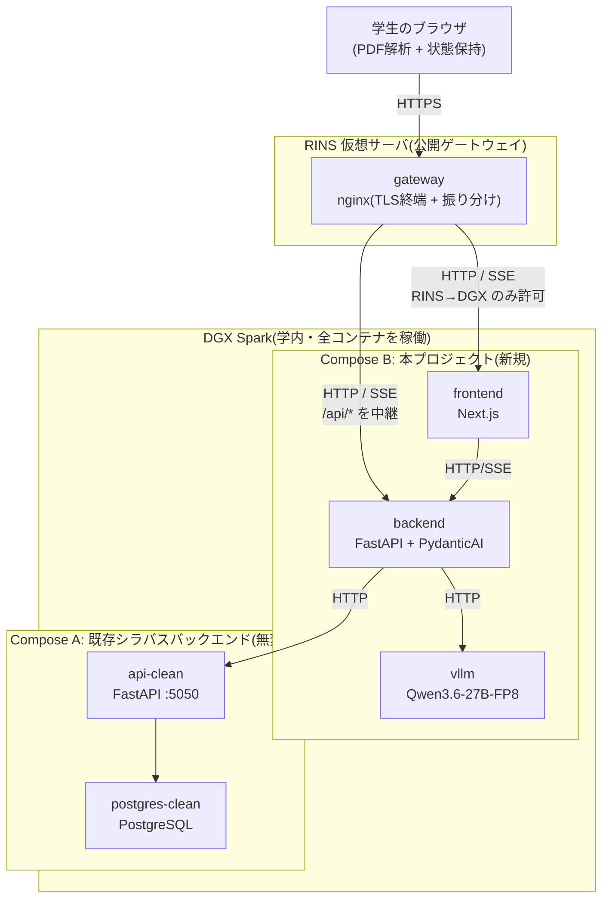
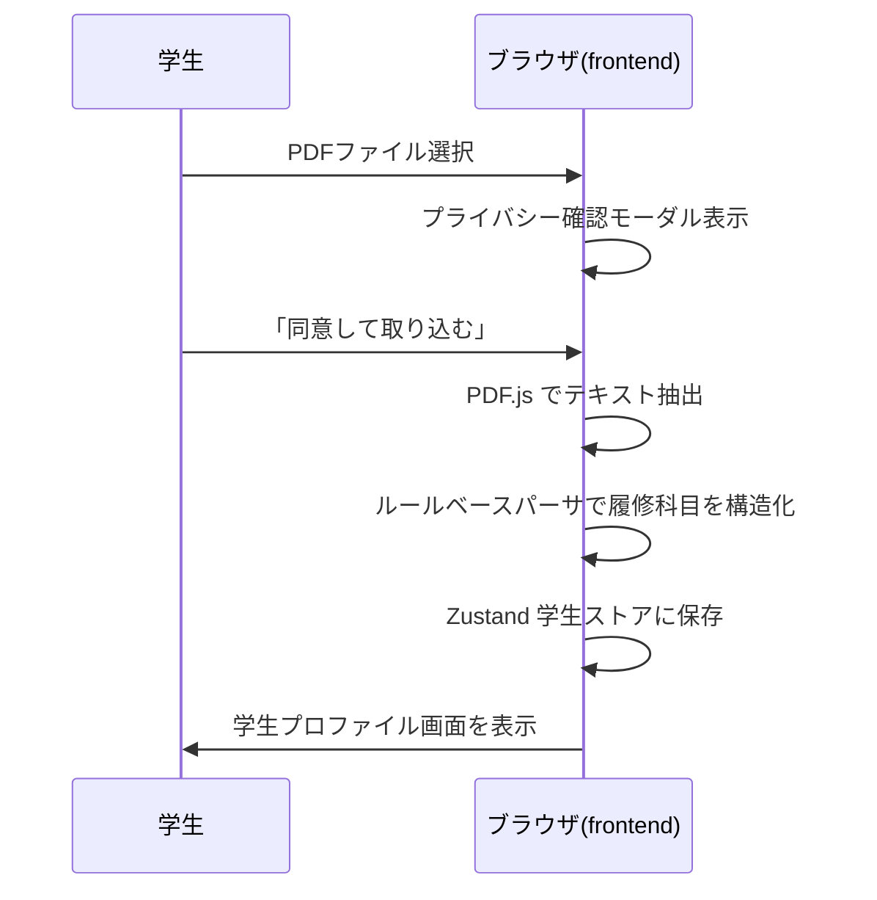
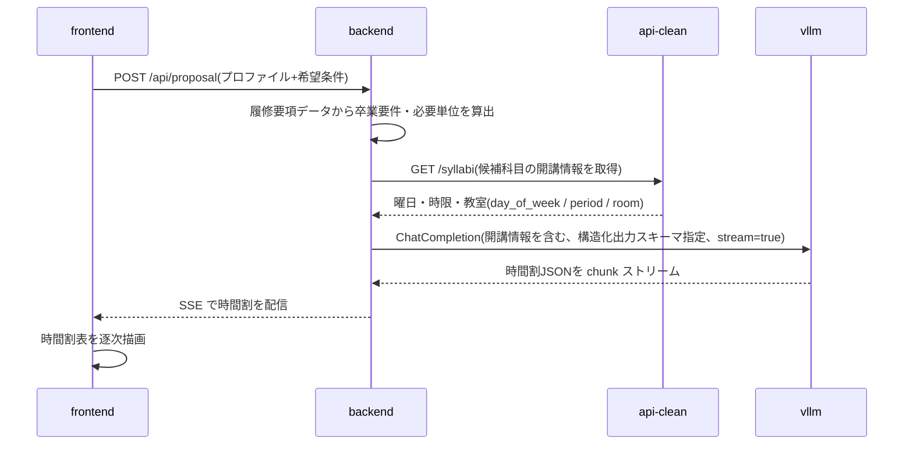
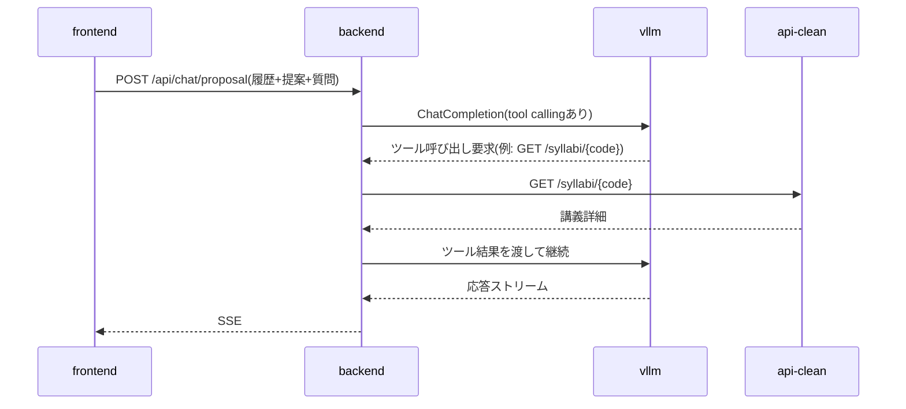
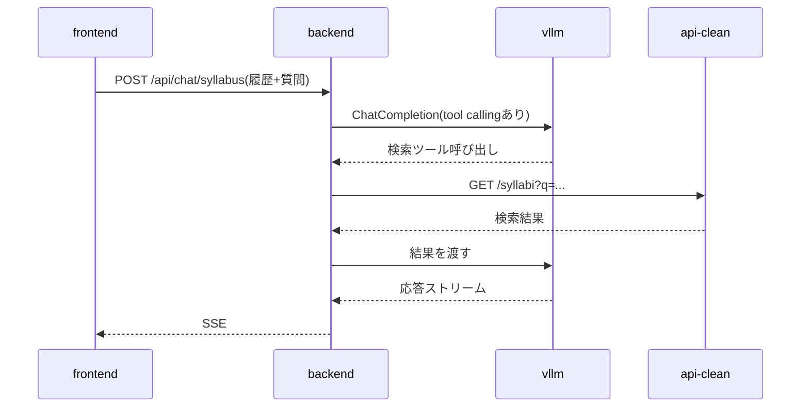

# 履修登録支援AIチャットボット 設計書(v0.5)

## 0. この文書について

### 0.1 本書の位置づけ

本書は、龍谷大学プロジェクトリサーチの活動として開発する「履修登録支援AIチャットボット」の設計書である。要件定義書(`requirements.md`)で示された「こういう機能がほしい」という要求を、「どの技術で、システムをどの部品に分け、どんなデータの形で、どんな順序で処理するか」という具体的な実装方針に落とし込むことを目的とする。

### 0.2 要件定義書との関係

本書は要件定義書を上位文書とし、要件定義書に反する記述は持たない。要件定義書の項番(§)を必要に応じて引用する。

---

## 1. システム全体構成

### 1.1 構成要素

サービスは以下の5つのコンテナで構成する。frontend / backend / vllm の3つを本プロジェクトで新規開発し、api-clean / postgres-clean は既存のシラバスバックエンドをそのまま利用する。

| 要素 | 役割 | 実装 | 新規/既存 |
|---|---|---|---|
| frontend | 学生が触れる Web UI | Next.js(React + TypeScript) | 新規 |
| backend | フロントと LLM/シラバスAPI を仲介し、履修提案ロジックを担う | FastAPI(Python)+ PydanticAI | 新規 |
| vllm | ローカル LLM 推論サーバ | vLLM、Qwen3.6-27B-FP8 | 新規 |
| api-clean | シラバス情報提供 API | FastAPI(既存) | 既存・無変更 |
| postgres-clean | シラバス DB | PostgreSQL(既存) | 既存・無変更 |

上記5コンテナはすべて学内 DGX Spark 上で稼働させる。学生のブラウザは DGX Spark へ直接アクセスせず、RINS が提供する仮想サーバ上のリバースプロキシ(公開ゲートウェイ)を経由する。

| 要素 | 役割 | 実装 | 新規/既存 |
|---|---|---|---|
| gateway | 公開する唯一の入口(学外からのアクセスも受ける)。TLS 終端を行い、リクエストを DGX Spark の frontend / backend へ振り分ける | RINS 仮想サーバ上の nginx | 新規(RINS 提供基盤を利用) |

ゲートウェイを RINS 仮想サーバに置くことで、不特定多数の学生からアクセスされるポートを DGX Spark 自身に開けずに済む。DGX Spark は当該ゲートウェイからの通信のみを受け付ける(ファイアウォールで送信元を RINS 仮想サーバに限定する)。学生のデータを処理する一連の機能(PDF 解析はブラウザ、提案・チャットは backend と vllm)は引き続き DGX Spark(およびブラウザ)上で完結し、ゲートウェイは通信を中継するのみでデータの処理・保存・記録を行わない(要件§3.1、§5.5)。

### 1.2 アーキテクチャ図



ゲートウェイは単一の公開オリジンとして振る舞い、`/` を frontend へ、`/api/*` を backend へ振り分ける。これによりブラウザから見た通信相手は常にゲートウェイの1オリジンに統一され、frontend / backend を別オリジンとして直接公開する必要がなく、CORS の考慮も不要になる。

### 1.3 データの流れ

要件§5.4のデータフロー図を各コンポーネントの責務に基づいて具体化する。ブラウザと DGX Spark の間の通信(下記2以降)はすべて RINS 仮想サーバ上のゲートウェイを経由する。ゲートウェイは TLS 終端と振り分けのみを担い、リクエスト/レスポンスの内容を保存・記録しない。

1. 学生がブラウザで成績表PDFを選択 → frontend 内の PDF.js でテキスト抽出 → ブラウザのメモリ(Zustand store)に学生プロファイルとして保持
2. 履修提案要求 → backend が学生プロファイル + 履修要項データを組み立て、vllm に推論依頼 → PydanticAI が構造化出力(時間割形式)を強制
3. 提案表示後のチャット → backend が会話履歴 + 必要に応じて api-clean を tool calling で参照しつつ、vllm から応答を生成 → SSE で frontend へストリーミング
4. シラバスチャット → 同様に tool calling で api-clean を呼びながら、vllm から応答を生成

データ永続化は一切行わず、ブラウザを閉じれば消える(要件§5.2)。

---

## 2. 技術スタック

| レイヤ | 技術 | 補足 |
|---|---|---|
| 言語(フロント) | TypeScript | |
| 言語(バックエンド) | Python 3.12+ | |
| Webフレームワーク(フロント) | Next.js(App Router) | |
| Webフレームワーク(バックエンド) | FastAPI | |
| ASGI サーバ | Uvicorn | |
| UIライブラリ | Tailwind CSS + shadcn/ui | |
| クライアント状態管理 | Zustand | 永続化機能はオフ(要件§5.2) |
| サーバ通信 | TanStack Query | |
| PDF解析 | pdfjs-dist(PDF.js) | クライアント側で実行 |
| LLMオーケストレーション | PydanticAI | 構造化出力・ツール呼び出し |
| LLM推論サーバ | vLLM | OpenAI 互換 API を提供 |
| ストリーミング | SSE(Server-Sent Events) | vLLM のストリーミングをそのまま中継 |
| 履修要項データ管理 | YAML + Git 管理 | アプリ起動時にメモリへロード |
| コンテナ | Docker、docker compose | |

### 2.1 LLMモデル

- 暫定: Qwen3.6-27B-FP8(vLLM 経由)
- API形式: OpenAI 互換 ChatCompletion(`/v1/chat/completions`、stream 対応、tool calling 対応)
- モデルは確定次第、本節と§4.3を更新する

---

## 3. デプロイ構成

### 3.1 配置先

本プロジェクトの全コンテナ(frontend / backend / vllm)および既存シラバスバックエンド(api-clean / postgres-clean)は、学内 DGX Spark 上で稼働させる。学生データを処理する一連の機能はこの単一ホスト上(およびブラウザ)で完結する(要件§3.1)。

公開する入口は、RINS が提供する仮想サーバ上のリバースプロキシ(ゲートウェイ)に限定する。学生のブラウザはこのゲートウェイにのみアクセスし、DGX Spark へは直接到達しない。学外(自宅等)からのアクセスも RINS の Web サーバ外部公開申請により許可する。これにより、不特定多数の学生がアクセスするポートを DGX Spark 自身に開けずに済む。ゲートウェイは通信を中継するのみで、データの処理・永続保存・記録は行わない。なお、アクセス経路を学外に公開することと、学生データの処理を学外へ出さないこと(要件§3.1)は別概念であり、後者は引き続き担保する(成績データの処理・保存は DGX 上で完結し、学外クラウドへ送信しない)。

RINS 仮想サーバの標準仕様は CPU 1コア / メモリ 2GB / ストレージ 32GB(OS は CentOS 7 または Ubuntu 16.04)であり、LLM 推論やアプリケーション本体を載せる余力はない。そのため、ゲートウェイの役割は TLS 終端とリクエストの振り分けに限定し、frontend / backend / vllm はすべて DGX Spark 側に置く。

### 3.2 docker compose 構成

本プロジェクトのリポジトリに新規 `docker-compose.yml` を置き、frontend / backend / vllm の3サービスを定義する。既存のシラバスバックエンド(`docker-compose.clean.yml`)には一切手を加えない。

サービス間通信は以下の2つのネットワークで成立する:

- **app-net** — 本プロジェクト内部のサービス間通信用(frontend ↔ backend ↔ vllm)。`docker-compose.yml` が自動作成
- **syllabus-clean-net**(既存) — backend が api-clean を呼ぶための共有ネットワーク。`external: true` で参照

backend のみ両方のネットワークに参加し、橋渡しを担う。

`docker-compose.yml`(抜粋):

```yaml
services:
  frontend:
    build: ./frontend
    networks: [app-net]

  backend:
    build: ./backend
    networks:
      - app-net
      - syllabus-clean-net
    depends_on:
      vllm:
        condition: service_healthy   # モデルロード完了(数分)を待ってから起動

  vllm:
    image: vllm/vllm-openai:latest   # vLLM >= 0.19.0 が必須(Qwen3.6対応)。DGX 上の現行は 0.20.0
    networks: [app-net]
    ports:
      - "127.0.0.1:8001:8000"        # デバッグ用のみ。全公開を避け 127.0.0.1 バインド
    ipc: host                        # vLLM のマルチプロセス共有メモリ用(または shm_size 指定)
    volumes:
      - /srv/qwen3.6/models/Qwen3.6-27B-FP8:/models:ro   # 事前DL済みモデルを読み取り専用で渡す
    deploy:
      resources:
        reservations:
          devices:
            - driver: nvidia
              count: all
              capabilities: [gpu]
    healthcheck:
      test: ["CMD", "python3", "-c", "import urllib.request; urllib.request.urlopen('http://localhost:8000/health')"]
      interval: 30s
      timeout: 5s
      retries: 30
      start_period: 900s             # モデルロードに数分かかるため長めに
    command:
      - --model
      - /models                       # 事前DLしたローカルパス。起動時に HF からは取得しない
      - --served-model-name          # §6.3 の OpenAIModel(model=...) と一致させ 404 を防ぐ
      - qwen3.6-27b-fp8
      - --language-model-only         # テキスト専用。ビジョンを省きメモリを KV cache に回す
      - --reasoning-parser            # 思考モデルのため必須。無いと思考が本文に漏れ構造化出力が壊れる
      - qwen3
      - --enable-auto-tool-choice
      - --tool-call-parser            # hermes ではなく qwen3_coder(公式指定の出力書式)
      - qwen3_coder
      - --max-model-len               # 既定262144はメモリ過大。最低128K推奨に沿い131072。OOM時さらに削減
      - "131072"
      - --gpu-memory-utilization      # 同一GPUを共有する他ワークロードがある前提で 121GiB に収めるため 0.4(≒48GB)
      - "0.4"
      # 単GPU構成のため tensor-parallel は指定しない(=1)

networks:
  app-net:
  syllabus-clean-net:
    external: true
    name: syllabus_backend_syllabus-clean-net
```

vllm のモデルはイメージ内に持たず、ホストの `/srv/qwen3.6/models/Qwen3.6-27B-FP8` に**事前DL**したものを読み取り専用で bind mount する。コンテナ起動時に HuggingFace から取得しないため、Docker 名前付きボリュームは使わない。

### 3.3 起動順序

0. (初回のみ) vllm 用モデルを事前DL: `/srv/qwen3.6/models/Qwen3.6-27B-FP8` を作成し、`hf download Qwen/Qwen3.6-27B-FP8 --revision <commit SHA> --local-dir /srv/qwen3.6/models/Qwen3.6-27B-FP8`(§4.3)
1. シラバスバックエンド側で `bin/init_clean.sh`(初回のみデータ投入込み)、以降は `docker compose -f docker-compose.clean.yml up -d`
2. 本プロジェクトで `docker compose up -d`

### 3.4 ポート割り当て(暫定)

| サービス | コンテナ内 | ホスト公開 |
|---|---|---|
| frontend | 3000 | 3000 |
| backend | 8000 | 8000 |
| vllm | 8000 | 8001 |
| api-clean(既存) | 5000 | 5050 |
| postgres-clean(既存) | 5432 | 5433 |

コンテナ内ポートは各サービスの標準値に従っている(Next.js は 3000、FastAPI/Uvicorn と vLLM は 8000、PostgreSQL は 5432、api-clean は既存設定の 5000)。ホスト公開ポートは、backend と vllm がコンテナ内で同じ 8000 を使うためホスト側で vllm を 8001 にずらしている。postgres-clean の 5433 は、ホスト上で別の PostgreSQL が動いている場合を想定した 5432 との衝突回避である(既存設定そのまま)。

コンテナ間通信はホスト公開ポートではなく Docker network 経由(サービス名:コンテナ内ポート、例: `http://vllm:8000`)で行う。

学生のブラウザは DGX Spark のホスト公開ポートには直接アクセスしない。ゲートウェイ(RINS 仮想サーバ)が振り分け先とする frontend(3000)と backend(8000)のみ、DGX Spark のホスト側に公開し、かつ**ファイアウォールで送信元をゲートウェイ(RINS 仮想サーバ)に限定する**。残りの vllm(8001)・api-clean(5050)・postgres-clean(5433)のホスト公開は、ホストOS からの開発時デバッグ用と位置付ける。

公開入口は RINS 仮想サーバ上のゲートウェイに限定する。学外(自宅等)からのアクセスも RINS の Web サーバ外部公開申請により許可する。一方、学生データの処理は DGX 上で完結させ学外クラウドへ送信しない(要件§3.1)。

### 3.5 アクセス制御

学生からのアクセスは、RINS が提供する仮想サーバ上のリバースプロキシ(ゲートウェイ)を唯一の入口とする。学外(自宅等)からのアクセスも許可し、その公開は RINS の Web サーバ外部公開申請により行う(§3.5.2)。データ処理の学外非送信は別途維持する(要件§3.1)。

#### 3.5.1 ゲートウェイ(RINS 仮想サーバ)の役割

- nginx を構築し、HTTPS を終端する。`/` を DGX Spark の frontend、`/api/*` を backend へリバースプロキシする(§1.2)。
- SSE(ストリーミング)を中継できるよう、該当パスではバッファリングを無効化する(`proxy_buffering off` 等)。
- リクエスト/レスポンスのボディはログに記録しない(要件§5.5。詳細は§9)。

#### 3.5.2 通信経路と必要な設定・申請

RINS が公式に受け付けている申請区分は次の通り(出典: RINS「ファイアウォールによる通信制限を解除するには」「Web サーバを龍大外部に公開するには」「仮想サーバ」各ページ)。

| 通信 | 方向 | 必須/要確認 | 対応(RINS の正式申請区分) |
|---|---|---|---|
| 学生ブラウザ(学外含む) → ゲートウェイ(80/443) | インバウンド | **必須** | RINS へ **Web サーバ外部公開申請**(80/tcp・443/tcp)。申請用紙(Word/PDF)を RINS WWW Administrator に提出。443 用サーバ証明書(UPKI 電子証明書 / Let's Encrypt / 各自用証明書発行サービスのいずれか)と、内向け・外向け DNS への登録が前提 |
| ゲートウェイ → DGX Spark(frontend 3000 / backend 8000) | 学内セグメント間(RINS VM 区画 → DGX 区画) | **要確認** | 区画をまたぐため疎通可否が未確定。まず疎通を試し、弾かれた場合のみ **ファイアウォール制限解除申請**を出す。3000/8000 は非標準ポートのため要注意 |
| ゲートウェイ → DGX Spark を DGX 側で受ける | インバウンド | 申請不要 | DGX のファイアウォールで送信元をゲートウェイに限定して許可(自分たちで設定) |

補足: 「ファイアウォール制限解除申請」は主に**外部→内部**の通信を対象とする(内→外は原則許可済み)。本構成で外部→内部に当たるのは「学生ブラウザ → ゲートウェイ(443)」だが、これは Web 公開用の専用申請(Web サーバ外部公開申請)が用意されているため、そちらで申請する。

#### 3.5.3 運用上の前提

- RINS 仮想サーバの**管理(初期構築・nginx 設定・保守)は SSH** で行う。これは運用者側の管理経路であり、**学生がサービスを利用するのに SSH は不要**(学生はブラウザから HTTPS でアクセスするのみ)。実務の構築・保守担当は**清水喜一**が担う。
- RINS 仮想サーバは年度ごとの継続申請(4月中)と、専任教員1名以上の運用責任者登録が必要。運用責任者はアドバイザー教員が担う(RINS への申請自体もアドバイザー教員が代行する)。
- 学外公開には DNS 登録(内向け・外向け)とサーバ証明書が前提となる。ゲートウェイ↔DGX Spark 間の疎通可否、非標準ポート(3000/8000)のファイアウォール制限解除申請の要否・範囲は RINS 担当教員に確認のうえ確定する(§13)。

#### 3.5.4 申請の段取りと確定状況

申請はアドバイザー教員が代行する。RINS の正式申請区分(§3.5.2)に沿って、**必須2件**を以下の順序で進める。

**段取り**: ①仮想サーバ申請(今)→ VM 上にゲートウェイを構築・内部テスト → ②公開フェーズ(ホスト名確定 → DNS 登録 → 証明書取得 → 外部公開申請②)。ホスト名・証明書は申請①には不要で、公開フェーズにまとめてよい。

**必須申請①: 仮想サーバ申請(確定値)**

| 項目 | 内容 |
|---|---|
| 利用目的 | 履修登録支援AIチャットボットの公開ゲートウェイ(nginx リバースプロキシ)。VM はプロキシのみを担い、本体・LLM は DGX Spark 側 |
| 希望仕様 | 標準(CPU 1コア / メモリ 2GB / ストレージ 32GB)で可 |
| OS | 最新の Ubuntu LTS を希望(16.04 は EOL のため避ける)。提供可能版は RINS に要確認 |
| 実務管理担当 | 清水喜一(SSH で構築・保守) |
| 申請時の空欄 | 申請責任単位、利用責任者(=アドバイザー教員)の氏名・メール(先生側情報) |

**必須申請②: Web サーバ外部公開申請(443)— 公開フェーズで実施**

| 項目 | 内容 |
|---|---|
| 証明書 | **Let's Encrypt** を採用(無料・自動更新)。ドメイン認証方式(HTTP-01 / DNS-01)は RINS の DNS・ポート段取り次第で公開時に決定 |
| 前提 | 公開ホスト名の確定、内向け・外向け DNS 登録 |
| ホスト名 | 公開フェーズで確定(後変更も可だが DNS・証明書・申請②・告知物に波及するため公開前に確定が望ましい) |

---

## 4. コンポーネント設計

### 4.1 frontend(Next.js)

#### 4.1.1 ディレクトリ構成

```
frontend/
├── app/                       # Next.js App Router
│   ├── page.tsx               # / 学生情報入力
│   ├── proposal/page.tsx      # /proposal 履修提案
│   ├── syllabus/
│   │   ├── page.tsx           # /syllabus 一覧・検索
│   │   └── [code]/page.tsx    # /syllabus/[code] 講義詳細
│   ├── privacy/page.tsx       # /privacy プライバシーポリシー
│   └── layout.tsx
├── components/
│   ├── ui/                    # shadcn/ui で生成された部品
│   └── ...
├── lib/
│   ├── pdf/                   # PDF解析
│   │   └── parseGradeReport.ts
│   ├── api/                   # backend との通信
│   └── streaming/             # SSE処理
├── stores/                    # Zustand
│   ├── student.ts             # 学生プロファイル
│   └── chat.ts                # 対話履歴
└── package.json
```

#### 4.1.2 状態管理

- Zustand store 2本: 学生プロファイル(`student.ts`)、対話履歴(`chat.ts`)
- どちらも **永続化機能を意図的にオフ** にする(要件§5.2)。ページリロード・タブクローズで完全消失
- リセット機能(要件§4.8)は両 store の `reset()` を呼ぶだけで実現
- サーバから取得するデータ(シラバス検索結果、履修要項データ等)は TanStack Query でキャッシュ管理

#### 4.1.3 PDF解析(クライアント側)

- `pdfjs-dist` でテキストレイヤーを抽出
- 龍谷大学成績表レイアウト前提のルールベースパーサーを実装
- 評価記号(`T`/`N`/`G`/`D`/`J`/`M`)と数値スコアを認識し、合否を判定(要件§4.2)
- 学籍番号は意図的に抽出しない(要件§4.2)
- 解析失敗時は「読み取れませんでした、手入力に切り替えてください」とフォールバック

#### 4.1.4 ストリーミング表示

- backend からの SSE を `fetch` + `ReadableStream` で受信
- 受信した chunk を逐次 React state に反映、画面に追記表示

### 4.2 backend(FastAPI)

#### 4.2.1 ディレクトリ構成

```
backend/
├── app/
│   ├── main.py                # FastAPI app entry
│   ├── api/                   # ルーティング
│   │   ├── proposal.py        # 履修提案
│   │   ├── chat_proposal.py   # 提案チャット
│   │   ├── chat_syllabus.py   # シラバスチャット
│   │   └── syllabus.py        # シラバス検索・詳細・値マスタ(api-clean 中継 JSON)
│   ├── agents/                # PydanticAI エージェント定義
│   │   ├── proposal_agent.py
│   │   ├── chat_agent.py
│   │   └── tools.py           # シラバスAPI呼び出し等
│   ├── schemas/               # Pydantic スキーマ
│   │   ├── student.py
│   │   ├── curriculum.py
│   │   └── proposal.py
│   ├── curricula/             # 履修要項データロード
│   │   └── loader.py
│   └── settings.py
├── pyproject.toml
└── Dockerfile
```

#### 4.2.2 役割

- フロントからのリクエストを受け、必要に応じて履修要項データを参照し、PydanticAI で定義したエージェントに処理を委ねる
- エージェントは vllm を OpenAI 互換クライアント経由で呼び、必要に応じて api-clean を tool calling で叩く
- 応答は SSE でフロントへストリーミング

#### 4.2.3 学生データの取り扱い

- backend は学生プロファイル(学年・課程・既修得科目)をリクエスト本文で受け取り、推論用プロンプトの組み立てに使うが、**永続化しない**
- リクエスト処理完了後にメモリから破棄される
- ログにも記録しない(要件§5.5)

### 4.3 vllm(LLM 推論サーバ)

- vLLM を Docker(`vllm/vllm-openai:latest`)で起動。Qwen3.6 対応には **vLLM >= 0.19.0** が必要(DGX 上の現行イメージは 0.20.0 で対応済み、アーキ `Qwen3_5ForConditionalGeneration` をサポート確認済み)
- `--model /models`(暫定モデル Qwen3.6-27B-FP8 を事前DLしたローカルパスを指す。リポジトリ名は起動時に使わない)。FP8(e4m3)量子化済み、約 31GB
- このモデルは**ビジョンエンコーダ付き(画像/動画対応)**だが、本プロジェクトはテキスト用途のため **`--language-model-only`** を付け、ビジョンを無効化してメモリを KV cache に回す
- **`--reasoning-parser qwen3`** を指定(思考(reasoning)モデルのため必須。無いと思考トークンが本文に混ざり、PydanticAI の構造化出力が壊れる)
- tool calling は **`--enable-auto-tool-choice` + `--tool-call-parser qwen3_coder`** で対応(公式モデルカード指定。`hermes` ではこのモデルの出力書式と合わず、ツール呼び出しがエラーにならず**サイレントに無視される**。`--tool-call-parser` 自体がないと vLLM は起動時にエラーで停止する)
- **`--served-model-name qwen3.6-27b-fp8`** を指定し、§6.3 の `OpenAIModel(model='qwen3.6-27b-fp8')` と一致させる(不一致だと 404)
- `--max-model-len 131072`(既定 262,144 はメモリ過大。公式は思考能力維持のため最低 128K の確保を推奨。OOM 時はさらに削減)
- DGX Spark は**単GPU**のため tensor parallel は使わない(=1)。`--gpu-memory-utilization` は同一GPUを共有する他ワークロードがある前提で 121GiB のユニファイドメモリに収めるため **0.4(≒48GB)** を起点とする(起動ログの KV cache サイズを見て余裕があれば 0.45 まで上げてよい)
- モデルは**事前に取得**して `/srv/qwen3.6/models/Qwen3.6-27B-FP8` に置き、`-v .../Qwen3.6-27B-FP8:/models:ro` で**読み取り専用 bind mount** する(`--model /models`)。取得は `hf download Qwen/Qwen3.6-27B-FP8 --revision <commit SHA> --local-dir ...` で**リビジョンを固定**する。`--model` がローカルパスを指すため起動時に HF から重みを取得せず、再現性を確保する(コンテナ起動時に都度DLしない。なお現状 `HF_HUB_OFFLINE` 等の環境変数までは設定していない)
- OpenAI 互換 API を `/v1/chat/completions` で公開
- backend からのみアクセス可能(`app-net` 内)、frontend からは直接呼ばない

### 4.4 履修要項データ層

#### 4.4.1 データ生成方針

- 龍谷大学公式サイトから閲覧できる履修要項を、**手動で YAML 形式に転記**する
- 第1フェーズの対象範囲(知能情報メディア課程・該当入学年度)分のみを作成
- 転記担当者がドラフトを作成 → Pull Request → アドバイザー教員のレビュー・承認(要件§8末尾)
- 第2フェーズ以降で他課程・他学年・他学部に対象を広げる際は、同じ手順で対象範囲のファイルを追加する

#### 4.4.2 ファイル配置と命名

- リポジトリの `curricula/` ディレクトリ配下に配置
- ファイル名は `<課程の英字略称>_<入学年度>.yaml`(例: `chinou_media_2024.yaml`)
- 課程・入学年度ごとに1ファイル(要件§2.1の段階的拡張に対応)

#### 4.4.3 ロード方式

- backend 起動時に `curricula/*.yaml` を全件読み込み、Pydantic スキーマで型付けしてメモリ上に保持
- 起動時にスキーマバリデーションを実行し、不正があれば起動失敗(転記ミスを早期に検出)
- 個々のリクエストでは、該当課程・該当入学年度のオブジェクトのみを参照する
- クライアントへ全量を返すことはせず、必要な部分のみを JSON で返却する

#### 4.4.4 更新運用

- YAMLファイルの追加・変更は Pull Request 経由でアドバイザー教員のレビュー・承認を必須とする
- GitHub の CODEOWNERS で `curricula/` 配下の承認者をアドバイザー教員に限定することを想定

---

## 5. データ設計

### 5.1 履修要項 YAML スキーマ(暫定)

```yaml
program: "知能情報メディア課程"
admission_year: 2024
graduation_requirements:
  total_credits: 124          # 卒業所要総単位数
  categories:
    - name: "仏教必修"
      required_credits: 4
    - name: "言語必修"
      required_credits: 6
    # ... 以下、教養・専門の各区分
  notes: |
    補足事項や例外規定があればここに記述
courses:
  - code: "B12345"            # api-clean の syllabus_code と対応
    title: "情報基礎"
    credits: 2
    category: "基礎必修"
    required: true
    grade_min: 1
    grade_max: 1
    term: "前期"
  # ... 以下、課程の対象科目を列挙
```

なお、**開講曜日・時限・教室は履修要項 YAML では保持しない**。これらは既存シラバスバックエンドの `syllabus` テーブル(`day_of_week` / `period` / `room` カラム)が保持しており、api-clean(`GET /syllabi`、`GET /syllabi/{code}`)経由で参照する。YAML 側に持たせると二重管理になるため、YAML は卒業要件・科目区分(課程固有の情報)のみを担う。

スキーマの最終確定はアドバイザー教員監修のもと、要件§8に従って行う。

### 5.2 クライアント側状態スキーマ

#### 5.2.1 学生プロファイル(Zustand `student.ts`)

```typescript
type Course = {
  code?: string          // 任意(成績表に明記されていれば)
  title: string          // 科目名
  year: number           // 履修年度
  term: "前期" | "後期" | "通年" | "1Q" | "2Q" | "3Q" | "4Q" | "サ集"
  credits: number
  status: "passed" | "failed" | "withdrawn"
  rawScore?: string      // 元の表記(数値または記号)
}

type StudentProfile = {
  grade: 1 | 2 | 3 | 4 | null
  program: string | null
  completedCourses: Course[]
}
```

#### 5.2.2 対話履歴(Zustand `chat.ts`)

```typescript
type Message = {
  id: string
  role: "user" | "assistant"
  content: string
  timestamp: number
}

type ChatState = {
  proposalMessages: Message[]
  syllabusMessages: Message[]
  syllabusPerCourse: Record<string, Message[]>  // 講義ページ単位
}
```

---

## 6. API設計

### 6.1 内部 API(frontend ↔ backend)

| メソッド | パス | 用途 | 応答形式 |
|---|---|---|---|
| POST | /api/proposal | 履修提案を生成 | SSE |
| POST | /api/chat/proposal | 履修提案に関するチャット | SSE |
| POST | /api/chat/syllabus | シラバス全体チャット | SSE |
| POST | /api/chat/syllabus/{code} | 講義単位チャット | SSE |
| GET | /api/syllabi | シラバス検索(一覧・絞り込み) | JSON |
| GET | /api/syllabi/{code} | シラバス詳細(講義ページ表示) | JSON |
| GET | /api/masters | 検索絞り込み用の値マスタ | JSON |
| GET | /api/curricula/{program}/{year} | 履修要項データ参照(タグ表示用) | JSON |
| GET | /healthz | ヘルスチェック | JSON |

チャット系(SSE)のリクエストには学生プロファイルと対話履歴を毎回含める(サーバ側で永続化しないため)。

`GET /api/syllabi` / `/api/syllabi/{code}` / `/api/masters` は、検索画面(§4.1 の `/syllabus` 一覧・検索および `/syllabus/[code]` 詳細)が使う読み取り専用エンドポイントで、backend は §6.2 の api-clean(`GET /syllabi` / `GET /syllabi/{code}` / `GET /masters`)を中継する。公開経路はゲートウェイの単一オリジンに統一され、`/` は frontend、`/api/*` は backend へ振り分けられる一方、api-clean は公開されない(§1.2)。したがって frontend は api-clean を直接呼べず、検索画面向けにも backend 側の口が必要となる。クエリパラメータは api-clean の `/syllabi`(`q` / `faculty` / `program` / `campus` / `term` / `day` / `period` / `year` / `instructor` / `grade` / `limit` / `offset`)を素通しする。検索結果に付す「必修 / 選択 / 既修得済み」タグ(§8)は、この結果と `GET /api/curricula` の履修要項、ブラウザ内の学生プロファイルを frontend 側で突き合わせて生成する。

### 6.2 既存シラバスバックエンド API の利用

backend から `http://api-clean:5000` 経由で以下を主に利用する:

- `GET /syllabi` — 検索(独自シラバス§4.5、シラバスチャット§4.6で使用)
- `GET /syllabi/{code}` — 詳細(講義ページ表示・講義単位チャットで使用)
- `GET /masters` — 値マスタ(検索 UI のドロップダウン候補に利用)

`POST /sql` はエージェントに任意 SQL を書かせるリスクを避けるため使用しない方針とする。

### 6.3 vLLM との連携

- backend は OpenAI 互換クライアント経由で `http://vllm:8000/v1/chat/completions` を呼ぶ
- PydanticAI の `OpenAIModel(model='qwen3.6-27b-fp8', base_url='http://vllm:8000/v1')` 形式で設定
- ツール呼び出しは PydanticAI の `@agent.tool` で定義し、内部で api-clean を HTTP で叩く

---

## 7. 主要シーケンス

### 7.1 成績表PDF取り込み



ネットワーク通信は一切発生しない(要件§5.2、§5.3を担保)。

### 7.2 履修提案生成



時間割(曜日×時限)の組み立てに必要な開講曜日・時限は、履修要項 YAML ではなく api-clean が保持する(§5.1)。backend は LLM 呼び出しの前に候補科目の開講情報を api-clean から取得し、コマ重複のない時間割を生成できるようプロンプトに含める。なお、週複数コマ開講の科目が `day_of_week` / `period`(1科目につき1組)でどう表現されるかは実データで確認する。

### 7.3 提案チャット



### 7.4 シラバスチャット(全体)

要件§4.6「シラバス全体に対する質問」。



### 7.5 シラバスチャット(講義ページ単位)

要件§4.6「講義ページ単位の質問」。frontend は現在表示中の `syllabus_code` を含めて送信。backend は最初にその講義詳細を取得し、システムプロンプトの一部としてコンテキストに含めたうえで LLM に渡す。

---

## 8. 画面構成とルーティング

| パス | 画面 | 主な機能 |
|---|---|---|
| / | 学生情報入力 | 手入力フォーム、PDF取り込み、プライバシー確認ダイアログ(要件§5.6) |
| /proposal | 履修提案 | 時間割表示、提案チャット(要件§4.3、§4.4) |
| /syllabus | 独自シラバス一覧 | 検索、タグ表示「必修」「選択」「既修得済み」(要件§4.5) |
| /syllabus/[code] | 講義詳細 | シラバス情報、講義単位チャット(要件§4.6) |
| /privacy | プライバシーポリシー | データの流れの図解、要件§5の規定説明 |

ヘッダーに常にリセットボタン(要件§4.8)を設置する。

---

## 9. プライバシー設計

要件§5の実装方針を以下にまとめる。

| 要件 | 実装 |
|---|---|
| §5.2 ブラウザ上のメモリにのみ保持 | Zustand store(永続化機能オフ) |
| §5.2 リロード/タブクローズで消去 | Zustand 初期状態(モジュール再ロード時に初期化) |
| §5.2 サーバへの永続保存禁止 | backend に DB 接続なし(履修要項 YAML はリードオンリー) |
| §5.2 認証なし | 認証機構を実装しない |
| §5.3 学外通信なし | 学内 vllm を利用、学外 API 呼び出しなし |
| §5.3 HTTPS | RINS 仮想サーバ上のゲートウェイ(nginx)で TLS 終端(§3.5) |
| §5.5 成績情報のログ非記録 | backend のロガー設定でリクエストボディの中身をログ出力しない。ゲートウェイ(nginx)もアクセスログにリクエスト/レスポンスボディを残さない設定とする |
| §5.6 確認ウィンドウ | PDF取り込みボタン押下時にモーダル表示 |
| §5.6 プライバシーポリシー | `/privacy` で要件§5.4のデータフロー図を含む解説を表示 |

TLS はゲートウェイで終端するため、ゲートウェイ↔DGX Spark 間(学内閉域)は平文 HTTP となる。同区間は学内ネットワーク内に閉じており、ゲートウェイはデータを保存・記録しない。より厳密に区間も暗号化する場合は、ゲートウェイ↔DGX 間を HTTPS で再暗号化する構成を取りうる(採否は§13で判断)。

---

## 10. 非機能設計

### 10.1 ストリーミング表示(要件§6)

- vLLM の `stream=true` を有効化
- backend は受信した chunk をそのまま SSE で配信
- frontend は受信した chunk を React state に逐次反映

### 10.2 同時利用(要件§6)

- 龍谷祭での展示を想定し、数〜十数人程度の同時利用を目標
- vLLM の並列処理性能に依存(`--max-num-seqs` 等の起動オプションで調整)
- 負荷試験は開発後半に実施

### 10.3 対応環境(要件§6)

- 主要ブラウザ(Chrome / Firefox / Safari / Edge)の最新版
- Tailwind CSS の breakpoint を活用し、スマートフォン・タブレット幅でも崩れないレイアウトを実装
- shadcn/ui の部品は基本的にレスポンシブ対応済み

---

## 11. 龍谷祭展示時の構成

要件§7に対応する実装方針。

| 要件 | 実装 |
|---|---|
| 自端末からのアクセス | 来場者の端末から、ゲートウェイ(RINS 仮想サーバ)の公開 URL でアクセス可能とする(学内 Wi-Fi・学外回線のいずれからでも可。具体 URL は§3.5・§13の DNS 登録と併せて決定) |
| 展示用端末でのデモ | 展示会場に別端末を設置し、サービスを開いた状態で来場者に操作してもらう |
| ダミーデータ | `frontend/lib/dummy/` に複数パターンのダミー学生プロファイル(成績上位 / 平均的 / 再履修あり等)を用意し、「デモモード」ボタンから読み込めるようにする |
| 実成績表の取り扱い | 展示用端末では「PDF取り込み」を無効化し、ダミーデータ専用とする。実成績表は来場者自身の端末でのみ利用 |

---

## 12. 開発・テスト方針

### 12.1 リポジトリ構成

本プロジェクトは単一の GitHub リポジトリで管理する。履修要項データ(`curricula/*.yaml`)も同一リポジトリ内に置く。

将来、履修要項データを別サービスから参照する必要が生じた場合のみ、別リポジトリへの分離を再検討する。

### 12.2 CI

- frontend: 型チェック(`tsc --noEmit`)、Lint(ESLint)、ビルド
- backend: 型チェック(`mypy` または `pyright`)、Lint(`ruff`)、ユニットテスト(`pytest`)
- curricula: YAML スキーマバリデーション(Pydantic でロード可能かを検査)

### 12.3 テスト

- frontend: コンポーネントテスト(Vitest + Testing Library)、PDF解析の単体テスト(複数パターンの成績表サンプルを用意)
- backend: API のユニットテスト、PydanticAI エージェントの応答スキーマ検証

### 12.4 開発環境

本プロジェクトの開発環境・開発ツールの詳細は、本書の対象外とし、別ドキュメントで管理する。

---

## 13. 未確定事項一覧

確定次第、本書を更新する。

| 項目 | 確定者 | 備考 |
|---|---|---|
| **【必須申請①】RINS 仮想サーバ申請** | アドバイザー教員 / RINS担当教員 | ゲートウェイの土台。専任教員1名以上の利用責任者登録と毎年4月の継続申請が必須(§3.5.3) |
| **【必須申請②】Web サーバ外部公開申請(443)** | アドバイザー教員 / RINS担当教員 | 学外公開のため必須。前提として 443 用サーバ証明書と内向け・外向け DNS 登録が要る(§3.5.2) |
| 【要確認】ゲートウェイ→DGX(3000/8000)の FW 制限解除 | RINS担当教員 / 開発チーム | 学内セグメント間で疎通する可能性があり必須か未確定。まず疎通確認し、弾かれた場合のみ申請(§3.5.2)。同区間を HTTPS 再暗号化するかも併せて判断(§9) |
| TLS 証明書の入手方法 | 開発チーム / RINS担当教員 | 443 用サーバ証明書(必須申請②の前提)。RINS は UPKI 電子証明書 / Let's Encrypt / 各自用証明書発行サービスのいずれかを選択可 |
| 展示用 URL の構造 | RINS担当教員 / 開発チーム | ゲートウェイの DNS 登録(必須申請②の前提)と併せて決定 |
| 履修要項 YAML の最終スキーマ | アドバイザー教員 + 履修要項データ担当者 | 暫定スキーマは§5.1の通り |
| ローカル LLM モデルの最終確定 | 開発チーム | 暫定 `Qwen3.6-27B-FP8` |
| 5人の役割分担 | 開発チーム | 別ドキュメントで管理 |

---

## 改訂履歴

| 版 | 日付 | 内容 |
|---|---|---|
| v0.1 | 2026-05-27 | 初版作成 |
| v0.2 | 2026-06-03 | 公開入口を RINS 仮想サーバ上のリバースプロキシ(ゲートウェイ)とする構成を反映(§1.1、§1.2、§1.3、§3.1、§3.4、§3.5、§9、§11、§13)。§12.4 から開発環境の具体記述を除去 |
| v0.3 | 2026-06-08 | 学外からのアクセスを許可する方針へ変更(旧「学外公開しない」は DGX 直結前提の名残のため修正)。アクセス経路の公開と、学生データ処理の学外非送信を別概念として整理。RINS の正式申請区分(Web サーバ外部公開申請・ファイアウォール制限解除申請・DNS 登録・サーバ証明書)を公式情報に基づき§3.5.2・§3.5.3・§3.1・§11・§13へ反映。§3.5.4 を新設し、必須申請2件の確定値・段取り(申請①→公開フェーズで②)・証明書は Let's Encrypt 採用・実務管理担当(清水喜一)を記載 |
| v0.4 | 2026-06-11 | §7.2 の履修提案シーケンスに api-clean からの開講情報(曜日・時限・教室)取得を追加。曜講時・教室は履修要項 YAML では保持せず api-clean を参照する旨を§5.1 に明記(既存シラバス DB に `day_of_week` / `period` / `room` があることを実コードで確認済み)。vLLM の起動オプションに `--tool-call-parser hermes` を追記(§3.2、§4.3。指定がないと起動エラーになるため)。タイトルの版番号を改訂履歴と同期 |
| v0.5 | 2026-07-02 | 検索画面向けの内部 API を §6.1 に追加(`GET /api/syllabi` / `/api/syllabi/{code}` / `/api/masters`)。従来 §6.1 は chat(SSE)のみで検索一覧の口が未定義だったため、api-clean を中継する読み取り専用 JSON を新設。§4.2.1 に `app/api/syllabus.py` を追加。frontend は単一オリジン経由で api-clean を直接呼べない(§1.2)ため backend パススルーが必要である旨を明記。あわせて §3.2・§4.3 の vLLM 起動オプションを実機に合わせて正確化(`--tool-call-parser qwen3_coder`、`--model /models`・オフライン運用) |