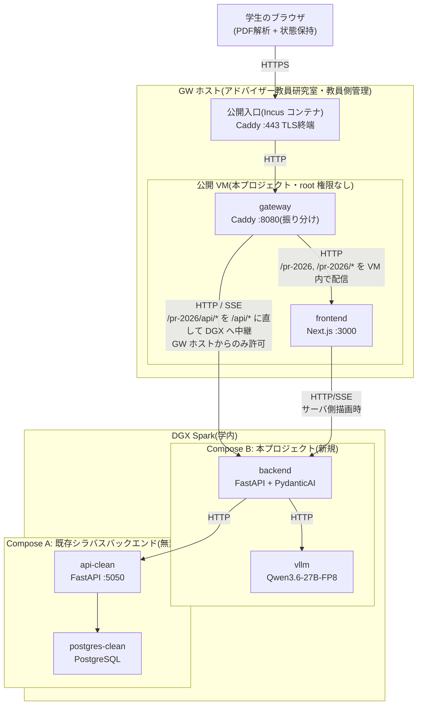

# 履修登録支援AIチャットボット 設計書(v0.9.9)— §1 システム全体構成 / §2 技術スタック

> 本ファイルは [`docs/design.md`](../design.md) の一部である。§番号は設計書全体で通し番号であり、他ファイルの節を `§X.Y` の形で参照する。全ファイルの対応表は [design.md](../design.md) の「0.3 本書の構成」を参照。

---

## 1. システム全体構成

### 1.1 構成要素

サービスは以下の5つのコンテナで構成する。frontend / backend / vllm の3つを本プロジェクトで新規開発し、api-clean / postgres-clean は既存のシラバスバックエンドをそのまま利用する。

| 要素 | 役割 | 実装 | 新規/既存 |
|---|---|---|---|
| frontend | 学生が触れる Web UI | Next.js(React + TypeScript) | 新規 |
| backend | フロントと LLM/シラバスAPI を仲介し、履修提案ロジックを担う | FastAPI(Python)+ PydanticAI | 新規 |
| vllm | ローカル LLM 推論サーバ | vLLM、Qwen3.6-27B-FP8 | 新規 |
| api-clean | シラバス情報提供 API | FastAPI(既存) | 既存・無変更 |
| postgres-clean | シラバス DB | PostgreSQL(既存) | 既存・無変更 |

これらに加え、公開入口として gateway を新規に構築する。

| 要素 | 役割 | 実装 | 新規/既存 |
|---|---|---|---|
| gateway | 公開する唯一の入口(学外からのアクセスも受ける)。リクエストを同一ホスト上の frontend と DGX Spark の backend へ振り分ける | 公開 VM 上の **Caddy** | 新規 |

これら6要素を2つのホストに分けて配置する。GW 側は、教員側が管理するホストと、その上に払い出されたゲスト VM の2層になる(§3.1)。

| ホスト | 設置場所 | 稼働させる要素 |
|---|---|---|
| **公開 VM**(GW ホスト上の libvirt ゲスト) | アドバイザー教員研究室 | gateway、frontend |
| **DGX Spark** | 学内 | backend、vllm、api-clean、postgres-clean |

公開 VM は、アドバイザー教員研究室の Web サーバ上に払い出された仮想マシンである。本プロジェクトが公開 VM で動かすのは gateway と frontend の2コンテナのみとする。学生のブラウザは DGX Spark へ直接アクセスせず、必ず GW 側を経由する。ブラウザに配信する画面(frontend)までを公開 VM が担い、履修提案ロジック・LLM 推論・シラバス参照は DGX Spark 側で行う。

公開するホストを GW 側1台に限ることで、不特定多数の学生からアクセスされるポートを DGX Spark 自身に開けずに済む。DGX Spark は本プロジェクト以外の用途にも使われているため、外部公開の範囲を GW 側に閉じ込める意味もある。**DGX Spark 上のサービスはすべてホストの loopback にバインドし、ホスト外へ出す口は GW ホストからの通信のみを許可する中継に限定する**(§3.4.1、§3.4.2)。

学生のデータを処理する一連の機能(PDF 解析はブラウザ、提案・チャットは backend と vllm)は引き続き DGX Spark(およびブラウザ)上で完結する。frontend は静的な画面配信とブラウザ内処理のためのコードを配るのみで、成績データを受け取らない。gateway も通信を中継するのみでデータの処理・保存・記録を行わない(要件§3.1、§5.5)。

**TLS 終端は GW ホスト側が担う。** 公開 VM は rootless コンテナ基盤のため 1024 未満のポートを待ち受けられず、80/443 の受けと証明書の管理は教員側の管理範囲にある(§3.1、§3.5.1、§3.5.3)。frontend は学外から HTTPS で到達できる状態にあり、未成立なのは backend への経路のみである(§3.4.2)。

### 1.2 アーキテクチャ図

ゲートウェイは単一の公開オリジンとして振る舞い、`/pr-2026`・`/pr-2026/*` を同一 VM 上の frontend へ、`/pr-2026/api/*` を DGX Spark 上の backend へ振り分ける(振り分けの実体は §3.2.1、URL 構造の規定は §3.5.2)。frontend と backend が別ホストに分かれても、ブラウザから見た通信相手は常にゲートウェイの1オリジンに統一されるため、backend を別オリジンとして直接公開する必要がなく、CORS の考慮も不要になる。

**公開パスは `/` ではなく `/pr-2026` 配下である。** GW ホストは他用途と共用されており、ルートを本プロジェクトが占有できないためである。backend へ向かうパスも `/pr-2026/api/*` であり、`/api/*` ではない(§3.5.2)。

### 1.3 データの流れ

要件§5.4のデータフロー図を各コンポーネントの責務に基づいて具体化する。ブラウザと DGX Spark の間の通信(下記2以降)はすべて GW 側のゲートウェイを経由する。ゲートウェイは TLS 終端と振り分けのみを担い、リクエスト/レスポンスの内容を保存・記録しない。

1. 学生がブラウザで成績表PDFを選択 → frontend 内の PDF.js でテキスト抽出 → ブラウザのメモリ(Zustand store)に学生プロファイルとして保持
2. 履修提案要求 → backend が学生プロファイル + 履修要項データを組み立て、vllm に推論依頼 → PydanticAI が構造化出力(時間割形式)を強制
3. 提案表示後のチャット → backend が会話履歴 + 必要に応じて api-clean を tool calling で参照しつつ、vllm から応答を生成 → SSE で frontend へストリーミング
4. シラバスチャット → 同様に tool calling で api-clean を呼びながら、vllm から応答を生成

データ永続化は一切行わず、ブラウザを閉じれば消える(要件§5.2)。

---

## 2. 技術スタック

| レイヤ | 技術 | 補足 |
|---|---|---|
| 言語(フロント) | TypeScript | |
| 言語(バックエンド) | Python 3.12+ | |
| Webフレームワーク(フロント) | Next.js(App Router) | |
| Webフレームワーク(バックエンド) | FastAPI | |
| ASGI サーバ | Uvicorn | |
| UIライブラリ | Tailwind CSS | 画面部品は自前実装 |
| アイコン・アニメーション | lucide-react、motion | |
| クライアント状態管理 | Zustand | 永続化機能はオフ(要件§5.2) |
| サーバ通信 | `fetch`(SSE は `ReadableStream` を自前で読む) | |
| PDF解析 | pdfjs-dist(PDF.js) | クライアント側で実行 |
| LLMオーケストレーション | PydanticAI | 構造化出力・ツール呼び出し |
| LLM推論サーバ | vLLM | OpenAI 互換 API を提供 |
| ストリーミング | SSE(Server-Sent Events) | vLLM のストリーミングをそのまま中継 |
| 履修要項データ管理 | YAML + Git 管理 | アプリ起動時にメモリへロード |
| コンテナ | DGX Spark は Docker + docker compose、公開 VM は rootless Podman | ホストで基盤もアーキテクチャ(arm64 / x86_64)も異なる(§3.2) |

当初は UI 部品に shadcn/ui、サーバ状態のキャッシュに TanStack Query を挙げていたが、いずれも導入していない。画面は8本(§8)で、サーバから取る読み取り専用データはシラバス(検索結果・詳細・値マスタ)と履修要項に限られ、`fetch` と Zustand で足りている。チャット・履修提案は SSE であり、いずれにせよキャッシュライブラリの管轄外である。導入するのは、同じ問い合わせを複数の画面が共有し再取得の制御が要るようになった時点とする。

### 2.1 LLMモデル

- 暫定: Qwen3.6-27B-FP8(vLLM 経由)
- API形式: OpenAI 互換 ChatCompletion(`/v1/chat/completions`、stream 対応、tool calling 対応)
- モデルは確定次第、本節と§4.3を更新する
