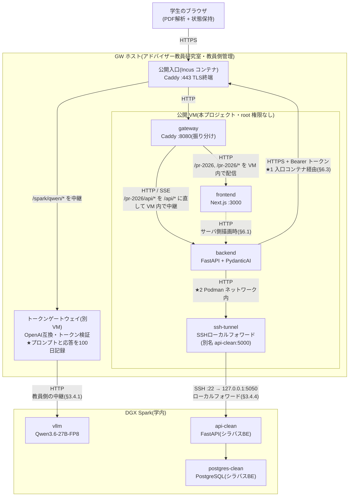

# 履修登録支援AIチャットボット 設計書(v0.9.12)— §1 システム全体構成 / §2 技術スタック

> 本ファイルは [`docs/design.md`](../design.md) の一部である。§番号は設計書全体で通し番号であり、他ファイルの節を `§X.Y` の形で参照する。全ファイルの対応表は [design.md](../design.md) の「0.3 本書の構成」を参照。

---

## 1. システム全体構成

### 1.1 構成要素

サービスは以下の5つのコンテナで構成する。frontend / backend / vllm の3つを本プロジェクトのリポジトリで新規開発し、api-clean / postgres-clean はシラバスバックエンドのものを使う。

| 要素 | 役割 | 実装 | リポジトリ |
|---|---|---|---|
| frontend | 学生が触れる Web UI | Next.js(React + TypeScript) | 本リポジトリ(新規開発) |
| backend | フロントと LLM/シラバスAPI を仲介し、履修提案ロジックを担う | FastAPI(Python)+ PydanticAI | 本リポジトリ(新規開発) |
| vllm | ローカル LLM 推論サーバ | vLLM、Qwen3.6-27B-FP8 | 既製品(設定のみ) |
| api-clean | シラバス情報提供 API | FastAPI | シラバスバックエンド(§1.1.1) |
| postgres-clean | シラバス DB | PostgreSQL | シラバスバックエンド(§1.1.1) |

#### 1.1.1 シラバスバックエンドの位置づけ

**api-clean / postgres-clean は「手を加えていない外部システム」ではない。** 実体は同一組織のフォーク [ProjectResearch2026/syllabus_backend](https://github.com/ProjectResearch2026/syllabus_backend) であり、上流 [RyukokuDX/syllabus_backend](https://github.com/RyukokuDX/syllabus_backend) に対して、本プロジェクトの必要に応じたデータ投入と改修が継続している。

| 変更 | 内容 | 時期 |
|---|---|---|
| ローダの修正 | `Y000001010`/2025 の欠損復元、講義計画の取りこぼし、年度間の表記ゆれの修正 | 2026-09-06 |
| 2026年度データの追加 | Web シラバス検索ページ由来の CSV を上流から取り込み | 2026-09-07 |
| **課程紐付けの解消** | 2026年度で 0 件だった `syllabus_course_program` を 2,871 件(939科目)投入。**`GET /syllabi/{code}` の `programs` が 2026年度でも返るようになった** | 2026-09-07 |

**したがって、本サービスの機能はシラバスバックエンド側の改修に依存する。** 現に残っている依存は §13 に置く(科目区分 `syllabus_attribute` が空であること、`note` の書式が不定であること)。

**改修は本リポジトリでは行わない。** 実装は当該リポジトリ側で行い、本書は利用者としての前提と、依存している未解決事項を記すに留める。両者の責任分界は §3.5.3 による。

これらに加え、公開 VM 上に補助的なコンテナを2つ新規に構築する。いずれもサービスの機能そのものではなく、入口と経路を成立させるためのものである。

| 要素 | 役割 | 実装 | リポジトリ |
|---|---|---|---|
| gateway | 公開する唯一の入口(学外からのアクセスも受ける)。リクエストを**同一 VM 上の** frontend と backend へ振り分ける | 公開 VM 上の **Caddy** | 本リポジトリ(設定のみ) |
| ssh-tunnel | DGX Spark 上の api-clean へ SSH ローカルフォワードを張り、**Podman ネットワーク上に `api-clean` という別名で見せる**。backend はこれを同一ホストの api-clean と同じ宛先で呼ぶ | 公開 VM 上の **OpenSSH クライアント**(§3.4.4) | 本リポジトリ(新規) |

さらに、本プロジェクトが管理しない外部要素を1つ経由する。

| 要素 | 役割 | 管理 |
|---|---|---|
| トークンゲートウェイ | 発行されたトークンを検証し、ローカル LLM へ中継する OpenAI 互換のゲートウェイ。**backend はこれを経由して vllm を呼ぶ** | アドバイザー教員(学内。**プロンプトと応答を100日間記録する**。要件§5.2・§5.5) |

これら6要素を2つのホストに分けて配置する。GW 側は、教員側が管理するホストと、その上に払い出されたゲスト VM の2層になる(§3.1)。

| ホスト | 設置場所 | 稼働させる要素 |
|---|---|---|
| **公開 VM**(GW ホスト上の libvirt ゲスト) | アドバイザー教員研究室 | gateway、frontend、**backend** |
| **DGX Spark** | 学内 | **vllm、api-clean、postgres-clean** |

**公開 VM には本プロジェクトが新規開発した要素だけを置き、既存資産(シラバスバックエンド)と LLM 推論は DGX Spark に置く。** 配置は2度動いている。当初は backend 以下を DGX Spark に置いていたが、公開 VM から DGX Spark の backend へ到達する経路が確保できず、2026-09-13 に backend・api-clean・postgres-clean を公開 VM 側へ移した(経緯は §3.4.2)。その後、公開 VM の資源が5コンテナの常時稼働に足りないことと、既存スタックを移設せずに済むことから、2026-09-14 に **api-clean・postgres-clean だけを DGX Spark へ戻した**(経緯は §3.4.4)。backend は公開 VM に留まる。

この配置により、**ホストを跨ぐ通信は backend を起点とする2本になる**。gateway → backend は公開 VM 内で閉じる。

| # | 区間 | 経路 | 節 |
|---|---|---|---|
| ★1 | backend → vllm | 公開入口コンテナ → トークンゲートウェイ → socat 中継 → vllm。HTTPS + Bearer トークン | §3.4.3 |
| ★2 | backend → api-clean | **公開 VM から張る SSH ローカルフォワード**。DGX Spark 側の loopback へ転送する | §3.4.4 |

**いずれも DGX Spark にホスト外向けの待受を新設しない。** ★1 は教員側が既に運用している中継を使い、★2 は公開 VM 側から張るトンネルであって DGX Spark は SSH(22)以外の口を開けない。公開するホストを GW 側1台に限ることで、不特定多数の学生からアクセスされるポートを DGX Spark 自身に開けずに済む。DGX Spark は本プロジェクト以外の用途にも使われているため、外部公開の範囲を GW 側に閉じ込める意味もある。**DGX Spark 上の vllm と api-clean はいずれもホストの loopback にバインドする**(§3.4.1、§3.4.4)。

学生のデータを処理する一連の機能(PDF 解析はブラウザ、提案・チャットは backend、推論は vllm)は**学内で完結する**。frontend は静的な画面配信とブラウザ内処理のためのコードを配るのみで、成績データを受け取らない。gateway も通信を中継するのみでデータの処理・保存・記録を行わない(要件§3.1、§5.5)。**一方、backend → vllm の経路にあるトークンゲートウェイは、プロンプトと応答を100日間記録する。** これは本プロジェクトの管理外であり、記録される内容を最小にする方針を §9 に置く。

**TLS 終端は GW ホスト側が担う。** 公開 VM は rootless コンテナ基盤のため 1024 未満のポートを待ち受けられず、80/443 の受けと証明書の管理は教員側の管理範囲にある(§3.1、§3.5.1、§3.5.3)。frontend は学外から HTTPS で到達できる状態にある(2026-09-09 確認)。

### 1.2 アーキテクチャ図

ゲートウェイは単一の公開オリジンとして振る舞い、`/pr-2026`・`/pr-2026/*` を frontend へ、`/pr-2026/api/*` を backend へ振り分ける。**いずれも同一 VM 内である**(振り分けの実体は §3.2.1、URL 構造の規定は §3.5.2)。ブラウザから見た通信相手は常にゲートウェイの1オリジンに統一されるため、backend を別オリジンとして直接公開する必要がなく、CORS の考慮も不要になる。

**公開パスは `/` ではなく `/pr-2026` 配下である。** GW ホストは他用途と共用されており、ルートを本プロジェクトが占有できないためである。backend へ向かうパスも `/pr-2026/api/*` であり、`/api/*` ではない(§3.5.2)。

### 1.3 データの流れ

要件§5.4のデータフロー図を各コンポーネントの責務に基づいて具体化する。ブラウザから backend への通信(下記2以降)はすべてゲートウェイを経由する。ゲートウェイは振り分けのみを担い、リクエスト/レスポンスの内容を保存・記録しない。

1. 学生がブラウザで成績表PDFを選択 → frontend 内の PDF.js でテキスト抽出 → ブラウザのメモリ(Zustand store)に学生プロファイルとして保持
2. 履修提案要求 → backend が学生プロファイル + 履修要項データ + **SSH トンネル越しに api-clean から取得した開講情報**を組み立て、**トークンゲートウェイ経由で** vllm に推論依頼 → PydanticAI が構造化出力(時間割形式)を強制
3. 提案表示後のチャット → backend が会話履歴 + 必要に応じて api-clean を tool calling で参照しつつ、vllm から応答を生成 → SSE で frontend へストリーミング
4. シラバスチャット → 同様に tool calling で api-clean を呼びながら、vllm から応答を生成

本プロジェクトの各要素はデータ永続化を一切行わず、ブラウザを閉じれば消える(要件§5.2)。**ただし 2〜4 で vllm へ渡したプロンプトと応答は、経路上のトークンゲートウェイに100日間記録される**(要件§5.2・§5.5、§9)。記録される内容を最小にするため、プロンプトには氏名・学籍番号・評語・GPA を含めず、修得済み科目の一覧も渡さない(§7.2.1)。**api-clean へ送るのは科目の検索条件のみであり、学生プロファイルは渡さない**(§6.2)。

---

## 2. 技術スタック

| レイヤ | 技術 | 補足 |
|---|---|---|
| 言語(フロント) | TypeScript | |
| 言語(バックエンド) | Python 3.12+ | |
| Webフレームワーク(フロント) | Next.js(App Router) | |
| Webフレームワーク(バックエンド) | FastAPI | |
| ASGI サーバ | Uvicorn | |
| UIライブラリ | Tailwind CSS | 画面部品は自前実装 |
| アイコン・アニメーション | lucide-react、motion | |
| クライアント状態管理 | Zustand | 永続化機能はオフ(要件§5.2) |
| サーバ通信 | `fetch`(SSE は `ReadableStream` を自前で読む) | |
| PDF解析 | pdfjs-dist(PDF.js) | クライアント側で実行 |
| LLMオーケストレーション | PydanticAI | 構造化出力・ツール呼び出し |
| LLM推論サーバ | vLLM | OpenAI 互換 API を提供 |
| ストリーミング | SSE(Server-Sent Events) | vLLM のストリーミングをそのまま中継 |
| 履修要項データ管理 | YAML + Git 管理 | アプリ起動時にメモリへロード |
| コンテナ | DGX Spark は Docker + docker compose、公開 VM は rootless Podman | ホストで基盤もアーキテクチャ(arm64 / x86_64)も異なる(§3.2) |
| ホスト間トンネル | OpenSSH のローカルフォワード | backend → api-clean の区間。公開 VM 側から張る(§3.4.4) |

当初は UI 部品に shadcn/ui、サーバ状態のキャッシュに TanStack Query を挙げていたが、いずれも導入していない。画面は8本(§8)で、サーバから取る読み取り専用データはシラバス(検索結果・詳細・値マスタ)と履修要項に限られ、`fetch` と Zustand で足りている。チャット・履修提案は SSE であり、いずれにせよキャッシュライブラリの管轄外である。導入するのは、同じ問い合わせを複数の画面が共有し再取得の制御が要るようになった時点とする。

### 2.1 LLMモデル

- 暫定: Qwen3.6-27B-FP8(vLLM 経由)
- API形式: OpenAI 互換 ChatCompletion(`/v1/chat/completions`、stream 対応、tool calling 対応)
- モデルは確定次第、本節と§4.3を更新する
