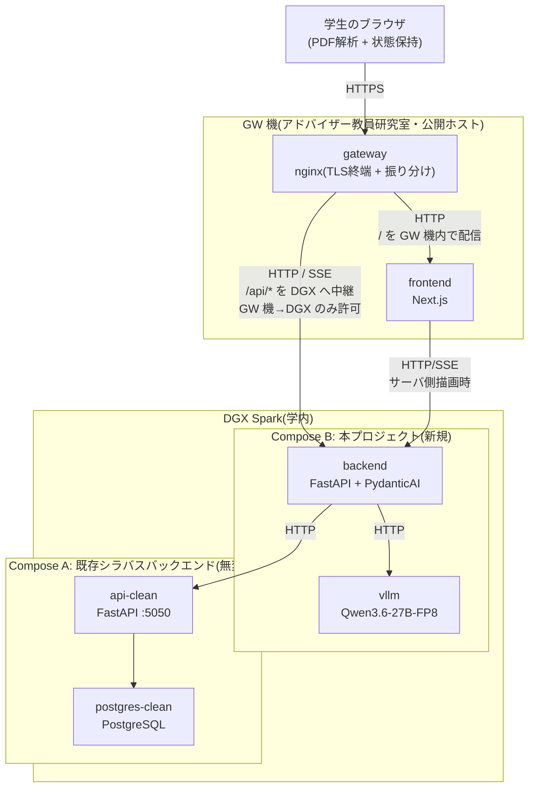

# 履修登録支援AIチャットボット 設計書(v0.9.1)— §1 システム全体構成 / §2 技術スタック

> 本ファイルは [`docs/design.md`](../design.md) の一部である。§番号は設計書全体で通し番号であり、他ファイルの節を `§X.Y` の形で参照する。全ファイルの対応表は [design.md](../design.md) の「0.3 本書の構成」を参照。

---

## 1. システム全体構成

### 1.1 構成要素

サービスは以下の5つのコンテナで構成する。frontend / backend / vllm の3つを本プロジェクトで新規開発し、api-clean / postgres-clean は既存のシラバスバックエンドをそのまま利用する。

| 要素 | 役割 | 実装 | 新規/既存 |
|---|---|---|---|
| frontend | 学生が触れる Web UI | Next.js(React + TypeScript) | 新規 |
| backend | フロントと LLM/シラバスAPI を仲介し、履修提案ロジックを担う | FastAPI(Python)+ PydanticAI | 新規 |
| vllm | ローカル LLM 推論サーバ | vLLM、Qwen3.6-27B-FP8 | 新規 |
| api-clean | シラバス情報提供 API | FastAPI(既存) | 既存・無変更 |
| postgres-clean | シラバス DB | PostgreSQL(既存) | 既存・無変更 |

これらに加え、公開入口として gateway を新規に構築する。

| 要素 | 役割 | 実装 | 新規/既存 |
|---|---|---|---|
| gateway | 公開する唯一の入口(学外からのアクセスも受ける)。TLS 終端を行い、リクエストを同一ホスト上の frontend と DGX Spark の backend へ振り分ける | GW 機上の nginx | 新規(自前で構築・運用) |

これら6要素を2つのホストに分けて配置する。

| ホスト | 設置場所 | 稼働させる要素 |
|---|---|---|
| **GW 機** | アドバイザー教員研究室 | gateway、frontend |
| **DGX Spark** | 学内 | backend、vllm、api-clean、postgres-clean |

GW 機は、アドバイザー教員の研究室に設置するサーバである。本プロジェクトが GW 機で動かすのは gateway と frontend の2コンテナのみとする。学生のブラウザは DGX Spark へ直接アクセスせず、必ず GW 機を経由する。ブラウザに配信する画面(frontend)までを GW 機が担い、履修提案ロジック・LLM 推論・シラバス参照は DGX Spark 側で行う。

公開するホストを GW 機1台に限ることで、不特定多数の学生からアクセスされるポートを DGX Spark 自身に開けずに済む。DGX Spark は GW 機からの通信のみを受け付ける(ファイアウォールで送信元を GW 機に限定する)。DGX Spark は本プロジェクト以外の用途にも使われているため、外部公開の範囲を GW 機に閉じ込める意味もある。

学生のデータを処理する一連の機能(PDF 解析はブラウザ、提案・チャットは backend と vllm)は引き続き DGX Spark(およびブラウザ)上で完結する。frontend は静的な画面配信とブラウザ内処理のためのコードを配るのみで、成績データを受け取らない。gateway も通信を中継するのみでデータの処理・保存・記録を行わない(要件§3.1、§5.5)。

### 1.2 アーキテクチャ図

ゲートウェイは単一の公開オリジンとして振る舞い、`/` を同一ホスト上の frontend へ、`/api/*` を DGX Spark 上の backend へ振り分ける。frontend と backend が別ホストに分かれても、ブラウザから見た通信相手は常にゲートウェイの1オリジンに統一されるため、backend を別オリジンとして直接公開する必要がなく、CORS の考慮も不要になる。

### 1.3 データの流れ

要件§5.4のデータフロー図を各コンポーネントの責務に基づいて具体化する。ブラウザと DGX Spark の間の通信(下記2以降)はすべて GW 機上のゲートウェイを経由する。ゲートウェイは TLS 終端と振り分けのみを担い、リクエスト/レスポンスの内容を保存・記録しない。

1. 学生がブラウザで成績表PDFを選択 → frontend 内の PDF.js でテキスト抽出 → ブラウザのメモリ(Zustand store)に学生プロファイルとして保持
2. 履修提案要求 → backend が学生プロファイル + 履修要項データを組み立て、vllm に推論依頼 → PydanticAI が構造化出力(時間割形式)を強制
3. 提案表示後のチャット → backend が会話履歴 + 必要に応じて api-clean を tool calling で参照しつつ、vllm から応答を生成 → SSE で frontend へストリーミング
4. シラバスチャット → 同様に tool calling で api-clean を呼びながら、vllm から応答を生成

データ永続化は一切行わず、ブラウザを閉じれば消える(要件§5.2)。

---

## 2. 技術スタック

| レイヤ | 技術 | 補足 |
|---|---|---|
| 言語(フロント) | TypeScript | |
| 言語(バックエンド) | Python 3.12+ | |
| Webフレームワーク(フロント) | Next.js(App Router) | |
| Webフレームワーク(バックエンド) | FastAPI | |
| ASGI サーバ | Uvicorn | |
| UIライブラリ | Tailwind CSS + shadcn/ui | |
| クライアント状態管理 | Zustand | 永続化機能はオフ(要件§5.2) |
| サーバ通信 | TanStack Query | |
| PDF解析 | pdfjs-dist(PDF.js) | クライアント側で実行 |
| LLMオーケストレーション | PydanticAI | 構造化出力・ツール呼び出し |
| LLM推論サーバ | vLLM | OpenAI 互換 API を提供 |
| ストリーミング | SSE(Server-Sent Events) | vLLM のストリーミングをそのまま中継 |
| 履修要項データ管理 | YAML + Git 管理 | アプリ起動時にメモリへロード |
| コンテナ | Docker、docker compose | |

### 2.1 LLMモデル

- 暫定: Qwen3.6-27B-FP8(vLLM 経由)
- API形式: OpenAI 互換 ChatCompletion(`/v1/chat/completions`、stream 対応、tool calling 対応)
- モデルは確定次第、本節と§4.3を更新する
