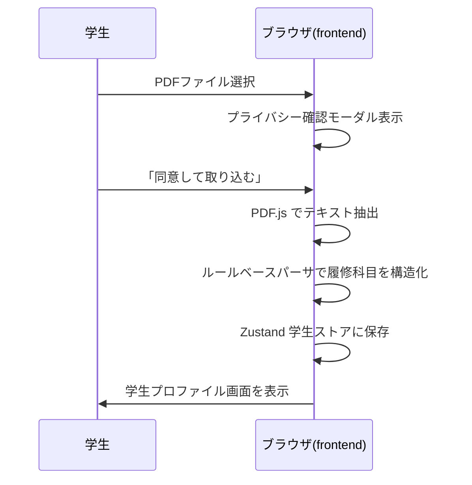
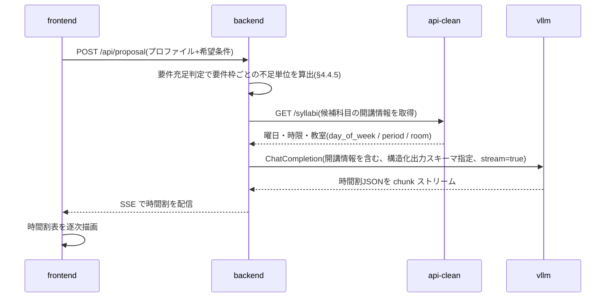
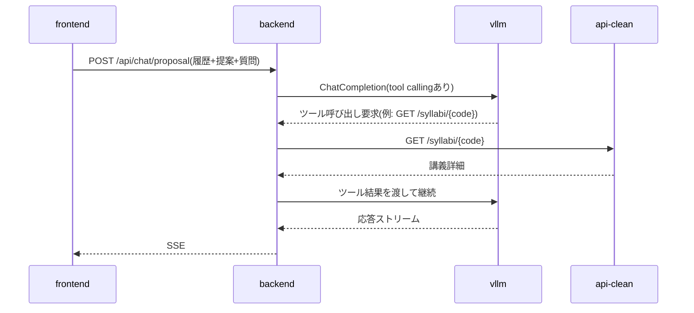
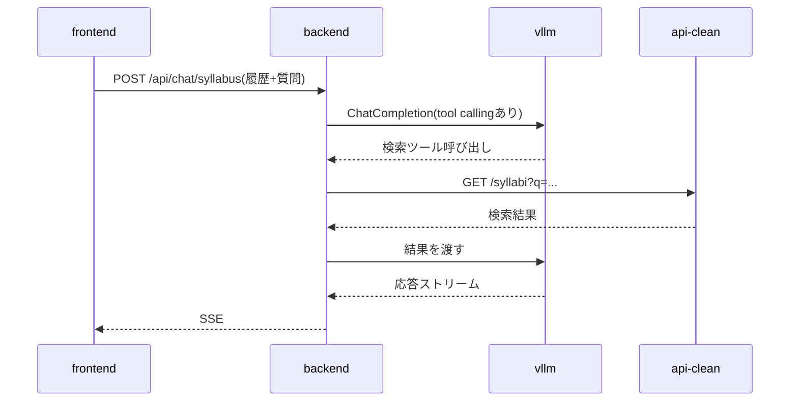

# 履修登録支援AIチャットボット 設計書(v0.9.7)— §6 API設計 / §7 主要シーケンス / §8 画面構成とルーティング

> 本ファイルは [`docs/design.md`](../design.md) の一部である。§番号は設計書全体で通し番号であり、他ファイルの節を `§X.Y` の形で参照する。全ファイルの対応表は [design.md](../design.md) の「0.3 本書の構成」を参照。

---

## 6. API設計

### 6.1 内部 API(frontend ↔ backend)

| メソッド | パス | 用途 | 応答形式 |
|---|---|---|---|
| POST | /api/proposal | 履修提案を生成 | SSE |
| POST | /api/chat/proposal | 履修提案に関するチャット | SSE |
| POST | /api/chat/syllabus | シラバス全体チャット | SSE |
| POST | /api/chat/syllabus/{code} | 講義単位チャット | SSE |
| GET | /api/syllabi | シラバス検索(一覧・絞り込み) | JSON |
| GET | /api/syllabi/{code} | シラバス詳細(講義ページ表示) | JSON |
| GET | /api/masters | 検索絞り込み用の値マスタ | JSON |
| GET | /api/curricula/{program_code}/{admission_year} | 履修要項データ参照(タグ表示用) | JSON |
| POST | /api/requirements | 卒業要件の充足判定(要件枠ごとの不足単位) | JSON |
| GET | /healthz | ヘルスチェック | JSON |

チャット系(SSE)のリクエストには学生プロファイルと対話履歴を毎回含める(サーバ側で永続化しないため)。

**`POST /api/chat/proposal` は未実装である**(2026-09-09 時点)。frontend 側は接続済みであり、backend にルートが入るまでこの経路は 404 を返す。他の9本は実装済みで、後述の書式に従う。

`GET /api/syllabi` / `/api/syllabi/{code}` / `/api/masters` は、検索画面(§4.1 の `/syllabus` 一覧・検索および `/syllabus/[code]` 詳細)が使う読み取り専用エンドポイントで、backend は §6.2 の api-clean(`GET /syllabi` / `GET /syllabi/{code}` / `GET /masters`)を中継する。公開経路はゲートウェイの単一オリジンに統一され、`/` は frontend、`/api/*` は backend へ振り分けられる一方、api-clean は公開されない(§1.2)。したがって frontend は api-clean を直接呼べず、検索画面向けにも backend 側の口が必要となる。クエリパラメータは api-clean の `/syllabi`(`q` / `faculty` / `program` / `campus` / `term` / `day` / `period` / `year` / `instructor` / `grade` / `limit` / `offset`)を素通しする。検索結果に付す「必修 / 選択 / 既修得済み」タグ(§8)は、この結果と `GET /api/curricula` の履修要項、ブラウザ内の学生プロファイルを frontend 側で突き合わせて生成する。突合はシラバスコードによる結合を第一とし、履修要項側のコードは開講年度ファイルの `resolved`(科目名 → シラバスコード。§5.1.4)から解決する。`not_offered` / `unresolved` の科目はコードを持たないためタグ付けの対象外とする。

`GET /api/curricula/{program_code}/{admission_year}` は、このタグ付けが必要とする科目レイヤ(§4.4.3)を返す。**backend は次の3点を解決済みの状態で返し、履修要項の構造をクライアントに持ち込まない。**

- **マージ後の `courses` を返す**(教養教育科目ファイルの取り込み、`not_available_to_programs` による除外、他課程からの専門関連科目の導出。§4.4.3)。検索結果には他課程が開講する科目も現れるため、当該課程の設置科目だけを返すとその大半がタグなしになる
- **各科目にシラバスコードを合成して返す。** コードは `curricula/` 側になく開講年度ファイルの `resolved` が持つ(§4.4.2)ため、解決は backend が行う。frontend が `offerings/` を直接参照することはない。`not_offered` / `unresolved` の科目は空配列とする
- **当該課程の設置科目か、他課程から導出した専門関連科目かを区別するフラグ(`own`)を付す。** 他課程の `type: 必修` はその課程の学生にとっての必修であり、区別せずに表示すると誤ったタグになる(導出科目の用途は §4.4.3 のとおり `related` / `free.faculty` スロットの判定に限られる)

あわせて `graduation`(`total_credits` / `excluded_types`)を返す。卒業残り単位の表示(§4.4.5)に必要であり、これを返さないとクライアントは卒業必要単位数を知る手段を持たない。**設置科目の単位数の総和は卒業必要単位数ではない。** 要件枠ごとの不足単位は `POST /api/requirements` で得る。

```json
{
  "programCode": "02", "admissionYear": 2024, "offeringYear": 2026,
  "graduation": { "totalCredits": 124, "excludedTypes": ["随意"] },
  "courses": [
    { "title": "仏教の思想A", "category": "教養教育科目", "subcategory": "「仏教の思想」科目",
      "type": "必修", "credits": 2, "grade": 1, "term": "前期", "quarters": ["1Q", "2Q"],
      "kikan": false, "own": true, "syllabusCodes": ["G260110004", "G260110005"] }
  ]
}
```

`POST /api/requirements` は、学生プロファイル(既修得科目を含む)を本文で受け取り、要件枠ごとの修得済み単位・不足単位を返す。判定規則をクライアントへ渡さないための口であり、その根拠と責務の切り分けは §4.4.5 による。

#### 6.1.1 SSE の書式

SSE を返す4本は、いずれも `data: <JSON>` の1行1イベントで配信する(実体は `app/api/sse.py`)。イベントの種類は用途で2系統に分かれる。

**チャット系(`/api/chat/*`)**

| イベント | 内容 |
|---|---|
| `{"delta": "..."}` | 本文の断片。受け取った順に連結すると回答になる |
| `{"error": "..."}` | 生成中の失敗。表示用の文言のみを載せ、例外の詳細は載せない |
| `{"done": true}` | 終端。エラー時も最後に必ず流れる |

思考(reasoning)とツール呼び出しはクライアントへ流さない。本文が始まる前の空白だけの出力も捨てる(§6.3.1 のとおりチャット系は思考を有効にしており、ツール呼び出しの前に空白だけの本文パートが出ることがある)。

**履修提案(`/api/proposal`)**

| イベント | 内容 |
|---|---|
| `{"snapshot": {...}}` | 組み立て途中の `TimetableProposal`(§5.3)。生成中に何度も流れる |
| `{"result": {...}}` | 検証を通った確定版。1度だけ流れる |
| `{"error": "..."}` / `{"done": true}` | チャット系と同じ |

`snapshot` は §5.3 のスキーマの**全フィールドを省略可能にした写し**で検証したもので、未到達のフィールドが null になるだけでキーの構成は `result` と同じである。クライアントは両者を同じ描画コードで扱える。写しはスキーマから機械的に作る(手で並べ直すと §5.3 を直したときに snapshot だけが古い形で残る)。まだ JSON として読めない断片と、直前と内容が変わらないものは流さない。コマ重複の検査(§5.3)は写しには引き継がない。途中経過は未確定の値を含むためである。

**SSE を開いたあとは HTTP の状態コードを返せない。** したがって提案の前処理(§7.2.1)はストリームを開く前に済ませ、そこでの失敗は 404(対応課程外)・400(前提不足)・502(上流障害)で返す。開いたあとに起きた失敗は `error` イベントで伝える。

#### 6.1.2 キャッシュの扱い

- `GET /api/curricula/{program_code}/{admission_year}` は本文から作る **ETag** と `Cache-Control: public, max-age=3600, must-revalidate` を付し、`If-None-Match` が一致すれば 304 を返す。内容は `curricula/` / `offerings/` の更新(=デプロイ)でしか変わらず(§4.4.4)、学生データを含まない GET であるため、マージ後の全課程分(2024年度入学コホートで課程あたり568〜577科目、約129KB / gzip 約9KB)の再送を避けられる。本文と ETag は (課程コード, 入学年度) ごとに1度だけ組み立ててメモリに持つ
- `POST /api/requirements` は既修得科目を本文で受けるため `Cache-Control: no-store` を付し、ブラウザにも中間経路にも残させない(§4.4.5)
- SSE には `Cache-Control: no-cache` と `X-Accel-Buffering: no` を付す。後者はゲートウェイ(nginx)がバッファリングして逐次配信を潰すのを防ぐためである(§3.5.1)

### 6.2 既存シラバスバックエンド API の利用

backend から `http://api-clean:5000` 経由で以下を主に利用する:

- `GET /syllabi` — 検索(独自シラバス§4.5、シラバスチャット§4.6で使用)
- `GET /syllabi/{code}` — 詳細(講義ページ表示・講義単位チャットで使用)
- `GET /masters` — 値マスタ(検索 UI のドロップダウン候補に利用)

`POST /sql` はエージェントに任意 SQL を書かせるリスクを避けるため使用しない方針とする。

### 6.3 vLLM との連携

- backend は OpenAI 互換クライアント経由で `http://vllm:8000/v1/chat/completions` を呼ぶ
- PydanticAI の `OpenAIChatModel('qwen3.6-27b-fp8', provider=OpenAIProvider(base_url='http://vllm:8000/v1', api_key='EMPTY'))` 形式で設定(base_url / api_key はモデルでなく `OpenAIProvider` に渡す。vllm は認証なしのため api_key はダミー。旧称 `OpenAIModel` は現行 pydantic-ai で `OpenAIChatModel` にリネーム)
- ツール呼び出しは PydanticAI の `@agent.tool` で定義し、内部で api-clean を HTTP で叩く

#### 6.3.1 リクエスト単位の推論設定(思考の有無)

Qwen3.6 は**思考(reasoning)モデル**であり、本文の前に思考トークンを生成する。サーバ側は `--reasoning-parser qwen3` で思考と本文を分離しており(§4.3)、思考をクライアントへ流すことはない。**思考を出させるかどうかはリクエストごとに** `chat_template_kwargs.enable_thinking` で決める。PydanticAI からは `OpenAIChatModelSettings(extra_body={"chat_template_kwargs": {"enable_thinking": False}})` を `Agent(model_settings=...)` に渡す形で指定する。

| 呼び出し | 思考 | 理由 |
|---|---|---|
| 履修提案(§7.2 / `POST /api/proposal`) | **切る** | 下記の実機計測による |
| チャット系(§7.3〜§7.5) | 既定のまま(**有効**) | 自由文の対話であり、ツール呼び出しの要否判断を含む。1回のモデル呼び出しに100秒超かかることがあるが現状は許容している(§13) |

**履修提案で思考を切る理由(2026-09-09 実機計測。DGX Spark + Qwen3.6-27B-FP8)。** 候補科目643行・約39,000トークンのプロンプトに対し、思考を有効にすると900秒経っても提案が返らなかった。このとき vLLM は 7.3 tokens/s で生成を続けており(`GPU KV cache usage` 17.5%、preemption なし)、停止や資源不足ではなく**思考が終わっていなかった**。600トークンで打ち切って観測しても本文には到達していない。`enable_thinking: false` を渡すと `final_result` の生成が即座に始まり、候補科目からの転記・不足要件枠への言及・希望条件の反映を含む提案が得られた。

提案は【候補科目】からの選択と転記が主であり、要件枠ごとの不足単位・開講曜日時限といった判断材料は backend が事前に揃えてプロンプトへ入れる(§7.2)。モデルに長い思考を求める課題ではない。

あわせて `max_tokens` と `timeout` を置く。出力が途中で切れると構造化出力の検証に落ち、作り直し(§7.2)が走って所要時間が倍以上になるためである。

---

## 7. 主要シーケンス

### 7.1 成績表PDF取り込み



ネットワーク通信は一切発生しない(要件§5.2、§5.3を担保)。

### 7.2 履修提案生成



**応答時間は出力トークン数でほぼ決まる(2026-09-09 実機計測)。** 生成は約 7.3 tokens/s であり、プロンプト39,000トークンのプリフィルは約20秒で済む一方、CAP いっぱいの11科目の提案(約1,900トークン)には4〜5分かかる。思考(reasoning)は切る(§6.3.1)。frontend はこの待ち時間を前提とし、確定を待たずに SSE の逐次配信で時間割を描く(§8 の `/proposal`)。

時間割(曜日×時限)の組み立てに必要な開講曜日・時限は、履修要項 YAML ではなく api-clean が保持する(§5.1)。backend は LLM 呼び出しの前に候補科目の開講情報を api-clean から取得し、コマ重複のない時間割を生成できるようプロンプトに含める。なお、週複数コマ開講の科目が `day_of_week` / `period`(1科目につき1組)でどう表現されるかは実データで確認する。

#### 7.2.1 プロンプトの組み立て

**提案エージェントはツールを持たない。** 提案に要る事実(要件枠ごとの不足単位・候補科目・開講情報)は backend が事前に集め、1つのプロンプトに書いて渡す(実体は `app/agents/proposal_agent.py`)。提案は候補科目からの選択と転記が主で対話的な探索を要さず、かつ思考を切っている(§6.3.1)ため、ツールを呼ぶか否かの判断をモデルに委ねると、呼ばれないまま推測で埋められる危険がある。tool calling を伴うのは提案後の対話(§7.3)である。

組み立ては次の5段階を順に行う。各段階は単体テストできるよう関数に分ける。

1. **履修要項の解決** — (課程コード, 入学年度)でマージ済みの履修要項を引く(§4.4.3)。無ければ 404
2. **要件充足判定** — §4.4.5 の純関数を **HTTP を経由せず直接呼ぶ**。要件§4.3.2 の「単位数の最適化」は要件枠ごとの不足単位を要する
3. **候補科目の抽出** — 次のすべてを満たす科目に絞る
   - `type != "随意"`(卒業要件単位に算入されない。§5.1.5)
   - `grade <= 学生の学年`(配当年次は「この年次**から**履修可能」の意。§5.1.5)
   - 未修得(合格した科目とのみ突合する。不合格・履修辞退の科目は未修得であり候補に残す)
   - シラバスコードを持つ(`not_offered` / `unresolved` の科目は時間割に置けない。§5.1.4)

   マージ済みの `courses` には他課程から導出した同名の専門関連科目が複数入り得る(§4.4.3)。ここでは科目名で1件に寄せ、当該課程の設置科目(`own`)を優先し、次いで課程コードの小さい出典を採る(§4.4.5 の科目索引と同じ順序)
4. **開講情報の突合** — 候補のシラバスコードに対応する曜日・時限・教室を api-clean から取る。`GET /syllabi?year=<開講年度>` を**ページ送りで一括取得**し、候補のコードだけを索引に残す。1件ずつ `GET /syllabi/{code}` を引かないのは、候補が数百件規模になるためである。1クラスも突合できなかった科目は、曜日・時限が分からず時間割に置けないため候補から外す。同名で多数のクラスが開講される科目(「英語総合1(A)」で22クラス、「スポーツ技術学A」で32クラス)はプロンプトを占有するため、曜日・時限・コードの昇順で上位数件に絞り、残りは件数だけを添える
5. **整形** — 【学生情報】【卒業要件の充足状況】【履修登録単位数の上限】【修得済み科目】【候補科目】【希望条件】の6節に並べる。候補科目は**1行1クラス**とし、`[シラバスコード] 科目名 | 区分 | 履修区分 | 単位 | 配当年次 | 学期 / 曜日時限 / 教室` の形で、モデルが値を転記するだけで済むようにする。CAP(§5.1.2 `registration_limits`)の節では学生の学年に対応するセメスター(1年前期を1として `2×学年-1` と `2×学年`)に印を付ける。次学期が前期・後期のどちらかはプロファイルから決まらないため、両方を該当として示し判断はモデルに委ねる

役割定義と規則は毎リクエスト同じであり、`Agent(instructions=...)` に固定で持たせる。学生ごとの事実は上記のプロンプトで渡す。

```
あなたは龍谷大学先端理工学部の履修登録を支援するAIアシスタントです。
与えられた学生の状況から、**次の学期に履修する時間割**を提案してください。

提案は次の規則に従ってください。
1. 提案してよいのは【候補科目】に挙がっている科目だけである。一覧に無い科目名やシラバスコードを作り出してはならない。
2. 各科目の syllabusCode・title・credits・term・day・period は、【候補科目】の行に書かれている値をそのまま転記する。推測して補わない。
3. 同じ曜日・時限・学期に2科目以上を割り当ててはならない。曜日・時限が「未定」の科目(集中講義など)はこの制約の対象外とする。
4. 合計単位数は【履修登録単位数の上限】を超えてはならない。
5. 【卒業要件の充足状況】で不足している要件枠を優先して埋める。不足単位を大きく超える科目数を詰め込まない一方、卒業に必要な単位を取り残さない。過不足のない分量にすること。
6. 【修得済み科目】に挙がっている科目は再度提案しない。ただし不合格・履修辞退の科目は未修得であり、提案してよい。
7. 【希望条件】がある場合はそれを尊重する。卒業要件と両立しない希望は、summary でその旨を説明する。
8. reason には、その科目を勧める理由(どの要件枠を埋めるか、希望条件のどれに合うか)を40字以内の1文で書く。
9. summary には提案全体の方針と履修上の注意点を2〜4文で書く。先修要件・進級要件・抽選科目など確認が要る点があれば触れる。
```

規則1・2が転記を強く縛るのは、候補一覧に無い科目名やシラバスコードを作られると、そのままでは履修できない時間割になるためである。規則3のコマ重複は §5.3 の検証でも拒否するが、検証に落ちると作り直しが走って所要時間が倍以上になる(§6.3.1)ため、プロンプト側にも置く。規則5が「過不足のない分量」を求めるのは要件§4.3.2 による。

回答内容は LLM 依存で非決定的なため、単体テストで確かめるのは各段階の関数の入出力と、規則がプロンプトに載ることまでとし、提案が実際に成立するかは実機スモーク(`backend/scripts/smoke_proposal.py`)で確認する(§12.3)。

### 7.3 提案チャット



### 7.4 シラバスチャット(全体)

要件§4.6「シラバス全体に対する質問」。



#### 7.4.1 システムプロンプト

backend は毎リクエスト、次のプロンプトを `instructions` としてエージェントに渡す(実体は `app/api/chat_syllabus.py` の `_SYLLABUS_PROMPT`)。§7.5 も同じ本文を先頭に置き、その後ろに対象講義の詳細を連結する。

```
あなたは龍谷大学の履修登録を支援するAIアシスタントです。
学生のシラバスに関する質問に日本語で答えてください。
必要に応じてツールを使ってシラバス情報を検索・参照してください。

回答は次の規則に従ってください。
1. ツールが返した内容だけを根拠にする。シラバスに書かれていない事項を補わない。
2. シラバスの語をそのまま使う。より具体的な語や製品名への言い換えをしない(例:「文書作成ソフト」を「Word」、「ネットワークストレージ」を「クラウド」と書き換えない)。
3. シラバスにない形容や評価を付け加えない(例:「実践的な」)。
4. 週数・回数・期間などの数値は、シラバスに書かれている場合だけ示す。自分で計算・推定しない。
5. 必修・選択必修・推奨といった履修要件の判断はしない。シラバス検索ツールはこれを判断できる情報を返さないため、履修要項で確認するよう案内する。
6. 同じ科目名で複数のクラスが開講されている場合は、どのクラスの情報かを講義コード・担当教員・サブタイトルで明示し、他のクラスにも当てはまるかのように書かない。
7. 推測を述べる場合は、推測であることを明示する。
8. シラバスに情報が無い事項は、無いと答える。
```

規則2〜4が個別の言い換えを名指ししているのは、2026-09-04 の実機検証で**捏造が装飾部分に集中して現れた**ためである。科目名・単位・担当教員・各回の内容といった骨格は原典どおりで、誤りは「文書作成ソフト」→「Word」、「ネットワークストレージ」→「クラウド」のような一般語の具体化、原典にない概念(プライバシー保護)の追加、`course_plan` の回数からの開講週数の推定、原典にない形容(「実践的な」)の付加として出た。「シラバスにない事を書くな」という一般規則だけではこれらは抑止されない。LLM の側にはいずれも言い換え・要約の範囲内に見えるためである。したがって観測された誤りの型を具体例つきで挙げる。

規則5は、必修・推奨の判定に使える情報をシラバス検索ツールが返さないことによる。api-clean の `programs` は空で返り、`note`(例: `Y1000 ◎`)の意味は未解明である(§13)。判定の根拠が無い以上、履修要項側で確認させるほかない。ツール側が課程情報を返すようになった時点で、この規則は見直す。

規則6はプロンプト単独では不十分である。同名科目が何クラス開講されているかを LLM が知る手段が現状は無く(`search_syllabi` は api-clean のレスポンスをそのまま返すのみ)、規則は「知っていれば書け」としか働かない。クラス数をツールの返却値に含める改修を別途行う。

回答内容は LLM 依存で非決定的なため、単体テストで確かめるのは規則がプロンプトに載り両ルートでモデルに渡ることまでとし、捏造が実際に消えたかは実機スモーク(`backend/scripts/smoke_chat_syllabus.py`)で確認する。

### 7.5 シラバスチャット(講義ページ単位)

要件§4.6「講義ページ単位の質問」。frontend は現在表示中の `syllabus_code` を含めて送信。backend は最初にその講義詳細を取得し、システムプロンプトの一部としてコンテキストに含めたうえで LLM に渡す。

---

## 8. 画面構成とルーティング

| パス | 画面 | 主な機能 |
|---|---|---|
| / | 学生情報入力 | 手入力フォーム、PDF取り込み、プライバシー確認ダイアログ(要件§5.6) |
| /import | 成績表の取り込み | PDF取り込みの手順表示、解析失敗時の手入力フォールバック、デモモードの読み込み(§11) |
| /proposal | 履修提案 | 時間割表示、提案チャット(要件§4.3、§4.4) |
| /syllabus | 独自シラバス一覧 | 検索、タグ表示「必修」「選択」「既修得済み」(要件§4.5) |
| /syllabus/[code] | 講義詳細 | シラバス情報、講義単位チャット(要件§4.6) |
| /mydata | マイデータ | 取り込んだプロファイルの確認・編集・破棄(要件§4.1、§4.8) |
| /chat | シラバスチャット | シラバス全体に対する質問(要件§4.6) |
| /privacy | プライバシーポリシー | データの流れの図解、要件§5の規定説明 |

`/import`・`/mydata`・`/chat` の3本は当初の設計には無く、実装で追加した。`/` は画面幅の広い端末向けに取り込みと確認を1画面へ収めているが、狭い端末では手順を分ける必要があり、取り込み(`/import`)と確認・編集(`/mydata`)を別ルートに切り出した。`/chat` は、講義を特定しない質問(要件§4.6 の「シラバス全体に対する質問」)の入口が `/syllabus/[code]` の講義単位チャットしか無かったために設けた。

ヘッダーに常にリセットボタン(要件§4.8)を設置する。
