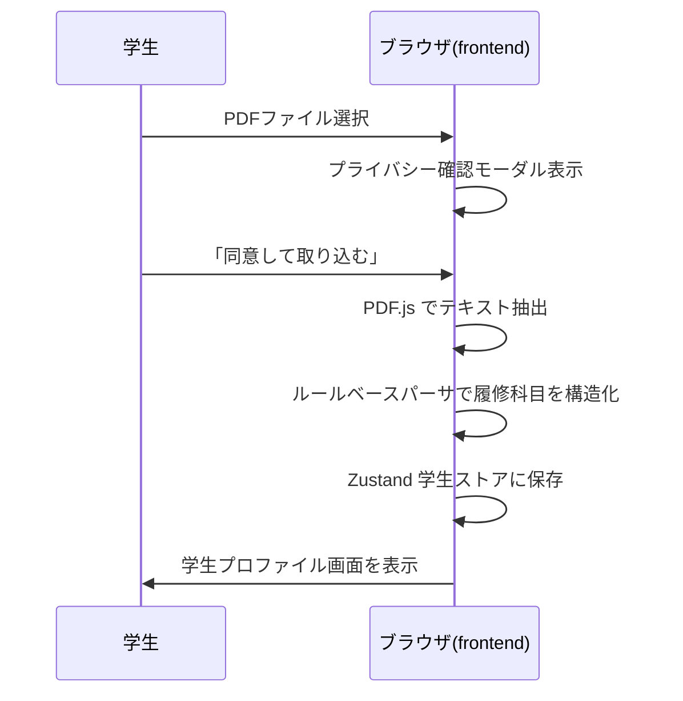
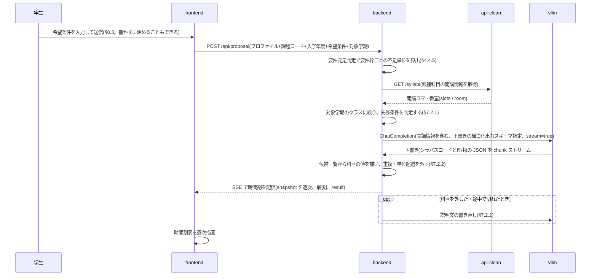
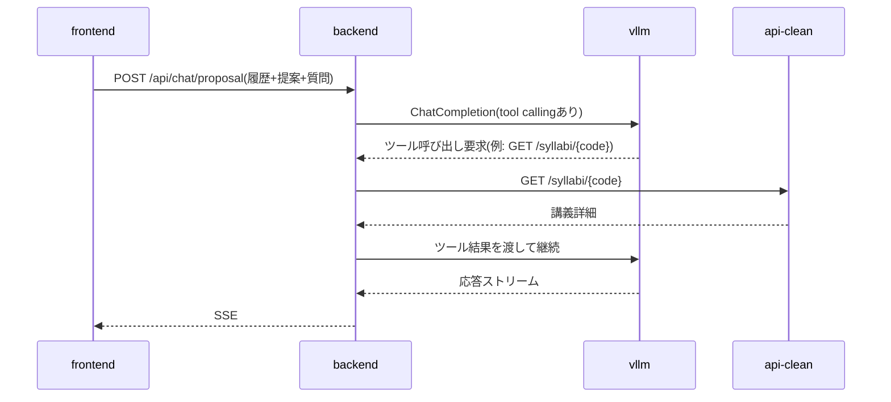
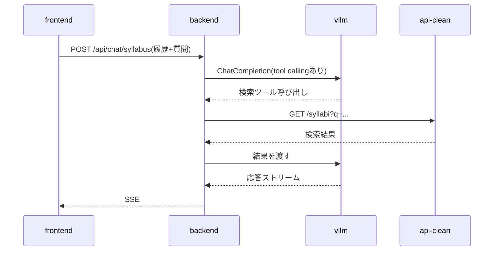

# 履修登録支援AIチャットボット 設計書(v0.9.83)— §6 API設計 / §7 主要シーケンス / §8 画面構成とルーティング

> 本ファイルは [`docs/design.md`](../design.md) の一部である。§番号は設計書全体で通し番号であり、他ファイルの節を `§X.Y` の形で参照する。全ファイルの対応表は [design.md](../design.md) の「0.3 本書の構成」を参照。

---

## 6. API設計

### 6.1 内部 API(frontend ↔ backend)

| メソッド | パス | 用途 | 応答形式 |
|---|---|---|---|
| POST | /api/proposal | 履修提案を生成 | SSE |
| POST | /api/chat/proposal | 履修提案に関するチャット | SSE |
| POST | /api/chat/syllabus | シラバス全体チャット | SSE |
| POST | /api/chat/syllabus/{code} | 講義単位チャット | SSE |
| GET | /api/syllabi | シラバス検索(一覧・絞り込み) | JSON |
| GET | /api/syllabi/{code} | シラバス詳細(講義ページ表示) | JSON |
| GET | /api/masters | 検索絞り込み用の値マスタ | JSON |
| GET | /api/curricula/{program_code}/{admission_year} | 履修要項データ参照(タグ表示用) | JSON |
| GET | /api/course-targets | シラバスコード → 対象課程(タグの履修可否判定用。§6.1.3) | JSON |
| POST | /api/requirements | 卒業要件の充足判定(要件枠ごとの不足単位) | JSON |
| GET | /api/healthz | ヘルスチェック(**公開経路からの死活確認はこちら**。§3.5.1) | JSON |
| GET | /healthz | ヘルスチェック(ネットワーク内から直に叩く用) | JSON |

チャット系(SSE)のリクエストには学生プロファイルと対話履歴を毎回含める(サーバ側で永続化しないため)。

`/healthz` だけがルート直下にあるため、**公開経路(`/syllabel/api/*`)からは到達しない**。`/syllabel/*` は frontend へ振り分けられるためである。外から死活を見るには `/api/healthz` を使う(§3.5.1)。

上表のパスは **backend が受けるパス**である。ブラウザおよびサーバ側描画から呼ぶときの**公開パスは `/syllabel` を前置した `/syllabel/api/...`** となる。ゲートウェイが `/syllabel` を剥がして backend へ渡すためである(§3.5.2)。Next.js の `basePath` はページとアセットの生成先を変えるだけで `fetch()` のパスには前置されないため、**frontend は呼び出し先に `/syllabel` を自分で含める**。

呼び出し元によって宛先が分かれる。backend の配置が決まったため(§3.4.2)、いずれも確定である。

| 呼び出し元 | 宛先 |
|---|---|
| ブラウザ(クライアントコンポーネント) | ゲートウェイと同一オリジンの `/syllabel/api/...`(相対パス)。§3.5.2 の URL 構造から従う |
| サーバ側描画(RSC / `page.tsx` の `async` 関数) | 同一 Podman ネットワーク上の backend コンテナ(`http://syllabel-backend:8000/api/...`)。**ゲートウェイを経由しないため `/syllabel` は付かない**。サーバ側の `fetch` は相対パスを解決できないため、オリジンを環境変数で与える |

いずれもハードコードせず、実行時の環境変数で与える(§3.2.1)。

**`lib/syllabus-api.ts` はサーバコンポーネント(`app/syllabus/page.tsx`、`app/syllabus/[code]/page.tsx`)とクライアントコンポーネント(`SyllabusTagList` 等の `fetchCurricula`)の双方から import される。** 宛先を単一の定数に置くとどちらか一方が必ず壊れるため、**オリジンはモジュール読み込み時に固定せず、呼び出しごとに解決する**(`lib/api_base.ts` の `apiBase()`。`typeof window` で呼び出し元を判別し、サーバ側は `BACKEND_ORIGIN` を読む)。この制約は到達経路の決定によらない。

**開発時はゲートウェイが居ない。** ブラウザからの `/syllabel/api/*` は Next の開発サーバに届いてしまうため、`next.config.ts` の `rewrites()` がゲートウェイと同じ振り分けを代行する(本番では空を返し、振り分けはゲートウェイに委ねる)。

`POST /api/chat/proposal` は、学生プロファイル・生成済みの提案・対話全体を1本の `messages` で受ける。**`messages` の末尾(role: user)が今回の質問、それより前が履歴である。** `proposal` は必須、`messages` は1件以上で末尾は `user` でなければならない。末尾が `assistant`、`messages` が空、`proposal` が無い場合は 422 を返す。提案が §5.3 の検証(コマ重複など)に落ちる場合も 422 となる(`POST /api/proposal` と同じスキーマを使うため)。

```json
{
  "studentProfile": { "grade": 3, "program": "知能情報メディア課程", "completedCourses": [] },
  "proposal": {
    "courses": [
      { "syllabusCode": "B12345", "title": "情報基礎", "day": "月", "period": 3,
        "term": "前期", "credits": 2, "category": "必修", "reason": "情報メディア分野の必修のため。" }
    ],
    "totalCredits": 2,
    "summary": "必修を軸にした構成。"
  },
  "messages": [
    { "role": "user", "content": "前の質問" },
    { "role": "assistant", "content": "前の回答" },
    { "role": "user", "content": "この時間割は何単位?" }
  ]
}
```

`GET /api/syllabi` / `/api/syllabi/{code}` / `/api/masters` は、検索画面(`/syllabus` 一覧と `/syllabus/[code]` 詳細。§8)が使う読み取り専用エンドポイントであり、backend は §6.2 の api-clean(`GET /syllabi` / `GET /syllabi/{code}` / `GET /masters`)を中継する。api-clean は公開されない(§1.2)ため frontend からは直接呼べず、検索画面向けにも backend 側の口を置く。クエリパラメータは api-clean の `/syllabi`(`q` / `faculty` / `program` / `campus` / `term` / `day` / `period` / `year` / `instructor` / `grade` / `limit` / `offset`)を素通しし、backend は検索条件に手を加えない。**api-clean への接続失敗・タイムアウト・上流の HTTP エラーはいずれも 502 で返し**、backend 自身の不具合(500)と区別する(`app/api/syllabus.py`)。検索画面がこれらをどう使うかは §6.1.4、タグ付けは §8.2.1 に定める。

`GET /api/curricula/{program_code}/{admission_year}` は、タグ付け(§8.2.1)と卒業残り単位の表示(§4.4.5)が必要とする**科目レイヤ**(§4.4.3)を返す。**backend は次の項目を解決済みの状態で返し、履修要項の構造をクライアントに持ち込まない。**

- **マージ後の `courses`**(教養教育科目の取り込み、`not_available_to_programs` による除外、他課程からの専門関連科目の導出。§4.4.3)。並びは「当該課程の設置科目 → 教養教育科目 → 他課程から導出した専門関連科目(課程コード順)」とする。検索結果には他課程が開講する科目も現れるため、当該課程の設置科目だけでは足りない
- **各科目のシラバスコード `syllabusCodes`。** コードは `curricula/` 側になく開講年度ファイルの `resolved` が持つ(§4.4.2)ため、解決は backend が行う。1科目に複数の開講クラスが対応するため配列とし、`not_offered` / `unresolved` の科目は空配列とする。frontend は `offerings/` を直接参照しない
- **`own`。** 当該課程の設置科目(教養教育科目+専攻科目)なら true、他課程から導出した専門関連科目なら false。導出科目の `category` は `専門関連科目` に付け替えてあるが、`type` は**導出元の課程にとっての**履修区分のままであり、閲覧している学生にとっての値ではない。frontend は `own` が false の科目に履修区分を出さない(§8.2.1)。**履修可否の判断には使わない**(§6.1.3)
- **`subcategory`(分野)。** 教養教育科目だけが持ち、専攻科目では null(§5.1.5)。タグの分野(§8.2.1)に使う
- **`graduation`(`totalCredits` / `excludedTypes`)。** 卒業残り単位の表示(§4.4.5)に要る。**設置科目の単位数の総和は卒業必要単位数ではない**ため、クライアントは `courses` から算出できない。要件枠ごとの不足単位は `POST /api/requirements` で得る

```json
{
  "programCode": "02", "admissionYear": 2024, "offeringYear": 2026,
  "graduation": { "totalCredits": 124, "excludedTypes": ["随意"] },
  "courses": [
    { "title": "仏教の思想A", "category": "教養教育科目", "subcategory": "「仏教の思想」科目",
      "type": "必修", "credits": 2, "grade": 1, "term": "前期", "quarters": ["1Q", "2Q"],
      "own": true, "syllabusCodes": ["G260110004", "G260110005"] }
  ]
}
```

`POST /api/requirements` は、学生プロファイル(既修得科目を含む)を本文で受け取り、要件枠ごとの修得済み単位・不足単位を返す。判定規則をクライアントへ渡さないための口であり、その根拠と責務の切り分けは §4.4.5 による。要件枠には公式の区分名 `name`(「教養教育科目(選択)」など。§5.1.2)を付けて返す(画面に出すのはこちらで、`key` は内部の識別子)。履修提案の画面が卒業要件枠の内訳を出すのに使う(§8.3.5)。

`POST /api/proposal` のリクエストは、学生プロファイルと**課程コード・入学年度を別に**受ける。履修要項を引くキーは (課程コード, 入学年度) である(§4.4.2)一方、`StudentProfile.program` に入るのは成績表から採れる**課程名**であり、課程は改称され得るため識別子には使えない。入学年度は成績表の入学日から読んだ値を優先し、無いとき(手入力)だけ学年から推定して送る(`lib/programs.ts` の `resolveAdmissionYear()`)。課程名 → 課程コードの解決は frontend が持つ(`lib/programs.ts`。一覧の正本は `curricula/admission-<年度>/` の課程ファイルである)。

```json
{
  "studentProfile": { "grade": 3, "program": "知能情報メディア課程", "completedCourses": [] },
  "programCode": "02", "admissionYear": 2024,
  "preferences": "午前中の科目を多めにしたい",
  "targetTerm": { "year": 2026, "term": "後期", "grade": 3 }
}
```

`targetTerm` は**提案する学期**(次に履修登録する学期)である。`year` は年度、`term` は `前期` / `後期`、`grade` は**その学期の**学年で、年度をまたぐと成績表の作成時点の学年(`studentProfile.grade`)より1つ上になる。frontend が取り込んだ成績表の次の学期(成績表の作成日の月から決める)を送る。学生は画面で確認できるが選び直せない(§5.2.1、§8.3)。backend は候補のクラスをこの学期に登録するものへ絞り、配当年次と CAP の該当セメスターにこの学年を使う(§7.2.1)。省略もできるが、その場合は前期・後期のクラスが混ざり学期の混ざった提案になり得る(旧い呼び出しの互換のためだけに残している)。

`preferences` は任意の自由文で、§7.2.1 のプロンプトの「希望条件」節にそのまま入る(未指定のときは「特になし」)。**(課程コード, 入学年度) に対応する履修要項が無い場合は 404 を返す**(ストリームを開く前の前処理であるため。§6.1.1)。

**この口を叩く契機は学生の送信であり、`/proposal` を開いたことではない。** 希望条件は提案画面の AI履修アシスタントの入力欄で受け取り、その本文がそのまま `preferences` になる(§8.3)。

#### 6.1.1 SSE の書式

SSE を返す4本は、いずれも `data: <JSON>` の1行1イベントで配信する(実体は `app/api/sse.py`)。イベントの種類は用途で2系統に分かれる。

**チャット系(`/api/chat/*`)**

| イベント | 内容 |
|---|---|
| `{"delta": "..."}` | 本文の断片。受け取った順に連結すると回答になる |
| `{"error": "..."}` | 生成中の失敗。表示用の文言のみを載せ、例外の詳細は載せない |
| `{"done": true}` | 終端。エラー時も最後に必ず流れる |

思考(reasoning)とツール呼び出しはクライアントへ流さない。本文が始まる前の空白だけの出力も捨てる(§6.3.1 のとおりチャット系は思考を有効にしており、ツール呼び出しの前に空白だけの本文パートが出ることがある)。

**履修提案(`/api/proposal`)**

| イベント | 内容 |
|---|---|
| `{"snapshot": {...}}` | 組み立て途中の `TimetableProposal`(§5.3)。生成中に何度も流れる |
| `{"result": {...}, "adjustments": [...]}` | 確定版。1度だけ流れる。`adjustments` は backend が外した科目・打ち切りの記録(文字列の配列。§7.2.2)で、**frontend は読まず学生に見せない** |
| `{"error": "..."}` / `{"done": true}` | チャット系と同じ |

`snapshot` は §5.3 のスキーマの**全フィールドを省略可能にした写し**で検証したもので、未到達のフィールドが null になるだけでキーの構成は `result` と同じである。クライアントは両者を同じ描画コードで扱える。写しはスキーマから機械的に作る(手で並べ直すと §5.3 を直したときに snapshot だけが古い形で残る)。まだ JSON として読めない断片と、直前と内容が変わらないものは流さない。コマ重複の検査(§5.3)は写しには引き継がない。途中経過は未確定の値を含むためである。

**SSE を開いたあとは HTTP の状態コードを返せない。** したがって提案の前処理(§7.2.1)はストリームを開く前に済ませ、そこでの失敗は 404(対応課程外)・400(前提不足)・502(上流障害)で返す。開いたあとに起きた失敗は `error` イベントで伝える。

#### 6.1.2 キャッシュの扱い

- `GET /api/curricula/{program_code}/{admission_year}` は本文から作る **ETag** と `Cache-Control: public, max-age=3600, must-revalidate` を付し、`If-None-Match` が一致すれば 304 を返す。内容は `curricula/` / `offerings/` の更新(=デプロイ)でしか変わらず(§4.4.4)、学生データを含まない GET であるため、マージ後の全課程分(2024年度入学コホートで課程あたり568〜577科目、約129KB / gzip 約9KB)の再送を避けられる。本文と ETag は (課程コード, 入学年度) ごとに1度だけ組み立ててメモリに持つ
- `POST /api/requirements` は既修得科目を本文で受けるため `Cache-Control: no-store` を付し、ブラウザにも中間経路にも残させない(§4.4.5)
- SSE には `Cache-Control: no-cache` と `X-Accel-Buffering: no` を付す。後者は中継が応答をバッファリングして逐次配信を潰すのを防ぐためである。現行のゲートウェイは Caddy であり `reverse_proxy` は既定でバッファリングしないため、このヘッダは nginx 系の中継が前段に入った場合の保険として付し続ける(§3.2.1)

#### 6.1.3 履修可否の判定

**タグは、その学生が履修登録できる開講クラスにだけ付け、履修提案の候補にもそのクラスだけを載せる**(要件§4.5)。履修要項は「科目」の単位で書かれている一方、1科目には複数の開講クラスが対応し(§5.1.4)、どのクラスを履修できるかは課程ごとに決まっている(例:「仏教の思想A」は複数のクラスが開講され、課程ごとに履修するクラスが指定されている)。履修要項側のデータだけでは可否を決められないため、**判定の正本はシラバスの対象課程とする。**

| シラバスの対象課程(`programs`)・対象学部(`faculties`) | 判定 |
|---|---|
| 学生の課程が `programs` に入っている | 履修可 |
| `programs` が空で、`faculties` に `先端理工学部` が入る | 課程指定なし。履修可 |
| それ以外 | 他課程指定のクラス。履修不可 |

**規則は上の3分岐だけであり、本節の1か所に置く。** 実装は対象課程の取得経路が違うため2か所に持つ。変更するときは本節と両実装を揃える。

| | 判定する場所 | 対象課程の取得 |
|---|---|---|
| 検索のタグ | frontend(`lib/eligibility.ts` の `canRegister()`、`lib/syllabusUI.ts` の `resolveTags()`) | 一覧は `GET /api/course-targets`(下記)、講義詳細は `GET /api/syllabi/{code}` の `programs` / `faculties` |
| 履修提案 | backend(`app/agents/proposal_agent.py` の `fetch_eligibility()`) | `GET /api/course-targets` と同じ組み立てを backend 内で行う |

**判定に使わないもの。**

- **学年(配当年次)。** タグの判定に学年は使わない。学年は入学年度、すなわち参照する履修要項の版を決めるためだけに使う(§4.4.2。成績表の入学日を優先し、無いときだけ学年から推定する。`lib/programs.ts` の `resolveAdmissionYear()`)。その年次で履修できる科目を探す手段は、検索の対象年次の絞り込み(§8.2.3)とする
- **`own`。** 他課程の科目でも学修プログラムを構成する科目は全課程に開かれており、自課程の教養教育科目にも他課程指定のクラスがある。`own` は可否の代理にならない
- **学修プログラムの帰属データ。** 学修プログラムを構成する科目は対象課程が全課程になっており、対象課程が帰属を代理する。学修プログラムの表(履修要項 s05【8】)に載らずに複数課程へ開かれている共通科目(`Y009` 系)は対象課程でしか判別できないため、表を転記するとかえって取りこぼす

**判定できないときは何も主張しない。** 対象課程を取得できなかったコードにはタグを出さない(修得済みは成績の事実なので出す。§8.2.1)。**取得できなかったコードを空配列で代用してはならない** — 空配列は「課程指定なし(＝履修可)」を意味する。frontend は `undefined` を渡して区別する。履修提案の側では、課程名の一覧(`GET /masters` の `course_program`)が取れなかったときに限り、学生の課程だけで引いて課程指定なしのクラスも履修可と扱う(候補を失うより緩い判定に倒す。`fetch_eligibility()`)。

**課程名の比較は改称を吸収する。** 課程コード `06` は入学年度で名称が異なり(2024年度入学: 環境生態工学課程、2025年度入学: 環境科学課程)、api-clean は両方を別々の課程として持つ(§4.4.2)。frontend は `lib/programs.ts` の `isSameProgram()`、backend は課程ファイルの `program.name_aliases` で比べる。

**履修提案では、1科目あたりのクラス数を絞る前に履修可否を掛ける。** `MAX_CLASSES_PER_COURSE` は曜日・時限の早い順で切るため、順序が逆だと、他課程指定のクラスが早い時限に並ぶ科目で履修できるクラスが候補に1つも載らない。

**`GET /api/course-targets?year=&faculty=`** は、シラバスコード → 対象課程の対応を (開講年度, 学部) 単位でまとめて返す。一覧のタグでの絞り込みは検索結果の全件に効かせる(§6.1.4)ため、全件ぶんの対象課程が手元に要る。

- **組み立て方。** api-clean の `GET /syllabi`(一覧)は対象課程を返さず、対象課程は `GET /syllabi/{code}` にしかない(§6.2)。1件ずつ引くと母数ぶんのリクエストになるため、**課程名で絞った一覧を課程ごとに引いて集合演算で組み立てる。** `program` は完全一致で、対象課程を持たないシラバスはその絞り込みから落ちるため、**どの課程の結果にも現れないコードを課程指定なし(空配列)とする**
- **学生データを含まない。** (開講年度, 学部)だけで決まるため、ETag と `Cache-Control: public, max-age=3600, must-revalidate` を付ける
- **backend は組み立て結果を (開講年度, 学部) ごとに保持し、1時間の期限を置く。** 上流(api-clean)の更新で変わり得るため、`/api/curricula` と違って恒久には持たない。組み立ては (開講年度, 学部) ごとに同時に1本だけとする(経路のトークンゲートウェイは同一トークンの同時リクエストを 503 で弾き得る)。期限切れのあとは古い結果をすぐ返し、組み直しを裏で1本だけ走らせる。待たせるのは結果を1つも持たない起動直後だけである。組み直しに失敗したら古い結果を使い続け、60秒おいてから再試行する(`app/api/syllabus.py` の `_targets_payload()`)
- **失敗しても一覧は出す。** タグは検索の付加価値であって前提ではない。frontend は失敗を null として扱い、修得済み以外のタグを出さずに続ける(`app/syllabus/page.tsx`)

#### 6.1.4 シラバス検索の取得と照合

検索画面(§8.2)が検索結果を得る規則を定める。取得と照合は `lib/syllabus-api.ts` の `searchCourses()` に、絞り込み後の切り出しと件数は `lib/useTaggedResults.ts` に集約し、PC とモバイルで共用する。

**取得**

- **開講年度は1年度に固定する。** frontend は `year` を定数(`OFFERING_YEAR`)で与え、絞り込み UI に年度を出さない(URL に `year` が付いていても読まない)。タグ付けに使う名寄せ結果(`offerings/<開講年度>/`。§5.1.4)が1年度分しか無く、他年度の科目はタグ付けの対象にならないためである。他年度の `offerings/` が揃えばこの定数を増やして開放する。backend の `/api/syllabi` は `year` を素通しし、制限を置かない
- **学部は `先端理工学部` に固定する**(`FACULTY`)。履修要項を持つのはこの学部だけであり(要件§2.1)、他学部の科目はタグ付けの対象にならず履修の判断にも使えない
- **条件に当たる全件を引く。** 500件(api-clean の `MAX_ROWS`)ずつ辿って集め、ページ送りは表示だけで行う。タグでの絞り込み(§8.2.2)は学生プロファイルとの突合で決まるため api-clean の検索条件にできず、**絞り込んだ結果をサーバへ送ることもできない**(修得済みのコード一覧はその学生の成績そのものである。要件§5)。絞り込みをクライアントで全件に効かせるには全件が手元に要る。総件数も `results.length` で確定する(api-clean は総件数を返さない。§6.2)
- **並びは api-clean の返すシラバスコード順のままとし、並び順の表示・切り替えは置かない。** その学年に合った科目を探す手段は、並び順ではなく絞り込み(対象年次・区分・タグ)とする

**キーワードの照合**

検索ボックスは科目名と教員名を1つの入力で受ける(§8.2.3)。api-clean の `q`(科目名)と `instructor`(教員名)は別のパラメータで、AND で効くため**同時に送ってはならない**(必ず0件になる)。**科目名で照合し、0件のときに同じ語を教員名として引き直す。** 教員名として引き直したことは検索結果の見出しに示す。

- **科目名は frontend で照合する**(`lib/titleSearch.ts` の `matchesTitle()`)。api-clean の `q` は正規化の無い `ILIKE` であり、大学のデータは表記が混在している(`Ⅰ` はローマ数字の1文字、括弧は全角、`A` は半角)。キーワードを `q` に送らず、その他の条件に当たる全件を引いてから照合する。照合は双方を NFKC で揃え、`Ⅰ`〜`Ⅹ` 由来のローマ数字(漢字・かなの直後で英字が続かないもの)を算用数字に、ひらがなをカタカナにし、大文字小文字・空白・中黒を無視して部分一致を取る。空白で区切った語は AND で効く。**履修要項との突合に使う `normalizeTitle()`(§5.1.5)とは別の規則である** — あちらは別の科目を同じ科目とみなさないよう、backend と同じ狭い規則に保つ
- **教員名は、入力を api-clean の登録表記に組み立て直して引く**(`lib/instructorName.ts` の `spellInstructorName()`)。api-clean の `instructor` は登録された表記のままの部分一致(`instructor.kanji_name ILIKE`)で、教員名は姓名を全角スペースで区切って登録されている。一覧は教員名を返さない(§6.2)ため、手元で正規化して突き合わせることはできない。組み立ての規則は次のとおり
  - **入力どおりの語で0件のときだけ組み立てる。** 姓のみ・全角区切りのフルネームは1回で当たる
  - 入力の空白を取り除き、**先頭から1文字ずつ伸ばしながら、他の条件を同じにした `limit=1` の問い合わせで当たるかを確かめる。** 次の1文字をそのまま繋げて外れたら、区切り(全角 → 半角)を挟んで試す。部分一致なので伸ばしている途中の語も当たる
  - **姓の長さも区切りの数も仮定しない。** 寄り道(別の教員の名前の一部)で行き止まったら戻って区切りを試す。問い合わせは1回の組み立てにつき64回で打ち切る
  - **問い合わせのどれかが失敗したら例外をそのまま送出する。** 失敗を「外れ」と扱うと、当たるはずだった語で「見つからない」と誤答する
  - **組み立ては frontend で行い、`GET /api/syllabi` では行わない。** この口は api-clean を素通しするページ送りの口であり、組み立てを入れるとページを送るたびに組み立て直すことになる

| 入力 | 組み立て |
|---|---|
| `山田`(姓のみ) / `山田　太郎`(全角) | 入力どおりで当たる。組み立てない |
| `山田 太郎` / `山田太郎` | `山田` → `山田太`(外れ)→ `山田　太` → `山田　太郎` |
| `オーガスティンジョナサン` | 姓の長さを仮定しないので、7文字の姓でも `オーガスティン　ジョナサン` に至る |
| `ドラグナラルカマリア` | 区切りの数を仮定しないので `ドラグナ　ラルカ　マリア` に至る |

**シラバスチャットの検索ツール(§7.4)も同じ規則で照合する**(科目名は `app/agents/title_search.py` と `app/agents/tools.py` の `search_syllabi_by_title()`、教員名は `app/agents/instructor_name.py` と `search_syllabi_by_instructor()`)。**frontend と backend の規則は同じに保つ** — 食い違うと「検索画面では出るのにチャットでは見つからない」というねじれが起きる。チャットの検索ツールはキーワードを `q` に送らず、その他の条件に当たる全件を500件ずつ辿ってから照合し、`limit` / `offset` は照合後に掛ける。年度・学部を指定しないときは全年度を辿る。

**入力の反映**

検索語は URL の `q` を正本とし、変えるとサーバ側描画と全件の取得がやり直される。そのため**1文字ごとには反映しない**(`lib/useSearchInput.ts`)。IME の変換中(`compositionstart`〜`compositionend`)は反映せず、確定後と英数字の入力は 300ms 止まってから、Enter は即時に反映する(変換の確定に押した Enter は除く)。

**ページ送りと件数**

- **ページ送り(30件)は絞り込み後の並びに対して行う。** `offset` は URL に持ち(詳細画面から戻ったときに位置を保つため。§8.2.3)、クライアントがその値で絞り込み後の配列を切る
- **URL の `offset` は 0 以上の整数だけを受け、ページの先頭(30 の倍数)に切り下げる**(`app/syllabus/page.tsx`)。**絞り込み後の件数を超える `offset` は最後のページに丸め**、URL は書き換えない(履修要項の取得中は一時的に0件になるため、届けば元の位置に戻れるようにする)
- **絞り込み(タグ・区分・分野・修得済みを除くスイッチ)を変えたら `offset` を消す**(`lib/useFilterControls.ts`)。絞り込みはクライアント状態、`offset` は URL にあるため、消さないと前の絞り込みでのページ位置が残る
- **件数は絞り込み後の並びで決める。** 絞り込みが効いているあいだは絞り込み後の件数を出し、絞る前の母数を併記する(「184件（1,219件中）」)。件数とページ数はクライアントでしか決まらないため、サーバ側描画では描かない

### 6.2 既存シラバスバックエンド API の利用

backend から以下の3つを利用する。**これがシラバスバックエンドに対して使う口のすべてである。**

- `GET /syllabi` — 検索(独自シラバス§4.5、シラバスチャット§4.6で使用)
- `GET /syllabi/{code}` — 詳細(講義ページ表示・講義単位チャットで使用)
- `GET /masters` — 値マスタ(検索 UI のドロップダウン候補に利用)

**`GET /syllabi` の検索条件の意味は次のとおり**(api-clean の `clean_api.py` で確認)。条件はすべて AND で結合される。

| パラメータ | 突合 |
|---|---|
| `q` | **科目名のみ**の部分一致(`subject.title ILIKE`)。**教員名には当たらない** |
| `instructor` | 担当教員の漢字名の部分一致(`instructor.kanji_name ILIKE`)。**正規化は無く、登録された表記のまま照合される**(姓名の区切りは全角スペース。§6.1) |
| `faculty` / `program` / `campus` | 名称の完全一致。候補は `/masters` |
| `term` / `day` / `period` | 開講期(名称の完全一致) / 曜日1文字 / 1〜7。**いずれかの開講コマ**と比べる(api-clean 0.3.0 以降。下記)。`day` と `period` は同じコマで満たす必要がある |
| `year` / `grade` | 開講年度 / `grade_min <= x <= grade_max` |

**開講コマは `slots` で受け取る(api-clean 0.3.0 以降)。** 1つのクラスが複数のコマを持つ(「後期　金4・金5」「3Q　金3、4Q　金3」)が、`term` / `day_of_week` / `period` は**1コマ目だけ**である。`GET /syllabi` の各行と `GET /syllabi/{code}` は全コマを `slots: [{term, day, period}]` として原文の順に返す(集中講義は空)。**時間割に置く・重複を判定するときは `slots` を使う**(§5.3)。0.2.0 以前の api-clean は `slots` を返さず、検索の `term` / `day` / `period` も1コマ目としか比べない(`day=金&period=5` で「金4・金5」の科目が出ない)。backend は `slots` が無ければ1コマ目だけで動く(`proposal_agent._read_slots()`)。

**`GET /syllabi` は担当教員を返さない。** 一覧の SELECT は科目1行に畳まれており(`SELECT DISTINCT`)、担当教員は結合こそするものの `instructor` パラメータでの絞り込みにしか使っていない。教員名を持つのは `GET /syllabi/{code}` だけである。したがって**検索結果に教員名を出すには、表示中の行のぶんだけ詳細を引いて補う**(`lib/syllabus-api.ts` の `fetchInstructorMap()`)。表示する行はタグでの絞り込みで決まり、それを知っているのはブラウザだけなので、**ブラウザから引く**(§8.2.4)。同時実行は4本に抑え、503 / 429 は1度だけ引き直し、失敗した科目は教員名なしで並べる。**取得は科目コードごとに1回にまとめる**(取得中のものも共有し、ブラウザのメモリに持つ)。一覧は PC 用とモバイル用の組み立てが常に両方 mount されており(§8)、まとめないと同じ詳細を2回ずつ引くためである。一度表示した科目は引き直さない(失敗した科目は次に表示したときに引き直す)。api-clean は無変更で使う前提(§1.1.1、§3.4.4)であり、一覧側に教員名を足す選択肢は取らない。

**`grading`(成績評価)は TEXT 列だが、中身は JSON 文字列である。** `{"評価項目": [{"項目", "割合", "基準", "備考"}], "自由記載": ...}` の形で、シラバスバックエンドが年度間の表記を揃えた結果である。**素のまま描くと画面に JSON が出る**ため、表示側で構造へ戻す(`lib/grading.ts` の `parseGrading()`)。構造化されていない生テキストの行もあり得るので、JSON として読めない値はテキストとして扱う。

**レスポンスの `count` は総ヒット数ではなく、そのページで返した件数**(`len(rows)`)である。api-clean に総件数を返す口は無く、`POST /sql` はゲートウェイが拒否する(§3.4.4)。

**総件数は全件を引いて得る。** 検索画面は条件に当たる全件を引くため(§6.1.4)、`results.length` がそのまま総件数である。

**api-clean は DGX Spark 上にあり、この通信はホストを跨ぐ**(§3.4.4)。宛先は教員側のトークンゲートウェイであり、**base_url とトークンを環境変数で与える**(vllm 向けと同じ形。§6.3)。ゲートウェイは**上記3つと `/healthz` だけを通し、`POST /sql` を拒否する**(§3.4.4)。

これに伴う留意点が2つある。

- **ゲートウェイへ到達できないと、ここに挙げた3つの口がすべて失敗する。** 影響範囲と検知の要否は §3.4.4 に置く
- **ホストを跨ぐぶん所要時間が伸びる。** とくに §7.2.1 手順4 の開講情報の取得は数百件規模をページ送りするため、`http_timeout`(既定 30 秒)で足りるかを実測する(§13)

**api-clean へ送るのは科目の検索条件のみとし、学生プロファイルは渡さない**(§4.2.3)。

`POST /sql` はエージェントに任意 SQL を書かせるリスクを避けるため使用しない方針とする。**ゲートウェイ側でも拒否するため、backend から到達する手段は無い**(§3.4.4)。

### 6.3 vLLM との連携

**backend は vllm を直接呼ばない。** 教員側が運用するトークンゲートウェイ(OpenAI 互換)を経由する(経路の性質は §3.4.3)。

- base_url はトークンゲートウェイのテキスト用エンドポイント、api_key は発行されたトークン(`Authorization: Bearer <token>` として送られる)
- PydanticAI の `OpenAIChatModel(<モデルID>, provider=OpenAIProvider(base_url=<ゲートウェイのURL>, api_key=<トークン>))` 形式で設定する(base_url / api_key はモデルでなく `OpenAIProvider` に渡す)
- **base_url・api_key・モデル ID はいずれも環境変数で与え、コードにもイメージにも埋め込まない。** トークンは有効期限を持ち、更新時に値が変わる(§3.4.3)
- モデル ID は `GET /v1/models` が返す値を用いる。不一致は `400 model_mismatch` となる
- ツール呼び出しは PydanticAI の `@agent.tool` で定義し、内部で api-clean を HTTP で叩く(ツールの実行は backend 側である。api-clean への到達もトークンゲートウェイ経由となる。§6.2)

**ゲートウェイ固有の応答を扱う必要がある。**

| 応答 | 意味 | backend の扱い |
|---|---|---|
| `503 busy` | 同一トークンで生成が進行中 | **即座に返る(待たされない)。**再送、または待ち行列に入れて待ち時間を提示する。学生に「混雑」として見せる文言を用意する(§3.4.3) |
| `401` | トークンが無い・不正・期限切れ・失効 | 全機能が停止する。運用として検知できるようにする(§13) |
| `400 model_mismatch` | モデル ID が接続先の期待値と異なる | 設定誤り。起動時の疎通確認で検出する |
| `413 payload_too_large` | 本文が上限(既定 16 MiB)を超えた | 履修提案のプロンプトは数万トークン規模であり通常は到達しないが、上限の存在を前提に置く |
| `502 upstream_unavailable` | vllm 側が応答しない | vllm の停止・再起動中。学生には一時的な不調として提示する |

**利用ログが100日間保存される。** プロンプトと応答が記録されるため、プロンプトに載せる学生データを要件§5.5 の範囲に限る(要件§5.5、§9、§7.2.1)。

#### 6.3.1 リクエスト単位の推論設定(思考の有無)

Qwen3.8 は思考(reasoning)モデルであり、思考の扱いはチャットテンプレート(`chat_template.jinja`)が決める。リクエストごとに `chat_template_kwargs` で次を指定できる。

- **`enable_thinking`** — 思考の生成を止めるスイッチではなく、**システムプロンプトに「よく考えよ」という指示文を入れるかどうか**の制御である。思考を出すかどうかはモデルの裁量になる。既定は真
- **`reasoning_effort`** — `enable_thinking` が真のときだけ効き、`xhigh`(既定) / `medium` / `low` の3値を取る。**3値以外を渡すとテンプレートが例外を投げて失敗する**

| `reasoning_effort` | 挿入される指示 |
|---|---|
| `xhigh`(既定) | 注意深く考え、前提を検証し、代替案を検討し、正確さ・一貫性・明快さを優先せよ |
| `medium` | 指示なし(テンプレートに文言が定義されていない) |
| `low` | 思考は簡潔に、余計な展開をせず結論へ直行せよ |

- **`preserve_thinking`** — 既定は真で、過去ターンの思考を履歴に残す。マルチターンのチャット(§7.3〜§7.5)ではそのぶんコンテキストが伸びる

**`--reasoning-parser qwen3`(§4.3)は外さない。** 思考が出力されたときに本文から分離する保険であり、出なければ無害である。パーサが本番条件で正しく働くことは未確認であり、検証を §13 に置く。

| 呼び出し | 思考の指定 | 理由 |
|---|---|---|
| 履修提案(§7.2 / `POST /api/proposal`) | **`enable_thinking: false`** | 提案は【候補科目】からの選択と転記が主であり、要件枠ごとの不足単位・開講曜日時限といった判断材料は backend が事前に揃えてプロンプトへ入れる(§7.2.1)。長い思考を要しない。数万トークンのプロンプトで思考させると、思考が終わらず提案が返らないことがある。指示文を入れないぶん出力は短くなる方向に働く。`reasoning_effort: "low"` に替えるか指定を外すかは、本番条件での計測を待って決める(§13) |
| チャット系(§7.3〜§7.5) | 既定のまま | 自由文の対話であり、ツール呼び出しの要否の判断を含む |

PydanticAI からは `OpenAIChatModelSettings(extra_body={"chat_template_kwargs": {...}})` を `Agent(model_settings=...)` に渡す形で指定する。

あわせて `max_tokens` と `timeout` を置く。出力が途中で切れると、提案は書き終えた科目までになる(§7.2.2)。

### 6.4 書誌の補足(openBD)

**書影と書誌の詳細は openBD(<https://openbd.jp/>)から引く。** api-clean の書誌(`textbooks`)は書名・著者・出版社・ISBN・価格しか持たず(§6.2)、**その本がどんな本なのかを判断する材料が無い**。ISBN から openBD を引き、書影・内容紹介・目次・ページ数を補う(§8.1)。**本設計で唯一、backend を介さずに参照する外部サービス**である(§1.1)。

| 口 | `GET https://api.openbd.jp/v1/get?isbn=<ISBN>[,<ISBN>...]` |
|---|---|
| 認証 | 無し(公開 API・登録不要) |
| 応答 | **要求した順の配列。** 該当が無い要素は `null` |
| 呼び出す側 | frontend のサーバ側描画(`lib/openbd.ts`)。書影の画像そのものはブラウザが直接引く |

取り出す値は次のとおり。**欠けている項目はその行ごと出さない。**

| 項目 | 場所 | 備考 |
|---|---|---|
| 書影 | `summary.cover` | **無い本は空文字**。`https` 以外は混在コンテンツになるので捨てる |
| 内容紹介 | `onix.CollateralDetail.TextContent` の `TextType` = `03`、無ければ `02` | `03` が長い紹介、`02` が短い紹介。**HTML が混じることがある**ので、素のテキストとして出す(タグは落とす。`dangerouslySetInnerHTML` は使わない) |
| 目次 | 同 `TextType` = `04` | 改行がそのまま入っている |
| ページ数 | `onix.DescriptiveDetail.Extent` のうち `ExtentUnit` = `03`(ページ) | |
| 刊行年月 | `summary.pubdate` | `201806` / `20180709` の形。年月まで出す |
| シリーズ | `summary.series` | **装丁の種別が入っていることがある**(有斐閣の単行本が `単行本` で返る)。そのまま出すと読む側に何も伝わらないので落とす |

**書誌ページへのリンクは版元ドットコム(`https://www.hanmoto.com/bd/isbn/<ISBN-13>`)に出す。** openBD の書誌はここが集めているため、**openBD が書誌を返した本は版元ドットコムにページがある**(洋書を含め実地に確認済み。未登録の ISBN は 404 になる)。したがって**リンクを出すのは openBD が書誌を返した本だけ**に限る。ISBN-13 でしか引けないので、こちらの持つ生値ではなく **openBD が返す `summary.isbn` を使う**(ISBN-10 で問い合わせても13桁に直って返るため、桁の変換を自前で持たずに済む)。

**在庫状況(`ProductSupply.SupplyDetail.ProductAvailability`)は使わない。** 実データでは `99`(不明・その他)しか返っておらず、品切れ・絶版の判断には使えない。

規定は4つある。

- **1科目ぶんを1リクエストにまとめる。** `isbn` はカンマ区切りで複数取れる。書誌は1科目で最大16件あり、1件ずつ引くと講義詳細の描画が16往復ぶん遅くなる
- **引けなかったときは書影なしとして続ける。** 例外・非200・タイムアウト(3秒)はすべて空の対応表に畳み、講義詳細は今までどおり描く。openBD は本サービスの可用性の外にあり、**この口の失敗で講義詳細を落としてはならない**
- **「引けない」ことのほうが多い前提で作る。** openBD の書誌は版元ドットコムに登録されたものが中心で、大学の指定図書(学術書・専門書)は書影も紹介文も欠けることがある。引ける本と引けない本が混ざるため、**枠の大きさは書影の有無で変えず**、**書名を押して開けるのも引けた本だけ**にする(§8.1)
- **ISBN は正規化してから投げる。** 大学のデータはハイフンの有無が揃わず全角で入っている値もある(§8.2.1 の科目名と同じ事情)。NFKC で寄せて記号を落とし、ISBN-13(13桁)か ISBN-10(9桁＋数字か X)だけを通す。同じ本がテキストと参考文献の両方に載ることがあるため、正規化した値を鍵に重複を畳む

**キャッシュは1週間で再検証する。** 刊行済みの本の書影はまず変わらない。

**学生の情報は一切送らない。** 送るのは ISBN だけであり、誰が見ているかに依存する値を含まない。ブラウザが画像を引く際も `referrerPolicy="no-referrer"` を付け、**閲覧中の講義の URL を openBD へ渡さない**(要件§5、§9)。

---

## 7. 主要シーケンス

### 7.1 成績表PDF取り込み



ネットワーク通信は一切発生しない(要件§5.2、§5.3を担保)。

### 7.2 履修提案生成

**この流れは学生が希望条件を送った時点で始まる。`/proposal` に到達しただけでは撃たない**(§8.3)。



**応答時間は出力トークン数でほぼ決まる。** 生成は毎秒数トークンで、数万トークンのプロンプトのプリフィルは数十秒で済む。そのためモデルに書かせるものを下書き(シラバスコードと理由)に絞り(§7.2.2)、対象学期のクラスだけをプロンプトに載せる(§7.2.1 手順4)。1回の提案は1分強かかる。思考(reasoning)は切る(§6.3.1)。frontend はこの待ち時間を前提とし、確定を待たずに SSE の逐次配信で時間割を描く(§8.3)。

時間割(曜日×時限)の組み立てに必要な開講曜日・時限は、履修要項 YAML ではなく api-clean が保持する(§5.1)。backend は LLM 呼び出しの前に候補科目の開講情報を api-clean から取得し、コマ重複のない時間割を生成できるようプロンプトに含める。**この取得はホストを跨ぐ**(公開 VM → トークンゲートウェイ → DGX Spark。§3.4.4)ため、所要時間と失敗時の扱いは §6.2 の留意点に従う。**週複数コマ・複数クォーターの科目は、api-clean の `slots`(0.3.0 以降)から全コマを取る**(§6.2、`proposal_agent._read_slots()`)。`slots` を返さない api-clean では1コマ目だけになり、2コマ目との重複は検証(§5.3)でも検出できない。

#### 7.2.1 プロンプトの組み立て

**提案エージェントはツールを持たない。** 提案に要る事実(要件枠ごとの不足単位・候補科目・開講情報)は backend が事前に集め、1つのプロンプトに書いて渡す(実体は `app/agents/proposal_agent.py`)。提案は候補科目からの選択と転記が主で対話的な探索を要さず、かつ思考を切っている(§6.3.1)ため、ツールを呼ぶか否かの判断をモデルに委ねると、呼ばれないまま推測で埋められる危険がある。tool calling を伴うのは提案後の対話(§7.3)である。

組み立ては次の5段階を順に行う。各段階は単体テストできるよう関数に分ける。

1. **履修要項の解決** — (課程コード, 入学年度)でマージ済みの履修要項を引く(§4.4.3)。無ければ 404
2. **要件充足判定** — §4.4.5 の純関数を **HTTP を経由せず直接呼ぶ**。要件§4.3.2 の「単位数の最適化」は要件枠ごとの不足単位を要する
3. **候補科目の抽出** — 次のすべてを満たす科目に絞る
   - `type != "随意"`(卒業要件単位に算入されない。§5.1.5)
   - `grade <= 対象学期の学年`(配当年次は「この年次**から**履修可能」の意。§5.1.5)
   - 未修得かつ未登録(合格した科目・登録済みの科目と突合する。不合格・履修辞退の科目は未修得であり候補に残す。登録済み(`registered`。§5.2.1)は成績未確定だが、すでに登録しているので外す)
   - シラバスコードを持つ(`not_offered` / `unresolved` の科目は時間割に置けない。§5.1.4)

   マージ済みの `courses` には他課程から導出した同名の専門関連科目が複数入り得る(§4.4.3)。ここでは科目名で1件に寄せ、当該課程の設置科目(`own`)を優先し、次いで課程コードの小さい出典を採る(§4.4.5 の科目索引と同じ順序)
4. **開講情報の突合** — 候補のシラバスコードに対応する曜日・時限・教室を api-clean から取る。`GET /syllabi?year=<開講年度>` を**ページ送りで一括取得**し、候補のコードだけを索引に残す。1件ずつ `GET /syllabi/{code}` を引かないのは、候補が数百件規模になるためである。あわせて**対象学期の履修登録で登録するクラスだけを残す** — 前期の登録では前期・1Q・2Q・通年・サ集、後期の登録では後期・3Q・4Q。通年科目は前期に登録する。サ集は夏期集中(「サ集　集中」)で後期より前に終わるため前期に含める。api-clean の `term` はマスタの8種(前期 / 後期 / 通年 / 1Q〜4Q / サ集)であり、マスタに無い表記は判定せず落とさない。この絞り込みでプロンプトはおよそ半分になる。この絞り込みも履修可否と同じく、1科目あたりのクラス数を絞る前に掛ける。1クラスも突合できなかった科目は、曜日・時限が分からず時間割に置けないため候補から外す。**したがって api-clean へ到達できない状態では候補が全滅し、提案が成立しない**(§3.4.4)。同名で多数のクラスが開講される科目(英語総合・スポーツ技術学など)はプロンプトを占有するため、曜日・時限・コードの昇順で上位数件に絞り、残りは件数だけを添える
4b. **先修条件の判定** — 開講情報を突き合わせた後の候補(対象学期に実際に選べる科目)に、履修要項の先修制(§5.1.5 `prerequisites`)を掛ける。結果は3つに分け、プロンプトの【先修条件】節に原文(`notes`)とともに書く。
   - **満たしている** — 候補に残し、満たしていると明記する(判定材料が無いと、モデルは「先修要件がある場合があり」と一般論で書く)
   - **満たしていない** — 候補から外し、外したと書く
   - **確認が要る** — 原文しか無く機械的に判定できない条件(2024〜2026年度入学のデータでは電子情報通信課程の「応用セミナー」「専門基礎研究」の「研究室に配属されていること」だけ)、または判定時点(`as_of`)が対象学期以降でまだ成績が出ていないもの。候補に残す

   判定は行に直接書いた `min_credits` / `all_of` / `any_of` と `one_of` の AND。`one_of` は選択肢のどれか1つを満たせばよい(OR)。`as_of` があればその学期末までに修得した科目だけで数え、`one_of` の選択肢に `as_of` が無ければ行の `as_of` を使う。`min_credits` は、`from` があれば列挙した科目の修得単位の合計、`accepts` があれば当該区分に当たる修得科目の単位の合計、どちらも無ければ卒業要件総修得単位数(§4.4.5 の `earned_credits`)と比べる。不合格・辞退・登録済みは修得に数えない。

   3つの結果の組み合わせ方は次のとおり。AND(行の条件どうし、同じ科目に複数の行があるとき)は、1つでも「満たしていない」なら満たしていない、そうでなく1つでも「確認が要る」なら確認が要る。OR(`one_of`)は、1つでも「満たしている」なら満たしている、すべて「満たしていない」なら満たしていない、それ以外は確認が要る。
5. **整形** — 【対象学期】【学生情報】【卒業要件の充足状況】【履修登録単位数の上限】【修得済み科目】【登録済み科目】【先修条件】【候補科目】【希望条件】の9節に並べる。【修得済み科目】には修得済みの科目名と単位数、未修得のまま残っている不合格・履修辞退の科目(再履修の対象)を書く。候補科目は**1行1クラス**とし、`[シラバスコード] 科目名 | 区分 | 履修区分 | 単位 | 配当年次 | 入る枠 | 学期 / 曜日時限 / 教室` の形で、モデルが値を転記するだけで済むようにする。**「入る枠」はその学生がその科目を修得したときに単位が入る要件枠で、backend が計算する**(`slot_destinations()`。下記)。CAP(§5.1.2 `registration_limits`)の節では**対象学期のセメスター**(1年前期を1として `(学年-1)×2+1` が前期、`+2` が後期)にだけ印を付ける。両方の学期に印を付けると、モデルが学期を混ぜて提案し得る(時間割表では同じコマの前期・後期の科目が上書きし合い、合計単位も2学期ぶんになる)

**プロンプトに載せる学生データは要件§5.5 の範囲に限る(§9)。** プロンプトと応答はトークンゲートウェイの利用ログに100日間記録されるため(§3.4.3)、次を守る。

- **氏名・学籍番号は渡さない。**もともとブラウザ内の学生プロファイルにも保持していない
- **成績の評価(点数・評価記号)と GPA は渡さない。**要件充足判定は合否のみで行う(要件§4.2)
- **修得済み科目は科目名と単位数を渡す。**成績の評価・修得年度は渡さない。何をすでに修得したかを踏まえた提案(履修の順序、内容の重なり、再履修か代替かの判断)に要る
- **不合格・履修辞退の科目は【再履修の対象】として科目名と合否(不合格 / 履修辞退)を渡す。**再履修の要否はモデルの判断材料である
- **登録済みの科目(`registered`)は【登録済み科目】として科目名・単位数・学期を渡す。**提案しない科目として示すためである(規則6)

課程・入学年度・学年と修得済み・未修得の科目の組合せから個人が推定される可能性がある。要件§5.6 で学生に明示する。

役割定義と規則は毎リクエスト同じであり、`Agent(instructions=...)` に固定で持たせる。学生ごとの事実は上記のプロンプトで渡す。

```
あなたは龍谷大学先端理工学部の履修登録を支援するAIアシスタントです。
与えられた学生の状況から、**【対象学期】に履修する時間割**を提案してください。

提案は次の規則に従ってください。
1. 提案してよいのは【候補科目】に挙がっている科目だけである。一覧に無い科目名やシラバスコードを作り出してはならない。
2. courses の各要素には syllabusCode(【候補科目】の行の [ ] 内のコード)と reason だけを書く。科目名・曜日・時限・学期・単位はシステムが候補一覧から補う。同じ科目(同名の別クラスを含む)を2回入れない。
3. 同じ曜日・時限で開講期間が重なる2科目を割り当ててはならない(前期と1Q・2Q、通年と前期・後期は重なる)。「金4・金5」のように複数のコマが書かれたクラスは、そのすべてのコマを占める。曜日・時限が「未定」の科目(集中講義など)はこの制約の対象外とする。
4. 提案する科目の単位の合計は、【履修登録単位数の上限】の「対象学期に登録できる残り単位」を超えてはならない。
5. 【卒業要件の充足状況】で不足している要件枠を優先して埋める。科目がどの要件枠に入るかは【候補科目】の「入る枠」に従い、区分や科目名から推測しない。「入る枠」は科目を1つだけ足したときの値で、同じ枠の科目を不足より多く選ぶと、超えた分は別の枠に回る。不足単位を大きく超える科目数を詰め込まない一方、卒業に必要な単位を取り残さない。過不足のない分量にすること。
6. 【修得済み科目】に挙がっている科目と【登録済み科目】は提案しない。ただし不合格・履修辞退の科目は未修得であり、提案してよい。
7. 【希望条件】がある場合はそれを尊重する。卒業要件と両立しない希望は、summary でその旨を説明する。
8. reason には、その科目を勧める理由(どの要件枠を埋めるか、希望条件のどれに合うか)を40字以内の1文で書く。
9. summary には提案全体の方針と履修上の注意点を2〜4文で書く。【先修条件】で「確認が要る」とされた科目、進級要件・抽選科目など確認が要る点があれば触れる。【先修条件】で満たしているとされた条件について、不確かな書き方をしない。
10. summary に単位数の合計や内訳の計算を書かない。単位数はシステムが計算して画面に表示する。
```

規則1・2は、候補一覧に無い科目名やシラバスコードを作られると履修できない時間割になるためのものである。規則2のとおりモデルにはコードと理由だけを書かせ、コードも下書きの形式で候補のものに限る(§7.2.2)ため、形式の上でも守られる。規則3・4(コマ重複と単位の上限)も書き終えた下書きを backend が確かめて外す(§7.2.2)が、外すと提案が細るのでプロンプト側にも置く。規則4の「残り単位」は、対象学期の上限から対象学期に登録済みの科目の単位を引いた値で、【履修登録単位数の上限】の節に数値で書く。規則5が「過不足のない分量」を求めるのは要件§4.3.2 による。規則10は、モデルが説明文の中で単位数の足し算を誤ることがあるためである。単位数は画面の単位バーに backend の計算値が出るので、説明文で繰り返す必要がない。科目を外したときの説明文の書き直し(§7.2.2)にも同じ規則を置く。

**「入る枠」を backend が計算して渡す理由。** 履修要項の科目は区分・履修区分・分野(`subcategory`)を持ち、要件枠は `accepts` でそれを受け入れる(§5.1.5)。区分と履修区分だけを渡すと、どの枠に入るかをモデルが推測することになり、基幹でない社会科学系科目で「教養教育科目(選択必修〈基幹〉・社会)」を埋めると書くような誤りが起きる。枠は科目の属性だけでは決まらず、**その学生の充足状況で変わる**(満たした枠からは `overflow_to` の先へ回る)ため、属性を並べるだけでは足りない。計算は要件充足判定(§4.4.5 の `judge()`)をそのまま使い、修得済み科目にその科目を1つ足して判定し直し、修得単位が増えた枠を拾う。割り当て・溢れ・算入上限の規則を二重に実装しないためである。1回の判定は1ミリ秒程度で、候補全体でも1秒未満に収まる。複数の枠に分かれるときは単位数を添えて並べ、どの枠の不足も減らさない科目は「なし(受け入れる枠はすでに満たしている)」と書く

#### 7.2.2 下書きと提案の組み上げ

**モデルには提案の下書き(シラバスコードと理由、全体の説明)だけを書かせ、科目名・曜日・時限・学期・単位・履修区分は backend が候補一覧から補う**(`app/schemas/proposal.py` の `proposal_draft_model()`、`app/agents/proposal_agent.py` の `assemble_proposal()`)。

**全項目を書かせない理由。** 全項目を書かせると、モデルが同じ科目の並びを繰り返して出力の上限で打ち切られる・シラバスコードを書かない・コマ重複や単位の上限超過を含む、といった崩れ方をする。書かせるものを減らし、残りは backend が候補一覧から決定的に補う。

**下書きの形式はリクエストごとに作る。**

- `syllabusCode` は**その回の【候補科目】のコードだけ**の列挙とする。vLLM の構造化出力(`tool_choice: required`)が形式を縛るので、候補に無いコードは書けない
- `courses` の件数に上限を置く。これは**暴走止め**であり、単位の上限そのものではない。単位の合計は JSON Schema で表せないため、書き終えた後に backend が確かめる。上限は「残り単位 ÷ 候補の最小単位 + 3」(最大30件)で、繰り返しが起きても `max_tokens` に届く前に書き終わる。+3 は、上限を超える科目や重なる科目を書いた分(backend が外す)だけ提案が細らないための余裕である

**書き終えた下書きは、作り直させずに backend が整える。** 作り直すと提案1回ぶんの時間(1分強)がもう一度かかるためである。モデルの書いた順に1件ずつ見て、次のものを外す。

| 外すもの | 調整の記録 |
|---|---|
| 同じ科目の2件目以降(同名の別クラスを含む) | 残さない(情報が失われない) |
| 同じ曜日・時限で開講期間が重なる2科目のうち軽い方(§5.3 と同じ規則。**全コマどうし**で比べ、記録には重なったコマを書く) | 残す |
| 採ると対象学期に登録できる残り単位を超えるもの | 残す |

**重なったら重い方を残す。** 重さは履修区分で、必修 > 選択必修 > 選択 とし、同じ重さなら先に書いた方を残す。後から来た科目の方が重ければ、先に採った方を外して入れ替える(入れ替えると残り単位を超える場合は入れ替えない)。先に書いた方を残すだけだと、1単位の教養科目を残して必修の専攻科目を外すことがある。**履修区分は学生にとっての区分**とし、他課程から導出した専門関連科目は開講元での区分(例: 環境の課程で必修の「地球環境概論A」)ではなく「選択」とする(プロンプトの【候補科目】の表示も同じ)。

記録は科目名ごとに1件とし、同名の別クラスを後で採った科目には残さない。件数では打ち切らない。

**調整の記録は学生に見せない。** summary は画面の吹き出しにそのまま出るため、記録を summary に混ぜると backend の都合が学生に見える。記録は `result` イベントの `adjustments`(文字列の配列。§6.1.1)に載せ、frontend は読まない。確認用のスクリプト(`backend/scripts/smoke_proposal.py`)が表示する。

**科目を外したときは、説明文だけを書き直させる。** summary はモデルが外す前の並びを見て書くため、外した科目に触れていることがある。外した科目か打ち切りがあったときだけ、確定した時間割・元の説明文・【卒業要件の充足状況】を渡し(時間割の各科目には、**確定した科目をすべて修得したときに**単位が入る要件枠を添える。`placed_slots()`。科目どうしの取り合いまで反映するので、同じ枠の科目を不足より多く選んだ分が下流の枠に入ることも正しく書ける)、ツールを持たない別のエージェント(`build_summary_agent()`)に2〜4文で書き直させる。出力が数文なので提案本体より短く済み、何も外していなければ呼ばない。書き直しに失敗したら元の説明文を使う(提案は成立しているのでエラーにしない)。

**作り直しはさせない(`OUTPUT_RETRIES = 0`)。** 下書きの形式は vLLM が縛るため、検証に落ちるのは実質的に**出力の上限で途中で切れたとき**だけである。pydantic-ai は切れた下書きも「JSON が不正」として作り直しを頼み、上限に達したと分かるのは作り直しを使い切った後になる(2回なら所要時間が3倍)。0 にすると切れた時点で例外になる。その場合でも、**理由まで書き終えた科目が1つでもあれば、そこまでで確定版(`result`)にし**、打ち切ったことを調整の記録に残す。summary を書き終える前に切れた場合は定型文を入れる。1つも無ければ `error` とする。

**途中経過(`snapshot`)も同じ組み上げを通す。** 書きかけの下書きから理由まで書き終えた科目を取り出し、候補一覧の値を補って流す。途中経過と確定版で科目の値が食い違わない。

回答内容は LLM 依存で非決定的なため、単体テストで確かめるのは各段階の関数の入出力と、規則がプロンプトに載ることまでとし、提案が実際に成立するかは実機スモーク(`backend/scripts/smoke_proposal.py`)で確認する(§12.3)。

### 7.3 提案チャット



#### 7.3.1 システムプロンプト

backend は毎リクエスト、次のプロンプトを `instructions` としてエージェントに渡し、末尾に提案を camelCase の JSON のまま【現在の提案】として連結する(実体は `app/api/chat_proposal.py` の `_PROPOSAL_PROMPT`)。

```
あなたは龍谷大学の履修登録を支援するAIアシスタントです。
学生に提示済みの履修提案(時間割)についての質問に日本語で答えてください。
講義の内容を問われたときは、ツールでシラバスを検索・参照してください。

回答は次の規則に従ってください。
1. 提案の内容は【現在の提案】に書かれているものがすべてである。そこに無い科目を提案済みであるかのように書かない。
2. 講義の内容・評価方法・教科書などシラバスの事項は、ツールが返した内容だけを根拠にする。ツールを使わずに答えない。
3. シラバスの語をそのまま使う。より具体的な語や製品名への言い換えをしない(例:「文書作成ソフト」を「Word」と書き換えない)。
4. 科目名・単位数・曜日・時限・学期は【現在の提案】の値をそのまま用いる。自分で計算・推定しない。合計単位数は totalCredits を答え、これが null のときは不明と答える。
5. 卒業要件の充足状況は、【現在の提案】の summary と各科目の reason に書かれている範囲でのみ述べる。不足単位を自分で算出しない。
6. 同じ科目名で複数のクラスが開講されている場合は、どのクラスの情報かを講義コード・担当教員・サブタイトルで明示し、他のクラスにも当てはまるかのように書かない。
7. 提案の変更を求められたときは、変更案を文章で示すにとどめる。時間割を差し替えたかのようには書かず、実際の作り直しは提案の再生成で行うと案内する。
8. 推測を述べる場合は、推測であることを明示する。
9. 情報が無い事項は、無いと答える。
```

提案チャットはシラバスチャット(§7.4)と同じ `chat_agent` を共用し、専用のエージェントは作らない。提案を camelCase の JSON に直して `instructions` に載せることで役割の差をそこで吸収しているためである。

規則4・5が科目名・単位数・曜日・時限・学期、合計単位数(`totalCredits`)、卒業要件の充足状況(`summary`・各科目の `reason`)を【現在の提案】の値に固定しているのは、提案チャット固有の危うさが「提案そのものを言い直すうちに中身が変わる」ことにあるためである。これらは提案に書いてあり、モデルが数え直す必要はない。

規則7は、対話の中で時間割を差し替えたかのように書かせないためのものである。作り直しは提案の再生成(§7.2)で行う。規則6はシラバスチャットの規則6(§7.4.1)と同じ文言であり、同じ誤りに同じ規則を当てる。

回答内容は LLM 依存で非決定的なため、単体テストで確かめるのは規則がプロンプトに載りモデルに渡ることまでとし、規則の効果は実機スモークで確認する。提案チャット専用のスモークスクリプトは未整備であり、§13 に挙げる。

### 7.4 シラバスチャット(全体)

要件§4.6「シラバス全体に対する質問」。



#### 7.4.1 システムプロンプト

backend は毎リクエスト、次のプロンプトを `instructions` としてエージェントに渡す(実体は `app/api/chat_syllabus.py` の `_SYLLABUS_PROMPT`)。§7.5 も同じ本文を先頭に置き、その後ろに対象講義の詳細を連結する。

```
あなたは龍谷大学の履修登録を支援するAIアシスタントです。
学生のシラバスに関する質問に日本語で答えてください。
必要に応じてツールを使ってシラバス情報を検索・参照してください。

回答は次の規則に従ってください。
1. ツールが返した内容だけを根拠にする。シラバスに書かれていない事項を補わない。
2. シラバスの語をそのまま使う。より具体的な語や製品名への言い換えをしない(例:「文書作成ソフト」を「Word」、「ネットワークストレージ」を「クラウド」と書き換えない)。
3. シラバスにない形容や評価を付け加えない(例:「実践的な」)。
4. 週数・回数・期間などの数値は、シラバスに書かれている場合だけ示す。自分で計算・推定しない。
5. 必修・選択必修・推奨といった履修要件の判断はしない。シラバス検索ツールはこれを判断できる情報を返さないため、履修要項で確認するよう案内する。
6. 同じ科目名で複数のクラスが開講されている場合は、どのクラスの情報かを講義コード・担当教員・サブタイトルで明示し、他のクラスにも当てはまるかのように書かない。
7. 推測を述べる場合は、推測であることを明示する。
8. シラバスに情報が無い事項は、無いと答える。
```

規則2〜4が個別の言い換えを名指ししているのは、**捏造が骨格ではなく装飾部分に出やすい**ためである。科目名・単位・担当教員・各回の内容といった骨格は原典どおりに出る一方、誤りは「文書作成ソフト」→「Word」、「ネットワークストレージ」→「クラウド」のような一般語の具体化、原典にない概念の追加、`course_plan` の回数からの開講週数の推定、原典にない形容(「実践的な」)の付加として出る。「シラバスにない事を書くな」という一般規則だけではこれらは抑止されない。LLM の側にはいずれも言い換え・要約の範囲内に見えるためである。したがって誤りの型を具体例つきで挙げる。

規則5は、必修・選択必修の判定に使える情報をシラバス検索ツールが返さないことによる。課程の紐付け(`programs`)は返るが、これは「どの課程の科目か」を示すのみである。**必修・選択必修の別は api-clean から取得できない**(§1.1.1)。科目区分を持つ `syllabus_attribute` が空であり、`note`(例: `Y1000 ◎`)の意味も未解明であるためである(§13)。判定の根拠が無い以上、履修要項側で確認させる。**科目区分がツールから取れるようになった時点で、この規則は見直す。**

規則6はプロンプト単独では働かない。同名科目が何クラス開講されているかを LLM が知る手段が無く(`search_syllabi` は api-clean のレスポンスをそのまま返す)、規則は「知っていれば書け」としか作用しないためである。**クラス数をツールの返却値に含める**(§13)。

回答内容は LLM 依存で非決定的なため、単体テストで確かめるのは規則がプロンプトに載り両ルートでモデルに渡ることまでとし、捏造が実際に消えたかは実機スモーク(`backend/scripts/smoke_chat_syllabus.py`)で確認する。

### 7.5 シラバスチャット(講義ページ単位)

要件§4.6「講義ページ単位の質問」。frontend は現在表示中の `syllabus_code` を含めて送信。backend は最初にその講義詳細を取得し、システムプロンプトの一部としてコンテキストに含めたうえで LLM に渡す。

---

## 8. 画面構成とルーティング

| パス | 画面 | 主な機能 |
|---|---|---|
| / | 成績表の取り込み | PDF取り込みと取り扱いの確認ダイアログ(要件§5.6)、取り込み内容の確認、解析失敗時の手入力フォールバック、デモモードの読み込み(§11) |
| /import | (旧ルート) | `/` へ転送するだけ。古いリンクから来た人を取り込み画面へ送る |
| /proposal | 履修提案 | 希望条件の入力と提案の開始・再提案(§8.3)、時間割表示、提案チャット(要件§4.3、§4.4) |
| /syllabus | 独自シラバス一覧 | 検索、タグ表示(状態 / 区分 / 分野 / 履修区分。要件§4.5。§8.2) |
| /syllabus/[code] | 講義詳細 | シラバス情報、講義単位チャット(要件§4.6) |
| /mydata | マイデータ | 取り込んだプロファイルの確認・編集・破棄(要件§4.1、§4.8) |
| /privacy | プライバシーポリシー | データの流れの図解、要件§5の規定説明 |

**取り込み(成績表・デモの学生)は別の学生への差し替えであり、前の学生の履修提案と会話を捨てる**(`lib/replaceStudent.ts`)。マイデータでの学年・科目の編集は同じ学生の訂正なので提案を残す。**シラバス検索の絞り込み(タグ・区分・分野)と検索条件(`listQuery`)も同時に初期状態に戻す**(タグは学生ごとに決まるため。§8.2.2)。

**取り込み完了画面の行き先は履修提案だけではない。** シラバス検索への入口も同じ画面に置く(PC は `履修提案を受ける` の下に、モバイルは「次のステップ」の3枚目に)。取り込んだプロファイルは**検索結果のタグ付けに効く**(§6.1.3)ため、取り込み直後は「自分にとっての必修・選択・修得済み」が付いたシラバス検索が使えるようになっている。そこへ辿り着く手段が履修提案経由しか無いと、要件§4.5 の主機能への導線が実質1本になる。

**PC とモバイルで同じ URL に同じ役割の画面を置く。** 見た目(レイアウト)だけを画面幅で切り替え、どの URL がどの画面かは端末に依らない(各 `page.tsx` が PC 用とモバイル用の組み立てを並べて置き、CSS で出し分ける)。同じリンクが端末によって別の画面を開かないようにするためである。`/` は取り込み(モバイルは手順を画面の中の3段で分ける)、`/proposal` は時間割とし、`/import` は `/` への転送だけを残す。ナビ(PC のヘッダー・モバイルのボトムドック)も同じ3つ・同じ行き先 — 時間割(`/proposal`)・シラバス(`/syllabus`)・マイデータ(`/mydata`)— を持ち、取り込み(`/`)ではどちらもナビを出さない。

`/mydata` は、取り込んだプロファイルの確認・編集・破棄を、取り込みの手順とは別に後から開けるようにするための画面である。

**シラバス全体への質問に専用のルートは設けない。** 同じ口(`POST /api/chat/syllabus`。§7.4)は `/syllabus` から叩ける — PC は検索結果の右に AIパネルがあり、モバイルは画面下部のボトムドックの Ask Bar から AI シートが開く。**両者は同じ会話を読み書きする**(§4.1.5)。要件§4.6 の「シラバス全体に対する質問」は検索画面の面で満たす。

ヘッダーに常にリセットボタン(要件§4.8)を設置する。PC のヘッダーには、リセットの左に取得済み・今期登録・卒業残りの単位数を出す(§8.3.5)。どの画面からも見え、取り込み前(ナビを出さないあいだ)は出さない。

### 8.1 講義詳細（`/syllabus/[code]`）の情報設計

**開講の表示は `term_schedule_raw` を整形して使い、1か所にだけ出す。** api-clean の `day_of_week` / `period` は1コマ分しか持たないため、`２Ｑ　火４・火５` のような複数コマ科目では2コマ目が落ち、集中講義では両方が null になる。生値には開講期とコマがそのまま入っているので、**全角の数字を半角に寄せ、`月３` を `月3限` に直して出す**(`lib/schedule.ts`)。`３Ｑ　金２、４Ｑ　金２` のように期が分かれる科目は行を分ける。開講期はこの1か所にだけ置き、見出しのバッジには出さない。**生値を持たない一覧**(`/syllabus`)は api-clean 0.3.0 の `slots`(§6.2)から `金4・5限` の形で出す(`formatSlots()`)。

**戻り先は開いた元に合わせる。** シラバス一覧から開いたときは「シラバス一覧に戻る」(絞り込みは `back` で復元。§8)、履修提案の時間割から開いたときは「時間割に戻る」(`from=proposal`。§8.3.4)。**「時間割に追加」はこの科目を時間割に直接登録する**(§8.3.6)。すでに入っている科目(同じシラバスコード)では「時間割に入っています」と「外す」に替え、時間割の「別の科目に変更する」から来たときは「(元の科目)をこの科目に変更」に替える。

**基本情報にはラベルを付ける。** 開講・担当教員・単位・配当年次・場所・対象学部(課程)をラベルと値の組で並べる。アイコンと値だけを横に並べると、`オンライン` がキャンパスなのか授業形態なのか、`2年次～4年次` が何の年次なのかが読み取れない。

**api-clean が返しているものを捨てない。** 書誌(`textbooks`)は自由記述とは別に構造化されて返っており、書名・著者・出版社・価格まで出す。

**書影は ISBN から openBD に引き、引けたものだけ出す(§6.4)。** 書名の文字列だけが縦に並ぶ一覧では、指定された本が手元のどれなのかを本の見た目で照合できない。**ただし書影が付くのは一部の本だけ**(openBD の書影は版元ドットコム登録分に限られる)なので、**引けなかった本の枠は書影と同じ大きさの背表紙アイコンのままにする。** 書影の有無で行の高さが変わると、1科目に何冊も並ぶ書誌が階段状になる。

**書名を押すと、その本の内容紹介・目次・ページ数と、版元ドットコムの書誌ページへのリンクが開く(§6.4)。** 書名・著者・出版社だけでは、その本が何を扱っていて講義にどう関わるのかが分からない。**押して開けるのは openBD が書誌を返した本だけ**にする — 引けなかった本は押しても出せるものが無く、押せるように見えるほうが誤りである(タグを「判定できないものには出さない」(§8.2.1)のと同じ扱い)。**開閉は `<details>` で組み、この木をクライアントコンポーネントにしない。** 開閉のためだけに講義詳細へクライアント JS を足す必要はなく、`<details>` はキーボード操作と支援技術への対応を素で持つ。**逆に、紹介文も目次も無い本でもパネルは開く** — 版元ドットコムへのリンクはどの本にも出せるので、そこから先を辿れる。

**備考(`note`)は履修登録の注記であり、扱いを3つに分ける。** ほぼすべての科目に値が入っており、中身は (1) 登録方法 — `【抽選登録科目】`・`【オープン登録科目】`、(2) ラベル付きの注記 — `【対象】T:情報メディア学科、Y:知能情報メディア課程` の形、(3) 履修要項の記号 — `Y4000` と `◎` のような科目区分コードと必修記号、に分かれる。**抽選かオープンかは履修できるかどうかそのものなので、これだけを見出しのタグとして出す。** (2)はラベルと値に分け、(3)は原文のまま並べる。**(3)を言葉に開いて書き換えない。** 記号の対応は履修要項側の定義であり、シラバスの値だけからは確定できない(§13)。

**同じことを2か所に書かない。** 備考の `【対象】` の多くは基本情報の対象課程と同じ内容であり、落としてよい。残す条件は、対象課程に無い課程を挙げているか(api-clean の課程マッピングが欠けている場合がある)、`留学生` のように課程では表せない条件を書いている場合に限る。**残すときも名前は組み立て直さず、名前空間を示す `Y:` だけを外す。** `T:` で始まる節は旧学科(理工学部)向けの表記であり、本システムの利用者である先端理工学部の学生には当たらないため落とす(`lib/courseTarget.ts`)。

**自由記述の改行は、折り返しのぶんだけ畳んでから出す。** api-clean の `summary`(授業概要)などは元の教務システムの固定幅のまま返っており、`…情報科学の基礎となる離散数` / `学の考え方を学ぶ。` のように**語の途中で改行が入っている**。講義詳細は本文を画面幅に合わせて流すため、この改行をそのまま出すと本文と無関係な位置で行が切れる。一方で、段落や箇条書きの区切りとして書き手が入れた改行は残さなければならず、**両者は本文からは見分けられない**。そこで**折り返しの証拠がある改行だけを畳む**(`lib/syllabusText.ts` の `unwrapWrappedLines()`。描画は `RichText`)。畳む条件は3つで、(1) その行が最長行と同じ桁数まで埋まっている(幅が尽きた以外に切れる理由がない)、(2) その行が句点で終わっていない、(3) 次の行が箇条書き・番号で始まっていない、である。**(2) を条件に入れるのは、文末の改行が書き手のものである可能性を捨てないため**であり、畳まずに残るのは文と文のあいだの改行だけで読めなくはならない。逆にここで畳むと、書き手が分けた文を1つにつないでしまう。**最長行が40桁に満たない本文には手を触れない** — 固定幅の折り返しではなく、短く書き分けた本文とみなす。つなぎ目は詰めるが、英字どうしは単語が溶けるため空白を挟む(URL の途中は詰める)。

**左は読み物、右は参照物に分ける。** 授業概要・到達目標・授業方法・授業外学習・授業計画を左に、成績評価・受講に際しての注意・備考・テキスト・参考文献を右に、この順で置く。**書誌は縦に長くなるので右の最後に置く。****縦に積むと本文がいたずらに長くなる**ためで、書誌は1科目で最大16件あり、これを本文側に入れると講義詳細の高さが5割増しになる。

**講義単位チャットの質問サジェストは、その科目のシラバスに対応する記述があるものだけを出す。** 講義単位チャットは対象講義のシラバスをそのまま渡し、「ツールが返した内容だけを根拠にする」「情報が無い事項は無いと答える」という規則で答えさせる(§7.4.1)。**対応する項目が無い質問は必ず「書かれていません」で終わる**ため、固定の文言を置かず、その科目が持つフィールド(`grading` / `textbooks` / `outside_study` / `goals` / `course_plan` / `methods` / `advice`)から組み立てる(`lib/courseQuestions.ts`)。例えば「課題の分量はどのくらい?」はシラバスに対応する項目が無く、多くの科目で空振りする。履修要件(必修 / 選択必修)の判断は §7.4.1 の規則5 で禁じているため入れない。

### 8.2 シラバス一覧（`/syllabus`）

検索結果の取得・キーワードの照合・ページ送りの規則は §6.1.4、履修可否の判定は §6.1.3 に置く。本節は一覧の画面の規則を定める。

#### 8.2.1 タグ

**目的。** 検索結果の各科目に、その学生にとっての位置づけ — もう修得したか、どの卒業要件枠に入るか、取る必要があるか — をタグで示す(要件§4.5)。

**軸。** 卒業要件の枠は (区分 × 履修区分) で決まり(`basic.required` = 専門基礎科目 × 必修、`applied.elective` = 専門応用科目 × 選択、…。§5.1.5)、教養教育科目の枠はさらに分野で分かれる(`liberal.buddhism` = 「仏教の思想」科目 × 必修、`liberal.general.humanities` = 人文科学系科目 × 選択必修、…)。1つの軸に潰すと「この科目がどの枠を埋めるのか」が読めなくなるため、履修要項の構造をそのまま次の4軸で出す。

| 軸 | 値 | 出典 |
|---|---|---|
| 状態 | `修得済み` | 学生プロファイルの合格科目 |
| 区分 | `教養教育` / `専門基礎` / `専門応用` / `専門関連` | 履修要項の `category` |
| 分野 | 教養教育科目のみ。下表 | 履修要項の `subcategory`(§5.1.5) |
| 履修区分 | `必修` / `選択必修` / `選択` / `随意` | 履修要項の `type` |

**分野の表示名は、履修要項の区分名から括弧と末尾の「科目」を除いたものとする**(`lib/courseLabels.ts` の `SUBCATEGORY_LABEL`。時間割(§8.3.4)と共用)。並びは `subcategory` の定義順(§5.1.5)に従う。

| `subcategory` | 表示 |
|---|---|
| 「仏教の思想」科目 | 仏教の思想 |
| 必修外国語科目 | 必修外国語 |
| 選択外国語科目 | 選択外国語 |
| 人文科学系科目 | 人文科学系 |
| 社会科学系科目 | 社会科学系 |
| 自然科学系科目 | 自然科学系 |
| スポーツ科学系科目 | スポーツ科学系 |
| 教養教育科目特別講義 | 教養教育科目特別講義 |
| 学部・センター等提供科目 | 学部・センター等提供 |

**基幹は別のタグにしない。** 2023〜2025年度入学版の基幹科目(設置科目表の●印)はデータ上 `type: 選択必修` で表しており(§5.1.5)、`人文科学系` + `選択必修` で「教養教育科目(選択必修〈基幹〉・人文)」の枠が読み取れる。2026年度入学版は基幹科目の指定が無く、人文科学系・社会科学系の全科目が選択必修である。**2026年度入学版の科目群(`course_group` / `subgroup`)も出さない。** 卒業要件の判定に使うのは分野の側である(§5.1.5)。

**タグは2段で決める**(`lib/syllabusUI.ts`)。

1. **候補を作る**(`buildTagMap()`)。`GET /api/curricula`(§6.1)の各科目の `syllabusCodes` をキーに、区分・分野・履修区分・`own` を対応づけ、学生の合格科目(`status: passed`)と突き合わせて修得済みかを決める。修得済みはシラバスコードの一致、または科目名の一致で判定する
   - **科目名は `lib/courseTitle.ts` の `normalizeTitle()`(NFKC 正規化 + 空白除去)を通してから比べる。** 成績表・履修要項・api-clean で全角・半角の表記が混在するためである。**backend の `normalize_title()`(`app/curricula/titles.py`)と同じ規則に保つ** — 食い違うと、卒業要件の残り単位とタグとで修得済みの判定がずれる
   - **同じコードが複数の科目レコードに現れたときは、区分・分野・履修区分は先に現れたもの**(§6.1 の並びにより、自課程の設置科目 → 教養教育科目 → 他課程の専門関連科目の順)**を採り、修得済みはレコードをまたいで OR を取る**
2. **履修可否を掛けて最終のタグにする**(`resolveTags()`。可否の規則は §6.1.3)

| 状況 | 状態 | 区分 | 分野 | 履修区分 |
|---|---|---|---|---|
| 修得済み | `修得済み` | 出す | 出す(教養教育のみ) | 出さない |
| 履修可 × 未修得 × 自課程の設置科目 | — | 出す | 出す(教養教育のみ) | 出す |
| 履修可 × 未修得 × 他課程の設置科目 | — | `専門関連` | — | 出さない |
| 履修不可 / 可否を判定できない | タグなし | | | |
| 履修要項に無い | タグなし | | | |

- **修得済みは履修可否を問わず出す。** 成績の事実であり、そのクラスをこれから履修できるかとは無関係である
- **修得済みには履修区分を出さない。** 履修区分は「これから履修する必要があるか」を示す情報で、修得した科目では意味を持たない
- **他課程の設置科目(`own` が false)には `専門関連` だけを出す。** その `type` は導出元の課程にとっての値であり、この学生にとっての区分は専門関連科目である(`related` → `free.faculty` の要件枠に計上される。§4.4.3)
- **`選択必修` と `随意` を他の値に丸めない。** `随意` は卒業要件単位数に算入されず(`graduation.excludedTypes`)履修提案の候補からも外れる科目であり、他と区別が付かないと学生が卒業に要る単位を取り違える
- **タグの付かない科目は「その学生には関係しないか、判定できなかったもの」である。** 履修できない理由は示さない(要件§4.5)

**判定は1か所に置く。** 入口は `lib/useTagMap.ts` の `useTagMap()` だけとし、一覧(PC・モバイル)と講義詳細で同じ結果にする。`useTagMap()` は `Map` ではなく、シラバスコードと対象課程からタグを決める**関数**を返す(呼び出し側が2段目を掛け忘れられないようにするため)。履修要項を引くキーは (課程コード, 入学年度) であり、課程名は `programCodeOf()`、入学年度は `resolveAdmissionYear()` で決める(§4.4.2)。プロファイルが無い・履修要項を取得できないときは、すべての科目をタグなしで描く。

**表示**(`app/syllabus/_components/CourseTags.tsx` に1つだけ置き、一覧 PC・一覧モバイル・講義詳細で共用する)

- **並びは 状態 → 区分 → 分野 → 履修区分 に固定する。** 「もう取ったか」→「どの枠か」→「取る必要があるか」の順で、学生が途中で判断を打ち切れる。分野は区分の内訳なので区分の直後に置く
- **色は履修区分にだけ使う。** 区分と分野は「どの卒業要件枠に属するか」を示す分類で、緊急度の軸ではない。両者は共通の落ち着いた配色にし、色の差は必修 / 選択必修 / 選択 / 随意 にだけ与える(`随意` は卒業要件に算入されないため彩度を落とす)

#### 8.2.2 タグでの絞り込み

| 軸 | UI | 値 |
|---|---|---|
| 履修区分 | チップ | すべて / 必修 / 選択必修 / 選択 / 随意 |
| 状態 | スイッチ「修得済みを除く」。**既定は ON** | ON(修得済みを除く)/ OFF(修得済みも出す) |
| 区分 | セレクト | すべて / 教養教育 / 専門基礎 / 専門応用 / 専門関連 |
| 分野 | セレクト。**区分が `教養教育` のときだけ出す** | すべて / 分野の9値(§8.2.1 の表の順) |

選択肢は `lib/syllabusUI.ts` の `TAG_CHIPS` / `CATEGORY_CHOICES` / `SUBCATEGORY_CHOICES` に1つだけ置き、PC の `SyllabusTopBar` / `SyllabusFilters` とモバイルの `MobileSyllabusPage` が共用する。

- **軸どうしは AND で効く**(`matchesFilter()`)
- **修得済みの科目は既定で一覧から除く**(`app/syllabus/_components/CompletedFilter.tsx`。PC・モバイル共用)。学生が一覧で探すのはこれから履修する科目であり、「すべて」のまま区分・分野・曜日などで絞ると修得済みの科目が混ざって探しにくい(1科目に複数のクラスが対応するため、3回生では検索結果のおよそ2割が修得済みになる)。修得済みの科目だけを見たいときはマイデータで見られるので、**修得済みに絞るチップは置かない**(チップとスイッチが同じ軸を操作すると、「修得済みだけ」と「修得済みを除く」が同時に選べてしまう)。スイッチを OFF にすると、修得済みの科目が `修得済み` のタグ付きで一覧に混ざる。修得済みには履修区分を出さない(§8.2.1)ので、履修区分のチップを選べば修得済みはスイッチによらず外れる
- **スイッチは件数の行に置き、ON の色は赤(`bg-accent`)とする。** モバイルも件数と同じ1行に並べ、一覧との間に罫線を引く。幅が狭いので、モバイルの件数は「1,020件（1,279件中）」までに詰める(何件目かはページ送りで分かる)。プロファイルが無いあいだは出さない(何も除かれない)
- **修得済みを除いたことが分かるようにする。** 除いた科目があるあいだは絞り込みが効いているとみなし、絞る前の母数を併記する(§6.1.4)。**修得済みを除いたせいで0件になったときは、そう言う**(「修得済みの科目を除いています。スイッチを切ると表示されます」。`emptyMessage()`) — 修得した科目を名前で引いても、スイッチが ON のままでは何も出ない
- **区分を変えたら分野を `すべて` に戻す。** 分野は教養教育科目の内訳であり、他の区分と組み合わせると必ず0件になる
- **分野の選択肢は9値すべてを出す。** コホートによっては該当する科目の無い値がある(`学部・センター等提供` は2026年度入学版のみ)が、その場合は0件になるだけである
- **絞り込みの状態は URL に持たず、クライアント状態(`useSyllabusUIStore`)に置く。** 履修要項と学生プロファイルの突合から決まる値であって api-clean に投げる検索条件ではないため、サーバ側描画の入力にならない。PC・モバイルで共有し、画面遷移をまたいで保つ。**リセット(全消去)と別の学生への差し替え(`lib/replaceStudent.ts`)で初期状態に戻す**(タグは学生ごとに決まるため)
- 絞り込みを変えたら `offset` を消す(§6.1.4)

**プロファイルが無いあいだはタグが1つも付かず、タグでの絞り込みは必ず0件になる。** その理由を、絞り込みを試す前に見えるところへ出す。チップの直下に取り込みへのリンクを兼ねた案内を1本置き、絞り込みパネルの「区分」にも短い注記を添える(`SyllabusProfileNotice.tsx`。PC・モバイル共用)。**プロファイルがあるときは出さない**(取り込んだ後には誤りになる)。

#### 8.2.3 検索条件

- **課程(`program`)で絞れるようにする。** 学部は固定する(§6.1.4)。候補は `/masters` の `course_program`(先端理工学部の課程)。api-clean の `program` は課程との対応で効くため、課程の対応が付いていない全学向けの教養教育科目は課程で絞ると結果から外れる。絞り込みの UI にその旨を添える
- **曜日と時限(`day` / `period`)はセレクトを対で置く。** 時限の選択肢は時間割表と同じ 1〜5(`lib/syllabusUI.ts` の `periodChoices()`)。時間割の空きコマの「この時間に入る科目を探す」はこの2つを付けて一覧を開く(§8.3.6)ため、効いている条件が画面に見え、選び直し・外しができなければならない。**URL に範囲外の値が付いていたときだけそれを選択肢に足す**(選択肢に無い値では選択が空に見え、外せなくなる)
- **対象年次(`grade`)はセレクトで選ぶ。** 選択肢は 1〜4(`GRADE_CHOICES`)で、`grade_min <= grade <= grade_max`、つまりその年次で履修できる科目に絞る(§6.2)
- **`period` / `grade` は api-clean の値域(1〜7 / 1〜4)に入る整数のときだけ検索条件にする**(`app/syllabus/page.tsx`)。値域外を渡すと api-clean が 422 を返し、一覧が表示できない
- **検索条件は URL のクエリに持つ。** 検索語・課程・キャンパス・開講期・曜日・時限・対象年次・ページ位置はサーバ側描画の入力(`searchParams`)である
  - **詳細画面との往復。** 検索結果カードのリンクに現在のクエリを `back` として持たせ、「シラバス一覧に戻る」でそれを開き直す(`lib/syllabusQuery.ts`)。`router.back()` は詳細 URL を直接開かれたときに戻り先が無いため採らない
  - **別の画面を経由したとき。** 一覧を開いているあいだクエリ(`LIST_QUERY_KEYS` で濾したもの)を `useSyllabusUIStore` の `listQuery` に書き写し(`SyllabusQueryMemory.tsx`)、PC ヘッダーとモバイルのタブバーの「シラバス」をそこへ向ける(`listHref(listQuery)`)。正本は URL であり、ストアは戻り先を覚えるだけである。メモリにだけ持ち、再読み込み・リセット・別の学生への差し替えで消える

#### 8.2.4 ページ送りと担当教員名

- **ページ送りは結果の上と下に置く**(下端だけだと、次のページへ移るたびに一覧の末尾まで運ばせる)
- **先頭と末尾への飛び先を同じ規則で足す**(`SyllabusPagination.tsx`)。ページ番号は現在地の前後にしか並ばないため、端のページから反対の端へ辿り着けるようにする。**番号が隣り合うときは「…」を挟まない**(飛ばしたページがあるように見えるため)
- **担当教員名は表示中の行のぶんだけブラウザから引く**(§6.2)。どの行が表示されるかは絞り込みで決まり、それを知っているのはブラウザだけである。教員名は補助情報なので、揃う前でもカードを描く。**教員名の行は取得前から同じ高さで確保し、届いたら中身だけ入れる**(届いた時点で行を足すと一覧が押し戻される)

### 8.3 履修提案（`/proposal`）の開始と再提案

**提案は学生の指示で始める。画面に到達しただけで `POST /api/proposal` を撃たない。** 提案は1回に1分強かかり(§7.2)、その1本は §6.1 の `preferences`(希望条件)を含めて投げるものである。到達と同時に撃つと、**学生が希望条件を書く前に「特になし」の提案が1本焼かれ、§7.2.1 の規則7・8(希望条件を尊重する / reason にどの希望に合うかを書く)が働く余地が無い。** 要件§4.3.2 の「対話を通じて学生の興味・関心をヒアリングし、提案に反映する」と要件§4.3.3 の「どの粒度で提案するかは、対話の中で学生の要望を汲み取って決める」は、いずれも提案の前に学生の言葉を受け取ることを前提としている。

**開始を学生の操作にすると、混雑で拒否されたときの復帰も学生の手に戻る。** 生成は同一トークンで1本しか通らず、進行中の後続は `503 busy` で即座に拒否される(§3.4.3、§6.3 の状態コード表、§13)。到達と同時に撃つ形では、拒否されたときに画面が死んだままになる。開始が明示の操作であれば、もう一度押すだけでよい。

#### 8.3.1 希望条件は AI履修アシスタントで受ける

**希望条件のための入力欄を別に設けず、提案チャットのパネルを提案前から使えるようにする。** この画面には既に自由記述の入力欄があり(PC は右の AIパネル、モバイルはボトムドックの Ask Bar から開く AI シート)、提案が出るまで使えない状態で置かれている。同じ画面に「提案を始めるための入力欄」と「提案について質問する入力欄」を並べると、**学生はどちらに書けばよいかを画面から判断できない。** 要件§4.3.2・§4.3.3 が求めるのは対話であり、入力欄は1つでよい。

**1つの入力欄が、提案の有無によって2つの口に向かう。**

| 送信時の状態 | 宛先 | 送るもの |
|---|---|---|
| 提案を持っていない(`status` が `idle` / `error`) | `POST /api/proposal`(§7.2) | 本文をそのまま `preferences` とする |
| 提案を持っている(`status` が `done`) | `POST /api/chat/proposal`(§7.3) | 従来どおり、提案と対話履歴を添える |

**分岐の条件を「何通目か」ではなく「提案を持っているか」に置く。** `POST /api/chat/proposal` は `proposal` を必須とし、無ければ 422 を返す(§6.1)。提案が無い状態で提案チャットは成立しないため、分岐の根拠は提案の有無そのものである。再提案(§8.3.3)で提案を捨てたあとも、次の1通は再び `/api/proposal` へ向かう。`status` が `loading` のあいだは送信させない — 生成中であり、どちらの口も次の入力を受けられない。

**モバイルの AI シートもこの入力欄である。** 時間割の画面でボトムドックの Ask Bar から開くシートは、PC の右の AIパネルと同じ会話(§5.2.2 の `proposalMessages`)を読み書きし、同じ分岐で `/api/proposal` と `/api/chat/proposal` に向かう(`lib/useProposalConversation.ts` の `useProposalAssistant()`)。PC とモバイルで提案の始め方を変えない。**提案を持っていないあいだは、Ask Bar を押すとハーフシートに案内と入力欄を出す**(ui-design_phone.pen AI_STEP0。サジェストは出さない。ハーフシートのサジェストは提案についての質問であり、提案前に送ると希望条件として提案が1本焼かれてしまう)。**希望条件を送る、または「希望条件なしで提案する」を押すと、シートを閉じて時間割を見せる。** 時間割は生成中も `snapshot` のたびに逐次描かれる(§6.1.1)ので、生成のあいだは表が埋まっていくところと表の上の「提案を作っています(1〜2分)」を見せ、Ask Bar も「提案を作っています…」とする(押すとシートで生成中の吹き出しを見られる)。全画面のシートで開くと、押した直後に画面全体が会話に切り替わり、逐次描画が見えないまま1分強のあいだ吹き出しの指標だけを見せることになる。**取り込み完了の画面の「履修提案を受ける」から来たときは、Ask Bar を押さなくてもハーフシートを開いておく**(PC は AI パネルの入力欄にフォーカスする)。取り込み直後の学生が次にすることは希望条件を書くことで、Ask Bar を探して押させる手間を省く。入力欄にはフォーカスしない(モバイル) — キーボードが案内の吹き出しを覆う。開くのはこの1回だけで、閉じたあとにタブから時間割へ戻っても開かない(`useAiStore` の `openOnArrival`。取り込み完了の画面が立て、時間割の画面が mount 時に読んで下ろす)。**Ask Bar の文言は押すと何が起きるかを書く** — 提案前は「AIに希望を伝えて提案を受ける」、生成中は「提案を作っています…」、提案後は「AIに質問…」。提案前は質問ではなく希望条件を受ける欄だからである。**提案後のハーフシートは提案の説明(`summary`)と時間割のクイックチップを出す**(科目・コマに絞ったときはその文脈のサジェスト)。サジェストで覆うと、提案の説明が全画面にしないと読めない。科目・コマを選んだ状態で書いた質問は、何についての質問かを添えて送る。

**希望条件を書かずに始められる。** `preferences` は任意であり、未指定なら【希望条件】節が「特になし」になる(§6.1)。入力欄は空文字を送れないため、**案内メッセージに「希望条件なしで提案する」導線を添える。** 卒業要件だけで組んでほしい学生に、書く必要のない文章を書かせない。

#### 8.3.2 提案前の画面

- **AIパネル(モバイルはハーフシート)** — 1通目に、何を書けばよいか(例:「午前中の科目を多めにしたい」「必修だけ知りたい」)と、書かずに始められることを示す案内を出す。**この案内は対話履歴(§5.2.2 の `proposalMessages`)に置く。** 提案後に出す `summary` と同じ系統の assistant メッセージであり、別扱いにする理由が無い。モバイルはハーフシートに入力欄・断り書き(§9.1)と並べて出すため、案内はその高さに収まる長さに保つ。**「この時間割 について質問」(何について聞くかのチップ)は出さない** — 表が空で指すものが無い(科目・コマを選んだときは出す)
- **時間割表・単位数** — まだ提案が無いことを示す。生成が始まったら、`snapshot`(§6.1.1)が届くたびに逐次描く(従来どおり)
- **提案する学期** — 卒業要件の帯の右端(PC。§8.3.5)・単位バーの直下(モバイル)に、対象学期(§5.2.1)を**表示だけする**(`TargetTermLabel`)。**提案するのは取り込んだ成績表の次の学期であり、選択欄は置かない**(成績表から一意に決まるため)。どの学期の提案かが分かるよう、見える場所には必ず出す。手入力(成績表なし)では今日の日付で決め、「今日の日付から決めています」と添える。デモの学生は選んだ学期に固定し、「デモ：2025年度入学・2年前期までの成績」のように、いつの時点の学生かを1行で添える(2行に折れると、モバイルで時間割の5限がボトムドックの下に隠れる)(龍谷祭の時期には前期の学生の提案はもう終わった学期になるため、時点を再現した体験だと分かるようにする)
- **提案を作れないとき** — (課程コード, 入学年度) を解決できない、学年が取れていない場合は、入力欄を不活性にし、理由と `/mydata` への導線を出す。**このとき提案チャットも使えない**(提案が無いため。§8.3.1 の表)。`POST /api/proposal` は履修要項を引けなければ 404 を返す(§6.1)ので投げても結論は同じだが、**往復を待たせてから同じ結論に達するより、投げる前に画面で示すほうがよい**

#### 8.3.3 再提案

**提案が出たあとも、条件を変えて提案し直せる。** 要件§4.4 の「提案内容の一部を変更したい場合の相談」は提案チャット(§7.3)が受けるが、**チャットは提案そのものを差し替えない** — `/api/chat/proposal` が返すのは本文であり、時間割は最初の1本のままである。希望条件を言い忘れた場合(「午前だけにしたい」等)、チャットだけでは時間割を立て直せない。

再提案は `status` を `idle` に戻すことで行い、その時点で次の3つを行う。

1. **提案を捨てる**(`courses` / `totalCredits` / `message`)。`snapshot` は組み立て途中の部分的な提案であり(§6.1.1)、前の提案を残したまま重ねると、時間割の各コマが前後の提案の混成になって読めない。**失敗したときは前の提案も戻らないが、条件を送り直せば済む**ため、混成を許すより捨てる
2. **提案チャットの履歴を切り、対話履歴へ退避する。** `/api/chat/proposal` は「学生プロファイル・生成済みの提案・対話全体」を1本の `messages` で受ける(§6.1)。前の提案についての問答を残したまま新しい提案を渡すと、**モデルは既に存在しない提案を根拠に答える**
3. **直前に送った希望条件を新しい案内に示す。** 2で前の会話を退避するため、学生が何を書いたかは画面から消える。差分だけ書き足せるよう、送った条件そのものは残して見せる(§5.2.3 の `preferences` はこのために持つ)

**「条件を変えて提案し直す」は隠さない。** モバイルの全画面シートでは時間割のクイックチップと同じ列に並ぶが、列は折り返して並べる(`MobileAiAssistant`)。横スクロールにすると末尾のこのボタンが画面の右端で切れ、横に送れることに気づかなければ再提案の入口が見えない。

**提案の生成中に別の会話へ切り替えたときは、生成を中止して提案を捨てる(`status` を `idle` に戻す)。** 「最近のチャット」は生成中も開けるため、過去の会話を選ぶと生成中の要求は中止される。このとき `loading` のまま残すと、生成中の印が消えず入力欄も開始の導線も戻らず、リロードするまで提案画面が使えなくなる。中止した生成の吹き出しは「提案の作成を中断しました。」として退避する(§4.1.4)

#### 8.3.4 時間割表

**提案の科目はすべて画面に出す。** 表に出ていない科目があると、表の科目の単位の和が単位数の「今期登録」(`totalCredits`。PC はヘッダー、モバイルは単位バー)と合わず、学生は何を登録すればよいか読めない。

- **1マスに複数の科目を並べる。** クォーターの違う科目(3Q と 4Q)は同じコマに入り得る(重複ではない。§5.3)。1マス1科目では後から来た科目で上書きされる。複数入ったマスは科目ごとに区分の色の枠を縦に積む(`lib/timetable.ts` の `coursesToSlotTable()`。PC は `TimetablePanel.tsx`、モバイルは `app/_components/TimetableGrid.tsx`)
- **クォーターの科目には印を付ける。** 「3Q」「4Q」の印が無いと、4Q だけの科目が後期いっぱいの科目と同じ見た目になる。学期いっぱい(前期・後期・通年、または 1Q・2Q / 3Q・4Q の両方)を占める科目には付けない
- **複数コマの科目は全部のマスに置く**(「金4・金5」。§5.3 の `slots`)
- **科目には区分と履修区分のバッジを、この順で付ける**(「専門応用 › 必修」。§5.3 の `course_category` / `category`)。履修区分だけでは、どの卒業要件枠の必修・選択必修かが読めない。**教養教育科目は区分の代わりに分野を出す**(「人文科学系 › 選択必修」) — 教養教育科目の必修・選択必修は分野ごとに決まり、`教養教育` では枠が読めない。セルの幅が狭いため区分と分野は並べない。その場のメニュー(`CourseMenu.tsx`)では区分・分野・履修区分をすべて出す。表示名と配色はシラバス一覧のタグ(§8.2.1)と同じで(`lib/courseLabels.ts`、色は履修区分のバッジにだけ使う)、分からない値のバッジは出さない(履修区分の分からない科目もセルの色は選択の色で描く)。**モバイルで1コマの高さが足りないときは科目名を1行に詰める**(バッジがセルの幅に横並びで収まらず2段になるため。科目名の全体はメニューに出る)。それでも収まらない行(1マスに2科目など)は行を伸ばし、重ねない
- **曜日・時限の無い科目は表の下の「曜日・時限未定」に並べる。** 集中講義や、開講のコマが未定の科目(「知能情報メディアセミナー」など)である。表に置けないからといって捨てない

- **科目を押すとその場のメニュー(`app/_components/CourseMenu.tsx`。モバイルと同じもの)を開き、そこから講義詳細(`/syllabus/[code]`、§8.1)を開く**(ほかの項目は §8.3.6)。シラバス検索から開くのと同じ画面である。マス・複数入ったマスの科目ごとの枠・「曜日・時限未定」の欄の科目が対象で、シラバスコードの無い科目には「シラバスを開く」を出さない。**メニューの「AIに相談する」でその科目を右の AI パネルの参照中の文脈にする**(選択中の科目は枠で示す) — パネルのヘッダーの下に「〇〇 について質問」を出し(×で「この時間割」に戻す。「参照中」とは書かない — AI が何かを読みに行っているように読める)、送る質問にその科目を添え、その科目について聞けること(モバイルのハーフシートのサジェストと同じ `timetableSuggestions()`)を定型の質問として並べる。選択はモバイルと同じ `useAiStore` の `selection` に置く。**空きコマを押すとその場のメニュー(`SlotPopover`。モバイルの長押しと同じもの)を出し**、「この時間に入る科目を探す」でそのコマで絞ったシラバス一覧を、「AIに相談する」でそのコマを参照中の文脈にする。**同じタブのクライアント遷移で開く** — 学生プロファイル・提案・対話はブラウザのメモリにしか無い(§9)ため、別タブで開くと取り込み前の状態になる。リンクには `from=proposal` を付け、詳細画面の戻り先を「時間割に戻る」(`/proposal`)にする(`lib/syllabusQuery.ts` の `proposalDetailHref()` / `backLink()`)。戻っても提案と対話はそのまま残る。生成中に開いた場合も生成は止めない

**モバイルも同じ `coursesToSlotTable()` を描く**(1マスに複数の科目・クォーターの印・「曜日・時限未定」の欄)。1マス1科目の `coursesToTimetable()` はどの画面からも使わない。**モバイルの科目は、押すとまず選択になる** — Ask Bar の文脈がその科目に絞られる(ui-design_phone.pen AI_STEP2)。同時に PC と同じその場のメニューを開き、講義詳細(リンクは PC と同じ `proposalDetailHref()`)・変更・外す・AIに相談する を選ばせる。空きコマの長押しはその場のメニュー(AI_STEP3)で、軽く押すと選択を外す。

#### 8.3.5 卒業要件枠の内訳

**ヘッダーカードの直下の帯に、卒業要件枠ごとの充足状況を1行で出す**(PC。常に出す。モバイルは下記)。足りない枠ごとに、修得済みの単位(紺)と、今期の時間割を修得したときに埋まる単位(赤)をバーに積み、「修得済み+今期 / 必要」の単位数を添える(`app/proposal/_components/RequirementsPanel.tsx`)。不足の単位数(「あと○単位」)は行を割かずツールチップに出す。枠の名前は公式の区分名(§5.1.2)で、受け皿を持たない `required: 0` の枠は出さない。

- **充足した枠は1つのまとめに畳み、足りない枠だけを並べる。** 全枠を並べると帯が何段にもなり時間割が低くなる。学生が見るべきは足りない枠である。まとめには「取得済み」と枠の名前を出す。**充足かどうかは修得済みの単位だけで決める**(今期の時間割を足した見込みで決めると、時間割の生成中に枠がまとめとバーを行き来してバーの本数が増減し、今期で埋まるだけの枠まで「取得済み」に入る)。今期で埋まる枠はバーのまま残し、赤で満たして示す
- **足りない枠は折り返さず、入りきらない分は横にスクロールさせる。** 枠は 140px の固定幅で並べる(枠が少なくてもバーを引き伸ばさない。入りきらない枠名は省略し、ツールチップで全体を出す)。足りない枠は10前後になることがあり、1行に詰めると枠名が読めなくなる。折り返すと帯が高くなる。スクロールバーは出さず、続きのある側の端をぼかして矢印ボタン(押すと1画面ぶん送る)を置く
- **凡例(修得済み・今期で埋まる分)は行を割かず、「取得済み」のまとめの ⓘ に畳む**(乗せる・フォーカスで開く)。数値の「+4」がバーの赤と同じ色なので、開かなくても読める。計算し直しているあいだは帯を薄くし、ⓘ の中に「計算し直しています」と出す
- **帯の右端に提案する学期を表示する**(§8.3.2)。取得済み・今期登録・卒業残りの単位数はヘッダーに移した(§8)

- **数字は `POST /api/requirements` の判定であり、画面で足し算しない**(§4.4.5)。同じ枠の科目を不足より多く取った分は下流の枠(オールフリーゾーンなど)に回るので、科目の区分から手元で数えると枠が食い違う
- **2回引いて差を取る**(`lib/requirements.ts` の `useRequirements()`)。1回目はプロファイルのまま(修得済み)、2回目は今期の時間割を修得したとみなして足したもの(見込み)。今期の時間割は提案の科目である。修得したとみなす科目は対象学期(§5.2.1)の年度・学期で送る。**登録済みで成績が未確定の科目(`registered`。§5.2.1)は入れない** — 成績表は学期の成績が確定してから公開される(3月中旬・9月初旬)ため、`***` で載るのは終わった学期の成績発表待ちの科目であり、対象学期の時間割ではない。**成績発表待ちの単位は、修得済み(紺)と今期(赤)のあいだに薄い紺(`--color-pending`)で積む**(3回目の判定として、登録済みの科目に合格したとみなしたものを引き、修得済みとの差を取る。登録済みの科目があるときだけ引く)。不足の単位(ツールチップの「あと○単位」)と卒業残りには含めない(合格が決まっていない)。凡例は PC は ⓘ に、モバイルはツールチップを開けないので帯の下に1行で添える。マイデータの `***` のバッジも同じ色にする
- **枠の名前は帯では短くして出す**(`shortSlotName()`。「教養教育科目(必修・仏教)」→「教養(必修・仏教)」、「専門基礎科目(必修)」→「専門基礎(必修)」、「選択必修〈基幹〉・」→「基幹・」。2026年度入学版の「選択必修・人文」はそのまま)。公式の区分名は区別に要る部分が括弧の中にあり、末尾を「…」で切ると「教養教育科目(必修…」のようにどの枠か分からなくなる。PC は名前に1行を与えて単位数をバーの右に移し、取得済みのまとめは2行まで折り返す。公式の区分名はツールチップと読み上げで出す
- **今期の時間割に追従する。** 見込みは提案の store の `courses` から作るので、提案の生成中は snapshot が届くたびに、提案が差し替われば(再提案。§8.3.3)そのたびに計算し直す。snapshot は短い間隔で何度も届くため、落ち着いてから(300ms)引き、古い要求は取り消す。計算し直しているあいだは修得済みだけを出し、帯を薄くして示す。提案を捨てれば見込みは消える
- **提案チャット(§7.3)は時間割を差し替えない**(§8.3.3)ため、会話で科目を足す依頼をしても数字は変わらない。時間割を変える経路を足すときは、store の `courses` を書き換えれば、ここは変えずに追従する
- **単位数の「卒業残り」も同じ判定を使う**(§4.4.5)。ヘッダーと帯が同じ値を見るよう、集計と判定の呼び出しは `lib/creditSummary.tsx` の `CreditSummaryProvider` に1つだけ置く(ルートのレイアウト。各所で `useRequirements()` を呼ぶと `POST /api/requirements` が呼んだ数だけ飛ぶ)。見込みの計算が追いついたあと(`updating` でない)に、今期の時間割を修得したあとの残りを出す
- **モバイルは単位バー・提案する学期の下に同じ判定を横1列に詰めて出す**(`RequirementsPanel.tsx` の `MobileRequirementsStrip`。ui-design_phone.pen RequirementsStrip)。時間割を大きく見せるためで、先頭に充足した枠の件数のチップ(押すと枠の名前が開く)、続けて足りない枠のカード(名前と、バー・単位数の2段。140px 固定幅・横スクロール)を並べる。指で送れるので矢印ボタンは置かない。単位バーの数字も `useCreditSummary()` から採り、PC のヘッダーと同じ値を出す
- **モバイルの時間割は5限までが1画面に収まるよう、1コマの高さを画面に合わせて詰める**(`MobileProposalPage` の `useFittedRowHeight()`。表の上端から画面の下端までの余りからボトムドックの高さを引いて5で割り、52〜96px に収める。背の高い端末では表を伸ばして画面を埋め、52px を下回る端末ではスクロールする)

#### 8.3.6 学生による時間割の編集

**時間割は学生が自分で直せる。** AI の提案を待たずに組む・提案の一部だけを差し替える・要らない科目を外す、のいずれも AI との対話を経ずにできる。編集は提案の store(`lib/proposal.ts`)の `courses` を書き換えるだけで、今期登録単位・卒業要件の見込み(§8.3.5)はそれに追従する。

| 操作 | 入口 | store |
|---|---|---|
| 登録 | 講義詳細の「時間割に追加」。空きコマのメニュー(PC は押す、モバイルは長押し)の「この時間に入る科目を探す」からそのコマで絞ったシラバス一覧を開ける(`slotSearchHref()`) | `addCourse()` |
| 外す | 時間割の科目のメニューの「時間割から外す」(もう一度押して確定)、または講義詳細の「外す」 | `removeCourse()` |
| 変更 | 時間割の科目のメニューの「別の科目に変更する」→ そのコマで絞ったシラバス一覧 → 講義詳細の「(元の科目)をこの科目に変更」 | `startReplace()` → `replaceCourse()` |

- **登録した時間割は提案と同じ扱いにする。** 提案前(`idle`)や失敗後(`error`)に登録すると `done` になり、提案チャットの宛先(§8.3.1)もその時間割についての質問になる。学生が登録した科目の `reason` は「学生が自分で時間割に登録した科目」で、提案チャットにもそのまま渡る。`totalCredits` は編集のたびに科目の単位から数え直す
- **生成中は編集させない。** 届く snapshot に上書きされて編集が消えるためである(メニューを開かせず、「時間割に追加」も押させない)
- **AI の提案と違い単位数上限などの検査を通らないため、入れる前に手元で確かめる。** 開講学期が時間割の学期(`useTargetTerm()`)と合わないとき、同じ曜日・時限・クォーターに別の科目があるとき(`lib/timetable.ts` の `termFits()` / `findConflicts()`)は、それでも入れるかを聞く。3Q と 4Q のように期間の分かれた同じコマは重なりとしない
- **変更の途中はシラバスの画面に帯(`components/ReplaceBanner.tsx`)を出し続ける。** 何を入れ替えようとしているかを見失わないためである。時間割へ戻ると入れ替えは終わる(選ばずに戻った場合も)
- 科目の同一性はシラバスコード、無ければ科目名(`courseKey()`。時間割表の `entryKey()` と同じ規則)
