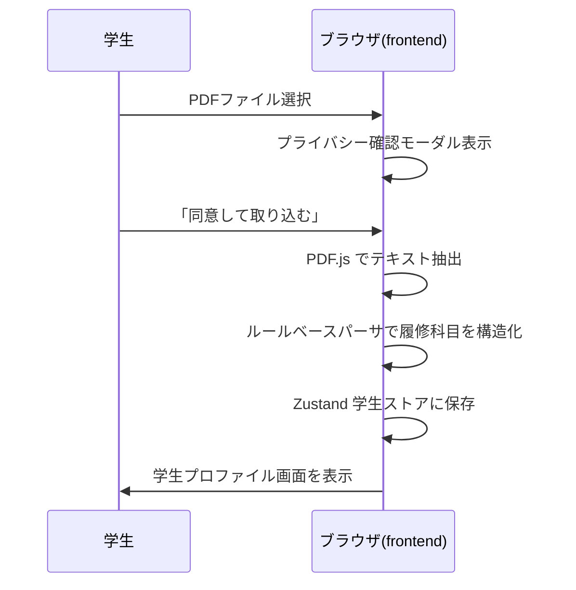
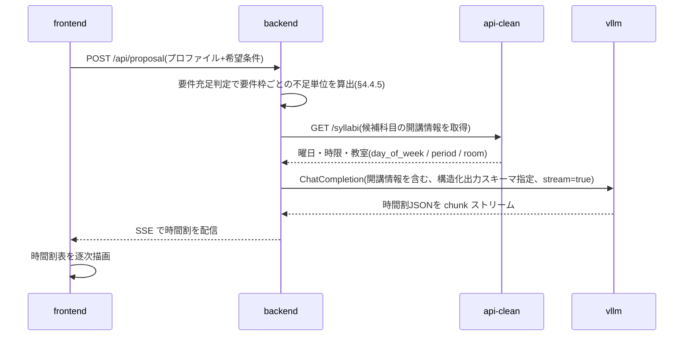
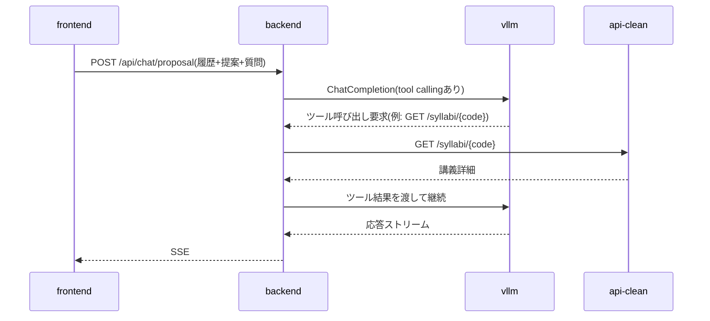
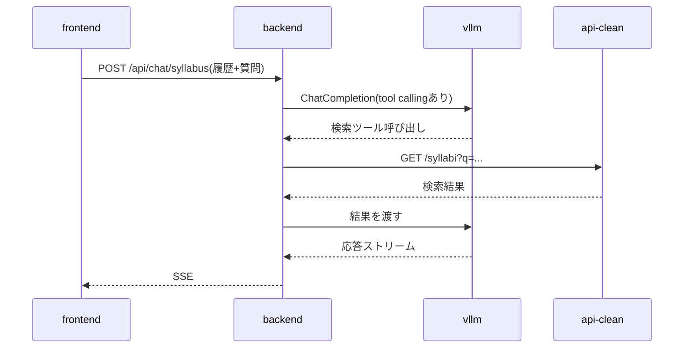

# 履修登録支援AIチャットボット 設計書(v0.9.38)— §6 API設計 / §7 主要シーケンス / §8 画面構成とルーティング

> 本ファイルは [`docs/design.md`](../design.md) の一部である。§番号は設計書全体で通し番号であり、他ファイルの節を `§X.Y` の形で参照する。全ファイルの対応表は [design.md](../design.md) の「0.3 本書の構成」を参照。

---

## 6. API設計

### 6.1 内部 API(frontend ↔ backend)

| メソッド | パス | 用途 | 応答形式 |
|---|---|---|---|
| POST | /api/proposal | 履修提案を生成 | SSE |
| POST | /api/chat/proposal | 履修提案に関するチャット | SSE |
| POST | /api/chat/syllabus | シラバス全体チャット | SSE |
| POST | /api/chat/syllabus/{code} | 講義単位チャット | SSE |
| GET | /api/syllabi | シラバス検索(一覧・絞り込み) | JSON |
| GET | /api/syllabi/{code} | シラバス詳細(講義ページ表示) | JSON |
| GET | /api/masters | 検索絞り込み用の値マスタ | JSON |
| GET | /api/curricula/{program_code}/{admission_year} | 履修要項データ参照(タグ表示用) | JSON |
| GET | /api/course-targets | シラバスコード → 対象課程(タグの履修可否判定用。§6.1.3) | JSON |
| POST | /api/requirements | 卒業要件の充足判定(要件枠ごとの不足単位) | JSON |
| GET | /api/healthz | ヘルスチェック(**公開経路からの死活確認はこちら**。§3.5.1) | JSON |
| GET | /healthz | ヘルスチェック(ネットワーク内から直に叩く用) | JSON |

チャット系(SSE)のリクエストには学生プロファイルと対話履歴を毎回含める(サーバ側で永続化しないため)。

`/healthz` だけがルート直下にあるため、**公開経路(`/pr-2026/api/*`)からは到達しない**。`/pr-2026/*` は frontend へ振り分けられるためである。外から死活を見るには `/api/healthz` を使う(§3.5.1)。

上表のパスは **backend が受けるパス**である。ブラウザおよびサーバ側描画から呼ぶときの**公開パスは `/pr-2026` を前置した `/pr-2026/api/...`** となる。ゲートウェイが `/pr-2026` を剥がして backend へ渡すためである(§3.5.2)。Next.js の `basePath` はページとアセットの生成先を変えるだけで `fetch()` のパスには前置されないため、**frontend は呼び出し先に `/pr-2026` を自分で含める**。

呼び出し元によって宛先が分かれる。backend の配置が決まったため(§3.4.2)、いずれも確定である。

| 呼び出し元 | 宛先 |
|---|---|
| ブラウザ(クライアントコンポーネント) | ゲートウェイと同一オリジンの `/pr-2026/api/...`(相対パス)。§3.5.2 の URL 構造から従う |
| サーバ側描画(RSC / `page.tsx` の `async` 関数) | 同一 Podman ネットワーク上の backend コンテナ(`http://pr2026-backend:8000/api/...`)。**ゲートウェイを経由しないため `/pr-2026` は付かない**。サーバ側の `fetch` は相対パスを解決できないため、オリジンを環境変数で与える |

いずれもハードコードせず、実行時の環境変数で与える(§3.2.1)。

**`lib/syllabus-api.ts` はサーバコンポーネント(`app/syllabus/page.tsx`、`app/syllabus/[code]/page.tsx`)とクライアントコンポーネント(`SyllabusTagList` 等の `fetchCurricula`)の双方から import される。** 宛先を単一の定数に置くとどちらか一方が必ず壊れるため、**オリジンはモジュール読み込み時に固定せず、呼び出しごとに解決する**(`lib/api_base.ts` の `apiBase()`。`typeof window` で呼び出し元を判別し、サーバ側は `BACKEND_ORIGIN` を読む)。この制約は到達経路の決定によらない。

**開発時はゲートウェイが居ない。** ブラウザからの `/pr-2026/api/*` は Next の開発サーバに届いてしまうため、`next.config.ts` の `rewrites()` がゲートウェイと同じ振り分けを代行する(本番では空を返し、振り分けはゲートウェイに委ねる)。

`POST /api/chat/proposal` は、学生プロファイル・生成済みの提案・対話全体を1本の `messages` で受ける。**`messages` の末尾(role: user)が今回の質問、それより前が履歴である。** `proposal` は必須、`messages` は1件以上で末尾は `user` でなければならない。末尾が `assistant`、`messages` が空、`proposal` が無い場合は 422 を返す。提案が §5.3 の検証(コマ重複など)に落ちる場合も 422 となる(`POST /api/proposal` と同じスキーマを使うため)。

```json
{
  "studentProfile": { "grade": 3, "program": "知能情報メディア課程", "completedCourses": [] },
  "proposal": {
    "courses": [
      { "syllabusCode": "B12345", "title": "情報基礎", "day": "月", "period": 3,
        "term": "前期", "credits": 2, "category": "必修", "reason": "情報メディア分野の必修のため。" }
    ],
    "totalCredits": 2,
    "summary": "必修を軸にした構成。"
  },
  "messages": [
    { "role": "user", "content": "前の質問" },
    { "role": "assistant", "content": "前の回答" },
    { "role": "user", "content": "この時間割は何単位?" }
  ]
}
```

`GET /api/syllabi` / `/api/syllabi/{code}` / `/api/masters` は、検索画面(§4.1 の `/syllabus` 一覧・検索および `/syllabus/[code]` 詳細)が使う読み取り専用エンドポイントで、backend は §6.2 の api-clean(`GET /syllabi` / `GET /syllabi/{code}` / `GET /masters`)を中継する。公開経路はゲートウェイの単一オリジンに統一され、`/` は frontend、`/api/*` は backend へ振り分けられる一方、api-clean は公開されない(§1.2)。したがって frontend は api-clean を直接呼べず、検索画面向けにも backend 側の口が必要となる。クエリパラメータは api-clean の `/syllabi`(`q` / `faculty` / `program` / `campus` / `term` / `day` / `period` / `year` / `instructor` / `grade` / `limit` / `offset`)を素通しする。検索結果に付す「必修 / 選択 / 修得済み」タグ(§8)は、この結果と `GET /api/curricula` の履修要項、ブラウザ内の学生プロファイルを frontend 側で突き合わせて生成する。突合はシラバスコードによる結合を第一とし、履修要項側のコードは開講年度ファイルの `resolved`(科目名 → シラバスコード。§5.1.4)から解決する。`not_offered` / `unresolved` の科目はコードを持たないためタグ付けの対象外とする。

**検索画面が扱う開講年度は1年度に固定する。** api-clean は2025年度の開講科目も保持しているが、履修要項側の名寄せ結果(`offerings/<開講年度>/`。§5.1.4)は2026年度分しか無く、教養教育科目の対応が揃っていない。他年度を選べるようにすると、タグ付けの対象外となる結果だけが並ぶ画面になる。したがって **frontend は `year` を定数(`lib/syllabus-api.ts` の `OFFERING_YEAR`)で与え、絞り込み UI から年度の選択肢を外す**(URL に `year` が付いていても見ない)。backend の `/api/syllabi` は引き続き `year` を素通しし、制限は置かない。他年度の `offerings/` が揃えばこの定数を増やすだけで開放できる。

**検索は条件に当たる全件を引き、ページ送りは表示だけの都合とする。** frontend の `searchCourses()` は `MAX_ROWS`(500)ずつページを辿って**全件を集めて返す**(`lib/syllabus-api.ts`)。理由は3つある。

1. **タグでの絞り込みが全件に効かないと使えない。** タグは学生プロファイルとの突合で決まり(§6.1.3)、プロファイルはブラウザにしか無いため api-clean の検索条件にできない。**さらに絞り込んだ結果をサーバへ送ることもできない** — 「修得済みのコード一覧」はその学生の成績そのものである(要件§5)。したがって振り分けはクライアントで閉じるしかなく、取得済みのページしか振り分けられないと**該当の少ないタグではほとんどのページが空になる**。2026年度開講・2024年度入学の知能情報メディア課程では、修得済み 184 コードが 41 ページに散り、**35 ページが「該当なし」**になっていた
2. **総ヒット数がタダで確定する。** `results.length` がそのまま総件数であり、下の数え上げが要らなくなる
3. **安い。** 先端理工学部・2026年度の全 1,219 件で **3リクエスト / 転送 gzip 約 22KB / 実測 0.23 秒**

ページ送りは**絞り込み後の並び**に対して行う。`offset` は URL に持ったまま(詳細画面から戻ったときに位置を保つため。§8)、クライアントがその値で絞り込み後の配列を切る。**絞り込みを変えたら `offset` を消す**(`lib/useFilterControls.ts`) — 絞り込みはクライアント状態、`offset` は URL にあるため、消さないと前の絞り込みでのページ位置が残る。

**総ヒット数はつねに確定する。** 全件を引くため `検索結果 N件以上` という表示は要らなくなった。絞り込みが効いているあいだは**絞り込み後の件数**を出し、絞る前の母数を併記する(「184件（1,219件中）」)。件数とページ数はどちらも絞り込み後の並びで決まるため、**サーバ側描画では描けない**(以前は見出しの件数を `page.tsx` が描いていたため、「1,219件」と出しながら16件しか並ばない食い違いが起きていた。§8)。

**検索ボックスの1語は、科目名 → 教員名の順で引く。** api-clean の `q` と `instructor` は別のパラメータであり、`q` は教員名に当たらない。一方 UI は科目名と教員名を1つの入力で受ける(§8)ため、frontend は `q` で引いて結果が空のときに同じ語を `instructor` で引き直す(`lib/syllabus-api.ts` の `searchCourses()`)。**両者を同時に送ってはならない。** api-clean のパラメータは AND 条件であり、必ず0件になる。教員名として引き直したことは検索結果の見出しに示す。

**教員名は、姓名の区切りの表記を展開して引き直す。** api-clean の `instructor` は**登録された表記のままの部分一致**(`instructor.kanji_name ILIKE`)であり、正規化を持たない。教員名は全角スペース区切りで登録されているため、半角スペースの「山田 太郎」でも区切りなしの「山田太郎」でも1件も引けなかった(**全角スペースを入れない限りフルネームで引けない**)。科目名の突合(§5.1.5 の `normalizeTitle()`)のようにこちら側で正規化して突き合わせることはできない — 照合するのは api-clean であり、**一覧は教員名を返さない**(§6.2)ため、手元で突き合わせるには全件の詳細を引く(1,200 リクエスト)しかない。したがって**入力の側を api-clean の表記に寄せて引き直す**(`lib/instructorName.ts` の `instructorQueries()`)。区切りの揺れは全角 / 半角 / 無しの3通りしかなく、区切りなしで入力されたときだけ姓の長さを1〜4文字で試す(日本語の姓の実質的な上限)。

| 入力 | 引く語 |
|---|---|
| `山田　太郎`(全角) | 入力どおりで当たる |
| `山田 太郎`(半角) | `山田　太郎` / `山田太郎` を足す |
| `山田太郎`(区切りなし) | 区切りを入れる位置が分からないので、姓の長さを1〜4で試す |
| `山田`(姓のみ) | 部分一致なので入力どおりで当たる |

**引き直すのは入力どおりの語が空振りしたときだけとする。** 姓のみ・全角区切りのフルネームは1回で当たるため、従来と同じ1リクエストで済む。引き直した結果は同じ教員に重ねて当たり得る(登録表記が科目ごとに違う場合)ので、シラバスコードで畳んでから返す。

**同じ規則を frontend と backend の双方に置く。** 検索画面は frontend が引き(`lib/instructorName.ts`)、シラバスチャット(§7.4)のエージェントは backend が引く(`app/agents/instructor_name.py` と `app/agents/tools.py` の `search_syllabi_by_instructor()`)。**両者は同じ規則に保つこと** — 食い違うと「検索画面では出るのに、チャットでは “その教員の科目は見つからない” と返る」というねじれが起きる(科目名の `normalize_title()` を frontend と backend の双方に置いているのと同じ理由。§5.1.5)。

**`GET /api/syllabi` では埋めない。** この口は api-clean の `/syllabi` を素通しする(上記)。引き直しは複数の語の結果を束ねることであり、**束ねた並びに対して `limit` / `offset` を意味づけられない**(語ごとに `offset` の指す位置が違う)。検索画面はこの口をページ送りに使わず全件を引く(§6.2)ため、引き直しは frontend 側で閉じられる。backend で埋めるのは、ページ送りを持たないチャットの検索ツールのほうである。

`GET /api/curricula/{program_code}/{admission_year}` は、このタグ付けが必要とする科目レイヤ(§4.4.3)を返す。**backend は次の3点を解決済みの状態で返し、履修要項の構造をクライアントに持ち込まない。**

- **マージ後の `courses` を返す**(教養教育科目ファイルの取り込み、`not_available_to_programs` による除外、他課程からの専門関連科目の導出。§4.4.3)。検索結果には他課程が開講する科目も現れるため、当該課程の設置科目だけを返すとその大半がタグなしになる
- **各科目にシラバスコードを合成して返す。** コードは `curricula/` 側になく開講年度ファイルの `resolved` が持つ(§4.4.2)ため、解決は backend が行う。frontend が `offerings/` を直接参照することはない。`not_offered` / `unresolved` の科目は空配列とする
- **当該課程の設置科目か、他課程から導出した専門関連科目かを区別するフラグ(`own`)を付す。** 導出科目の用途は §4.4.3 のとおり `related` / `free.faculty` スロットの判定に限られる。**その `type` は導出元の課程にとっての区分である。** 例えば「プログラミング及び実習Ⅱ」(Y001009010)は数理・情報科学課程の専攻科目で、知能情報メディア課程の履修要項には専門関連科目として `選択必修` で載る。これを「選択」と表示すると、その学生にとっての区分ではない値を見せることになる。したがって `own` が false の科目には**導出元の `category` / `type` をそのまま出さない**。実際に出すタグは §8.2 の表が定める(履修可 × 未修得なら `専門関連` のみ)。`buildTagMap()` はタグの候補を作るところまでを担い、履修可否(§6.1.3)と `own` を掛けて最終のタグを決めるのは `resolveTags()` である(`lib/syllabusUI.ts`)。ただし**修得済みだけは `own` を問わず付ける**。修得済みかどうかは学生の成績の事実であり、科目がどの課程の設置かに左右されない

#### 6.1.3 履修可否の判定

**履修要項は「科目」の単位で書かれており、その学生がその開講クラスを履修登録できるかを持たない。** 1科目に複数のクラスが対応し(§5.1.4)、どのクラスを履修できるかは課程ごとに決まっているため、履修要項側のデータだけではタグを正しく出せない。**判定の正本はシラバスの対象課程とする。** 規則は次の3分岐で、検索のタグ表示(frontend)と履修提案の候補抽出(backend)で共通である。

| シラバスの対象課程(`programs` / `faculties`) | 判定 |
|---|---|
| 学生の課程が `programs` に入っている | 履修可 |
| `programs` が空で、`faculties` に `先端理工学部` が入る | 課程指定なし。履修可 |
| それ以外 | 他課程指定のクラス。履修不可 |

**履修できないクラスにはタグを出さず、履修提案の候補にも載せない。** 判定を持たなかったときの実測(2026年度開講・2024年度入学の知能情報メディア課程)は次のとおりだった。

| | 変更前 | 変更後 |
|---|---|---|
| 検索結果でタグが付くコード | 430(うち **126 が誤り**) | 304(誤り 0) |
| 履修提案のプロンプトのクラス行 | 673(うち **189 が履修不可**) | 508(履修不可 0) |

誤タグ126件はすべてクラス指定のある教養教育科目10科目だった(仏教の思想A/B 各8件、英語総合1(A)〜4 各11件、スポーツ技術学A/B 各22件)。例えば「仏教の思想A」は11クラス開講され、火1の3クラスは電子情報通信+機械工学・ロボティクス課程、火2の2クラスは知能情報メディア課程、水1の3クラスは応用化学+環境生態工学課程、水2の2クラスは数理・情報科学課程、木5の1クラスは課程指定なしの後期開講(救済措置)である。履修要項側の対応表(`offerings/`)は科目名 → コードの対応しか持たず課程を区別しないため、11クラス全部に `必修` が付いていた。

**学修プログラムの帰属は持たない。** 履修要項の専門関連科目は「学修プログラムを構成する科目のうち他課程が主体となって開講する科目」であり(履修要項 s04)他課程の全科目ではないが、この帰属を別に持つ必要はない。2026年度開講・2024年度入学コホートで突き合わせると、**学修プログラム含有科目 242 コードは100%が全6課程対象**であり、**非含有の専攻科目 400 コードは97%(389)が主開講課程のみ**で、対象課程が帰属を代理している。加えて、学修プログラムの表(履修要項 s05【8】。PNG画像)に載らないのに複数課程へ開かれている `Y009` 系の共通科目(情報と職業・職業指導・地学概論・生物学概論・地学実験・生物学実験の11コード)は**対象課程でしか判別できない**ため、表を転記するとかえって取りこぼす。

**科目名の突合は正規化してから行う。** `curricula/` の科目名は履修要項の表記のまま転記する規約であり(§5.1.5)、正規化は**突き合わせる側の責務**である。大学のデータ自体が表記を混在させており、「仏教の思想A」は履修要項と api-clean の `course_title` が半角 `A`(U+0041)、Web シラバスの検索ページが**全角 `Ａ`(U+FF21)**である。成績表由来の科目名にも全角英数字や空白が混じるため、完全一致では外れる。規則は **NFKC 正規化 + 空白除去**で、backend は `app/curricula/requirements.py` の `normalize_title()`、frontend は `lib/courseTitle.ts` の `normalizeTitle()` が持つ。**両者を同じ規則に保つこと。** frontend 側に正規化が無かったとき、**卒業要件の残り単位(backend 計算)では修得済みなのに検索のタグ(frontend 計算)には出ない**というねじれが起きていた。

**課程名の比較は改称を吸収する。** 課程コード `06` は入学年度で名称が異なり(2024年度入学: 環境生態工学課程、2025年度入学: 環境科学課程)、api-clean は**両方を別々の課程として持つ**ため、文字列の一致で比べると取り違える(§4.4.2)。frontend は `lib/programs.ts` の `isSameProgram()`、backend は課程ファイルの `program.name_aliases` を使う。

**対象課程の取得経路は frontend と backend で異なる。** api-clean の `GET /syllabi`(一覧)は対象課程を返さない。1科目に複数の課程が対応するため `SELECT DISTINCT` から外されており、対象課程は `GET /syllabi/{code}` にしかない(§6.2)。1件ずつ引くと 1,200 リクエストになるため、どちらも**課程名で絞った一覧を課程ごとに引いて集合演算で組み立てる**。`program` は `cp.name = %s` の完全一致で、対象課程を持たないシラバスは絞り込みから落ちるため、**「どの課程の結果にも現れないコード」が課程指定なしのコード**である。

| | 判定する場所 | 対象課程の取得 |
|---|---|---|
| 検索のタグ | frontend(`lib/eligibility.ts` / `lib/syllabusUI.ts` の `resolveTags()`) | backend の `GET /api/course-targets` から**全件ぶんまとめて**受け取る(下記) |
| 履修提案 | backend(`app/agents/proposal_agent.py` の `fetch_eligibility()`) | 同じ手を backend 内で行う |

**`GET /api/course-targets?year=&faculty=` が、シラバスコード → 対象課程の対応をまとめて返す。** 検索のタグは絞り込みを全件に効かせる必要があり(§6.1)、そのためには**検索結果の全件ぶんの対象課程**が手元に要る。表示中の行だけ詳細を引く方式(担当教員名と同じやり方。§6.2)では足りない。

**対象課程が引けなくても一覧は出す。** タグは検索の付加価値であって前提ではないため、この口の失敗で画面ごと落としてはならない(`fetchCourseTargets()` の失敗は null として扱い、タグを出さずに続ける)。**対象課程が分からないコードに空配列を渡してはならない** — 空配列は「課程指定なし(＝履修可)」を意味するため、引けなかったコードをすべて履修可と扱い、誤タグが戻る。修得済みは成績の事実なのでこの場合も出る。

> **実際に事故が起きた。** frontend だけを入れ替えて backend を古いまま(この口を持たない)にしたとき、404 で検索画面が `error.tsx` に落ちた。**frontend と backend は揃えて入れ替える**必要がある(§3.2)。

**このレスポンスに学生データは1件も含まれない。** (開講年度, 学部)だけで決まるため ETag と `Cache-Control: public, max-age=3600, must-revalidate` を付けて再送を避ける。2026年度・先端理工学部で 1,219 コード / 約 99KB / **gzip 約 4KB** / 組み立て 10 リクエスト・実測 0.9 秒。組み立て結果は backend が (開講年度, 学部) ごとに保持するが、**`/api/curricula` と違い上流(api-clean)の更新で変わり得るため恒久キャッシュにはせず、期限を置く**。

**規則は本節の1か所に置き、実装は2か所に持つ。** 取得経路が違うため実装は分かれるが、判定そのものは上の3分岐だけである。片方だけを直す事故を避けるため、変更はこの節と両実装を必ず揃えて行う。

**対象課程が取れなかったコードにはタグを出さない。** 一覧は表示中のぶんだけ詳細を引いており、その取得が失敗したコードでは可否が判定できない。**履修可否の正本は対象課程である**という原則に従い、判定できないものについては何も主張しない(可否不明のまま「必修」と出すのは、この節が直した誤りと同じことになる)。

**履修提案では、1科目あたりのクラス数を絞る前に履修可否を掛ける。** 順序が逆だと、`MAX_CLASSES_PER_COURSE` が曜日・時限の早い順で切るため、他課程指定のクラスが早い時限に並ぶ科目で**履修できるクラスが1つも候補に載らない**。実測では4科目(英語総合1(A)・英語総合2(A)・スポーツ技術学A/B)がこの状態で、コードだけでなく曜日・時限が丸ごと違うため、コマ重複の判定も誤った前提で行われていた。

あわせて `graduation`(`total_credits` / `excluded_types`)を返す。卒業残り単位の表示(§4.4.5)に必要であり、これを返さないとクライアントは卒業必要単位数を知る手段を持たない。**設置科目の単位数の総和は卒業必要単位数ではない。** 要件枠ごとの不足単位は `POST /api/requirements` で得る。

```json
{
  "programCode": "02", "admissionYear": 2024, "offeringYear": 2026,
  "graduation": { "totalCredits": 124, "excludedTypes": ["随意"] },
  "courses": [
    { "title": "仏教の思想A", "category": "教養教育科目", "subcategory": "「仏教の思想」科目",
      "type": "必修", "credits": 2, "grade": 1, "term": "前期", "quarters": ["1Q", "2Q"],
      "kikan": false, "own": true, "syllabusCodes": ["G260110004", "G260110005"] }
  ]
}
```

`POST /api/requirements` は、学生プロファイル(既修得科目を含む)を本文で受け取り、要件枠ごとの修得済み単位・不足単位を返す。判定規則をクライアントへ渡さないための口であり、その根拠と責務の切り分けは §4.4.5 による。

`POST /api/proposal` のリクエストは、学生プロファイルと**課程コード・入学年度を別に**受ける。履修要項を引くキーは (課程コード, 入学年度) である(§4.4.2)一方、`StudentProfile.program` に入るのは成績表から採れる**課程名**であり、課程は改称され得るため識別子には使えない。入学年度もプロファイルには無い(成績表から採れない)ため、frontend が学年から算出して送る。課程名 → 課程コードの解決は frontend が持つ(`lib/programs.ts`。一覧の正本は `curricula/admission-<年度>/` の課程ファイルである)。

```json
{
  "studentProfile": { "grade": 3, "program": "知能情報メディア課程", "completedCourses": [] },
  "programCode": "02", "admissionYear": 2024,
  "preferences": "午前中の科目を多めにしたい"
}
```

`preferences` は任意の自由文で、§7.2.1 のプロンプトの「希望条件」節にそのまま入る(未指定のときは「特になし」)。**(課程コード, 入学年度) に対応する履修要項が無い場合は 404 を返す**(ストリームを開く前の前処理であるため。§6.1.1)。

#### 6.1.1 SSE の書式

SSE を返す4本は、いずれも `data: <JSON>` の1行1イベントで配信する(実体は `app/api/sse.py`)。イベントの種類は用途で2系統に分かれる。

**チャット系(`/api/chat/*`)**

| イベント | 内容 |
|---|---|
| `{"delta": "..."}` | 本文の断片。受け取った順に連結すると回答になる |
| `{"error": "..."}` | 生成中の失敗。表示用の文言のみを載せ、例外の詳細は載せない |
| `{"done": true}` | 終端。エラー時も最後に必ず流れる |

思考(reasoning)とツール呼び出しはクライアントへ流さない。本文が始まる前の空白だけの出力も捨てる(§6.3.1 のとおりチャット系は思考を有効にしており、ツール呼び出しの前に空白だけの本文パートが出ることがある)。

**履修提案(`/api/proposal`)**

| イベント | 内容 |
|---|---|
| `{"snapshot": {...}}` | 組み立て途中の `TimetableProposal`(§5.3)。生成中に何度も流れる |
| `{"result": {...}}` | 検証を通った確定版。1度だけ流れる |
| `{"error": "..."}` / `{"done": true}` | チャット系と同じ |

`snapshot` は §5.3 のスキーマの**全フィールドを省略可能にした写し**で検証したもので、未到達のフィールドが null になるだけでキーの構成は `result` と同じである。クライアントは両者を同じ描画コードで扱える。写しはスキーマから機械的に作る(手で並べ直すと §5.3 を直したときに snapshot だけが古い形で残る)。まだ JSON として読めない断片と、直前と内容が変わらないものは流さない。コマ重複の検査(§5.3)は写しには引き継がない。途中経過は未確定の値を含むためである。

**SSE を開いたあとは HTTP の状態コードを返せない。** したがって提案の前処理(§7.2.1)はストリームを開く前に済ませ、そこでの失敗は 404(対応課程外)・400(前提不足)・502(上流障害)で返す。開いたあとに起きた失敗は `error` イベントで伝える。

#### 6.1.2 キャッシュの扱い

- `GET /api/curricula/{program_code}/{admission_year}` は本文から作る **ETag** と `Cache-Control: public, max-age=3600, must-revalidate` を付し、`If-None-Match` が一致すれば 304 を返す。内容は `curricula/` / `offerings/` の更新(=デプロイ)でしか変わらず(§4.4.4)、学生データを含まない GET であるため、マージ後の全課程分(2024年度入学コホートで課程あたり568〜577科目、約129KB / gzip 約9KB)の再送を避けられる。本文と ETag は (課程コード, 入学年度) ごとに1度だけ組み立ててメモリに持つ
- `POST /api/requirements` は既修得科目を本文で受けるため `Cache-Control: no-store` を付し、ブラウザにも中間経路にも残させない(§4.4.5)
- SSE には `Cache-Control: no-cache` と `X-Accel-Buffering: no` を付す。後者は中継が応答をバッファリングして逐次配信を潰すのを防ぐためである。現行のゲートウェイは Caddy であり `reverse_proxy` は既定でバッファリングしないため、このヘッダは nginx 系の中継が前段に入った場合の保険として付し続ける(§3.2.1)

### 6.2 既存シラバスバックエンド API の利用

backend から以下の3つを利用する。**これがシラバスバックエンドに対して使う口のすべてである。**

- `GET /syllabi` — 検索(独自シラバス§4.5、シラバスチャット§4.6で使用)
- `GET /syllabi/{code}` — 詳細(講義ページ表示・講義単位チャットで使用)
- `GET /masters` — 値マスタ(検索 UI のドロップダウン候補に利用)

**`GET /syllabi` の検索条件の意味は次のとおり**(api-clean の `clean_api.py` で確認)。条件はすべて AND で結合される。

| パラメータ | 突合 |
|---|---|
| `q` | **科目名のみ**の部分一致(`subject.title ILIKE`)。**教員名には当たらない** |
| `instructor` | 担当教員の漢字名の部分一致(`instructor.kanji_name ILIKE`)。**正規化は無く、登録された表記のまま照合される**(姓名の区切りは全角スペース。§6.1) |
| `faculty` / `program` / `campus` / `term` | 名称の完全一致。候補は `/masters` |
| `day` / `period` / `year` / `grade` | 曜日1文字 / 1〜7 / 開講年度 / `grade_min <= x <= grade_max` |

**`GET /syllabi` は担当教員を返さない。** 一覧の SELECT は科目1行に畳まれており(`SELECT DISTINCT`)、担当教員は結合こそするものの `instructor` パラメータでの絞り込みにしか使っていない。教員名を持つのは `GET /syllabi/{code}` だけである。したがって**検索結果に教員名を出すには、表示中のページ分だけ詳細を引いて補う**(frontend のサーバ側描画で行う。`lib/syllabus-api.ts` の `fetchInstructorMap()`)。同時実行を抑え、取得した詳細は1日キャッシュし、失敗した科目は教員名なしで並べる。api-clean は無変更で使う前提(§1.1.1、§3.4.4)であり、一覧側に教員名を足す選択肢は取らない。

**`grading`(成績評価)は TEXT 列だが、中身は JSON 文字列である。** `{"評価項目": [{"項目", "割合", "基準", "備考"}], "自由記載": ...}` の形で、シラバスバックエンドが年度間の表記を揃えた結果である。**素のまま描くと画面に JSON が出る**ため、表示側で構造へ戻す(`lib/grading.ts` の `parseGrading()`)。構造化されていない生テキストの行もあり得るので、JSON として読めない値はテキストとして扱う。

**レスポンスの `count` は総ヒット数ではなく、そのページで返した件数**(`len(rows)`)である。api-clean に総件数を返す口は無く、`POST /sql` はゲートウェイが拒否する(§3.4.4)。

**総件数は全件を引いて得る。** かつては `limit=1` の空振り判定で `MAX_ROWS`(500)単位のブロックを特定し、最後のブロックだけを数えていた(検索1回につき余分に3〜4リクエスト)。**タグでの絞り込みを全件に効かせるため全件を引くようにした結果(§6.1)、この数え上げは不要になった** — `results.length` がそのまま総件数である。

**api-clean は DGX Spark 上にあり、この通信はホストを跨ぐ**(§3.4.4)。宛先は教員側のトークンゲートウェイであり、**base_url とトークンを環境変数で与える**(vllm 向けと同じ形。§6.3)。ゲートウェイは**上記3つと `/healthz` だけを通し、`POST /sql` を拒否する**(§3.4.4)。

これに伴う留意点が2つある。

- **ゲートウェイへ到達できないと、ここに挙げた3つの口がすべて失敗する。** 影響範囲と検知の要否は §3.4.4 に置く
- **ホストを跨ぐぶん所要時間が伸びる。** とくに §7.2.4 の一括取得は数百件規模をページ送りするため、`http_timeout`(既定 30 秒)で足りるかを実測する(§13)

**api-clean へ送るのは科目の検索条件のみとし、学生プロファイルは渡さない**(§4.2.3)。

`POST /sql` はエージェントに任意 SQL を書かせるリスクを避けるため使用しない方針とする。**ゲートウェイ側でも拒否するため、backend から到達する手段は無い**(§3.4.4)。

### 6.3 vLLM との連携

**backend は vllm を直接呼ばない。** 教員側が運用するトークンゲートウェイ(OpenAI 互換)を経由する(経路の実測は §3.4.3)。

- base_url はトークンゲートウェイのテキスト用エンドポイント、api_key は発行されたトークン(`Authorization: Bearer <token>` として送られる)
- PydanticAI の `OpenAIChatModel(<モデルID>, provider=OpenAIProvider(base_url=<ゲートウェイのURL>, api_key=<トークン>))` 形式で設定する(base_url / api_key はモデルでなく `OpenAIProvider` に渡す。旧称 `OpenAIModel` は現行 pydantic-ai で `OpenAIChatModel` にリネーム)
- **base_url・api_key・モデル ID はいずれも環境変数で与え、コードにもイメージにも埋め込まない。** トークンは有効期限を持ち、更新時に値が変わる(§3.4.3)
- モデル ID は `GET /v1/models` が返す値を用いる。不一致は `400 model_mismatch` となる
- ツール呼び出しは PydanticAI の `@agent.tool` で定義し、内部で api-clean を HTTP で叩く(ツールの実行は backend 側である。api-clean への到達もトークンゲートウェイ経由となる。§6.2)

**ゲートウェイ固有の応答を扱う必要がある。**

| 応答 | 意味 | backend の扱い |
|---|---|---|
| `503 busy` | 同一トークンで生成が進行中 | **即座に返る(待たされない)。**再送、または待ち行列に入れて待ち時間を提示する。学生に「混雑」として見せる文言を用意する(§3.4.3) |
| `401` | トークンが無い・不正・期限切れ・失効 | 全機能が停止する。運用として検知できるようにする(§13) |
| `400 model_mismatch` | モデル ID が接続先の期待値と異なる | 設定誤り。起動時の疎通確認で検出する |
| `413 payload_too_large` | 本文が上限(既定 16 MiB)を超えた | 履修提案のプロンプトは数万トークン規模であり通常は到達しないが、上限の存在を前提に置く |
| `502 upstream_unavailable` | vllm 側が応答しない | vllm の停止・再起動中。学生には一時的な不調として提示する |

**利用ログが100日間保存される。** プロンプトと応答が記録されるため、プロンプトに載せる学生データを最小化する(要件§5.5、§9、§7.2.1)。

#### 6.3.1 リクエスト単位の推論設定(思考の有無)

Qwen3.8 は**思考(reasoning)モデル**であり、本文の前に思考トークンを生成する。サーバ側は `--reasoning-parser qwen3` で思考と本文を分離しており(§4.3)、思考をクライアントへ流すことはない。**思考を出させるかどうかはリクエストごとに** `chat_template_kwargs.enable_thinking` で決める。PydanticAI からは `OpenAIChatModelSettings(extra_body={"chat_template_kwargs": {"enable_thinking": False}})` を `Agent(model_settings=...)` に渡す形で指定する。

| 呼び出し | 思考 | 理由 |
|---|---|---|
| 履修提案(§7.2 / `POST /api/proposal`) | **切る** | 下記の実機計測による |
| チャット系(§7.3〜§7.5) | 既定のまま(**有効**) | 自由文の対話であり、ツール呼び出しの要否判断を含む。1回のモデル呼び出しに100秒超かかることがあるが現状は許容している(§13) |

**以下の計測は Qwen3.6 で採ったものであり、Qwen3.8 では取り直す**(§13)。3.8 は 3.6 と同一アーキ・同一構成(§4.3)のため判断そのものは変わらないと見込むが、生成速度と思考の長さは重みに依存するため、本節末尾の `max_tokens` と `timeout` の妥当性は実測で確かめる。

**履修提案で思考を切る理由(2026-09-09 実機計測。DGX Spark + Qwen3.6-27B-FP8)。** 候補科目643行・約39,000トークンのプロンプトに対し、思考を有効にすると900秒経っても提案が返らなかった。このとき vLLM は 7.3 tokens/s で生成を続けており(`GPU KV cache usage` 17.5%、preemption なし)、停止や資源不足ではなく**思考が終わっていなかった**。600トークンで打ち切って観測しても本文には到達していない。`enable_thinking: false` を渡すと `final_result` の生成が即座に始まり、候補科目からの転記・不足要件枠への言及・希望条件の反映を含む提案が得られた。

提案は【候補科目】からの選択と転記が主であり、要件枠ごとの不足単位・開講曜日時限といった判断材料は backend が事前に揃えてプロンプトへ入れる(§7.2)。モデルに長い思考を求める課題ではない。

あわせて `max_tokens` と `timeout` を置く。出力が途中で切れると構造化出力の検証に落ち、作り直し(§7.2)が走って所要時間が倍以上になるためである。

### 6.4 書誌の補足(openBD)

**書影と書誌の詳細は openBD(<https://openbd.jp/>)から引く。** api-clean の書誌(`textbooks`)は書名・著者・出版社・ISBN・価格しか持たず(§6.2)、**その本がどんな本なのかを判断する材料が無い**。ISBN から openBD を引き、書影・内容紹介・目次・ページ数を補う(§8.1)。**本設計で唯一、backend を介さずに参照する外部サービス**である(§1.1)。

| 口 | `GET https://api.openbd.jp/v1/get?isbn=<ISBN>[,<ISBN>...]` |
|---|---|
| 認証 | 無し(公開 API・登録不要) |
| 応答 | **要求した順の配列。** 該当が無い要素は `null` |
| 呼び出す側 | frontend のサーバ側描画(`lib/openbd.ts`)。書影の画像そのものはブラウザが直接引く |

取り出す値は次のとおり。**欠けている項目はその行ごと出さない。**

| 項目 | 場所 | 備考 |
|---|---|---|
| 書影 | `summary.cover` | **無い本は空文字**。`https` 以外は混在コンテンツになるので捨てる |
| 内容紹介 | `onix.CollateralDetail.TextContent` の `TextType` = `03`、無ければ `02` | `03` が長い紹介、`02` が短い紹介。**HTML が混じることがある**ので、素のテキストとして出す(タグは落とす。`dangerouslySetInnerHTML` は使わない) |
| 目次 | 同 `TextType` = `04` | 改行がそのまま入っている |
| ページ数 | `onix.DescriptiveDetail.Extent` のうち `ExtentUnit` = `03`(ページ) | |
| 刊行年月 | `summary.pubdate` | `201806` / `20180709` の形。年月まで出す |
| シリーズ | `summary.series` | **装丁の種別が入っていることがある**(有斐閣の単行本が `単行本` で返る)。そのまま出すと読む側に何も伝わらないので落とす |

**書誌ページへのリンクは版元ドットコム(`https://www.hanmoto.com/bd/isbn/<ISBN-13>`)に出す。** openBD の書誌はここが集めているため、**openBD が書誌を返した本は版元ドットコムにページがある**(洋書を含め実地に確認済み。未登録の ISBN は 404 になる)。したがって**リンクを出すのは openBD が書誌を返した本だけ**に限る。ISBN-13 でしか引けないので、こちらの持つ生値ではなく **openBD が返す `summary.isbn` を使う**(ISBN-10 で問い合わせても13桁に直って返るため、桁の変換を自前で持たずに済む)。

**在庫状況(`ProductSupply.SupplyDetail.ProductAvailability`)は使わない。** 実データでは `99`(不明・その他)しか返っておらず、品切れ・絶版の判断には使えない。

規定は4つある。

- **1科目ぶんを1リクエストにまとめる。** `isbn` はカンマ区切りで複数取れる。書誌は1科目で最大16件あり、1件ずつ引くと講義詳細の描画が16往復ぶん遅くなる
- **引けなかったときは書影なしとして続ける。** 例外・非200・タイムアウト(3秒)はすべて空の対応表に畳み、講義詳細は今までどおり描く。openBD は本サービスの可用性の外にあり、**この口の失敗で講義詳細を落としてはならない**
- **「引けない」ことのほうが多い前提で作る。** openBD の書誌は版元ドットコムに登録されたものが中心で、大学の指定図書(学術書・専門書)は書影も紹介文も欠けることがある。引ける本と引けない本が混ざるため、**枠の大きさは書影の有無で変えず**、**書名を押して開けるのも引けた本だけ**にする(§8.1)
- **ISBN は正規化してから投げる。** 大学のデータはハイフンの有無が揃わず全角で入っている値もある(§8.2 の科目名と同じ事情)。NFKC で寄せて記号を落とし、ISBN-13(13桁)か ISBN-10(9桁＋数字か X)だけを通す。同じ本がテキストと参考文献の両方に載ることがあるため、正規化した値を鍵に重複を畳む

**キャッシュは1週間で再検証する。** 刊行済みの本の書影はまず変わらない。

**学生の情報は一切送らない。** 送るのは ISBN だけであり、誰が見ているかに依存する値を含まない。ブラウザが画像を引く際も `referrerPolicy="no-referrer"` を付け、**閲覧中の講義の URL を openBD へ渡さない**(要件§5、§9)。

---

## 7. 主要シーケンス

### 7.1 成績表PDF取り込み



ネットワーク通信は一切発生しない(要件§5.2、§5.3を担保)。

### 7.2 履修提案生成



**応答時間は出力トークン数でほぼ決まる(2026-09-09 実機計測)。** 生成は約 7.3 tokens/s であり、プロンプト39,000トークンのプリフィルは約20秒で済む一方、CAP いっぱいの11科目の提案(約1,900トークン)には4〜5分かかる。思考(reasoning)は切る(§6.3.1)。frontend はこの待ち時間を前提とし、確定を待たずに SSE の逐次配信で時間割を描く(§8 の `/proposal`)。

時間割(曜日×時限)の組み立てに必要な開講曜日・時限は、履修要項 YAML ではなく api-clean が保持する(§5.1)。backend は LLM 呼び出しの前に候補科目の開講情報を api-clean から取得し、コマ重複のない時間割を生成できるようプロンプトに含める。**この取得はホストを跨ぐ**(公開 VM → トークンゲートウェイ → DGX Spark。§3.4.4)ため、所要時間と失敗時の扱いは §6.2 の留意点に従う。なお、週複数コマ開講の科目が `day_of_week` / `period`(1科目につき1組)でどう表現されるかは実データで確認する。

#### 7.2.1 プロンプトの組み立て

**提案エージェントはツールを持たない。** 提案に要る事実(要件枠ごとの不足単位・候補科目・開講情報)は backend が事前に集め、1つのプロンプトに書いて渡す(実体は `app/agents/proposal_agent.py`)。提案は候補科目からの選択と転記が主で対話的な探索を要さず、かつ思考を切っている(§6.3.1)ため、ツールを呼ぶか否かの判断をモデルに委ねると、呼ばれないまま推測で埋められる危険がある。tool calling を伴うのは提案後の対話(§7.3)である。

組み立ては次の5段階を順に行う。各段階は単体テストできるよう関数に分ける。

1. **履修要項の解決** — (課程コード, 入学年度)でマージ済みの履修要項を引く(§4.4.3)。無ければ 404
2. **要件充足判定** — §4.4.5 の純関数を **HTTP を経由せず直接呼ぶ**。要件§4.3.2 の「単位数の最適化」は要件枠ごとの不足単位を要する
3. **候補科目の抽出** — 次のすべてを満たす科目に絞る
   - `type != "随意"`(卒業要件単位に算入されない。§5.1.5)
   - `grade <= 学生の学年`(配当年次は「この年次**から**履修可能」の意。§5.1.5)
   - 未修得(合格した科目とのみ突合する。不合格・履修辞退の科目は未修得であり候補に残す)
   - シラバスコードを持つ(`not_offered` / `unresolved` の科目は時間割に置けない。§5.1.4)

   マージ済みの `courses` には他課程から導出した同名の専門関連科目が複数入り得る(§4.4.3)。ここでは科目名で1件に寄せ、当該課程の設置科目(`own`)を優先し、次いで課程コードの小さい出典を採る(§4.4.5 の科目索引と同じ順序)
4. **開講情報の突合** — 候補のシラバスコードに対応する曜日・時限・教室を api-clean から取る。`GET /syllabi?year=<開講年度>` を**ページ送りで一括取得**し、候補のコードだけを索引に残す。1件ずつ `GET /syllabi/{code}` を引かないのは、候補が数百件規模になるためである。1クラスも突合できなかった科目は、曜日・時限が分からず時間割に置けないため候補から外す。**したがって api-clean へ到達できない状態では候補が全滅し、提案が成立しない**(§3.4.4)。同名で多数のクラスが開講される科目(「英語総合1(A)」で22クラス、「スポーツ技術学A」で32クラス)はプロンプトを占有するため、曜日・時限・コードの昇順で上位数件に絞り、残りは件数だけを添える
5. **整形** — 【学生情報】【卒業要件の充足状況】【履修登録単位数の上限】【再履修の対象】【候補科目】【希望条件】の6節に並べる。候補科目は**1行1クラス**とし、`[シラバスコード] 科目名 | 区分 | 履修区分 | 単位 | 配当年次 | 学期 / 曜日時限 / 教室` の形で、モデルが値を転記するだけで済むようにする。CAP(§5.1.2 `registration_limits`)の節では学生の学年に対応するセメスター(1年前期を1として `2×学年-1` と `2×学年`)に印を付ける。次学期が前期・後期のどちらかはプロファイルから決まらないため、両方を該当として示し判断はモデルに委ねる

**プロンプトに載せる学生データは最小にする(要件§5.5、§9)。** プロンプトと応答はトークンゲートウェイの利用ログに100日間記録されるため(§3.4.3)、次を守る。

- **氏名・学籍番号は渡さない。**もともとブラウザ内の学生プロファイルにも保持していない
- **評語(秀・優・良・可等)と GPA は渡さない。**要件充足判定は合否のみで行う(要件§4.2)
- **修得済み科目の一覧は渡さない。**手順3の抽出条件により候補は未修得科目に限られるため、修得済み科目が提案に現れることはなく、一覧を渡す必要がない。進捗は【卒業要件の充足状況】の集計値で足りる
- **不合格・履修辞退の科目は【再履修の対象】として科目名のみ渡す。**再履修の要否はモデルの判断材料であり、これは落とせない。不合格と履修辞退の別は提案に影響しないため「未修得」に丸める

この措置を講じてもなお、課程・入学年度・学年と未修得科目の組合せから個人が推定される可能性は残る。要件§5.6 で学生に明示する。

**実装は未対応である**(2026-09-13 時点)。`app/agents/proposal_agent.py` の `_format_completed()` は修得済み科目名と単位数を渡しており、上記への変更と、変更後に提案の質が落ちないことの実機スモークによる確認が要る。

役割定義と規則は毎リクエスト同じであり、`Agent(instructions=...)` に固定で持たせる。学生ごとの事実は上記のプロンプトで渡す。

```
あなたは龍谷大学先端理工学部の履修登録を支援するAIアシスタントです。
与えられた学生の状況から、**次の学期に履修する時間割**を提案してください。

提案は次の規則に従ってください。
1. 提案してよいのは【候補科目】に挙がっている科目だけである。一覧に無い科目名やシラバスコードを作り出してはならない。
2. 各科目の syllabusCode・title・credits・term・day・period は、【候補科目】の行に書かれている値をそのまま転記する。推測して補わない。
3. 同じ曜日・時限・学期に2科目以上を割り当ててはならない。曜日・時限が「未定」の科目(集中講義など)はこの制約の対象外とする。
4. 合計単位数は【履修登録単位数の上限】を超えてはならない。
5. 【卒業要件の充足状況】で不足している要件枠を優先して埋める。不足単位を大きく超える科目数を詰め込まない一方、卒業に必要な単位を取り残さない。過不足のない分量にすること。
6. 【再履修の対象】に挙がっている科目は未修得であり、提案してよい。
7. 【希望条件】がある場合はそれを尊重する。卒業要件と両立しない希望は、summary でその旨を説明する。
8. reason には、その科目を勧める理由(どの要件枠を埋めるか、希望条件のどれに合うか)を40字以内の1文で書く。
9. summary には提案全体の方針と履修上の注意点を2〜4文で書く。先修要件・進級要件・抽選科目など確認が要る点があれば触れる。
```

規則1・2が転記を強く縛るのは、候補一覧に無い科目名やシラバスコードを作られると、そのままでは履修できない時間割になるためである。規則3のコマ重複は §5.3 の検証でも拒否するが、検証に落ちると作り直しが走って所要時間が倍以上になる(§6.3.1)ため、プロンプト側にも置く。規則5が「過不足のない分量」を求めるのは要件§4.3.2 による。

回答内容は LLM 依存で非決定的なため、単体テストで確かめるのは各段階の関数の入出力と、規則がプロンプトに載ることまでとし、提案が実際に成立するかは実機スモーク(`backend/scripts/smoke_proposal.py`)で確認する(§12.3)。

### 7.3 提案チャット



#### 7.3.1 システムプロンプト

backend は毎リクエスト、次のプロンプトを `instructions` としてエージェントに渡し、末尾に提案を camelCase の JSON のまま【現在の提案】として連結する(実体は `app/api/chat_proposal.py` の `_PROPOSAL_PROMPT`)。

```
あなたは龍谷大学の履修登録を支援するAIアシスタントです。
学生に提示済みの履修提案(時間割)についての質問に日本語で答えてください。
講義の内容を問われたときは、ツールでシラバスを検索・参照してください。

回答は次の規則に従ってください。
1. 提案の内容は【現在の提案】に書かれているものがすべてである。そこに無い科目を提案済みであるかのように書かない。
2. 講義の内容・評価方法・教科書などシラバスの事項は、ツールが返した内容だけを根拠にする。ツールを使わずに答えない。
3. シラバスの語をそのまま使う。より具体的な語や製品名への言い換えをしない(例:「文書作成ソフト」を「Word」と書き換えない)。
4. 科目名・単位数・曜日・時限・学期は【現在の提案】の値をそのまま用いる。自分で計算・推定しない。合計単位数は totalCredits を答え、これが null のときは不明と答える。
5. 卒業要件の充足状況は、【現在の提案】の summary と各科目の reason に書かれている範囲でのみ述べる。不足単位を自分で算出しない。
6. 同じ科目名で複数のクラスが開講されている場合は、どのクラスの情報かを講義コード・担当教員・サブタイトルで明示し、他のクラスにも当てはまるかのように書かない。
7. 提案の変更を求められたときは、変更案を文章で示すにとどめる。時間割を差し替えたかのようには書かず、実際の作り直しは提案の再生成で行うと案内する。
8. 推測を述べる場合は、推測であることを明示する。
9. 情報が無い事項は、無いと答える。
```

提案チャットはシラバスチャット(§7.4)と同じ `chat_agent` を共用し、専用のエージェントは作らない。提案を camelCase の JSON に直して `instructions` に載せることで役割の差をそこで吸収しているためである。

規則4・5が科目名・単位数・曜日・時限・学期、合計単位数(`totalCredits`)、卒業要件の充足状況(`summary`・各科目の `reason`)を【現在の提案】の値に固定しているのは、提案チャット固有の危うさが「提案そのものを言い直すうちに中身が変わる」ことにあるためである。これらは提案に書いてあり、モデルが数え直す必要はない。

規則7は、対話の中で時間割を差し替えたかのように書かせないためのものである。作り直しは提案の再生成(§7.2)で行う。規則6はシラバスチャットの規則6(§7.4.1)と同じ文言であり、同じ誤りに同じ規則を当てる。

回答内容は LLM 依存で非決定的なため、単体テストで確かめるのは規則がプロンプトに載りモデルに渡ることまでとし、規則の効果は実機スモークで確認する。提案チャット専用のスモークスクリプトは未整備であり、§13 に挙げる。

### 7.4 シラバスチャット(全体)

要件§4.6「シラバス全体に対する質問」。



#### 7.4.1 システムプロンプト

backend は毎リクエスト、次のプロンプトを `instructions` としてエージェントに渡す(実体は `app/api/chat_syllabus.py` の `_SYLLABUS_PROMPT`)。§7.5 も同じ本文を先頭に置き、その後ろに対象講義の詳細を連結する。

```
あなたは龍谷大学の履修登録を支援するAIアシスタントです。
学生のシラバスに関する質問に日本語で答えてください。
必要に応じてツールを使ってシラバス情報を検索・参照してください。

回答は次の規則に従ってください。
1. ツールが返した内容だけを根拠にする。シラバスに書かれていない事項を補わない。
2. シラバスの語をそのまま使う。より具体的な語や製品名への言い換えをしない(例:「文書作成ソフト」を「Word」、「ネットワークストレージ」を「クラウド」と書き換えない)。
3. シラバスにない形容や評価を付け加えない(例:「実践的な」)。
4. 週数・回数・期間などの数値は、シラバスに書かれている場合だけ示す。自分で計算・推定しない。
5. 必修・選択必修・推奨といった履修要件の判断はしない。シラバス検索ツールはこれを判断できる情報を返さないため、履修要項で確認するよう案内する。
6. 同じ科目名で複数のクラスが開講されている場合は、どのクラスの情報かを講義コード・担当教員・サブタイトルで明示し、他のクラスにも当てはまるかのように書かない。
7. 推測を述べる場合は、推測であることを明示する。
8. シラバスに情報が無い事項は、無いと答える。
```

規則2〜4が個別の言い換えを名指ししているのは、2026-09-04 の実機検証で**捏造が装飾部分に集中して現れた**ためである。科目名・単位・担当教員・各回の内容といった骨格は原典どおりで、誤りは「文書作成ソフト」→「Word」、「ネットワークストレージ」→「クラウド」のような一般語の具体化、原典にない概念(プライバシー保護)の追加、`course_plan` の回数からの開講週数の推定、原典にない形容(「実践的な」)の付加として出た。「シラバスにない事を書くな」という一般規則だけではこれらは抑止されない。LLM の側にはいずれも言い換え・要約の範囲内に見えるためである。したがって観測された誤りの型を具体例つきで挙げる。

規則5は、必修・選択必修の判定に使える情報をシラバス検索ツールが返さないことによる。課程の紐付け(`programs`)は返るが、これは「どの課程の科目か」を示すのみである。**必修・選択必修の別は api-clean から取得できない**(§1.1.1)。科目区分を持つ `syllabus_attribute` が空であり、`note`(例: `Y1000 ◎`)の意味も未解明であるためである(§13)。判定の根拠が無い以上、履修要項側で確認させる。**科目区分がツールから取れるようになった時点で、この規則は見直す。**

規則6はプロンプト単独では働かない。同名科目が何クラス開講されているかを LLM が知る手段が無く(`search_syllabi` は api-clean のレスポンスをそのまま返す)、規則は「知っていれば書け」としか作用しないためである。**クラス数をツールの返却値に含める**(§13)。

回答内容は LLM 依存で非決定的なため、単体テストで確かめるのは規則がプロンプトに載り両ルートでモデルに渡ることまでとし、捏造が実際に消えたかは実機スモーク(`backend/scripts/smoke_chat_syllabus.py`)で確認する。

### 7.5 シラバスチャット(講義ページ単位)

要件§4.6「講義ページ単位の質問」。frontend は現在表示中の `syllabus_code` を含めて送信。backend は最初にその講義詳細を取得し、システムプロンプトの一部としてコンテキストに含めたうえで LLM に渡す。

---

## 8. 画面構成とルーティング

| パス | 画面 | 主な機能 |
|---|---|---|
| / | 学生情報入力 | 手入力フォーム、PDF取り込み、プライバシー確認ダイアログ(要件§5.6) |
| /import | 成績表の取り込み | PDF取り込みの手順表示、解析失敗時の手入力フォールバック、デモモードの読み込み(§11) |
| /proposal | 履修提案 | 時間割表示、提案チャット(要件§4.3、§4.4) |
| /syllabus | 独自シラバス一覧 | 検索、タグ表示(状態 / 区分 / 履修区分の3軸。要件§4.5) |
| /syllabus/[code] | 講義詳細 | シラバス情報、講義単位チャット(要件§4.6) |
| /mydata | マイデータ | 取り込んだプロファイルの確認・編集・破棄(要件§4.1、§4.8) |
| /chat | シラバスチャット | シラバス全体に対する質問(要件§4.6) |
| /privacy | プライバシーポリシー | データの流れの図解、要件§5の規定説明 |

**取り込み完了画面の行き先は履修提案だけではない。** シラバス検索への入口も同じ画面に置く(PC は `履修提案を見る` の下に、モバイルは「次のステップ」の3枚目に)。取り込んだプロファイルは**検索結果のタグ付けに効く**(§6.1.3)ため、取り込み直後は「自分にとっての必修・選択・修得済み」が付いたシラバス検索が使えるようになっている。そこへ辿り着く手段が履修提案経由しか無いと、要件§4.5 の主機能への導線が実質1本になる。

`/import`・`/mydata`・`/chat` の3本は当初の設計には無く、実装で追加した。`/` は画面幅の広い端末向けに取り込みと確認を1画面へ収めているが、狭い端末では手順を分ける必要があり、取り込み(`/import`)と確認・編集(`/mydata`)を別ルートに切り出した。`/chat` は、講義を特定しない質問(要件§4.6 の「シラバス全体に対する質問」)の入口が `/syllabus/[code]` の講義単位チャットしか無かったために設けた。

### 8.1 講義詳細（`/syllabus/[code]`）の情報設計

**開講の表示は `term_schedule_raw` を整形して使い、1か所にだけ出す。** api-clean の `day_of_week` / `period` は1コマ分しか持たないため、`２Ｑ　火４・火５` のような複数コマ科目では2コマ目が落ち、集中講義(2026年度で 263 件)では両方が null になる。生値には開講期とコマがそのまま入っているので、**全角の数字を半角に寄せ、`月３` を `月3限` に直して出す**(`lib/schedule.ts`)。`３Ｑ　金２、４Ｑ　金２` のように期が分かれる科目は行を分ける。開講期はこの1か所にだけ置き、見出しのバッジには出さない。

**基本情報にはラベルを付ける。** 開講・担当教員・単位・配当年次・場所・対象学部(課程)をラベルと値の組で並べる。アイコンと値だけを横に並べると、`オンライン` がキャンパスなのか授業形態なのか、`2年次～4年次` が何の年次なのかが読み取れない。

**api-clean が返しているものを捨てない。** 書誌(`textbooks`)は自由記述とは別に構造化されて返っており(2026年度でテキスト 607 件・参考文献 1,206 件)、書名・著者・出版社・価格まで出す。

**書影は ISBN から openBD に引き、引けたものだけ出す(§6.4)。** 書名の文字列だけが縦に並ぶ一覧では、指定された本が手元のどれなのかを本の見た目で照合できない。**ただし書影が付くのは一部の本だけ**(openBD の書影は版元ドットコム登録分に限られる)なので、**引けなかった本の枠は書影と同じ大きさの背表紙アイコンのままにする。** 書影の有無で行の高さが変わると、1科目に何冊も並ぶ書誌が階段状になる。

**書名を押すと、その本の内容紹介・目次・ページ数と、版元ドットコムの書誌ページへのリンクが開く(§6.4)。** 書名・著者・出版社だけでは、その本が何を扱っていて講義にどう関わるのかが分からない。**押して開けるのは openBD が書誌を返した本だけ**にする — 引けなかった本は押しても出せるものが無く、押せるように見えるほうが誤りである(タグを「判定できないものには出さない」(§8.2)のと同じ扱い)。**開閉は `<details>` で組み、この木をクライアントコンポーネントにしない。** 開閉のためだけに講義詳細へクライアント JS を足す必要はなく、`<details>` はキーボード操作と支援技術への対応を素で持つ。**逆に、紹介文も目次も無い本でもパネルは開く** — 版元ドットコムへのリンクはどの本にも出せるので、そこから先を辿れる。

**備考(`note`)は履修登録の注記であり、扱いを3つに分ける。** 2026年度は1,512件すべてに値が入っており、中身は (1) 登録方法 — `【抽選登録科目】`(392件)・`【オープン登録科目】`(221件)、(2) ラベル付きの注記 — `【対象】T:情報メディア学科、Y:知能情報メディア課程` の形、(3) 履修要項の記号 — `Y4000` と `◎`(840件)のような科目区分コードと必修記号、に分かれる。**抽選かオープンかは履修できるかどうかそのものなので、これだけを見出しのタグとして出す。** (2)はラベルと値に分け、(3)は原文のまま並べる。**(3)を言葉に開いて書き換えない。** 記号の対応は履修要項側の定義であり、シラバスの値だけからは確定できない(§13)。

**同じことを2か所に書かない。** 備考の `【対象】` は 238 件あるが、うち 102 件は基本情報の対象課程と同じ内容であり、落としてよい。残す条件は、対象課程に無い課程を挙げているか(api-clean の課程マッピングが欠けている場合がある)、`留学生` のように課程では表せない条件を書いている場合に限る。**残すときも名前は組み立て直さず、名前空間を示す `Y:` だけを外す。** `T:` で始まる節は旧学科(理工学部)向けの表記であり、本システムの利用者である先端理工学部の学生には当たらないため落とす(`lib/courseTarget.ts`)。

**自由記述の改行は、折り返しのぶんだけ畳んでから出す。** api-clean の `summary`(授業概要)などは元の教務システムの固定幅のまま返っており、`…情報科学の基礎となる離散数` / `学の考え方を学ぶ。` のように**語の途中で改行が入っている**。講義詳細は本文を画面幅に合わせて流すため、この改行をそのまま出すと本文と無関係な位置で行が切れる。一方で、段落や箇条書きの区切りとして書き手が入れた改行は残さなければならず、**両者は本文からは見分けられない**。そこで**折り返しの証拠がある改行だけを畳む**(`lib/syllabusText.ts` の `unwrapWrappedLines()`。描画は `RichText`)。畳む条件は3つで、(1) その行が最長行と同じ桁数まで埋まっている(幅が尽きた以外に切れる理由がない)、(2) その行が句点で終わっていない、(3) 次の行が箇条書き・番号で始まっていない、である。**(2) を条件に入れるのは、文末の改行が書き手のものである可能性を捨てないため**であり、畳まずに残るのは文と文のあいだの改行だけで読めなくはならない。逆にここで畳むと、書き手が分けた文を1つにつないでしまう。**最長行が40桁に満たない本文には手を触れない** — 固定幅の折り返しではなく、短く書き分けた本文とみなす。つなぎ目は詰めるが、英字どうしは単語が溶けるため空白を挟む(URL の途中は詰める)。

**左は読み物、右は参照物に分ける。** 授業概要・到達目標・授業方法・授業外学習・授業計画を左に、成績評価・受講に際しての注意・備考・テキスト・参考文献を右に、この順で置く。**書誌は縦に長くなるので右の最後に置く。****縦に積むと本文がいたずらに長くなる**ためで、書誌は1科目で最大16件あり、これを本文側に入れると講義詳細の高さが5割増しになる。

**講義単位チャットの質問サジェストは、その科目のシラバスに対応する記述があるものだけを出す。** 講義単位チャットは対象講義のシラバスをそのまま渡し、「ツールが返した内容だけを根拠にする」「情報が無い事項は無いと答える」という規則で答えさせる(§7.4.1)。**対応する項目が無い質問は必ず「書かれていません」で終わる**ため、固定の文言を置かず、その科目が持つフィールド(`grading` / `textbooks` / `outside_study` / `goals` / `course_plan` / `methods` / `advice`)から組み立てる(`lib/courseQuestions.ts`)。例えば「課題の分量はどのくらい?」はシラバスに対応する項目が無く、多くの科目で空振りする。履修要件(必修 / 選択必修)の判断は §7.4.1 の規則5 で禁じているため入れない。

#### 8.2 タグ

**タグは一覧と詳細の両方に出す。** 突合は `lib/useTagMap.ts` に1つだけ置き、一覧(PC・モバイル)と詳細で同じ結果になるようにする。**`useTagMap()` は `Map` ではなくタグを決める関数を返す。** タグは履修要項との突合と履修可否の判定(§6.1.3)の2段でできており、関数として渡すことで呼び出し側が2段目を掛け忘れられないようにする。**履修できないクラスにはタグを出さない**ため、タグが付かない科目は「その学生には関係がないか、判定できなかったもの」である。

**タグは3つの軸に分ける。** 卒業要件の枠は **(区分 × 履修区分)** で決まっており(`basic.required` = 専門基礎科目 × 必修、`applied.elective` = 専門応用科目 × 選択、…。§5.1.5)、1つの軸に潰すとその対応が消える。学生が「この科目がどの枠を埋めるのか」を読み取れるようにするため、履修要項の構造をそのまま出す。要件§4.3.2 の「単位数の最適化」を学生が自分で判断する材料でもある。

| 軸 | 値 |
|---|---|
| 状態 | `修得済み` |
| 区分 | `教養教育` / `専門基礎` / `専門応用` / `専門関連` |
| 履修区分 | `必修` / `選択必修` / `選択` / `随意` |

出し方は次のとおり(`lib/syllabusUI.ts` の `resolveTags()`)。並びは **状態 → 区分 → 履修区分** に固定する。「もう取ったか」→「どの枠か」→「取る必要があるか」の順で、学生が途中で判断を打ち切れる。

| 状況 | 出すタグ |
|---|---|
| 履修不可(§6.1.3) | なし |
| 履修可 × 修得済み | `修得済み` + 区分 |
| 履修可 × 未修得 × 自課程の設置科目 | 区分 + 履修区分 |
| 履修可 × 未修得 × 他課程の設置科目 | `専門関連` のみ |
| 履修要項に無い | なし |

**履修区分を出さない場合が2つある。** (1) **修得済みのとき。** 履修区分は「これから履修する必要があるか」を示す情報であり、単位を修得した科目では意味を持たない。バッジも2つに収まる。(2) **他課程の設置科目(`own` が false)のとき。** その `type` は導出元の課程にとっての区分であって、閲覧している学生にとっての区分ではない(§6.1)。その学生にとっての区分は**専門関連科目**であり、`related` → `free.faculty` の要件枠に計上される(§4.4.3)。

**`選択必修` と `随意` を欠かしてはならない。** 従来は `選択必修` を `選択` に丸め、`随意` はタグなしにしていた。`選択必修` は2024・2025年度入学コホートで 142 科目あり(専門基礎24・専門応用52・教養66)、`随意` は 20 科目ある。**知能情報メディア課程の専攻科目には `選択必修` が1件も無い**ため第1フェーズでは露見しなかったが、他課程(数理・情報科学課程の専門応用13科目、電子情報通信課程の専門基礎9・専門応用13科目など)へ広げると必ず問題になる。`随意` は**卒業要件単位数に算入されず**(`graduation.excluded_types`)履修提案の候補からも外れる科目であり、他と区別が付かないのは危ない。

**色は履修区分にだけ使う。** 区分は「どの卒業要件枠に属するか」を示す分類であって緊急度の軸ではなく、色を割ると履修区分と競合してどちらを先に読むべきか分からなくなる。区分は4値とも共通の落ち着いた配色にし、色の差は必修 / 選択必修 / 選択 / 随意 にだけ与える(`随意` は卒業要件に算入されないため彩度を落とす)。**バッジの実装は `app/syllabus/_components/CourseTags.tsx` に1つだけ置く**(一覧 PC・一覧モバイル・詳細の3か所に配色表が写されており、値を増やすたびに3か所を直す必要があった)。

**ページ送りは結果の上にも置く。** 下端にしか無いと、次のページへ移るたびに一覧の末尾まで運ばせることになる。

**タグが付く条件は、絞り込みを試す前に見えるところへ出す。** タグは学生プロファイルとの突合で決まる(§6.1)ため、**プロファイルが無いあいだはチップも区分のセレクトも、押せるのに必ず0件になる**(`matchesFilter()` は `tags.requirement === activeTag` を見る)。しかも出る文言は「絞り込みに該当する科目がありません」で、本当の理由が画面のどこにも無かった。**チップの直下に、取り込みへのリンクを兼ねた案内を1本置く**(`SyllabusProfileNotice.tsx`。PC・モバイルで共用する)。絞り込みパネルの「区分」にも同じ条件で短い注記を添える — セレクトはパネルを開かないと見えない(モバイル)・スクロールの先にある(PC)ため、バーを見ていない学生もそこで気づける。

**プロファイルがあるときは出さない。** 「取り込むと絞れます」は取り込んだ後には誤りである。以前は PC の左サイドバーに 11px のグレーで常時1行あるだけ(モバイルには無し)で、取り込み済みかどうかの手がかりにもなっていなかった。

**両端のページへの飛び先は対称に出す。** ページ番号は現在地の前後にしか並ばないため、端のページは自力では反対の端へ辿り着けない。末尾への飛び先だけを足していた頃は、1ページ目からは「1 2 3 4 5 … 41」で最後まで飛べる一方、41ページ目は「37 38 39 40 41」となり**1ページ目へ戻る手段が「前へ」を40回だけ**だった。先頭と末尾は同じ規則で足す(`SyllabusPagination.tsx`)。**番号が隣り合うときは「…」を挟まない** — 飛ばしたページがあるように見えるため。

**検索の対象は先端理工学部に固定し、課程で絞れるようにする。** 本サービスの対象は先端理工学部の学生であり(要件§2.1。第1フェーズは知能情報メディア課程、第3フェーズでも同学部の他課程まで)、**他学部の科目は履修要項を持たないためタグ付け(§6.1)の対象外になり、履修の判断にも使えない**。したがって学部は選ばせず `先端理工学部` を常に送る(2026年度は 1,512 件中 1,219 件)。代わりに **課程(`program`)で絞れるようにする**。候補は `/masters` の `course_program`(先端理工学部の7課程)である。

**課程で絞ると、課程の対応が付いていない科目は外れる。** api-clean の `program` は `syllabus_course_program` の結合で効くため、全学向けの教養教育科目(2026年度で 288 件)のように課程が結び付いていない科目は結果に出ない。絞り込みの UI にその旨を添える。

**`/syllabus` の絞り込みは URL のクエリに持ち、`/syllabus/[code]` へは `back` に畳んで渡す。** 検索語・学部・キャンパス・開講期・曜日・ページ送りはサーバ側描画の入力(`searchParams`)であり、詳細画面へ移れば当然失われる。そのため検索結果カードのリンクに現在のクエリを `back` として持たせ、「シラバス一覧に戻る」でそれを開き直す(`lib/syllabusQuery.ts`)。`router.back()` は詳細 URL を直接開かれたときに戻り先が無いため採らない。一方、**タグの絞り込み(履修区分・状態のチップと区分のセレクト)はクライアント状態(`lib/syllabusUI.ts`)に置き**、PC・モバイルとも画面遷移をまたいで保つ。これらは履修要項と学生プロファイルの突合から決まる値であって api-clean に投げる検索条件ではないため、サーバ側描画の入力にはならない(URL に持たせても意味を持たない)。**チップは履修区分と状態の5値+「すべて」に使い、区分はセレクトに出す。** 7値を1行のチップに並べると収まらないため、軸で分ける。選択肢の一覧は `lib/syllabusUI.ts` の `TAG_CHIPS` / `CATEGORY_CHOICES` に1つだけ置き、PC の `SyllabusTopBar` / `SyllabusFilters` とモバイルの `MobileSyllabusPage` が共用する。**絞り込みを変えたら `offset` を消す**(`lib/useFilterControls.ts`)。絞り込みはクライアント状態、`offset` は URL にあるため、消さないと前の絞り込みでのページ位置が残る(「修得済みの2ページ目」から「選択必修」に切り替えると、38件しかないのに31件目から表示されていた)。

**絞り込み・ページの切り出し・件数はクライアントに置き、PC とモバイルで同じものを使う**(`lib/useTaggedResults.ts`)。絞り込みはプロファイルとの突合で決まり、その結果をサーバへ送れない(§6.1.3)ため、サーバ側描画では表示する行を決められない。**担当教員名も同じ理由でブラウザから引く** — どの行が表示されるかを知っているのはブラウザだけである(§6.2)。教員名は補助情報なので、揃う前でもカードは描く。

ヘッダーに常にリセットボタン(要件§4.8)を設置する。
