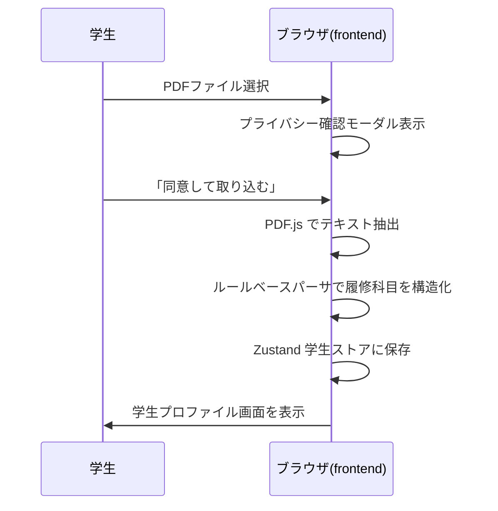
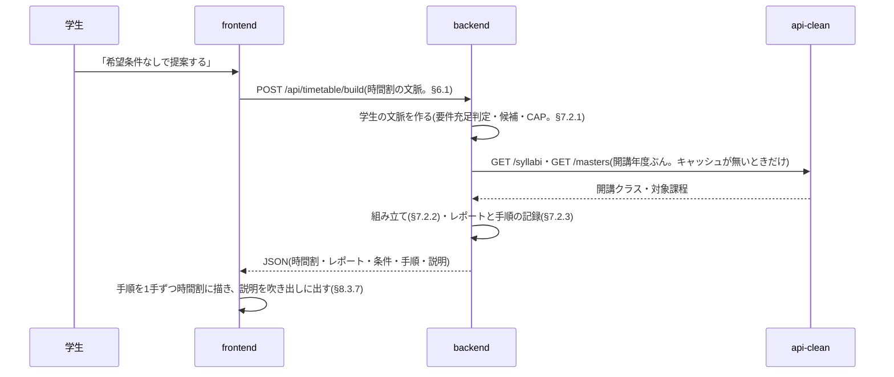
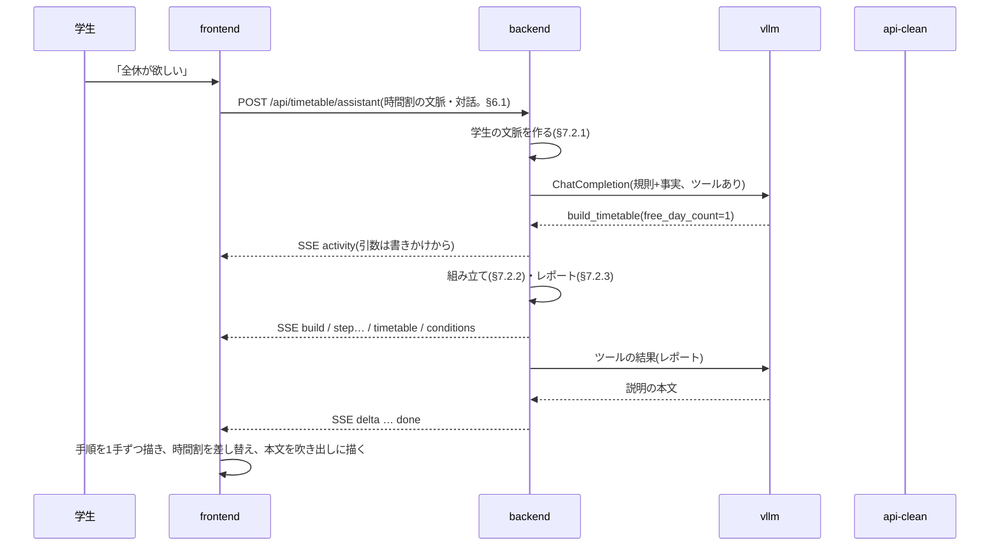
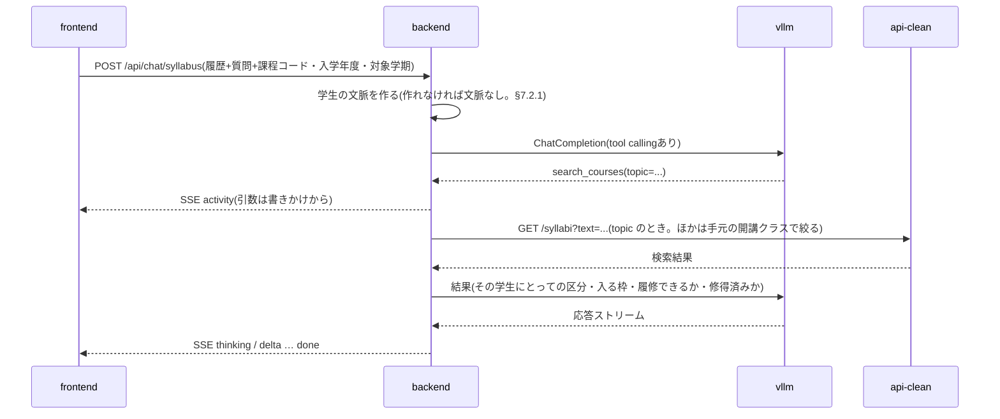

# 履修登録支援AIチャットボット 設計書(v0.9.95)— §6 API設計 / §7 主要シーケンス / §8 画面構成とルーティング

> 本ファイルは [`docs/design.md`](../design.md) の一部である。§番号は設計書全体で通し番号であり、他ファイルの節を `§X.Y` の形で参照する。全ファイルの対応表は [design.md](../design.md) の「0.3 本書の構成」を参照。

---

## 6. API設計

### 6.1 内部 API(frontend ↔ backend)

| メソッド | パス | 用途 | 応答形式 |
|---|---|---|---|
| POST | /api/timetable/assistant | 時間割の画面の会話のすべて(時間割の組み立て・組み直しと質問。§7.3) | SSE |
| POST | /api/timetable/build | 条件から時間割を組み立てる。モデルを呼ばない(§7.2) | JSON |
| POST | /api/timetable/check | 与えた時間割のレポート(§7.2.3)。学生が手で直した後の事実の更新に使う | JSON |
| POST | /api/chat/syllabus | シラバス全体チャット | SSE |
| POST | /api/chat/syllabus/{code} | 講義単位チャット | SSE |
| GET | /api/syllabi | シラバス検索(一覧・絞り込み) | JSON |
| GET | /api/syllabi/{code} | シラバス詳細(講義ページ表示) | JSON |
| GET | /api/masters | 検索絞り込み用の値マスタ | JSON |
| GET | /api/curricula/{program_code}/{admission_year} | 履修要項データ参照(タグ表示用) | JSON |
| GET | /api/course-targets | シラバスコード → 対象課程(タグの履修可否判定用。§6.1.3) | JSON |
| POST | /api/requirements | 卒業要件の充足判定(要件枠ごとの不足単位) | JSON |
| GET | /api/healthz | ヘルスチェック(**公開経路からの死活確認はこちら**。§3.5.1) | JSON |
| GET | /healthz | ヘルスチェック(ネットワーク内から直に叩く用) | JSON |

SSE のリクエストには学生プロファイルと対話履歴を毎回含める(サーバ側で永続化しないため)。時間割と条件も frontend が持ち、`/api/timetable/*` に毎回送る。

`/healthz` だけがルート直下にあるため、**公開経路(`/syllabel/api/*`)からは到達しない**。`/syllabel/*` は frontend へ振り分けられるためである。外から死活を見るには `/api/healthz` を使う(§3.5.1)。

上表のパスは **backend が受けるパス**である。ブラウザおよびサーバ側描画から呼ぶときの**公開パスは `/syllabel` を前置した `/syllabel/api/...`** となる。ゲートウェイが `/syllabel` を剥がして backend へ渡すためである(§3.5.2)。Next.js の `basePath` はページとアセットの生成先を変えるだけで `fetch()` のパスには前置されないため、**frontend は呼び出し先に `/syllabel` を自分で含める**。

呼び出し元によって宛先が分かれる。backend の配置が決まったため(§3.4.2)、いずれも確定である。

| 呼び出し元 | 宛先 |
|---|---|
| ブラウザ(クライアントコンポーネント) | ゲートウェイと同一オリジンの `/syllabel/api/...`(相対パス)。§3.5.2 の URL 構造から従う |
| サーバ側描画(RSC / `page.tsx` の `async` 関数) | 同一 Podman ネットワーク上の backend コンテナ(`http://syllabel-backend:8000/api/...`)。**ゲートウェイを経由しないため `/syllabel` は付かない**。サーバ側の `fetch` は相対パスを解決できないため、オリジンを環境変数で与える |

いずれもハードコードせず、実行時の環境変数で与える(§3.2.1)。

**`lib/syllabus-api.ts` はサーバコンポーネント(`app/syllabus/page.tsx`、`app/syllabus/[code]/page.tsx`)とクライアントコンポーネント(`SyllabusTagList` 等の `fetchCurricula`)の双方から import される。** 宛先を単一の定数に置くとどちらか一方が必ず壊れるため、**オリジンはモジュール読み込み時に固定せず、呼び出しごとに解決する**(`lib/api_base.ts` の `apiBase()`。`typeof window` で呼び出し元を判別し、サーバ側は `BACKEND_ORIGIN` を読む)。この制約は到達経路の決定によらない。

**開発時はゲートウェイが居ない。** ブラウザからの `/syllabel/api/*` は Next の開発サーバに届いてしまうため、`next.config.ts` の `rewrites()` がゲートウェイと同じ振り分けを代行する(本番では空を返し、振り分けはゲートウェイに委ねる)。

`GET /api/syllabi` / `/api/syllabi/{code}` / `/api/masters` は、検索画面(`/syllabus` 一覧と `/syllabus/[code]` 詳細。§8)が使う読み取り専用エンドポイントであり、backend は §6.2 の api-clean(`GET /syllabi` / `GET /syllabi/{code}` / `GET /masters`)を中継する。api-clean は公開されない(§1.2)ため frontend からは直接呼べず、検索画面向けにも backend 側の口を置く。クエリパラメータは api-clean の `/syllabi`(`q` / `faculty` / `program` / `campus` / `term` / `day` / `period` / `year` / `instructor` / `grade` / `limit` / `offset`)を素通しし、backend は検索条件に手を加えない。**api-clean への接続失敗・タイムアウト・上流の HTTP エラーはいずれも 502 で返し**、backend 自身の不具合(500)と区別する(`app/api/syllabus.py`)。検索画面がこれらをどう使うかは §6.1.4、タグ付けは §8.2.1 に定める。

`GET /api/curricula/{program_code}/{admission_year}` は、タグ付け(§8.2.1)と卒業残り単位の表示(§4.4.5)が必要とする**科目レイヤ**(§4.4.3)を返す。**backend は次の項目を解決済みの状態で返し、履修要項の構造をクライアントに持ち込まない。**

- **マージ後の `courses`**(教養教育科目の取り込み、`not_available_to_programs` による除外、他課程からの専門関連科目の導出。§4.4.3)。並びは「当該課程の設置科目 → 教養教育科目 → 他課程から導出した専門関連科目(課程コード順)」とする。検索結果には他課程が開講する科目も現れるため、当該課程の設置科目だけでは足りない
- **各科目のシラバスコード `syllabusCodes`。** コードは `curricula/` 側になく開講年度ファイルの `resolved` が持つ(§4.4.2)ため、解決は backend が行う。1科目に複数の開講クラスが対応するため配列とし、`not_offered` / `unresolved` の科目は空配列とする。frontend は `offerings/` を直接参照しない
- **`own`。** 当該課程の設置科目(教養教育科目+専攻科目)なら true、他課程から導出した専門関連科目なら false。導出科目の `category` は `専門関連科目` に付け替えてあるが、`type` は**導出元の課程にとっての**履修区分のままであり、閲覧している学生にとっての値ではない。frontend は `own` が false の科目に履修区分を出さない(§8.2.1)。**履修可否の判断には使わない**(§6.1.3)
- **`subcategory`(分野)。** 教養教育科目だけが持ち、専攻科目では null(§5.1.5)。タグの分野(§8.2.1)に使う
- **`graduation`(`totalCredits` / `excludedTypes`)。** 卒業残り単位の表示(§4.4.5)に要る。**設置科目の単位数の総和は卒業必要単位数ではない**ため、クライアントは `courses` から算出できない。要件枠ごとの不足単位は `POST /api/requirements` で得る

```json
{
  "programCode": "02", "admissionYear": 2024, "offeringYear": 2026,
  "graduation": { "totalCredits": 124, "excludedTypes": ["随意"] },
  "courses": [
    { "title": "仏教の思想A", "category": "教養教育科目", "subcategory": "「仏教の思想」科目",
      "type": "必修", "credits": 2, "grade": 1, "term": "前期", "quarters": ["1Q", "2Q"],
      "own": true, "syllabusCodes": ["G260110004", "G260110005"] }
  ]
}
```

`POST /api/requirements` は、学生プロファイル(既修得科目を含む)を本文で受け取り、要件枠ごとの修得済み単位・不足単位を返す。判定規則をクライアントへ渡さないための口であり、その根拠と責務の切り分けは §4.4.5 による。要件枠には公式の区分名 `name`(「教養教育科目(選択)」など。§5.1.2)を付けて返す(画面に出すのはこちらで、`key` は内部の識別子)。履修提案の画面が卒業要件枠の内訳を出すのに使う(§8.3.5)。

**`/api/timetable/*` の3本は、同じ「時間割の文脈」を受ける**(`app/api/timetable.py` の `TimetableContextRequest`)。学生プロファイルと**課程コード・入学年度を別に**受ける。履修要項を引くキーは (課程コード, 入学年度) である(§4.4.2)一方、`StudentProfile.program` に入るのは成績表から採れる**課程名**であり、課程は改称され得るため識別子には使えない。入学年度は成績表の入学日から読んだ値を優先し、無いとき(読み取れなかったとき)だけ学年から推定して送る(`lib/programs.ts` の `resolveAdmissionYear()`)。課程名 → 課程コードの解決は frontend が持つ(`lib/programs.ts`。一覧の正本は `curricula/admission-<年度>/` の課程ファイルである)。

```json
{
  "studentProfile": { "grade": 3, "program": "知能情報メディア課程", "completedCourses": [] },
  "programCode": "02", "admissionYear": 2024,
  "targetTerm": { "year": 2026, "term": "後期", "grade": 3 },
  "timetable": [ { "syllabusCode": "B12345", "title": "情報基礎", "source": "student", "...": "§5.3 の ProposedCourse" } ],
  "conditions": { "freeDays": ["水"], "maxPeriodsPerDay": 4 }
}
```

- **`targetTerm`** は**時間割を組む学期**(次に履修登録する学期)である。`year` は年度、`term` は `前期` / `後期`、`grade` は**その学期の**学年で、年度をまたぐと成績表の作成時点の学年(`studentProfile.grade`)より1つ上になる。frontend が取り込んだ成績表の次の学期(成績表の作成日の月から決める)を送る。学生は画面で確認できるが選び直せない(§5.2.1、§8.3)。backend は候補のクラスをこの学期に登録するものへ絞り、配当年次と CAP の該当セメスターにこの学年を使う(§7.2.1)
- **`timetable`** は今の時間割(§5.3 の `ProposedCourse` の配列)で、空でもよい。**学生が自分で入れた科目は `source: "student"`** とし、組み立て(§7.2)はこれを外さない。コマが重なっていてもよい(学生は重なりを承知で入れられる。§8.3.6)
- **`conditions`** は時間割の形についての条件(§7.2.2)。frontend はアシスタントの `conditions` イベント(§6.1.1)と `/api/timetable/build` の応答の値をそのまま持って送り、中身を画面で組み立てない(条件は会話で変える)
- **前提の不足はストリームを開く前に状態コードで返す。** (課程コード, 入学年度) に対応する履修要項が無ければ 404、学年が無いなど前提の不足は 400、api-clean に届かなければ 502(§6.1.1)

`POST /api/timetable/assistant` は、時間割の文脈に**対話全体を1本の `messages`** で足して受ける。**`messages` の末尾(role: user)が今回の発話、それより前が履歴である。** `messages` が空、または末尾が `assistant` なら 422 を返す。**時間割が空でも成立する**(時間割を組む前の「何ができる?」にも答える)。

```json
{
  "...": "時間割の文脈",
  "messages": [
    { "role": "assistant", "content": "時間割について話しかけてください。…" },
    { "role": "user", "content": "週に1日は全休にしたい" }
  ]
}
```

`POST /api/timetable/build` は時間割の文脈に `mode` を足して受け、組み上がった時間割を JSON で返す。モデルを呼ばないので数秒で返る。「希望条件なしで提案する」(§8.3.1)が使う。

| `mode` | 意味 |
|---|---|
| `rebuild`(既定) | 学生が自分で入れた科目(`source: "student"`)だけを残し、残りを組み直す |
| `adjust` | 今の時間割をすべて残し、条件に反する科目(外してよいもの)を外して空いた分を埋める。「今の時間割で水曜だけ空けたい」に使う |

```json
{
  "timetable": [ { "syllabusCode": "...", "title": "...", "reason": "専門応用科目(選択)の不足を埋める", "source": "assistant" } ],
  "totalCredits": 20,
  "report": { "...": "§7.2.3 のレポート" },
  "conditions": { "freeDays": ["水"], "freeDayCount": 1 },
  "steps": [ { "kind": "required", "course": { "...": "..." }, "note": "必修" } ],
  "message": "時間割を組みました。…"
}
```

`conditions` は組み立てで**実際に使った**条件で、全休の曜日を backend が選んだときはその曜日が入る。`steps` は組み立ての手順の記録(§7.2.3)、`message` はレポートから backend が作った決まった説明(吹き出しにそのまま出す)である。

`POST /api/timetable/check` は時間割の文脈を受け、その時間割のレポート(§7.2.3)を `{"report": {...}}` で返す。学生が手で時間割を直したあと、画面の事実(満たせない条件・確かめること)を更新するのに使う(§8.3.6)。モデルを呼ばない。

**これらを叩く契機は学生の送信か「希望条件なしで提案する」であり、`/proposal` を開いたことではない**(§8.3)。

`POST /api/chat/syllabus` / `/api/chat/syllabus/{code}` は、質問(`message`)・履歴(`history`)・学生プロファイル(`profile`)に加えて、**課程コード・入学年度・対象学期(`programCode` / `admissionYear` / `targetTerm`)を揃えば受ける**(`app/schemas/chat.py` の `ChatRequest`)。揃えば backend が学生の文脈(§7.2.1)を作り、検索結果にその学生にとっての区分・入る要件枠・履修できるか・修得済みかを付け、プロンプトに卒業要件の充足状況を入れる(§7.4.1)。揃わない・履修要項が無い・api-clean に届かないときは文脈なしで答える(エラーにしない)。

#### 6.1.1 SSE の書式

SSE を返す3本(`/api/timetable/assistant`・`/api/chat/syllabus`・`/api/chat/syllabus/{code}`)は、いずれも `data: <JSON>` の1行1イベントで配信する(実体は `app/api/sse.py`、エージェントのイベントの変換は `app/api/agent_stream.py` の `stream_agent()`)。

**共通**

| イベント | 内容 |
|---|---|
| `{"delta": "..."}` | 本文の断片。受け取った順に連結すると回答になる。本文が始まる前の空白は捨てる(ツール呼び出しの前に空白だけの本文パートが出ることがある) |
| `{"thinking": "..."}` | モデルの思考の断片(出たときだけ。§6.3.1)。frontend は本文が届くまで小さく流し、本文が始まったら畳む(§8.3.7) |
| `{"activity": {"id": "...", "tool": "search_courses", "label": "シラバスを検索しています", "args": {...}}}` | ツールを呼び始めたとき。`label` はツールごとに backend が決めた固定の文言で、モデルには書かせない。`args` はモデルが書いた引数で、**書きかけの間から流す**(読めるところまで読んだ JSON。変わったときだけ)。`id` は呼び出しごとの値で、同じ呼び出しの書きかけは同じ `id` で流れ直す |
| `{"error": "..."}` | 生成中の失敗。表示用の文言のみを載せ、例外の詳細は載せない |
| `{"done": true}` | 終端。エラー時も最後に必ず流れる |

**時間割のアシスタント(`/api/timetable/assistant`)だけ**

| イベント | 内容 |
|---|---|
| `{"build": {"mode": "rebuild"}}` | 組み立てが始まった。続いて `step` が手順の数だけ、最後に `timetable` と `conditions` が流れる |
| `{"step": {...}}` | 組み立ての1手(§7.2.3)。置いた順に流れる |
| `{"timetable": {"courses": [...], "totalCredits": 20, "report": {...}}}` | 組み上がった時間割。frontend は時間割をこれで**差し替える**(`step` で描いた途中の表はこれで確定する) |
| `{"conditions": {...}}` | 組み立てで使った条件。frontend は持っている条件をこれで差し替える |

組み立てのイベントはツール(`build_timetable`)が積み、**ツールの実行が終わった時点でまとめて流す**。組み立ては数秒で終わる決定的な処理なので、モデルが書きかけの時間割を流すことはしない。

**SSE を開いたあとは HTTP の状態コードを返せない。** したがって前処理(学生の文脈の組み立て。§7.2.1)はストリームを開く前に済ませ、そこでの失敗は 404(対応課程外)・400(前提不足)・502(上流障害)で返す。開いたあとに起きた失敗は `error` イベントで伝える。

#### 6.1.2 キャッシュの扱い

- `GET /api/curricula/{program_code}/{admission_year}` は本文から作る **ETag** と `Cache-Control: public, max-age=3600, must-revalidate` を付し、`If-None-Match` が一致すれば 304 を返す。内容は `curricula/` / `offerings/` の更新(=デプロイ)でしか変わらず(§4.4.4)、学生データを含まない GET であるため、マージ後の全課程分(2024年度入学コホートで課程あたり568〜577科目、約129KB / gzip 約9KB)の再送を避けられる。本文と ETag は (課程コード, 入学年度) ごとに1度だけ組み立ててメモリに持つ
- `POST /api/requirements` は既修得科目を本文で受けるため `Cache-Control: no-store` を付し、ブラウザにも中間経路にも残させない(§4.4.5)
- SSE には `Cache-Control: no-cache` と `X-Accel-Buffering: no` を付す。後者は中継が応答をバッファリングして逐次配信を潰すのを防ぐためである。現行のゲートウェイは Caddy であり `reverse_proxy` は既定でバッファリングしないため、このヘッダは nginx 系の中継が前段に入った場合の保険として付し続ける(§3.2.1)

#### 6.1.3 履修可否の判定

**タグは、その学生が履修登録できる開講クラスにだけ付け、履修提案の候補にもそのクラスだけを載せる**(要件§4.5)。履修要項は「科目」の単位で書かれている一方、1科目には複数の開講クラスが対応し(§5.1.4)、どのクラスを履修できるかは課程ごとに決まっている(例:「仏教の思想A」は複数のクラスが開講され、課程ごとに履修するクラスが指定されている)。履修要項側のデータだけでは可否を決められないため、**判定の正本はシラバスの対象課程とする。**

| シラバスの対象課程(`programs`)・対象学部(`faculties`) | 判定 |
|---|---|
| 学生の課程が `programs` に入っている | 履修可 |
| `programs` が空で、`faculties` に `先端理工学部` が入る | 課程指定なし。履修可 |
| それ以外 | 他課程指定のクラス。履修不可 |

**規則は上の3分岐だけであり、本節の1か所に置く。** 実装は対象課程の取得経路が違うため2か所に持つ。変更するときは本節と両実装を揃える。

| | 判定する場所 | 対象課程の取得 |
|---|---|---|
| 検索のタグ | frontend(`lib/eligibility.ts` の `canRegister()`、`lib/syllabusUI.ts` の `resolveTags()`) | 一覧は `GET /api/course-targets`(下記)、講義詳細は `GET /api/syllabi/{code}` の `programs` / `faculties` |
| 時間割の組み立て・検索のツール | backend(`app/timetable/offerings.py` の `Catalog.eligibility()`) | `GET /api/course-targets` と同じ組み立てを backend 内で行う(開講年度ぶんの開講クラスとともに持つ。§7.2.1) |

**判定に使わないもの。**

- **学年(配当年次)。** タグの判定に学年は使わない。学年は入学年度、すなわち参照する履修要項の版を決めるためだけに使う(§4.4.2。成績表の入学日を優先し、無いときだけ学年から推定する。`lib/programs.ts` の `resolveAdmissionYear()`)。その年次で履修できる科目を探す手段は、検索の対象年次の絞り込み(§8.2.3)とする
- **`own`。** 他課程の科目でも学修プログラムを構成する科目は全課程に開かれており、自課程の教養教育科目にも他課程指定のクラスがある。`own` は可否の代理にならない
- **学修プログラムの帰属データ。** 学修プログラムを構成する科目は対象課程が全課程になっており、対象課程が帰属を代理する。学修プログラムの表(履修要項 s05【8】)に載らずに複数課程へ開かれている共通科目(`Y009` 系)は対象課程でしか判別できないため、表を転記するとかえって取りこぼす

**判定できないときは何も主張しない。** 対象課程を取得できなかったコードにはタグを出さない(修得済みは成績の事実なので出す。§8.2.1)。**取得できなかったコードを空配列で代用してはならない** — 空配列は「課程指定なし(＝履修可)」を意味する。frontend は `undefined` を渡して区別する。時間割の組み立ての側では、課程名の一覧(`GET /masters` の `course_program`)が取れなかったときに限り、学生の課程だけで引いて課程指定なしのクラスも履修可と扱う(候補を失うより緩い判定に倒す。`Catalog.eligibility()`。このときの結果はキャッシュしない)。

**課程名の比較は改称を吸収する。** 課程コード `06` は入学年度で名称が異なり(2024年度入学: 環境生態工学課程、2025年度入学: 環境科学課程)、api-clean は両方を別々の課程として持つ(§4.4.2)。frontend は `lib/programs.ts` の `isSameProgram()`、backend は課程ファイルの `program.name_aliases` で比べる。

**`GET /api/course-targets?year=&faculty=`** は、シラバスコード → 対象課程の対応を (開講年度, 学部) 単位でまとめて返す。一覧のタグでの絞り込みは検索結果の全件に効かせる(§6.1.4)ため、全件ぶんの対象課程が手元に要る。

- **組み立て方。** api-clean の `GET /syllabi`(一覧)は対象課程を返さず、対象課程は `GET /syllabi/{code}` にしかない(§6.2)。1件ずつ引くと母数ぶんのリクエストになるため、**課程名で絞った一覧を課程ごとに引いて集合演算で組み立てる。** `program` は完全一致で、対象課程を持たないシラバスはその絞り込みから落ちるため、**どの課程の結果にも現れないコードを課程指定なし(空配列)とする**
- **学生データを含まない。** (開講年度, 学部)だけで決まるため、ETag と `Cache-Control: public, max-age=3600, must-revalidate` を付ける
- **backend は組み立て結果を (開講年度, 学部) ごとに保持し、1時間の期限を置く。** 上流(api-clean)の更新で変わり得るため、`/api/curricula` と違って恒久には持たない。組み立ては (開講年度, 学部) ごとに同時に1本だけとする(経路のトークンゲートウェイは同一トークンの同時リクエストを 503 で弾き得る)。期限切れのあとは古い結果をすぐ返し、組み直しを裏で1本だけ走らせる。待たせるのは結果を1つも持たない起動直後だけである。組み直しに失敗したら古い結果を使い続け、60秒おいてから再試行する(`app/api/syllabus.py` の `_targets_payload()`)
- **失敗しても一覧は出す。** タグは検索の付加価値であって前提ではない。frontend は失敗を null として扱い、修得済み以外のタグを出さずに続ける(`app/syllabus/page.tsx`)

#### 6.1.4 シラバス検索の取得と照合

検索画面(§8.2)が検索結果を得る規則を定める。取得と照合は `lib/syllabus-api.ts` の `searchCourses()` に、絞り込み後の切り出しと件数は `lib/useTaggedResults.ts` に集約し、PC とモバイルで共用する。

**取得**

- **開講年度は1年度に固定する。** frontend は `year` を定数(`OFFERING_YEAR`)で与え、絞り込み UI に年度を出さない(URL に `year` が付いていても読まない)。タグ付けに使う名寄せ結果(`offerings/<開講年度>/`。§5.1.4)が1年度分しか無く、他年度の科目はタグ付けの対象にならないためである。他年度の `offerings/` が揃えばこの定数を増やして開放する。backend の `/api/syllabi` は `year` を素通しし、制限を置かない
- **学部は `先端理工学部` に固定する**(`FACULTY`)。履修要項を持つのはこの学部だけであり(要件§2.1)、他学部の科目はタグ付けの対象にならず履修の判断にも使えない
- **条件に当たる全件を引く。** 500件(api-clean の `MAX_ROWS`)ずつ辿って集め、ページ送りは表示だけで行う。タグでの絞り込み(§8.2.2)は学生プロファイルとの突合で決まるため api-clean の検索条件にできず、**絞り込んだ結果をサーバへ送ることもできない**(修得済みのコード一覧はその学生の成績そのものである。要件§5)。絞り込みをクライアントで全件に効かせるには全件が手元に要る。総件数も `results.length` で確定する(api-clean は総件数を返さない。§6.2)
- **並びは api-clean の返すシラバスコード順のままとし、並び順の表示・切り替えは置かない。** その学年に合った科目を探す手段は、並び順ではなく絞り込み(対象年次・区分・タグ)とする

**キーワードの照合**

検索ボックスは科目名と教員名を1つの入力で受ける(§8.2.3)。api-clean の `q`(科目名)と `instructor`(教員名)は別のパラメータで、AND で効くため**同時に送ってはならない**(必ず0件になる)。**科目名で照合し、0件のときに同じ語を教員名として引き直す。** 教員名として引き直したことは検索結果の見出しに示す。

- **科目名は frontend で照合する**(`lib/titleSearch.ts` の `matchesTitle()`)。api-clean の `q` は正規化の無い `ILIKE` であり、大学のデータは表記が混在している(`Ⅰ` はローマ数字の1文字、括弧は全角、`A` は半角)。キーワードを `q` に送らず、その他の条件に当たる全件を引いてから照合する。照合は双方を NFKC で揃え、`Ⅰ`〜`Ⅹ` 由来のローマ数字(漢字・かなの直後で英字が続かないもの)を算用数字に、ひらがなをカタカナにし、大文字小文字・空白・中黒を無視して部分一致を取る。空白で区切った語は AND で効く。**履修要項との突合に使う `normalizeTitle()`(§5.1.5)とは別の規則である** — あちらは別の科目を同じ科目とみなさないよう、backend と同じ狭い規則に保つ
- **教員名は、入力を api-clean の登録表記に組み立て直して引く**(`lib/instructorName.ts` の `spellInstructorName()`)。api-clean の `instructor` は登録された表記のままの部分一致(`instructor.kanji_name ILIKE`)で、教員名は姓名を全角スペースで区切って登録されている。一覧は教員名を返さない(§6.2)ため、手元で正規化して突き合わせることはできない。組み立ての規則は次のとおり
  - **入力どおりの語で0件のときだけ組み立てる。** 姓のみ・全角区切りのフルネームは1回で当たる
  - 入力の空白を取り除き、**先頭から1文字ずつ伸ばしながら、他の条件を同じにした `limit=1` の問い合わせで当たるかを確かめる。** 次の1文字をそのまま繋げて外れたら、区切り(全角 → 半角)を挟んで試す。部分一致なので伸ばしている途中の語も当たる
  - **姓の長さも区切りの数も仮定しない。** 寄り道(別の教員の名前の一部)で行き止まったら戻って区切りを試す。問い合わせは1回の組み立てにつき64回で打ち切る
  - **問い合わせのどれかが失敗したら例外をそのまま送出する。** 失敗を「外れ」と扱うと、当たるはずだった語で「見つからない」と誤答する
  - **組み立ては frontend で行い、`GET /api/syllabi` では行わない。** この口は api-clean を素通しするページ送りの口であり、組み立てを入れるとページを送るたびに組み立て直すことになる

| 入力 | 組み立て |
|---|---|
| `山田`(姓のみ) / `山田　太郎`(全角) | 入力どおりで当たる。組み立てない |
| `山田 太郎` / `山田太郎` | `山田` → `山田太`(外れ)→ `山田　太` → `山田　太郎` |
| `オーガスティンジョナサン` | 姓の長さを仮定しないので、7文字の姓でも `オーガスティン　ジョナサン` に至る |
| `ドラグナラルカマリア` | 区切りの数を仮定しないので `ドラグナ　ラルカ　マリア` に至る |

**AI がシラバスを探すツール(`search_courses`。§7.2.4)も同じ規則で照合する**(科目名は `app/agents/title_search.py` の `matches_title()`、教員名は `app/agents/instructor_name.py` と `app/agents/tools.py` の `search_syllabi_by_instructor()`)。**frontend と backend の規則は同じに保つ** — 食い違うと「検索画面では出るのにチャットでは見つからない」というねじれが起きる。ツールはキーワードを `q` に送らず、backend がメモリに持つ開講年度ぶんの開講クラス(§7.2.1)に対して照合する。開講年度は `offering_year`、学部は先端理工学部に固定する(検索画面と同じ。§6.1.4 の取得)。

**入力の反映**

検索語は URL の `q` を正本とし、変えるとサーバ側描画と全件の取得がやり直される。そのため**1文字ごとには反映しない**(`lib/useSearchInput.ts`)。IME の変換中(`compositionstart`〜`compositionend`)は反映せず、確定後と英数字の入力は 300ms 止まってから、Enter は即時に反映する(変換の確定に押した Enter は除く)。

**ページ送りと件数**

- **ページ送り(30件)は絞り込み後の並びに対して行う。** `offset` は URL に持ち(詳細画面から戻ったときに位置を保つため。§8.2.3)、クライアントがその値で絞り込み後の配列を切る
- **URL の `offset` は 0 以上の整数だけを受け、ページの先頭(30 の倍数)に切り下げる**(`app/syllabus/page.tsx`)。**絞り込み後の件数を超える `offset` は最後のページに丸め**、URL は書き換えない(履修要項の取得中は一時的に0件になるため、届けば元の位置に戻れるようにする)
- **絞り込み(タグ・区分・分野・修得済みを除くスイッチ)を変えたら `offset` を消す**(`lib/useFilterControls.ts`)。絞り込みはクライアント状態、`offset` は URL にあるため、消さないと前の絞り込みでのページ位置が残る
- **件数は絞り込み後の並びで決める。** 絞り込みが効いているあいだは絞り込み後の件数を出し、絞る前の母数を併記する(「184件（1,219件中）」)。件数とページ数はクライアントでしか決まらないため、サーバ側描画では描かない

### 6.2 既存シラバスバックエンド API の利用

backend から以下の3つを利用する。**これがシラバスバックエンドに対して使う口のすべてである。**

- `GET /syllabi` — 検索(独自シラバス§4.5、時間割の組み立て§7.2、AI の検索のツール§7.2.4で使用)
- `GET /syllabi/{code}` — 詳細(講義ページ表示・講義単位チャット・AI の `get_course` で使用)
- `GET /masters` — 値マスタ(検索 UI のドロップダウン候補、課程名の一覧に利用)

**`GET /syllabi` の検索条件の意味は次のとおり**(api-clean の `clean_api.py` で確認)。条件はすべて AND で結合される。

| パラメータ | 突合 |
|---|---|
| `q` | **科目名のみ**の部分一致(`subject.title ILIKE`)。**教員名には当たらない** |
| `instructor` | 担当教員の漢字名の部分一致(`instructor.kanji_name ILIKE`)。**正規化は無く、登録された表記のまま照合される**(姓名の区切りは全角スペース。§6.1) |
| `faculty` / `program` / `campus` | 名称の完全一致。候補は `/masters` |
| `term` / `day` / `period` | 開講期(名称の完全一致) / 曜日1文字 / 1〜7。**いずれかの開講コマ**と比べる(api-clean 0.3.0 以降。下記)。`day` と `period` は同じコマで満たす必要がある |
| `year` / `grade` | 開講年度 / `grade_min <= x <= grade_max` |
| `text` | **本文の検索**(api-clean 0.4.0 以降)。科目名・サブタイトル・講義概要・到達目標・授業計画を対象に、空白で区切った語を AND で照合する(NFKC で寄せる)。各行は一致した箇所を `text_matched`(`title` / `subtitle` / `summary` / `goals` / `course_plan`)で返す |

**開講コマは `slots` で受け取る(api-clean 0.3.0 以降)。** 1つのクラスが複数のコマを持つ(「後期　金4・金5」「3Q　金3、4Q　金3」)が、`term` / `day_of_week` / `period` は**1コマ目だけ**である。`GET /syllabi` の各行と `GET /syllabi/{code}` は全コマを `slots: [{term, day, period}]` として原文の順に返す(集中講義は空)。**時間割に置く・重複を判定するときは `slots` を使う**(§5.3)。0.2.0 以前の api-clean は `slots` を返さず、検索の `term` / `day` / `period` も1コマ目としか比べない(`day=金&period=5` で「金4・金5」の科目が出ない)。backend は `slots` が無ければ1コマ目だけで動く(`app/timetable/offerings.py` の `read_slots()`)。

**古い api-clean は知らない検索条件を黙って無視する**(FastAPI は未定義のクエリを捨てる)。0.4.0 より前の api-clean に `text` を送ると、絞り込まれずに全件が返り、学生には「内容に合う科目」として見えてしまう。そこで backend は**返った行で見分ける**。0.4.0 以降は `text` を渡すと各行に `text_matched` を付けるので、`text_matched` の無い行が返ったら対応していないとみなし、本文で探せない旨をツールの結果として返す(5分のあいだは `text` を送らない。`app/agents/course_tools.py` の `_topic_matches()`)。**`GET /healthz` の `version` では判定しない** — api-clean 自身は `/healthz` に版を載せるが、トークンゲートウェイ経由の `/healthz` は `{"status": "ok"}` だけを返し、版が見えない(2026-10-23 に公開 VM から確認)。

**`GET /syllabi` は担当教員を返さない。** 一覧の SELECT は科目1行に畳まれており(`SELECT DISTINCT`)、担当教員は結合こそするものの `instructor` パラメータでの絞り込みにしか使っていない。教員名を持つのは `GET /syllabi/{code}` だけである。したがって**検索結果に教員名を出すには、表示中の行のぶんだけ詳細を引いて補う**(`lib/syllabus-api.ts` の `fetchInstructorMap()`)。表示する行はタグでの絞り込みで決まり、それを知っているのはブラウザだけなので、**ブラウザから引く**(§8.2.4)。同時実行は4本に抑え、503 / 429 は1度だけ引き直し、失敗した科目は教員名なしで並べる。**取得は科目コードごとに1回にまとめる**(取得中のものも共有し、ブラウザのメモリに持つ)。一覧は PC 用とモバイル用の組み立てが常に両方 mount されており(§8)、まとめないと同じ詳細を2回ずつ引くためである。一度表示した科目は引き直さない(失敗した科目は次に表示したときに引き直す)。api-clean は無変更で使う前提(§1.1.1、§3.4.4)であり、一覧側に教員名を足す選択肢は取らない。

**`grading`(成績評価)は TEXT 列だが、中身は JSON 文字列である。** `{"評価項目": [{"項目", "割合", "基準", "備考"}], "自由記載": ...}` の形で、シラバスバックエンドが年度間の表記を揃えた結果である。**素のまま描くと画面に JSON が出る**ため、表示側で構造へ戻す(`lib/grading.ts` の `parseGrading()`)。構造化されていない生テキストの行もあり得るので、JSON として読めない値はテキストとして扱う。

**レスポンスの `count` は総ヒット数ではなく、そのページで返した件数**(`len(rows)`)である。api-clean に総件数を返す口は無く、`POST /sql` はゲートウェイが拒否する(§3.4.4)。

**総件数は全件を引いて得る。** 検索画面は条件に当たる全件を引くため(§6.1.4)、`results.length` がそのまま総件数である。

**api-clean は DGX Spark 上にあり、この通信はホストを跨ぐ**(§3.4.4)。宛先は教員側のトークンゲートウェイであり、**base_url とトークンを環境変数で与える**(vllm 向けと同じ形。§6.3)。ゲートウェイは**上記3つと `/healthz` だけを通し、`POST /sql` を拒否する**(§3.4.4)。

これに伴う留意点が2つある。

- **ゲートウェイへ到達できないと、ここに挙げた3つの口がすべて失敗する。** 影響範囲と検知の要否は §3.4.4 に置く
- **ホストを跨ぐぶん所要時間が伸びる。** とくに §7.2.1 の開講年度ぶんの開講クラスの取得は千件規模をページ送りし、課程ごとの一覧も引くため、`http_timeout`(既定 30 秒)で足りるかを実測する(§13)。取得した結果は30分持つ(§7.2.1)

**api-clean へ送るのは科目の検索条件のみとし、学生プロファイルは渡さない**(§4.2.3)。

`POST /sql` はエージェントに任意 SQL を書かせるリスクを避けるため使用しない方針とする。**ゲートウェイ側でも拒否するため、backend から到達する手段は無い**(§3.4.4)。

### 6.3 vLLM との連携

**backend は vllm を直接呼ばない。** 教員側が運用するトークンゲートウェイ(OpenAI 互換)を経由する(経路の性質は §3.4.3)。

- base_url はトークンゲートウェイのテキスト用エンドポイント、api_key は発行されたトークン(`Authorization: Bearer <token>` として送られる)
- PydanticAI の `OpenAIChatModel(<モデルID>, provider=OpenAIProvider(base_url=<ゲートウェイのURL>, api_key=<トークン>))` 形式で設定する(base_url / api_key はモデルでなく `OpenAIProvider` に渡す)
- **base_url・api_key・モデル ID はいずれも環境変数で与え、コードにもイメージにも埋め込まない。** トークンは有効期限を持ち、更新時に値が変わる(§3.4.3)
- モデル ID は `GET /v1/models` が返す値を用いる。不一致は `400 model_mismatch` となる
- ツール呼び出しは PydanticAI の `@agent.tool` で定義し、内部で api-clean を HTTP で叩く(ツールの実行は backend 側である。api-clean への到達もトークンゲートウェイ経由となる。§6.2)

**ゲートウェイ固有の応答を扱う必要がある。**

| 応答 | 意味 | backend の扱い |
|---|---|---|
| `503 busy` | 同一トークンで生成が進行中 | **即座に返る(待たされない)。**再送、または待ち行列に入れて待ち時間を提示する。学生に「混雑」として見せる文言を用意する(§3.4.3) |
| `401` | トークンが無い・不正・期限切れ・失効 | 全機能が停止する。運用として検知できるようにする(§13) |
| `400 model_mismatch` | モデル ID が接続先の期待値と異なる | 設定誤り。起動時の疎通確認で検出する |
| `413 payload_too_large` | 本文が上限(既定 16 MiB)を超えた | プロンプトは候補の科目の一覧を載せない(§7.3.1)ため数千トークン規模であり通常は到達しないが、上限の存在を前提に置く |
| `502 upstream_unavailable` | vllm 側が応答しない | vllm の停止・再起動中。学生には一時的な不調として提示する |

**利用ログが100日間保存される。** プロンプトと応答が記録されるため、プロンプトに載せる学生データを要件§5.5 の範囲に限る(要件§5.5、§9、§7.3.1)。

#### 6.3.1 リクエスト単位の推論設定(思考の有無)

Qwen3.8 は思考(reasoning)モデルであり、思考の扱いはチャットテンプレート(`chat_template.jinja`)が決める。リクエストごとに `chat_template_kwargs` で次を指定できる。

- **`enable_thinking`** — 思考の生成を止めるスイッチではなく、**システムプロンプトに「よく考えよ」という指示文を入れるかどうか**の制御である。思考を出すかどうかはモデルの裁量になる。既定は真
- **`reasoning_effort`** — `enable_thinking` が真のときだけ効き、`xhigh`(既定) / `medium` / `low` の3値を取る。**3値以外を渡すとテンプレートが例外を投げて失敗する**

| `reasoning_effort` | 挿入される指示 |
|---|---|
| `xhigh`(既定) | 注意深く考え、前提を検証し、代替案を検討し、正確さ・一貫性・明快さを優先せよ |
| `medium` | 指示なし(テンプレートに文言が定義されていない) |
| `low` | 思考は簡潔に、余計な展開をせず結論へ直行せよ |

- **`preserve_thinking`** — 既定は真で、過去ターンの思考を履歴に残す。マルチターンの会話(§7.3〜§7.5)ではそのぶんコンテキストが伸びる

**`--reasoning-parser qwen3`(§4.3)は外さない。** 思考が出力されたときに本文から分離する保険であり、出なければ無害である。パーサが本番条件で正しく働くことは未確認であり、検証を §13 に置く。

| 呼び出し | 思考の指定 | 理由 |
|---|---|---|
| 時間割の組み立て(§7.2 / `POST /api/timetable/build`) | — | モデルを呼ばない |
| 時間割のアシスタント・シラバスチャット(§7.3〜§7.5) | 既定のまま | 自由文の対話であり、ツール呼び出しの要否と引数の判断を含む。時間割の中身は組み立てが決める(§7.2)ので、旧い履修提案(モデルが数万トークンの候補一覧から時間割を書いた)のように思考が終わらず返らない事態は起きにくい。思考が出たときは `thinking` として画面に流す(§6.1.1)。本番条件で思考が出るか・`reasoning_effort` をどうするかは計測を待つ(§13) |

PydanticAI からは `OpenAIChatModelSettings(extra_body={"chat_template_kwargs": {...}})` を `Agent(model_settings=...)` に渡す形で指定する。

あわせて `max_tokens` と `timeout` を置く。

### 6.4 書誌の補足(openBD)

**書影と書誌の詳細は openBD(<https://openbd.jp/>)から引く。** api-clean の書誌(`textbooks`)は書名・著者・出版社・ISBN・価格しか持たず(§6.2)、**その本がどんな本なのかを判断する材料が無い**。ISBN から openBD を引き、書影・内容紹介・目次・ページ数を補う(§8.1)。**本設計で唯一、backend を介さずに参照する外部サービス**である(§1.1)。

| 口 | `GET https://api.openbd.jp/v1/get?isbn=<ISBN>[,<ISBN>...]` |
|---|---|
| 認証 | 無し(公開 API・登録不要) |
| 応答 | **要求した順の配列。** 該当が無い要素は `null` |
| 呼び出す側 | frontend のサーバ側描画(`lib/openbd.ts`)。書影の画像そのものはブラウザが直接引く |

取り出す値は次のとおり。**欠けている項目はその行ごと出さない。**

| 項目 | 場所 | 備考 |
|---|---|---|
| 書影 | `summary.cover` | **無い本は空文字**。`https` 以外は混在コンテンツになるので捨てる |
| 内容紹介 | `onix.CollateralDetail.TextContent` の `TextType` = `03`、無ければ `02` | `03` が長い紹介、`02` が短い紹介。**HTML が混じることがある**ので、素のテキストとして出す(タグは落とす。`dangerouslySetInnerHTML` は使わない) |
| 目次 | 同 `TextType` = `04` | 改行がそのまま入っている |
| ページ数 | `onix.DescriptiveDetail.Extent` のうち `ExtentUnit` = `03`(ページ) | |
| 刊行年月 | `summary.pubdate` | `201806` / `20180709` の形。年月まで出す |
| シリーズ | `summary.series` | **装丁の種別が入っていることがある**(有斐閣の単行本が `単行本` で返る)。そのまま出すと読む側に何も伝わらないので落とす |

**書誌ページへのリンクは版元ドットコム(`https://www.hanmoto.com/bd/isbn/<ISBN-13>`)に出す。** openBD の書誌はここが集めているため、**openBD が書誌を返した本は版元ドットコムにページがある**(洋書を含め実地に確認済み。未登録の ISBN は 404 になる)。したがって**リンクを出すのは openBD が書誌を返した本だけ**に限る。ISBN-13 でしか引けないので、こちらの持つ生値ではなく **openBD が返す `summary.isbn` を使う**(ISBN-10 で問い合わせても13桁に直って返るため、桁の変換を自前で持たずに済む)。

**在庫状況(`ProductSupply.SupplyDetail.ProductAvailability`)は使わない。** 実データでは `99`(不明・その他)しか返っておらず、品切れ・絶版の判断には使えない。

規定は4つある。

- **1科目ぶんを1リクエストにまとめる。** `isbn` はカンマ区切りで複数取れる。書誌は1科目で最大16件あり、1件ずつ引くと講義詳細の描画が16往復ぶん遅くなる
- **引けなかったときは書影なしとして続ける。** 例外・非200・タイムアウト(3秒)はすべて空の対応表に畳み、講義詳細は今までどおり描く。openBD は本サービスの可用性の外にあり、**この口の失敗で講義詳細を落としてはならない**
- **「引けない」ことのほうが多い前提で作る。** openBD の書誌は版元ドットコムに登録されたものが中心で、大学の指定図書(学術書・専門書)は書影も紹介文も欠けることがある。引ける本と引けない本が混ざるため、**枠の大きさは書影の有無で変えず**、**書名を押して開けるのも引けた本だけ**にする(§8.1)
- **ISBN は正規化してから投げる。** 大学のデータはハイフンの有無が揃わず全角で入っている値もある(§8.2.1 の科目名と同じ事情)。NFKC で寄せて記号を落とし、ISBN-13(13桁)か ISBN-10(9桁＋数字か X)だけを通す。同じ本がテキストと参考文献の両方に載ることがあるため、正規化した値を鍵に重複を畳む

**キャッシュは1週間で再検証する。** 刊行済みの本の書影はまず変わらない。

**学生の情報は一切送らない。** 送るのは ISBN だけであり、誰が見ているかに依存する値を含まない。ブラウザが画像を引く際も `referrerPolicy="no-referrer"` を付け、**閲覧中の講義の URL を openBD へ渡さない**(要件§5、§9)。

---

## 7. 主要シーケンス

### 7.1 成績表PDF取り込み



ネットワーク通信は一切発生しない(要件§5.2、§5.3を担保)。

### 7.2 時間割の組み立て

**どの科目をどのコマに入れるかは backend の組み立てが決め、モデルは決めない**(`app/timetable/`)。モデルは条件を書いて組み立てを呼び、返ったレポートだけを根拠に説明する(§7.3)。組み立てはモデルを呼ばない決定的な処理で、順位で決まらない同点だけを無作為に選ぶ。

**モデルに時間割を書かせない理由。** 数百件の候補科目をプロンプトに並べてモデルに時間割を書かせると、数万トークンのプロンプトで1分強かかるうえ、単位の過不足・コマの重複・条件の取りこぼし(全休を頼んでもどの曜日も空かない)が起き、説明文が時間割と食い違った。条件を守る・不足を埋める・重ならないように置く、はいずれも規則で決まる処理であり、規則で書く方が速く確実である。モデルには、学生の言葉を条件に写すことと、結果を説明することを任せる。

**この流れは学生の送信か「希望条件なしで提案する」で始まる。`/proposal` に到達しただけでは撃たない**(§8.3)。



会話からの組み立ては、アシスタント(§7.3)がツール `build_timetable` として同じ組み立てを呼ぶ。

#### 7.2.1 学生の文脈と候補

組み立て・アシスタント・シラバスチャットは、1人の学生について次の材料を **backend が計算して**使う(`app/timetable/context.py` の `build_student_context()`。モデルに推測させない)。

1. **履修要項の解決** — (課程コード, 入学年度)でマージ済みの履修要項を引く(§4.4.3)。無ければ 404
2. **要件充足判定** — §4.4.5 の純関数を **HTTP を経由せず直接呼び**、要件枠ごとの不足単位を得る
3. **候補の科目** — 次のすべてを満たす科目(`app/timetable/candidates.py` の `select_candidates()`)
   - `type != "随意"`(卒業要件単位に算入されない。§5.1.5)
   - `grade <= 対象学期の学年`(配当年次は「この年次**から**履修可能」の意。§5.1.5)
   - 未修得かつ未登録(合格した科目・登録済みの科目と突合する。**不合格・履修辞退の科目は未修得であり、再履修の対象として候補に残る**。登録済み(`registered`。§5.2.1)は成績未確定だが、すでに登録しているので外す)
   - シラバスコードを持つ(`not_offered` / `unresolved` の科目は時間割に置けない。§5.1.4)

   マージ済みの `courses` には他課程から導出した同名の専門関連科目が複数入り得る(§4.4.3)。科目名で1件に寄せ、当該課程の設置科目(`own`)を優先し、次いで課程コードの小さい出典を採る(§4.4.5 の科目索引と同じ順序)。**履修区分は学生にとっての区分**とし、他課程から導出した専門関連科目は開講元での区分ではなく「選択」とする(`student_type()`)
4. **開講クラスの突合** — 候補のシラバスコードに対応する開講コマ(`slots`)を、開講年度ぶんの開講クラス(下記)から引く。**その学生が履修登録できるクラス**(§6.1.3)で、**対象学期の履修登録で登録するクラス**だけを残す — 前期の登録では前期・1Q・2Q・通年・サ集、後期の登録では後期・3Q・4Q(`registration_half()`。通年は前期に登録し、サ集は夏期集中で後期より前に終わるため前期に含める。マスタに無い表記は判定せず落とさない)。1クラスも残らない科目は時間割に置けないため候補から外す。**したがって api-clean へ到達できない状態では候補が全滅し、組み立てが成立しない**(§3.4.4)
5. **先修条件** — 履修要項の先修制(§5.1.5 `prerequisites`)を掛け、満たさない科目を候補から外す。満たすか分からない科目(`unknown`)は残す
6. **登録できる単位** — 対象学期の CAP(§5.1.2 `registration_limits`)から、対象学期に登録済みの単位を引いた残り

**開講年度ぶんの開講クラスと対象課程は backend のメモリに持つ**(`app/timetable/offerings.py` の `get_catalog()`)。いずれも学生データを含まない公開の値で、2026年度で1,500件程度と小さい。`GET /syllabi?year=<開講年度>` をページ送りで一括取得し、対象課程(§6.1.3)は課程名で絞った一覧を課程ごとに引いて組み立てる。**30分持ち**(`catalog_ttl_seconds`)、組み立ては同時に1本だけとする(経路のトークンゲートウェイは同一トークンの同時リクエストを 503 で弾き得る)。課程名の一覧が取れず履修可否を緩く判定したときは持たない。全休の曜日を選ぶ手順(§7.2.2 手順4)は不足を埋める手順を曜日の数だけ試すため、組み立て1回のうちに api-clean を引き直さない形にしておく必要がある。AI の検索のツール(§7.2.4)も同じものを使う。

**単位が入る要件枠(「入る枠」)も backend が計算する。** 履修要項の科目は区分・履修区分・分野(`subcategory`)を持ち、要件枠は `accepts` でそれを受け入れる(§5.1.5)。区分と履修区分だけを渡すと、どの枠に入るかをモデルが推測することになり、基幹でない社会科学系科目で「教養教育科目(選択必修〈基幹〉・社会)」を埋めると書くような誤りが起きる。枠は科目の属性だけでは決まらず、**その学生の充足状況で変わる**(満たした枠からは `overflow_to` の先へ回る)。計算は要件充足判定(§4.4.5 の `judge()`)をそのまま使い、修得済み科目にその科目を1つ足して判定し直し、修得単位が増えた枠を拾う。割り当て・溢れ・算入上限の規則を二重に実装しないためである。

#### 7.2.2 条件と組み立ての手順

**条件(`Conditions`。`app/timetable/conditions.py`)** は時間割の形についての希望を、backend が守れる形で表したものである。アシスタントがツールの引数として書き(§7.3)、frontend が保持して次のリクエストに載せる(§6.1)。

| 項目 | 意味 |
|---|---|
| `scope` | 提案の粒度(要件§4.3.3)。`必修のみ` は必修だけを置く。`不足を埋める`(既定)は卒業要件の不足を埋める科目を入れる。`広く` は不足を埋めた後も登録できる単位の範囲で科目を足す |
| `freeDays` / `freeDayCount` | 全休にする曜日と、全休にしたい平日の数(指定した曜日を含む)。全休は平日(月〜金)について数える |
| `avoidPeriods` | 避ける時限(`{"day": "金", "period": 5}`。`day` が null なら全曜日) |
| `maxDays` | 授業のある平日の数の上限 |
| `maxPeriodsPerDay` | 選択科目を足して1日に入れるコマ数の上限。**既定は4**。2コマ続きの科目は2コマと数える。必修で超えるのは仕方ないものとし、学生が望めば上げられる |
| `targetCredits` | 単位数の上限(登録できる単位の上限は超えない) |
| `include` / `exclude` | 入れたい科目(シラバスコード)と、入れない科目(科目名またはシラバスコード) |

**興味・関心は条件に入れない。** 「AI に関係する科目を取りたい」はアシスタントが検索のツール(§7.2.4)で科目を探し、`include` に入れる。自由文のキーワードを backend が解釈する口は作らない(照合の規則を決められないため)。値の範囲はスキーマで縛り、ツールの引数の JSON Schema に `enum` / `minimum` / `maximum` として載せる。

**組み立て(`app/timetable/builder.py` の `build_timetable()`)の手順。**

1. **残す科目を置く。** `rebuild` は学生が自分で入れた科目(`source: "student"`)だけ、`adjust` は今の時間割の全科目を残す。`adjust` では、外してよい科目(必修・学生が入れた科目・入れたい科目以外)のうち、全休の曜日・避ける時限に反するものと `exclude` に当たるものを外す
2. **必修を置く。** 対象学期に履修できる必修(学生にとっての履修区分)は、**不合格・履修辞退の再履修を含めて必ず置く**。配当年次を過ぎた再履修の科目も候補に残る(§7.2.1 手順3)ので、今期の必修と同じ扱いで置かれる。クラスの少ない科目から置き、条件に合うクラスを選ぶ。どのクラスも合わなければ条件を破って置き、破ったことをレポートの満たせない条件に残す。必修どうしが重なったときはどちらも置かず、レポートの「確かめること」に載せる。再履修者向けのクラスが別に開講される科目など、例外の扱いは後で足す(§13)
3. **入れたい科目(`include`)を置く。** 置けなかったときは理由をレポートに残す
4. **全休の曜日を決める。** 曜日を言われずに日数だけ言われたとき(「全休が欲しい」)は、**学生に聞き返さずここで決める**。空けたい曜日が決まっている学生は最初からそれを伝えるので、言わなかったなら曜日は問わないと読む。候補は外せない科目の無い平日で、各候補を空けた場合について手順5を同じ乱数の種で試し、**卒業要件の不足を最も多く埋められる曜日**を選ぶ。比べるのは溢れの段ごとの残る不足を上流から並べたもの(辞書順)で、同点なら外す科目が少ない方、それでも同点なら無作為。選ばなかった候補の曜日は、レポートの「代わりに全休にできる平日」に残す
5. **不足を埋める**(`scope` が `必修のみ` なら飛ばす)。条件(全休の曜日・避ける時限・平日の数の上限・1日のコマ数の上限・`exclude`)に反せず、置いた科目と重ならず、単位の上限に収まる科目のうち、**どれかの要件枠の不足を減らすもの**を1件ずつ置く。順は次のとおり
   1. **溢れの流れの上流の枠を先に、下流の枠(受け皿)を後に埋める。** 要件枠は溢れ(`overflow_to`)でつながっており、下流の枠(教養教育科目(選択)・学部フリーゾーン・オールフリーゾーン)ほど多くの枠から単位を受ける。受け皿は後から何を取っても埋まりやすいので、単位の上限で埋めきれないときに残すならここがよい。段は `overflow_to` を辿った深さで決める(`app/curricula/requirements.py` の `entry_slot_keys()`。どこからも溢れを受けない枠が最上流)
   2. **同じ段の枠どうしは、不足の大きい順**
   3. 履修区分の重さ(選択必修 > 選択)。選択必修は枠の中で取るべき科目の候補が限られているため、先に置かないと後でコマが塞がる。選択は教養教育科目に限らず、課程によって専門基礎・専門応用にもある
   4. **単位が不足にちょうど合う科目。** 不足が2単位のときに4単位の科目を入れると、2単位が下流の枠へ溢れる
   5. **既に授業のある曜日に入る科目。** 授業のある日をなるべく詰める(1日のコマ数の上限の範囲で)
   6. ここまでで決まらなければ**無作為**。シラバスコードや配当年次のような、学生にとって意味の無い順では決めない(毎回同じ科目に偏り、選び直しの自由度が減る)
6. `scope` が `広く` なら、不足が無くなった後も上限まで手順5の順に足す

単位が要件枠のどこに入るかは、要件充足判定(§4.4.5)と同じ規則で決める。1件置くごとに判定し直し、候補の見積もりには判定と同じ起点の枠から溢れの先を辿る。

**単位の上限**は `targetCredits` があればそれ、無ければ**対象学期に登録できる残り単位**(§7.2.1 手順6)とする。不足を埋める科目だけを入れるので、不足が上限より小さければ不足のぶんで止まる。要件§4.3.2 の「過不足のない分量」はこれで満たす。**卒業までの学期の配分は考えない** — 4年次に余裕を残すといった学期ごとの配分はせず、対象学期に登録できる単位の範囲で不足を埋める、理論上成り立つ時間割を目指す。**抽選科目・定員は考えない**(本サービスは履修の提案であり、抽選や定員による不成立までは扱わない)。

**条件を満たせないときに黙って破らない。** 破るのは必修を置くとき(手順2)だけで、それ以外の条件は守り、守った結果として不足を埋めきれなかったことをレポートに残す。どちらの場合も、アシスタントは満たせなかった事実と理由をそのまま学生に伝える(§7.3.1 規則4)。

#### 7.2.3 レポートと手順の記録

**レポート(`Report`。`app/timetable/report.py`)** は組み立て(`/api/timetable/build`)と確認(`/api/timetable/check`)が返す、時間割についての事実である。アシスタントの説明の根拠であり、画面にもそのまま出せる形にする。**値はすべて backend が計算する。**

| 項目 | 中身 |
|---|---|
| `days` | 平日ごとの科目(「音声・音響メディア処理論(2限)」の形) |
| `freeDays` / `otherFreeDayOptions` | 授業の無い平日と、空けた曜日の**代わりに**空けられた平日(必修と学生が入れた科目の無い平日)。アシスタントが「木曜を空ける形にもできます」と言える材料になる |
| `unscheduled` | 曜日・時限の無い科目(集中講義など) |
| `conditions` | 条件ごとに満たしたか(`met` / `unmet`)と、その理由(「金曜に必修の英語総合4(3限)がある」) |
| `requirements` | 要件枠ごとの修得単位の増減(この時間割を修得する前と後) |
| `remainingShortfall` | この時間割を修得しても残る不足と、埋めきれなかった理由(「登録できる単位の上限に達した」「対象学期に履修できる候補が無い」) |
| `credits` | 合計・上限・CAP・対象学期に登録済みの単位 |
| `retakes` / `needsConfirmation` | 時間割に入った再履修の科目と、学生が確かめるべきこと(必修どうしの重なり、先修条件を確かめられない科目など) |

学生が手で時間割を直したあとは、frontend が `/api/timetable/check` を引いてレポートを更新する(モデル呼び出しは無い)。アシスタントはリクエストのたびに backend が計算し直したものを受け取るので、手で直した時間割についても事実に基づいて答えられる。

**組み立ては、置いた科目と決めたことを1手ずつ記録する(`Step`)。** frontend はこれを順に描いて、時間割が組み上がっていく様子を見せる(§8.3.7)。

| `kind` | いつ | 主な値 |
|---|---|---|
| `keep` | 手順1で残した | `course` |
| `remove` | 手順1・4で外した | `course`・`note`(「金曜を全休にするため」など) |
| `required` | 手順2で必修を置いた | `course`・`note`(`必修` / `再履修`) |
| `include` | 手順3で入れたい科目を置いた | `course` |
| `free_day` | 手順4で全休の曜日を決めた | `day`・`others`(代わりに空けられた平日) |
| `fill` | 手順5・6で科目を置いた | `course`・`slot`(埋めた枠)・`shortfallAfter`(その枠の残りの不足) |
| `unmet` | 満たせなかった条件 | `condition`・`detail` |

全休の曜日を選ぶために試した組み立ては記録しない。`/api/timetable/build` は記録を `steps` として JSON で返し、アシスタントは `step` イベントとして流す(§6.1.1)。

**「希望条件なしで提案する」の説明は backend がレポートから作る**(`summarize_report()`。「時間割を組みました。11科目・22単位です」「この時間割を修得しても 学部フリーゾーン が2単位不足。登録できる単位の上限に達した」)。モデルを待たないので数秒で返る。

#### 7.2.4 シラバスを探すツール

時間割のアシスタント(§7.3)とシラバスチャット(§7.4・§7.5)は、同じ2つのツールでシラバスを探す(`app/agents/course_tools.py`)。api-clean を引く関数(`app/agents/tools.py`)の上に、**Qwen が引きやすい形**の口を置く。

- **引数は少なく、値は列挙で縛る。** 曜日・時限・学期・区分・分野・履修区分は `Literal` / 範囲つきの `int` にし、JSON Schema の `enum` / `minimum` / `maximum` としてモデルに見せる。モデルは api-clean のマスタの値を知らず、名称の完全一致の引数(`faculty` / `program` / `term`)に「後期」「知能情報」のような値を書いて0件になっていた
- **名称の完全一致を求める引数を見せない。** 学部は先端理工学部、開講年度は `offering_year` に固定する(検索画面と同じ。§6.1.4)
- **返り値は小さく、決まった形にする。** api-clean の JSON をそのまま返すと、要らない項目と JSON 文字列のままの成績評価でトークンを使い、履歴に残って会話が重くなる
- **0件のときは理由を返す。** どの条件を外せば何件になるかを添える(手元で数えるので api-clean を引き直さない)
- **失敗を例外にせず、結果として返す**(`{"error": "..."}`)。例外にすると応答全体が落ちる

**`search_courses`** — 科目を探す。開講年度ぶんの開講クラス(§7.2.1)を手元で絞り、科目ごとに1件にまとめて返す。

| 引数 | 意味 |
|---|---|
| `keyword` | 科目名の一部。表記の揺れは吸収する(`matches_title()`。§6.1.4) |
| `topic` | 講義の内容に含まれる語。api-clean 0.4.0 の本文の検索(`text`。§6.2)に渡し、科目名・サブタイトル・講義概要・到達目標・授業計画を AND で探す。0.4.0 より前の api-clean では使えない旨を返す |
| `instructor` | 教員名(姓だけでもよい)。登録表記に組み立て直して引く(`spell_instructor_name()`。§6.1.4) |
| `day` / `period` / `term` | 曜日・時限(1〜7)・登録する学期(`前期` / `後期`。1Q・2Q は前期、3Q・4Q は後期に含める) |
| `category` / `subcategory` / `course_type` | 区分・教養教育科目の分野・履修区分。表示名はシラバス一覧のタグ(§8.2.1)と揃え、履修要項の表記への対応は backend が持つ |
| `only_registrable` / `include_taken` | 履修できるクラスだけ(既定)/ 修得済みの科目も含める。学生の文脈があるときだけ効く |
| `limit` | 1〜20(既定10) |

返す各科目は `code`・`title`・`when`(「後期 金4・金5」)・`credits`・`subtitle`、学生の文脈があれば `registrable`・`type`(「専門応用 › 選択」)・`fillsSlot`(入る枠。§7.2.1)・`status`(修得済みなど)、`topic` で探したときは `matchedIn`(講義概要など、どこに一致したか)である。同じ科目名の別クラスは1件にまとめ、`otherClasses`(講義コード・曜日時限・担当教員)に添える(多いときは件数を `moreClasses` に)。全体に `total`・`shown`・`hint`(0件の理由)を付ける。

**`get_course`** — 1科目のシラバスの、頼まれた節だけを返す(`sections`。既定は 概要・到達目標・成績評価)。節は 概要・到達目標・講義方法・授業計画・成績評価・教科書・参考文献・授業外学修・アドバイス・担当教員・備考 から選ぶ。成績評価は JSON 文字列を項目と割合の行に直し(frontend の `parseGrading()` と同じ規則)、長い節は1節1,200字で切って切ったことを書き添える。

**学生の文脈があれば、結果にその学生にとっての値を付ける。** 区分・履修区分・入る枠・履修できるか・修得済みかで、シラバス一覧のタグ(§8.2.1)と同じ判定である。**api-clean へ送るのは検索条件だけで、学生プロファイルは送らない**(§6.2)。判定は backend の手元で行う。

回答内容は LLM 依存で非決定的なため、単体テストで確かめるのは組み立て・レポート・ツールの入出力と、規則がプロンプトに載ることまでとし、会話としての振る舞いは実機スモーク(`backend/scripts/smoke_timetable.py`)で確認する(§12.3)。

### 7.3 時間割のアシスタント

要件§4.3・§4.4。**`/proposal` の会話のすべてを1つのエージェントが受ける**(`app/agents/timetable_assistant.py`、`POST /api/timetable/assistant`)。質問には答え、時間割を作る・変えるときは組み立て(§7.2)をツール `build_timetable` として呼ぶ。「何ができる?」「この科目の評価方法は?」のような発話にも答えられる。



**サーバは状態を持たない**(要件§5.2)。時間割・条件・対話は frontend が持ち、毎回送る。

| ツール | 返すもの |
|---|---|
| `build_timetable` | 引数は条件(§7.2.2)と `mode`。指定しなかった引数は今の条件のまま(`0` / `[]` でその条件をやめる)。返すのはレポートの文章で、あわせて SSE の `build` / `step` / `timetable` / `conditions` を積む(§6.1.1) |
| `search_courses` / `get_course` | §7.2.4 |

- **時間割を変えるのは `build_timetable` だけである。** 「この科目を外して」「代わりにこれを入れて」は `exclude` / `include` に足して `adjust` で組み直す。個別の追加・削除のツールは作らない(条件として残らない変更は、次に組み直したときに消えるため)
- **避ける時限は「金5」「1限」の形の文字列で受ける**(`parse_period_rule()`)。読めない値は書き直しを頼む(`ModelRetry`)
- 1回の応答で組み直しが複数回あれば、イベントもその回数だけ流れる。frontend は最後の `timetable` で確定する

#### 7.3.1 システムプロンプト

backend は毎リクエスト、規則(`INSTRUCTIONS`)の後に、backend がリクエストごとに計算した事実を節に分けて入れる(`render_instructions()`)。

| 節 | 中身 |
|---|---|
| 【学生】 | 課程・入学年度・学年・対象学期 |
| 【卒業要件の充足状況】 | 要件枠ごとの修得済み・不足(公式の区分名で。不足のある枠を先に) |
| 【登録できる単位】 | 対象学期の上限・登録済み・残り |
| 【未修得の科目(再履修の対象)】 | 不合格・履修辞退の科目名(要件§5.5) |
| 【現在の時間割】 | 今の時間割のレポート(§7.2.3。曜日ごとの科目・授業の無い平日・満たせない条件・残る不足) |
| 【現在の条件】 | 条件(§7.2.2)の文章 |

**候補の科目の一覧は載せない。** 候補はツールで引く。プロンプトは数千トークンに収まり、プリフィルの時間とトークンゲートウェイに記録される量(要件§5.5)がともに減る。**修得済み科目の一覧も載せない**(組み立てと検索が backend 側で使う)。

```
あなたは龍谷大学先端理工学部の履修登録を支援するAIアシスタントです。
学生と対話しながら、【学生】の対象学期の時間割づくりを手伝ってください。

回答は次の規則に従ってください。
1. 時間割を作る・変えるときは build_timetable を呼ぶ。自分で科目を並べて時間割として示さない。
2. 学生が時間割を求めたとき、または時間割の形についての希望(全休・避けたい時限・必修だけ・入れたい科目・外したい科目など)を述べたときに build_timetable を呼ぶ。使い方の質問・科目についての質問・雑談では呼ばない。
3. 希望は build_timetable の引数に写す。曜日を言わない全休の希望は、聞き返さずに free_day_count で組み、返った結果の「代わりに全休にできる平日」を示して選び直せることを伝える。今の時間割を少し直すときは mode に adjust を、組み直すときは rebuild を使う。
4. 時間割の説明は、build_timetable が返したレポートと【現在の時間割】に書かれた事実だけに基づく。満たせなかった条件は、満たせなかったと理由とともに書く。満たしていない希望を満たしたと書かない。
5. 卒業要件・単位数は【卒業要件の充足状況】とレポートの値を用いる。自分で計算しない。単位数は整数で書き、「2.0単位」のように小数で書かない。
6. 必修の科目(不合格・履修辞退の再履修を含む)は履修できる学期に履修するものであり、不足の確保や補填として書かない。再履修の科目は再履修であることを書く。
7. 科目を勧めるときは search_courses で探し、その結果にある科目だけを勧める。興味・関心から探すときは topic を使う。時間割に入れるときは、その code を build_timetable の include に渡す。
8. 講義の内容・評価方法・教科書などシラバスの事項は get_course が返した内容だけを根拠にする。シラバスの語をそのまま使い、より具体的な語や製品名に言い換えない。
9. 時間割や説明の誤りを指摘されたら、まず【現在の時間割】とレポートで事実を確かめ、事実を答える。言葉の定義の説明から始めない。
10. 推測を述べる場合は推測であることを明示し、情報が無い事項は無いと答える。
```

- **規則1・4は、時間割の中身と説明の根拠をモデルから外すためのものである。** 旧い履修提案では、モデルが時間割を書き、説明文も自分の書いた時間割を見て書いたため、外された科目に触れる・満たしていない全休を満たしたと書く、といった食い違いが起きた
- **規則2は、最初の1通で必ず提案を始めないためのものである。** 旧い作りは提案前の入力をすべて希望条件として提案に回したため、「何ができる?」にも1分強かけて時間割を返した
- **規則3は、曖昧な全休の希望を聞き返さないためのものである**(§7.2.2 手順4)
- **規則5の後半と規則6は、旧い提案で観測した誤りに当てる。** 説明文で単位数の足し算を誤る・「2.0単位」と書く・必修を「不足分の確保」として語る、がいずれも起きた。必修は配当された学期に履修するのが当然であり、選ぶ理由を要件枠の不足に求めると説明文に不足の補填として書かれる
- **規則8はシラバスチャットの規則2〜4(§7.4.1)と同じ誤りの型を防ぐ**
- **規則9は、旧い提案チャットで観測した誤りに当てる。** 「金曜も授業があるのに全休と書いている」と指摘された回答が、時間割を確かめずに「全休」という言葉の定義の説明から始まった

回答内容は LLM 依存で非決定的なため、単体テストで確かめるのは規則と事実がプロンプトに載り、ツールの結果がイベントとして流れることまでとし、会話としての振る舞いは実機スモーク(`backend/scripts/smoke_timetable.py chat "発話"`)で確認する。

### 7.4 シラバスチャット(全体)

要件§4.6「シラバス全体に対する質問」。ツールは時間割のアシスタントと同じ `search_courses` / `get_course`(§7.2.4)である。



#### 7.4.1 システムプロンプト

backend は毎リクエスト、次のプロンプトを `instructions` としてエージェントに渡す(実体は `app/api/chat_syllabus.py` の `_SYLLABUS_PROMPT`)。その後ろに学生の節を連結する。課程コード・入学年度・対象学期が送られて学生の文脈(`StudentContext`。§7.2)が作れたときは【学生】【卒業要件の充足状況】【未修得の科目(再履修の対象)】を、作れないとき(履修要項が無い・api-clean に届かない)は学年と課程だけの【学生】を置く。修得済み科目の一覧は載せない(検索結果の `status` で足りる)。§7.5 も同じ本文を先頭に置き、その後ろに【対象講義】を連結する。

```
あなたは龍谷大学の履修登録を支援するAIアシスタントです。
学生のシラバスに関する質問に日本語で答えてください。
科目を探すときは search_courses、講義の内容を読むときは get_course を使ってください。

回答は次の規則に従ってください。
1. ツールが返した内容だけを根拠にする。シラバスに書かれていない事項を補わない。
2. シラバスの語をそのまま使う。より具体的な語や製品名への言い換えをしない(例:「文書作成ソフト」を「Word」、「ネットワークストレージ」を「クラウド」と書き換えない)。
3. シラバスにない形容や評価を付け加えない(例:「実践的な」)。
4. 週数・回数・期間などの数値は、シラバスに書かれている場合だけ示す。自分で計算・推定しない。
5. 区分・履修区分(必修・選択必修・選択)と、単位が入る要件枠は、ツールが返した type・fillsSlot と【卒業要件の充足状況】の値で答える。ツールがそれを返さないときは、履修要項で確認するよう案内する。
6. 同じ科目名で複数のクラスが開講されている場合は、どのクラスの情報かを講義コード・担当教員・サブタイトルで明示し、他のクラスにも当てはまるかのように書かない。
7. 興味・関心から科目を探すときは search_courses の topic を使い、勧める理由には matchedIn(講義概要など、どこに書かれていたか)を添える。
8. 推測を述べる場合は、推測であることを明示する。
9. シラバスに情報が無い事項は、無いと答える。
10. 単位数は整数で書き、「2.0単位」のように小数で書かない。
```

規則2〜4が個別の言い換えを名指ししているのは、**捏造が骨格ではなく装飾部分に出やすい**ためである。科目名・単位・担当教員・各回の内容といった骨格は原典どおりに出る一方、誤りは「文書作成ソフト」→「Word」、「ネットワークストレージ」→「クラウド」のような一般語の具体化、原典にない概念の追加、`course_plan` の回数からの開講週数の推定、原典にない形容(「実践的な」)の付加として出る。「シラバスにない事を書くな」という一般規則だけではこれらは抑止されない。LLM の側にはいずれも言い換え・要約の範囲内に見えるためである。したがって誤りの型を具体例つきで挙げる。

規則5は、区分・履修区分と入る要件枠を**モデルに推測させず、backend が計算した値で答えさせる**ためのものである。api-clean は必修・選択必修の別を返さない(§1.1.1)が、学生の文脈があれば履修要項から引ける。ツール(`search_courses` / `get_course`。§7.2.4)は各科目に、その学生にとっての区分(`type`)・単位が入る要件枠(`fillsSlot`。§7.2.1 と同じ計算)・履修できるか(`registrable`)・修得状況(`status`)を添える。文脈が作れないときはこれらを返さないので、従来どおり履修要項で確認させる。

規則6は、同名科目のクラス数をツールが返すこと(`otherClasses` / `moreClasses`)で働く。`search_courses` は同じ科目名のクラスを1件にまとめ、ほかのクラスの講義コード・曜日時限・担当教員を添える。

規則7は、api-clean 0.4.0 の本文検索(`text`。§6.2)を使う。`topic` は講義名・サブタイトル・概要・到達目標・授業計画を対象に AND で探し、どこに一致したかを `matchedIn` で返す。勧める理由を一致した箇所に結び付け、科目名からの連想で勧めさせない。

回答内容は LLM 依存で非決定的なため、単体テストで確かめるのは規則がプロンプトに載り両ルートでモデルに渡ることまでとし、捏造が実際に消えたかは実機スモーク(`backend/scripts/smoke_chat_syllabus.py`)で確認する。

### 7.5 シラバスチャット(講義ページ単位)

要件§4.6「講義ページ単位の質問」。frontend は現在表示中の `syllabus_code` を含めて送信。backend は最初にその講義詳細を取得し、【対象講義】としてシステムプロンプトの後ろに連結したうえで LLM に渡す(`app/api/chat_syllabus.py`)。プロンプトの本文・学生の節・ツールは §7.4 と同じである。

**【対象講義】は `get_course`(§7.2.4)と同じ形に整え、全節を入れる。** api-clean の JSON をそのまま入れると、内部の id・JSON 文字列のままの成績評価・生の値でトークンを使い、読み違いのもとになる。この画面は1科目についての問答なので、授業計画を含む全節を入れる(成績評価は項目と割合の行にする)。学生の文脈があれば、その学生にとっての区分・入る枠・履修できるか・修得済みかも添える。講義詳細が引けなければ 404 / 502 をストリームを開く前に返す。

---

## 8. 画面構成とルーティング

| パス | 画面 | 主な機能 |
|---|---|---|
| / | 成績表の取り込み | PDF取り込みと取り扱いの確認ダイアログ(要件§5.6)、取り込み内容の確認、解析失敗時の案内(もう一度選ぶか、デモの学生で試す。手入力のフォームは置かない。要件§4.1)、デモモードの読み込み(§11) |
| /import | (旧ルート) | `/` へ転送するだけ。古いリンクから来た人を取り込み画面へ送る |
| /proposal | 履修提案 | 時間割の組み立てと会話(§8.3)、時間割表示、手での編集(要件§4.3、§4.4) |
| /syllabus | 独自シラバス一覧 | 検索、タグ表示(状態 / 区分 / 分野 / 履修区分。要件§4.5。§8.2) |
| /syllabus/[code] | 講義詳細 | シラバス情報、講義単位チャット(要件§4.6) |
| /mydata | マイデータ | 取り込んだプロファイルの確認・訂正・破棄(要件§4.1、§4.8。訂正は §8.4) |
| /privacy | プライバシーポリシー | データの流れの図解、要件§5の規定説明 |

**取り込み(成績表・デモの学生)は別の学生への差し替えであり、前の学生の履修提案と会話を捨てる**(`lib/replaceStudent.ts`)。マイデータでの訂正も、内容が変わったときは同じく捨てる(§8.4)。**シラバス検索の絞り込み(タグ・区分・分野)と検索条件(`listQuery`)も同時に初期状態に戻す**(タグは学生ごとに決まるため。§8.2.2)。

**取り込み完了画面の行き先は履修提案だけではない。** シラバス検索への入口も同じ画面に置く(PC は `履修提案を受ける` の下に、モバイルは「次のステップ」の3枚目に)。取り込んだプロファイルは**検索結果のタグ付けに効く**(§6.1.3)ため、取り込み直後は「自分にとっての必修・選択・修得済み」が付いたシラバス検索が使えるようになっている。そこへ辿り着く手段が履修提案経由しか無いと、要件§4.5 の主機能への導線が実質1本になる。

**PC とモバイルで同じ URL に同じ役割の画面を置く。** 見た目(レイアウト)だけを画面幅で切り替え、どの URL がどの画面かは端末に依らない(各 `page.tsx` が PC 用とモバイル用の組み立てを並べて置き、CSS で出し分ける)。同じリンクが端末によって別の画面を開かないようにするためである。`/` は取り込み(モバイルは手順を画面の中の3段で分ける)、`/proposal` は時間割とし、`/import` は `/` への転送だけを残す。ナビ(PC のヘッダー・モバイルのボトムドック)も同じ3つ・同じ行き先 — 時間割(`/proposal`)・シラバス(`/syllabus`)・マイデータ(`/mydata`)— を持ち、取り込み(`/`)ではどちらもナビを出さない。

`/mydata` は、取り込んだプロファイルの確認・訂正・破棄を、取り込みの手順とは別に後から開けるようにするための画面である。

**シラバス全体への質問に専用のルートは設けない。** 同じ口(`POST /api/chat/syllabus`。§7.4)は `/syllabus` から叩ける — PC は検索結果の右に AIパネルがあり、モバイルは画面下部のボトムドックの Ask Bar から AI シートが開く。**両者は同じ会話を読み書きする**(§4.1.5)。要件§4.6 の「シラバス全体に対する質問」は検索画面の面で満たす。

ヘッダーに常にリセットボタン(要件§4.8)を設置する。PC のヘッダーには、リセットの左に取得済み・今期登録・卒業残りの単位数を出す(§8.3.5)。どの画面からも見え、取り込み前(ナビを出さないあいだ)は出さない。

### 8.1 講義詳細（`/syllabus/[code]`）の情報設計

**開講の表示は `term_schedule_raw` を整形して使い、1か所にだけ出す。** api-clean の `day_of_week` / `period` は1コマ分しか持たないため、`２Ｑ　火４・火５` のような複数コマ科目では2コマ目が落ち、集中講義では両方が null になる。生値には開講期とコマがそのまま入っているので、**全角の数字を半角に寄せ、`月３` を `月3限` に直して出す**(`lib/schedule.ts`)。`３Ｑ　金２、４Ｑ　金２` のように期が分かれる科目は行を分ける。開講期はこの1か所にだけ置き、見出しのバッジには出さない。**生値を持たない一覧**(`/syllabus`)は api-clean 0.3.0 の `slots`(§6.2)から `金4・5限` の形で出す(`formatSlots()`)。

**戻り先は開いた元に合わせる。** シラバス一覧から開いたときは「シラバス一覧に戻る」(絞り込みは `back` で復元。§8)、履修提案の時間割から開いたときは「時間割に戻る」(`from=proposal`。§8.3.4)。**「時間割に追加」はこの科目を時間割に直接登録する**(§8.3.6)。すでに入っている科目(同じシラバスコード)では「時間割に入っています」と「外す」に替え、時間割の「別の科目に変更する」から来たときは「(元の科目)をこの科目に変更」に替える。

**基本情報にはラベルを付ける。** 開講・担当教員・単位・配当年次・場所・対象学部(課程)をラベルと値の組で並べる。アイコンと値だけを横に並べると、`オンライン` がキャンパスなのか授業形態なのか、`2年次～4年次` が何の年次なのかが読み取れない。

**api-clean が返しているものを捨てない。** 書誌(`textbooks`)は自由記述とは別に構造化されて返っており、書名・著者・出版社・価格まで出す。

**書影は ISBN から openBD に引き、引けたものだけ出す(§6.4)。** 書名の文字列だけが縦に並ぶ一覧では、指定された本が手元のどれなのかを本の見た目で照合できない。**ただし書影が付くのは一部の本だけ**(openBD の書影は版元ドットコム登録分に限られる)なので、**引けなかった本の枠は書影と同じ大きさの背表紙アイコンのままにする。** 書影の有無で行の高さが変わると、1科目に何冊も並ぶ書誌が階段状になる。

**書名を押すと、その本の内容紹介・目次・ページ数と、版元ドットコムの書誌ページへのリンクが開く(§6.4)。** 書名・著者・出版社だけでは、その本が何を扱っていて講義にどう関わるのかが分からない。**押して開けるのは openBD が書誌を返した本だけ**にする — 引けなかった本は押しても出せるものが無く、押せるように見えるほうが誤りである(タグを「判定できないものには出さない」(§8.2.1)のと同じ扱い)。**開閉は `<details>` で組み、この木をクライアントコンポーネントにしない。** 開閉のためだけに講義詳細へクライアント JS を足す必要はなく、`<details>` はキーボード操作と支援技術への対応を素で持つ。**逆に、紹介文も目次も無い本でもパネルは開く** — 版元ドットコムへのリンクはどの本にも出せるので、そこから先を辿れる。

**備考(`note`)は履修登録の注記であり、扱いを3つに分ける。** ほぼすべての科目に値が入っており、中身は (1) 登録方法 — `【抽選登録科目】`・`【オープン登録科目】`、(2) ラベル付きの注記 — `【対象】T:情報メディア学科、Y:知能情報メディア課程` の形、(3) 履修要項の記号 — `Y4000` と `◎` のような科目区分コードと必修記号、に分かれる。**抽選かオープンかは履修できるかどうかそのものなので、これだけを見出しのタグとして出す。** (2)はラベルと値に分け、(3)は原文のまま並べる。**(3)を言葉に開いて書き換えない。** 記号の対応は履修要項側の定義であり、シラバスの値だけからは確定できない(§13)。

**同じことを2か所に書かない。** 備考の `【対象】` の多くは基本情報の対象課程と同じ内容であり、落としてよい。残す条件は、対象課程に無い課程を挙げているか(api-clean の課程マッピングが欠けている場合がある)、`留学生` のように課程では表せない条件を書いている場合に限る。**残すときも名前は組み立て直さず、名前空間を示す `Y:` だけを外す。** `T:` で始まる節は旧学科(理工学部)向けの表記であり、本システムの利用者である先端理工学部の学生には当たらないため落とす(`lib/courseTarget.ts`)。

**自由記述の改行は、折り返しのぶんだけ畳んでから出す。** api-clean の `summary`(授業概要)などは元の教務システムの固定幅のまま返っており、`…情報科学の基礎となる離散数` / `学の考え方を学ぶ。` のように**語の途中で改行が入っている**。講義詳細は本文を画面幅に合わせて流すため、この改行をそのまま出すと本文と無関係な位置で行が切れる。一方で、段落や箇条書きの区切りとして書き手が入れた改行は残さなければならず、**両者は本文からは見分けられない**。そこで**折り返しの証拠がある改行だけを畳む**(`lib/syllabusText.ts` の `unwrapWrappedLines()`。描画は `RichText`)。畳む条件は3つで、(1) その行が最長行と同じ桁数まで埋まっている(幅が尽きた以外に切れる理由がない)、(2) その行が句点で終わっていない、(3) 次の行が箇条書き・番号で始まっていない、である。**(2) を条件に入れるのは、文末の改行が書き手のものである可能性を捨てないため**であり、畳まずに残るのは文と文のあいだの改行だけで読めなくはならない。逆にここで畳むと、書き手が分けた文を1つにつないでしまう。**最長行が40桁に満たない本文には手を触れない** — 固定幅の折り返しではなく、短く書き分けた本文とみなす。つなぎ目は詰めるが、英字どうしは単語が溶けるため空白を挟む(URL の途中は詰める)。

**左は読み物、右は参照物に分ける。** 授業概要・到達目標・授業方法・授業外学習・授業計画を左に、成績評価・受講に際しての注意・備考・テキスト・参考文献を右に、この順で置く。**書誌は縦に長くなるので右の最後に置く。****縦に積むと本文がいたずらに長くなる**ためで、書誌は1科目で最大16件あり、これを本文側に入れると講義詳細の高さが5割増しになる。

**講義単位チャットの質問サジェストは、その科目のシラバスに対応する記述があるものだけを出す。** 講義単位チャットは対象講義のシラバスをそのまま渡し、「ツールが返した内容だけを根拠にする」「情報が無い事項は無いと答える」という規則で答えさせる(§7.4.1)。**対応する項目が無い質問は必ず「書かれていません」で終わる**ため、固定の文言を置かず、その科目が持つフィールド(`grading` / `textbooks` / `outside_study` / `goals` / `course_plan` / `methods` / `advice`)から組み立てる(`lib/courseQuestions.ts`)。例えば「課題の分量はどのくらい?」はシラバスに対応する項目が無く、多くの科目で空振りする。履修要件(必修 / 選択必修)の判断は §7.4.1 の規則5 で禁じているため入れない。

### 8.2 シラバス一覧（`/syllabus`）

検索結果の取得・キーワードの照合・ページ送りの規則は §6.1.4、履修可否の判定は §6.1.3 に置く。本節は一覧の画面の規則を定める。

#### 8.2.1 タグ

**目的。** 検索結果の各科目に、その学生にとっての位置づけ — もう修得したか、どの卒業要件枠に入るか、取る必要があるか — をタグで示す(要件§4.5)。

**軸。** 卒業要件の枠は (区分 × 履修区分) で決まり(`basic.required` = 専門基礎科目 × 必修、`applied.elective` = 専門応用科目 × 選択、…。§5.1.5)、教養教育科目の枠はさらに分野で分かれる(`liberal.buddhism` = 「仏教の思想」科目 × 必修、`liberal.general.humanities` = 人文科学系科目 × 選択必修、…)。1つの軸に潰すと「この科目がどの枠を埋めるのか」が読めなくなるため、履修要項の構造をそのまま次の4軸で出す。

| 軸 | 値 | 出典 |
|---|---|---|
| 状態 | `修得済み` | 学生プロファイルの合格科目 |
| 区分 | `教養教育` / `専門基礎` / `専門応用` / `専門関連` | 履修要項の `category` |
| 分野 | 教養教育科目のみ。下表 | 履修要項の `subcategory`(§5.1.5) |
| 履修区分 | `必修` / `選択必修` / `選択` / `随意` | 履修要項の `type` |

**分野の表示名は、履修要項の区分名から括弧と末尾の「科目」を除いたものとする**(`lib/courseLabels.ts` の `SUBCATEGORY_LABEL`。時間割(§8.3.4)と共用)。並びは `subcategory` の定義順(§5.1.5)に従う。

| `subcategory` | 表示 |
|---|---|
| 「仏教の思想」科目 | 仏教の思想 |
| 必修外国語科目 | 必修外国語 |
| 選択外国語科目 | 選択外国語 |
| 人文科学系科目 | 人文科学系 |
| 社会科学系科目 | 社会科学系 |
| 自然科学系科目 | 自然科学系 |
| スポーツ科学系科目 | スポーツ科学系 |
| 教養教育科目特別講義 | 教養教育科目特別講義 |
| 学部・センター等提供科目 | 学部・センター等提供 |

**基幹は別のタグにしない。** 2023〜2025年度入学版の基幹科目(設置科目表の●印)はデータ上 `type: 選択必修` で表しており(§5.1.5)、`人文科学系` + `選択必修` で「教養教育科目(選択必修〈基幹〉・人文)」の枠が読み取れる。2026年度入学版は基幹科目の指定が無く、人文科学系・社会科学系の全科目が選択必修である。**2026年度入学版の科目群(`course_group` / `subgroup`)も出さない。** 卒業要件の判定に使うのは分野の側である(§5.1.5)。

**タグは2段で決める**(`lib/syllabusUI.ts`)。

1. **候補を作る**(`buildTagMap()`)。`GET /api/curricula`(§6.1)の各科目の `syllabusCodes` をキーに、区分・分野・履修区分・`own` を対応づけ、学生の合格科目(`status: passed`)と突き合わせて修得済みかを決める。修得済みはシラバスコードの一致、または科目名の一致で判定する
   - **科目名は `lib/courseTitle.ts` の `normalizeTitle()`(NFKC 正規化 + 空白除去)を通してから比べる。** 成績表・履修要項・api-clean で全角・半角の表記が混在するためである。**backend の `normalize_title()`(`app/curricula/titles.py`)と同じ規則に保つ** — 食い違うと、卒業要件の残り単位とタグとで修得済みの判定がずれる
   - **同じコードが複数の科目レコードに現れたときは、区分・分野・履修区分は先に現れたもの**(§6.1 の並びにより、自課程の設置科目 → 教養教育科目 → 他課程の専門関連科目の順)**を採り、修得済みはレコードをまたいで OR を取る**
2. **履修可否を掛けて最終のタグにする**(`resolveTags()`。可否の規則は §6.1.3)

| 状況 | 状態 | 区分 | 分野 | 履修区分 |
|---|---|---|---|---|
| 修得済み × 自課程の設置科目 | `修得済み` | 出す | 出す(教養教育のみ) | 出す |
| 修得済み × 他課程の設置科目 | `修得済み` | `専門関連` | — | 出さない |
| 履修可 × 未修得 × 自課程の設置科目 | — | 出す | 出す(教養教育のみ) | 出す |
| 履修可 × 未修得 × 他課程の設置科目 | — | `専門関連` | — | 出さない |
| 履修不可 / 可否を判定できない | タグなし | | | |
| 履修要項に無い | タグなし | | | |

- **修得済みは履修可否を問わず出す。** 成績の事実であり、そのクラスをこれから履修できるかとは無関係である
- **他課程の設置科目(`own` が false)には `専門関連` だけを出す(修得済みなら `修得済み` も付く)。** その `type` は導出元の課程にとっての値であり、この学生にとっての区分は専門関連科目である(`related` → `free.faculty` の要件枠に計上される。§4.4.3)
- **`選択必修` と `随意` を他の値に丸めない。** `随意` は卒業要件単位数に算入されず(`graduation.excludedTypes`)履修提案の候補からも外れる科目であり、他と区別が付かないと学生が卒業に要る単位を取り違える
- **タグの付かない科目は「その学生には関係しないか、判定できなかったもの」である。** 履修できない理由は示さない(要件§4.5)

**判定は1か所に置く。** 入口は `lib/useTagMap.ts` の `useTagMap()` だけとし、一覧(PC・モバイル)と講義詳細で同じ結果にする。`useTagMap()` は `Map` ではなく、シラバスコードと対象課程からタグを決める**関数**を返す(呼び出し側が2段目を掛け忘れられないようにするため)。履修要項を引くキーは (課程コード, 入学年度) であり、課程名は `programCodeOf()`、入学年度は `resolveAdmissionYear()` で決める(§4.4.2)。プロファイルが無い・履修要項を取得できないときは、すべての科目をタグなしで描く。

**表示**(`app/syllabus/_components/CourseTags.tsx` に1つだけ置き、一覧 PC・一覧モバイル・講義詳細で共用する)

- **並びは 状態 → 区分 → 分野 → 履修区分 に固定する。** 「もう取ったか」→「どの枠か」→「取る必要があるか」の順で、学生が途中で判断を打ち切れる。分野は区分の内訳なので区分の直後に置く
- **色は履修区分にだけ使う。** 区分と分野は「どの卒業要件枠に属するか」を示す分類で、緊急度の軸ではない。両者は共通の落ち着いた配色にし、色の差は必修 / 選択必修 / 選択 / 随意 にだけ与える(`随意` は卒業要件に算入されないため彩度を落とす)

#### 8.2.2 タグでの絞り込み

| 軸 | UI | 値 |
|---|---|---|
| 履修区分 | チップ | すべて / 必修 / 選択必修 / 選択 / 随意 |
| 状態 | スイッチ「修得済みを除く」。**既定は ON** | ON(修得済みを除く)/ OFF(修得済みも出す) |
| 区分 | セレクト | すべて / 教養教育 / 専門基礎 / 専門応用 / 専門関連 |
| 分野 | セレクト。**区分が `教養教育` のときだけ出す** | すべて / 分野の9値(§8.2.1 の表の順) |

選択肢は `lib/syllabusUI.ts` の `TAG_CHIPS` / `CATEGORY_CHOICES` / `SUBCATEGORY_CHOICES` に1つだけ置き、PC の `SyllabusTopBar` / `SyllabusFilters` とモバイルの `MobileSyllabusPage` が共用する。

- **軸どうしは AND で効く**(`matchesFilter()`)
- **修得済みの科目は既定で一覧から除く**(`app/syllabus/_components/CompletedFilter.tsx`。PC・モバイル共用)。学生が一覧で探すのはこれから履修する科目であり、「すべて」のまま区分・分野・曜日などで絞ると修得済みの科目が混ざって探しにくい(1科目に複数のクラスが対応するため、3回生では検索結果のおよそ2割が修得済みになる)。修得済みの科目だけを見たいときはマイデータで見られるので、**修得済みに絞るチップは置かない**(チップとスイッチが同じ軸を操作すると、「修得済みだけ」と「修得済みを除く」が同時に選べてしまう)。スイッチを OFF にすると、修得済みの科目が `修得済み` のタグ付きで一覧に混ざる。修得済みも履修区分を持つ(§8.2.1)ので、履修区分のチップを選んだときも修得済みの科目が当たる(スイッチの ON / OFF で件数が変わる)
- **スイッチは件数の行に置き、ON の色は赤(`bg-accent`)とする。** モバイルも件数と同じ1行に並べ、一覧との間に罫線を引く。幅が狭いので、モバイルの件数は「1,020件（1,279件中）」までに詰める(何件目かはページ送りで分かる)。プロファイルが無いあいだは出さない(何も除かれない)
- **修得済みを除いたことが分かるようにする。** 除いた科目があるあいだは絞り込みが効いているとみなし、絞る前の母数を併記する(§6.1.4)。**修得済みを除いたせいで0件になったときは、そう言う**(「修得済みの科目を除いています。スイッチを切ると表示されます」。`emptyMessage()`) — 修得した科目を名前で引いても、スイッチが ON のままでは何も出ない
- **区分を変えたら分野を `すべて` に戻す。** 分野は教養教育科目の内訳であり、他の区分と組み合わせると必ず0件になる
- **分野の選択肢は9値すべてを出す。** コホートによっては該当する科目の無い値がある(`学部・センター等提供` は2026年度入学版のみ)が、その場合は0件になるだけである
- **絞り込みの状態は URL に持たず、クライアント状態(`useSyllabusUIStore`)に置く。** 履修要項と学生プロファイルの突合から決まる値であって api-clean に投げる検索条件ではないため、サーバ側描画の入力にならない。PC・モバイルで共有し、画面遷移をまたいで保つ。**リセット(全消去)と別の学生への差し替え(`lib/replaceStudent.ts`)で初期状態に戻す**(タグは学生ごとに決まるため)
- 絞り込みを変えたら `offset` を消す(§6.1.4)

**プロファイルが無いあいだはタグが1つも付かず、タグでの絞り込みは必ず0件になる。** その理由を、絞り込みを試す前に見えるところへ出す。チップの直下に取り込みへのリンクを兼ねた案内を1本置き、絞り込みパネルの「区分」にも短い注記を添える(`SyllabusProfileNotice.tsx`。PC・モバイル共用)。**プロファイルがあるときは出さない**(取り込んだ後には誤りになる)。

#### 8.2.3 検索条件

- **課程(`program`)で絞れるようにする。** 学部は固定する(§6.1.4)。候補は `/masters` の `course_program`(先端理工学部の課程)。api-clean の `program` は課程との対応で効くため、課程の対応が付いていない全学向けの教養教育科目は課程で絞ると結果から外れる。絞り込みの UI にその旨を添える
- **曜日と時限(`day` / `period`)はセレクトを対で置く。** 時限の選択肢は時間割表と同じ 1〜5(`lib/syllabusUI.ts` の `periodChoices()`)。時間割の空きコマの「この時間に入る科目を探す」はこの2つを付けて一覧を開く(§8.3.6)ため、効いている条件が画面に見え、選び直し・外しができなければならない。**URL に範囲外の値が付いていたときだけそれを選択肢に足す**(選択肢に無い値では選択が空に見え、外せなくなる)
- **対象年次(`grade`)はセレクトで選ぶ。** 選択肢は 1〜4(`GRADE_CHOICES`)で、`grade_min <= grade <= grade_max`、つまりその年次で履修できる科目に絞る(§6.2)
- **`period` / `grade` は api-clean の値域(1〜7 / 1〜4)に入る整数のときだけ検索条件にする**(`app/syllabus/page.tsx`)。値域外を渡すと api-clean が 422 を返し、一覧が表示できない
- **検索条件は URL のクエリに持つ。** 検索語・課程・キャンパス・開講期・曜日・時限・対象年次・ページ位置はサーバ側描画の入力(`searchParams`)である
  - **詳細画面との往復。** 検索結果カードのリンクに現在のクエリを `back` として持たせ、「シラバス一覧に戻る」でそれを開き直す(`lib/syllabusQuery.ts`)。`router.back()` は詳細 URL を直接開かれたときに戻り先が無いため採らない
  - **別の画面を経由したとき。** 一覧を開いているあいだクエリ(`LIST_QUERY_KEYS` で濾したもの)を `useSyllabusUIStore` の `listQuery` に書き写し(`SyllabusQueryMemory.tsx`)、PC ヘッダーとモバイルのタブバーの「シラバス」をそこへ向ける(`listHref(listQuery)`)。正本は URL であり、ストアは戻り先を覚えるだけである。メモリにだけ持ち、再読み込み・リセット・別の学生への差し替えで消える

#### 8.2.4 ページ送りと担当教員名

- **ページ送りは結果の上と下に置く**(下端だけだと、次のページへ移るたびに一覧の末尾まで運ばせる)
- **先頭と末尾への飛び先を同じ規則で足す**(`SyllabusPagination.tsx`)。ページ番号は現在地の前後にしか並ばないため、端のページから反対の端へ辿り着けるようにする。**番号が隣り合うときは「…」を挟まない**(飛ばしたページがあるように見えるため)
- **担当教員名は表示中の行のぶんだけブラウザから引く**(§6.2)。どの行が表示されるかは絞り込みで決まり、それを知っているのはブラウザだけである。教員名は補助情報なので、揃う前でもカードを描く。**教員名の行は取得前から同じ高さで確保し、届いたら中身だけ入れる**(届いた時点で行を足すと一覧が押し戻される)

### 8.3 履修提案（`/proposal`）の時間割と会話

**時間割は学生の指示で組む。画面に到達しただけでは組み立てもアシスタントも撃たない。** 要件§4.3.2 の「対話を通じて学生の興味・関心をヒアリングし、提案に反映する」と要件§4.3.3 の「どの粒度で提案するかは、対話の中で学生の要望を汲み取って決める」は、いずれも組む前に学生の言葉を受け取ることを前提としている。到達と同時に組むと、学生が希望を書く前に条件なしの時間割が出る。

**開始を学生の操作にすると、混雑で拒否されたときの復帰も学生の手に戻る。** 生成は同一トークンで1本しか通らず、進行中の後続は `503 busy` で即座に拒否される(§3.4.3、§6.3 の状態コード表、§13)。到達と同時に撃つ形では、拒否されたときに画面が死んだままになる。開始が明示の操作であれば、もう一度送るだけでよい。

#### 8.3.1 入力欄は1つで、宛先も1つ

**AI履修アシスタントの入力欄(PC は右の AIパネル、モバイルはボトムドックの Ask Bar から開く AI シート)が、この画面の会話のすべてを受ける。** 何を書いても `POST /api/timetable/assistant`(§7.3)に送り、時間割を組み直すか・質問に答えるかはアシスタントが決める(`lib/useProposalConversation.ts`)。時間割を組む前の「何ができる?」にも、組んだ後の「金曜は空けたい」にも同じ口で答える。

旧い作りは「提案を持っているか」で宛先を2つ(提案の生成と提案チャット)に分けていた。提案前の入力はすべて希望条件として提案に回り、「何ができる?」にも1分強かけて時間割を返した。提案後のチャットは時間割を差し替えられず、条件を言い忘れたら提案を捨てて作り直すしかなかった。

**「希望条件なしで提案する」はアシスタントを通さず `POST /api/timetable/build`(§7.2)を直接引く。** モデルを待たないので数秒で返り、吹き出しには backend がレポートから作った決まった説明を出す。入力欄は空文字を送れないため、案内メッセージの下にこのボタンを置く。卒業要件だけで組んでほしい学生に、書く必要のない文章を書かせない。**時間割を持ったあとは出さない** — 会話で条件を変えれば組み直されるため、作り直しのボタンは要らない。

**時間割と条件は frontend が持ち、毎回送る**(§6.1)。アシスタントの `timetable` イベント(§6.1.1)で時間割を差し替え、`conditions` イベントで条件を差し替える。学生の手での編集(§8.3.6)は store を書き換え、次のリクエストで送る。**条件を画面にチップで出すことはしない**(条件は会話で変える)。

**送信中は入力を止める。** 応答中(`busy`)と組み立て中(`status` が `loading`)はどちらも次の入力を受けない。

**モバイルの AI シートもこの入力欄である。** 時間割の画面でボトムドックの Ask Bar から開くシートは、PC の右の AIパネルと同じ会話(§5.2.2 の `proposalMessages`)を読み書きする(`useProposalAssistant()`)。PC とモバイルで始め方を変えない。

- **時間割が無いあいだは、Ask Bar を押すとハーフシートに案内と入力欄を出す**(ui-design_phone.pen AI_STEP0)。サジェストは出さない — ハーフシートのサジェストは今の時間割についての質問であり、表が空では答えようがない
- **送ると全画面に上げて答えを読ませる。組み立てが始まったら(`build` イベント)シートを閉じて、時間割が組み上がっていくところを見せる**(§8.3.7)。説明はシートを開き直すと読める。「希望条件なしで提案する」も押すとシートを閉じる
- **取り込み完了の画面の「履修提案を受ける」から来たときは、Ask Bar を押さなくてもハーフシートを開いておく**(PC は AI パネルの入力欄にフォーカスする)。取り込み直後の学生が次にすることは希望を書くことで、Ask Bar を探して押させる手間を省く。入力欄にはフォーカスしない(モバイル) — キーボードが案内の吹き出しを覆う。開くのはこの1回だけで、閉じたあとにタブから時間割へ戻っても開かない(`useAiStore` の `openOnArrival`)
- **Ask Bar の文言は押すと何が起きるかを書く** — 時間割が無いあいだは「AIに希望を伝えて提案を受ける」、組み立て中は「時間割を組んでいます…」、応答中は「AIが答えています…」、それ以外は「AIに質問…」
- **時間割を持ったあとのハーフシートは時間割のクイックチップを出す**(科目・コマに絞ったときはその文脈のサジェスト)。科目・コマを選んだ状態で書いた質問は、何についての質問かを添えて送る

#### 8.3.2 時間割を組む前の画面

- **AIパネル(モバイルはハーフシート)** — 1通目に、何ができるか・何を書けばよいか(例:「週に1日は全休にしたい」「必修だけ入れて」「金曜の5限は避けたい」)と、書かずに始められることを示す案内を出す。**この案内は対話履歴(§5.2.2 の `proposalMessages`)に置く。** モバイルはハーフシートに入力欄・断り書き(§9.1)と並べて出すため、案内はその高さに収まる長さに保つ。**「この時間割 について質問」(何について聞くかのチップ)は出さない** — 表が空で指すものが無い(科目・コマを選んだときは出す)
- **時間割表・単位数** — まだ時間割が無いことを示す(「右のAI履修アシスタントに希望を送ると、ここに時間割が組み上がります」)
- **提案する学期** — 卒業要件の帯の右端(PC。§8.3.5)・単位バーの直下(モバイル)に、対象学期(§5.2.1)を**表示だけする**(`TargetTermLabel`)。**提案するのは取り込んだ成績表の次の学期であり、選択欄は置かない**(成績表から一意に決まるため)。どの学期の提案かが分かるよう、見える場所には必ず出す。成績表から作成日を読み取れなかったときは今日の日付で決め、「今日の日付から決めています」と添える。デモの学生は選んだ学期に固定し、「デモ：2025年度入学・2年前期までの成績」のように、いつの時点の学生かを1行で添える(2行に折れると、モバイルで時間割の5限がボトムドックの下に隠れる)(龍谷祭の時期には前期の学生の提案はもう終わった学期になるため、時点を再現した体験だと分かるようにする)
- **時間割を組めないとき** — (課程コード, 入学年度) を解決できない、学年が取れていない場合は、入力欄を不活性にし、理由と `/mydata` への導線を出す(`lib/studentContext.ts` の `useStudentContext()`)。`/api/timetable/*` は履修要項を引けなければ 404 を返す(§6.1)ので投げても結論は同じだが、**往復を待たせてから同じ結論に達するより、投げる前に画面で示すほうがよい**

#### 8.3.3 会話のやり直し

**時間割を組んだあとも、会話で条件を変えれば組み直される**(§7.3)。旧い作りにあった「条件を変えて提案し直す」(提案を捨てて作り直す)は置かない。

**会話だけを最初からやり直す導線は残す**(パネルのヘッダーの新規ボタン)。会話を「最近のチャット」(§5.2.2)へ退避し、案内の1通目から始める。**時間割と条件はそのまま残る**(1通目は「時間割はそのままです。続けて希望や質問を書いてください。」)。時間割と条件は毎回のリクエストで送るので、会話を切っても時間割についての事実は失われない。

**応答の途中で別の会話へ切り替えたときは、応答を中止する。** 組み立ての途中で中止されたとき(`build` は届いたが `timetable` が届かなかったとき)は、組み立てを始める前の時間割へ戻す(`lib/timetableBuild.ts` の `cancel()`)。中止した吹き出しは「応答の途中で会話を切り替えました。」として退避する(§4.1.4)。

#### 8.3.4 時間割表

**提案の科目はすべて画面に出す。** 表に出ていない科目があると、表の科目の単位の和が単位数の「今期登録」(`totalCredits`。PC はヘッダー、モバイルは単位バー)と合わず、学生は何を登録すればよいか読めない。

- **1マスに複数の科目を並べる。** クォーターの違う科目(3Q と 4Q)は同じコマに入り得る(重複ではない。§5.3)。1マス1科目では後から来た科目で上書きされる。複数入ったマスは科目ごとに区分の色の枠を縦に積み、枠には細い線を引く(選択の色は白との差が小さく、線が無いと2科目の境目が読みにくい。`lib/timetable.ts` の `coursesToSlotTable()`。PC は `TimetablePanel.tsx`、モバイルは `app/_components/TimetableGrid.tsx`)
- **クォーターの科目には印を付ける。** 「3Q」「4Q」の印が無いと、4Q だけの科目が後期いっぱいの科目と同じ見た目になる。学期いっぱい(前期・後期・通年、または 1Q・2Q / 3Q・4Q の両方)を占める科目には付けない
- **複数コマの科目は全部のマスに置く**(「金4・金5」。§5.3 の `slots`)
- **科目には区分と履修区分のバッジを、この順で付ける**(「専門応用 › 必修」。§5.3 の `course_category` / `category`)。履修区分だけでは、どの卒業要件枠の必修・選択必修かが読めない。**教養教育科目は区分の代わりに分野を出す**(「人文科学系 › 選択必修」) — 教養教育科目の必修・選択必修は分野ごとに決まり、`教養教育` では枠が読めない。セルの幅が狭いため区分と分野は並べない。その場のメニュー(`CourseMenu.tsx`)では区分・分野・履修区分をすべて出す。表示名と配色はシラバス一覧のタグ(§8.2.1)と同じで(`lib/courseLabels.ts`、色は履修区分のバッジにだけ使う)、分からない値のバッジは出さない(履修区分の分からない科目もセルの色は選択の色で描く)。**専門関連科目には履修区分を出さない**(`専門関連` だけを出す) — 学生にとっては常に選択であり、シラバス一覧のタグも他課程の設置科目には `専門関連` だけを出す(§8.2.1)。セルの色は選択の色で描く。**モバイルで1コマの高さが足りないときは科目名を1行に詰める**(バッジがセルの幅に横並びで収まらず2段になるため。科目名の全体はメニューに出る)。それでも収まらない行(1マスに2科目など)は行を伸ばし、重ねない
- **列は CSS Grid の同じ列定義で組む**(限ラベルの固定幅 + `repeat(曜日の数, minmax(0, 1fr))`。ヘッダーと各限の行が同じ定義を持つ)。flex の `flex-1` で幅を分けると、マスの左右の余白がそのまま列の幅に足される。2科目が入ったマスは余白を詰めているため、その行だけ列が細くなり縦の線がずれた
- **曜日・時限の無い科目は表の下の「曜日・時限未定」に並べる。** 集中講義や、開講のコマが未定の科目(「知能情報メディアセミナー」など)である。表に置けないからといって捨てない

- **科目を押すとその場のメニュー(`app/_components/CourseMenu.tsx`。モバイルと同じもの)を開き、そこから講義詳細(`/syllabus/[code]`、§8.1)を開く**(ほかの項目は §8.3.6)。シラバス検索から開くのと同じ画面である。マス・複数入ったマスの科目ごとの枠・「曜日・時限未定」の欄の科目が対象で、シラバスコードの無い科目には「シラバスを開く」を出さない。**メニューの「AIに相談する」でその科目を右の AI パネルの参照中の文脈にする**(選択中の科目は枠で示す) — パネルのヘッダーの下に「〇〇 について質問」を出し(×で「この時間割」に戻す。「参照中」とは書かない — AI が何かを読みに行っているように読める)、送る質問にその科目を添え、その科目について聞けること(モバイルのハーフシートのサジェストと同じ `timetableSuggestions()`)を定型の質問として並べる。選択はモバイルと同じ `useAiStore` の `selection` に置く。**空きコマを押すとその場のメニュー(`SlotPopover`。モバイルの長押しと同じもの)を出し**、「この時間に入る科目を探す」でそのコマで絞ったシラバス一覧を、「AIに相談する」でそのコマを参照中の文脈にする。**同じタブのクライアント遷移で開く** — 学生プロファイル・提案・対話はブラウザのメモリにしか無い(§9)ため、別タブで開くと取り込み前の状態になる。リンクには `from=proposal` を付け、詳細画面の戻り先を「時間割に戻る」(`/proposal`)にする(`lib/syllabusQuery.ts` の `proposalDetailHref()` / `backLink()`)。戻っても提案と対話はそのまま残る。生成中に開いた場合も生成は止めない

**モバイルも同じ `coursesToSlotTable()` を描く**(1マスに複数の科目・クォーターの印・「曜日・時限未定」の欄)。**モバイルの土曜の列は、土曜に科目が入ったときだけ出す**(`TimetableGrid.tsx` の `visibleDays()`)。提案に土曜の科目はほとんど入らず、幅の狭いモバイルでは空の列が平日の列を細くして科目名が読みにくくなる。科目が入れば列を出すので、提案の科目は画面から落ちない。土曜の空きコマの長押しは、列が出ていないあいだは使えない(シラバス一覧の曜日の絞り込みで探せる)。PC は幅に余裕があるので常に6列を出す。1マス1科目の `coursesToTimetable()` はどの画面からも使わない。**モバイルの科目は、押すとまず選択になる** — Ask Bar の文脈がその科目に絞られる(ui-design_phone.pen AI_STEP2)。同時に PC と同じその場のメニューを開き、講義詳細(リンクは PC と同じ `proposalDetailHref()`)・変更・外す・AIに相談する を選ばせる。空きコマの長押しはその場のメニュー(AI_STEP3)で、軽く押すと選択を外す。

#### 8.3.5 卒業要件枠の内訳

**ヘッダーカードの直下の帯に、卒業要件枠ごとの充足状況を1行で出す**(PC。常に出す。モバイルは下記)。足りない枠ごとに、修得済みの単位(紺)と、今期の時間割を修得したときに埋まる単位(赤)をバーに積み、「修得済み+今期 / 必要」の単位数を添える(`app/proposal/_components/RequirementsPanel.tsx`)。不足の単位数(「あと○単位」)は行を割かずツールチップに出す。枠の名前は公式の区分名(§5.1.2)で、受け皿を持たない `required: 0` の枠は出さない。

- **充足した枠は1つのまとめに畳み、足りない枠だけを並べる。** 全枠を並べると帯が何段にもなり時間割が低くなる。学生が見るべきは足りない枠である。まとめには「取得済み」と枠の名前を出す。**PC は名前を2行で切るので、まとめに枠の数のボタン(「7枠 ▾」)を置き、押すと(名前の部分を押しても)取得済みの枠をすべて公式の区分名と「修得済み / 必要」の単位数で一覧に開く**(帯の下に重ねて出し、もう一度押す・外を押す・Esc で閉じる)。以前は全体をツールチップにだけ出しており、見つけにくいうえ指では開けなかった。モバイルのチップ(押すと名前が開く)と同じ操作にそろえる。**充足かどうかは修得済みの単位だけで決める**(今期の時間割を足した見込みで決めると、時間割の生成中に枠がまとめとバーを行き来してバーの本数が増減し、今期で埋まるだけの枠まで「取得済み」に入る)。今期で埋まる枠はバーのまま残し、赤で満たして示す
- **足りない枠は折り返さず、入りきらない分は横にスクロールさせる。** 枠は 140px の固定幅で並べる(枠が少なくてもバーを引き伸ばさない。入りきらない枠名は省略し、ツールチップで全体を出す)。足りない枠は10前後になることがあり、1行に詰めると枠名が読めなくなる。折り返すと帯が高くなる。スクロールバーは出さず、続きのある側の端をぼかして矢印ボタン(押すと1画面ぶん送る)を置く
- **凡例(修得済み・今期で埋まる分)は行を割かず、「取得済み」のまとめの ⓘ に畳む**(乗せる・フォーカスで開く)。数値の「+4」がバーの赤と同じ色なので、開かなくても読める。計算し直しているあいだは帯を薄くし、ⓘ の中に「計算し直しています」と出す
- **帯の右端に提案する学期を表示する**(§8.3.2)。取得済み・今期登録・卒業残りの単位数はヘッダーに移した(§8)

- **数字は `POST /api/requirements` の判定であり、画面で足し算しない**(§4.4.5)。同じ枠の科目を不足より多く取った分は下流の枠(オールフリーゾーンなど)に回るので、科目の区分から手元で数えると枠が食い違う
- **2回引いて差を取る**(`lib/requirements.ts` の `useRequirements()`)。1回目はプロファイルのまま(修得済み)、2回目は今期の時間割を修得したとみなして足したもの(見込み)。今期の時間割は提案の科目である。修得したとみなす科目は対象学期(§5.2.1)の年度・学期で送る。**登録済みで成績が未確定の科目(`registered`。§5.2.1)は入れない** — 成績表は学期の成績が確定してから公開される(3月中旬・9月初旬)ため、`***` で載るのは終わった学期の成績発表待ちの科目であり、対象学期の時間割ではない。**成績発表待ちの単位は、修得済み(紺)と今期(赤)のあいだに薄い紺(`--color-pending`)で積む**(3回目の判定として、登録済みの科目に合格したとみなしたものを引き、修得済みとの差を取る。登録済みの科目があるときだけ引く)。不足の単位(ツールチップの「あと○単位」)と卒業残りには含めない(合格が決まっていない)。凡例は PC は ⓘ に、モバイルはツールチップを開けないので帯の下に1行で添える。マイデータの `***` のバッジも同じ色にする
- **枠の名前は帯では短くして出す**(`shortSlotName()`。「教養教育科目(必修・仏教)」→「教養(必修・仏教)」、「専門基礎科目(必修)」→「専門基礎(必修)」、「選択必修〈基幹〉・」→「基幹・」。2026年度入学版の「選択必修・人文」はそのまま)。公式の区分名は区別に要る部分が括弧の中にあり、末尾を「…」で切ると「教養教育科目(必修…」のようにどの枠か分からなくなる。PC は名前に1行を与えて単位数をバーの右に移し、取得済みのまとめは2行まで折り返す(全部は押して開く一覧で公式の区分名で出す)。足りない枠の公式の区分名はツールチップと読み上げで出す
- **今期の時間割に追従する。** 見込みは提案の store の `courses` から作るので、組み立ての手順を描いているあいだは1手ごとに、時間割が差し替われば(組み直し・手での編集)そのたびに計算し直す。手順は短い間隔で描かれるため、落ち着いてから(300ms)引き、古い要求は取り消す。計算し直しているあいだは修得済みだけを出し、帯を薄くして示す
- 時間割を変える経路(組み立て・アシスタント・手での編集)はどれも store の `courses` を書き換えるだけで、ここは変えずに追従する
- **単位数の「卒業残り」も同じ判定を使う**(§4.4.5)。ヘッダーと帯が同じ値を見るよう、集計と判定の呼び出しは `lib/creditSummary.tsx` の `CreditSummaryProvider` に1つだけ置く(ルートのレイアウト。各所で `useRequirements()` を呼ぶと `POST /api/requirements` が呼んだ数だけ飛ぶ)。見込みの計算が追いついたあと(`updating` でない)に、今期の時間割を修得したあとの残りを出す
- **モバイルは単位バー・提案する学期の下に同じ判定を横1列に詰めて出す**(`RequirementsPanel.tsx` の `MobileRequirementsStrip`。ui-design_phone.pen RequirementsStrip)。時間割を大きく見せるためで、先頭に充足した枠の件数のチップ(押すと枠の名前が開く)、続けて足りない枠のカード(名前と、バー・単位数の2段。140px 固定幅・横スクロール)を並べる。指で送れるので矢印ボタンは置かない。単位バーの数字も `useCreditSummary()` から採り、PC のヘッダーと同じ値を出す
- **モバイルの時間割は5限までが1画面に収まるよう、1コマの高さを画面に合わせて詰める**(`MobileProposalPage` の `useFittedRowHeight()`。表の上端から画面の下端までの余りからボトムドックの高さを引いて5で割り、52〜96px に収める。背の高い端末では表を伸ばして画面を埋め、52px を下回る端末ではスクロールする)

#### 8.3.6 学生による時間割の編集

**時間割は学生が自分で直せる。** AI の提案を待たずに組む・提案の一部だけを差し替える・要らない科目を外す、のいずれも AI との対話を経ずにできる。編集は提案の store(`lib/proposal.ts`)の `courses` を書き換えるだけで、今期登録単位・卒業要件の見込み(§8.3.5)はそれに追従する。

| 操作 | 入口 | store |
|---|---|---|
| 登録 | 講義詳細の「時間割に追加」。空きコマのメニュー(PC は押す、モバイルは長押し)の「この時間に入る科目を探す」からそのコマで絞ったシラバス一覧を開ける(`slotSearchHref()`) | `addCourse()` |
| 外す | 時間割の科目のメニューの「時間割から外す」(もう一度押して確定)、または講義詳細の「外す」 | `removeCourse()` |
| 変更 | 時間割の科目のメニューの「別の科目に変更する」→ そのコマで絞ったシラバス一覧 → 講義詳細の「(元の科目)をこの科目に変更」 | `startReplace()` → `replaceCourse()` |

- **登録した時間割は組んだ時間割と同じ扱いにする。** 組む前(`idle`)や失敗後(`error`)に登録すると `done` になる。**学生が登録した科目は `source: "student"` を持ち、組み直しても外されない**(§7.2.2 手順1)。`reason` は「学生が自分で時間割に登録した科目」で、アシスタントにもそのまま渡る。`totalCredits` は編集のたびに科目の単位から数え直す
- **編集したら、レポートを引き直す。** 編集は `reportStale` を立て、時間割の画面が `POST /api/timetable/check`(§6.1)で満たせない条件・確かめることを更新する(500ms 落ち着いてから。PC のパネルとモバイルのシートが同時に mount されるので、引き直しは画面に1本だけにする)。講義詳細から登録したときは、時間割へ戻ったときに引く
- **組み立て中とアシスタントの応答中は編集させない。** 届く時間割に上書きされて編集が消えるためである(メニューを開かせず、「時間割に追加」も押させない)
- **AI の提案と違い単位数上限などの検査を通らないため、入れる前に手元で確かめる。** 開講学期が時間割の学期(`useTargetTerm()`)と合わないとき、同じ曜日・時限・クォーターに別の科目があるとき(`lib/timetable.ts` の `termFits()` / `findConflicts()`)は、それでも入れるかを聞く。3Q と 4Q のように期間の分かれた同じコマは重なりとしない
- **変更の途中はシラバスの画面に帯(`components/ReplaceBanner.tsx`)を出し続ける。** 何を入れ替えようとしているかを見失わないためである。時間割へ戻ると入れ替えは終わる(選ばずに戻った場合も)
- 科目の同一性はシラバスコード、無ければ科目名(`courseKey()`。時間割表の `entryKey()` と同じ規則)

#### 8.3.7 考えている様子を見せる

アシスタントの1ターンはツール呼び出しを挟んでモデル呼び出しが2回以上になり、本文の最初の文字が届くまでの待ちが長い。**待っている間に何が起きているかを順に見せる。**

| 段階 | 画面 | 元になるイベント(§6.1.1) |
|---|---|---|
| 送った直後 | 吹き出しに「読んでいます…」を出す(応答を待たずに出す) | なし(frontend だけで出す) |
| モデルが考えている | 吹き出しの中に、思考の文章を小さく薄い字で流す(末尾の数行だけを見せる)。本文が始まったら「考えた過程」の1行に畳み、押すと開く | `thinking` |
| ツールを呼び始めた | 「シラバスを検索しています」「時間割を組んでいます」のチップに、モデルが書いた引数(検索語・曜日、「全休1日」のような条件)を添える。引数は書きかけの間から伸びる。呼び終えたチップは「シラバスを検索した」のように過去形にする | `activity` |
| 時間割を組んでいる | 時間割表に1手ずつ描く。必修が先に入り、全休にした曜日の列が薄くなって見出しに「全休」が付き、選択科目が1つずつ入る。表の下に今の1手(「専門応用科目(選択)を埋める: …(残り6単位)」)を出す。卒業要件の帯のバーもそれに合わせて伸びる | `build` / `step` |
| 組み終わった | 表を確定させ、満たせなかった条件と確かめることがあれば表の上に出す | `timetable` |
| 説明を書いている | 本文を流す | `delta` |

- **組み立ての描画は frontend が間を空けて行う**(`lib/timetableBuild.ts`)。組み立ては数秒で終わり、`step` はほぼ一度に届く。1手ごとに 150ms 空けて描けば、組み上がっていく様子が見える。**backend は待たない**(待ちを足すと「希望条件なしで提案する」も遅くなる)。動きを減らす設定の端末では間を空けない。描いている途中にリセット・学生の差し替えがあれば、残りの手は捨てる
- **進み具合のチップは呼び出しごとに1つ**(`activity` の `id`)。書きかけの引数が届くたびに同じチップを書き換える(`lib/chat.ts` の `upsertActivity()`)。引数は読める形に直して出す(`components/ai/AgentTrace.tsx`。`topic` は「「機械学習」」、`free_day_count` は「全休1日」)
- **思考は出たときだけ出す。** Qwen3.8 で本番条件のときに思考が出るかは未確認である(§6.3.1、§13)。出なければ `activity` と `step` だけでも段階は見える
- **思考に新しい学生データは乗らない。** 思考はプロンプト(本人のデータ)から生まれ、本人のブラウザにだけ流れる。サーバに残さないことは本文と同じ(要件§5.5)
- シラバスチャット(§7.4・§7.5)も同じ吹き出しで `thinking` と `activity` を出す。検索の引数が見えると、なぜその科目が出てきたかが学生に分かる
- **満たせなかった条件と確かめることは、表の上に出す**(`app/proposal/_components/TimetableNotices.tsx`)。値はレポート(§7.2.3)のままで、画面で判定しない。学生が手で直したあとは `/api/timetable/check` で引き直したものになる

### 8.4 マイデータ（`/mydata`）の訂正

**取り込んだプロファイルは学生が訂正できる**(要件§4.1)。成績表の読み取りの誤りを直す手段であり、成績表を使わずに試す学生がデモの学生を自分に近づける手段でもある。入口は PC・モバイルとも同じフォーム(`app/_components/ProfileEditForm.tsx`)で、学年・課程と科目を1画面で直す。

| 対象 | できること |
|---|---|
| 学年・課程 | 選び直す。学年を変えたら入学年度を学年から推定し直す(変えなければ成績表から読んだ値を保つ) |
| 科目の削除 | どの科目でも消せる |
| 科目の履修状態 | 合格・不合格・履修辞退・登録済みを選び直せる |
| 科目の追加 | **その学生の課程・入学年度の履修要項に載る科目から選ぶ** |

- **制限は「科目は履修要項から選んで足す」の1点だけにする。** 成績表から取り込んだ科目の削除や学年・課程の訂正は止めない。このサービスは学生が自分のために使う道具で、訂正した内容が大学に提出されることはなく、書き換えて得をする者がいない。止めると、パーサーの読み取りの誤りを直す手段が再取り込みだけになり、パーサーの誤りは何度取り込んでも直らない。科目名の自由入力を許さないのは不正の防止ではなく、**履修要項に無い科目名は卒業要件の判定(§4.4.5)で突き合わせられず、計上されない科目になる**ためである
- **候補は `GET /api/curricula/{課程コード}/{入学年度}` の `courses` 全件**(当該課程の設置科目と、他課程から導出した専門関連科目)。課程・入学年度はフォームで選んでいる値から決めるので、学年・課程を選び直すと候補も引き直す。**絞り込みは手元で行い、学生の科目一覧はサーバへ送らない。** 科目名の照合はシラバス検索と同じ `matchesTitle()`(`lib/titleSearch.ts`)を使う
- **科目名と単位数は履修要項の値で固定する。** 年度は入学年度から今年度まで、学期は履修要項の学期(1クォーターだけの科目はそのクォーター)を初期値にして選び直せる(開講時期が年度で変わった科目があるため)。履修状態は合格を初期値にして4つから選べる
- **同じ科目を2件にしない。** すでに一覧にある科目(正規化した科目名が一致するもの)は候補から外す。結果が変わったとき(不合格だった科目に合格した等)は、その行の履修状態を変える。不合格の行を残したまま合格の行を足すと、同じ科目が修得済みと再履修の対象の両方として提案に渡る
- **候補が引けないとき**(backend に届かない、該当する履修要項が無い)は、科目を足せないことをその場で伝え、ほかの訂正と保存は続けられるようにする
- **保存はプロファイルの他の項目を保つ。** フォームが触らない `issuedOn`・`enrollment`・`demo` は元の値のまま残す(消すと提案する学期が今日の日付からの推定に変わり、デモの学生は選んだ学期の固定が外れる)
- **内容が変わったら、保存の前に確認して履修提案と会話を捨てる**(`useReplaceStudent()` を通す)。学年・課程が変われば提案の前提が変わり、科目が変われば修得済みの科目が時間割に残る・再履修の判断が変わる、のように提案と食い違う。場合分けせず「変わったら捨てる」に揃える。何も変えずに保存したときは捨てない
