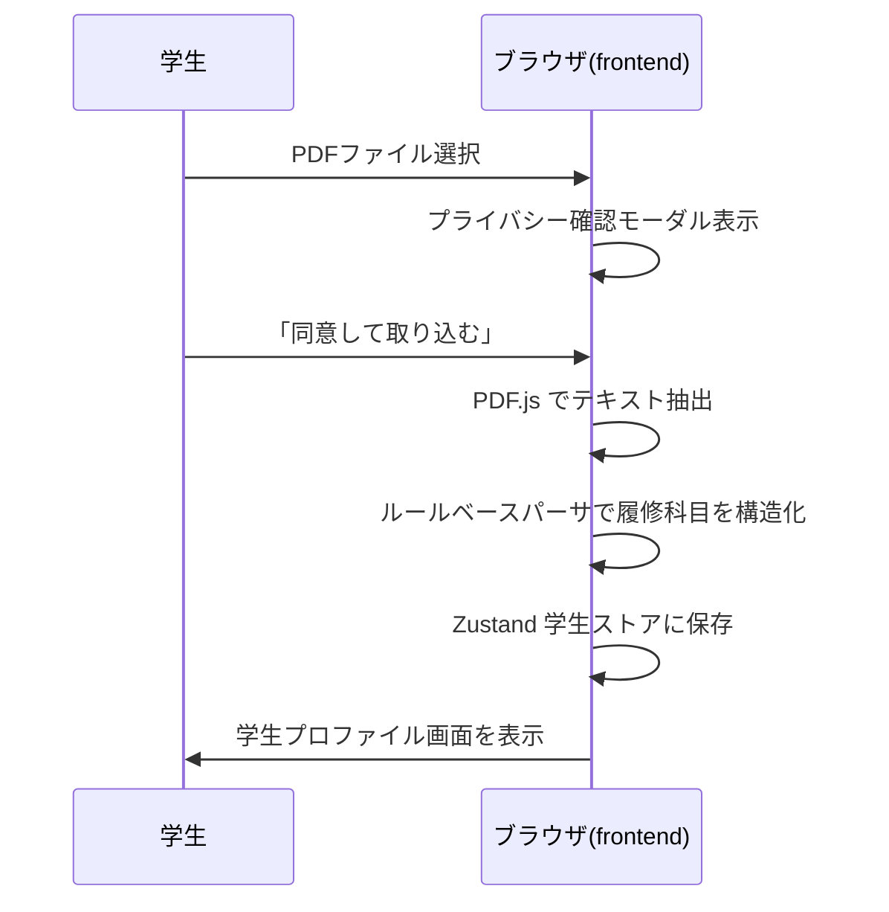
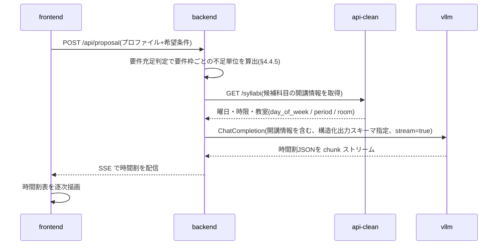
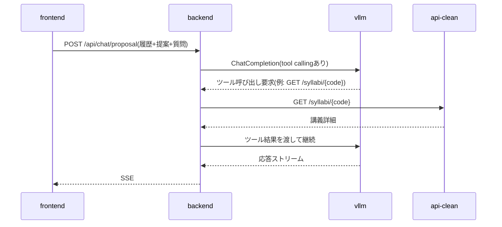
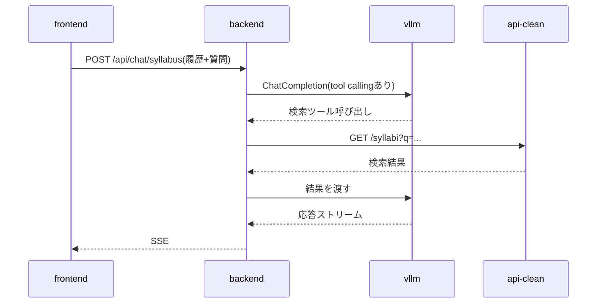

# 履修登録支援AIチャットボット 設計書(v0.9.6)— §6 API設計 / §7 主要シーケンス / §8 画面構成とルーティング

> 本ファイルは [`docs/design.md`](../design.md) の一部である。§番号は設計書全体で通し番号であり、他ファイルの節を `§X.Y` の形で参照する。全ファイルの対応表は [design.md](../design.md) の「0.3 本書の構成」を参照。

---

## 6. API設計

### 6.1 内部 API(frontend ↔ backend)

| メソッド | パス | 用途 | 応答形式 |
|---|---|---|---|
| POST | /api/proposal | 履修提案を生成 | SSE |
| POST | /api/chat/proposal | 履修提案に関するチャット | SSE |
| POST | /api/chat/syllabus | シラバス全体チャット | SSE |
| POST | /api/chat/syllabus/{code} | 講義単位チャット | SSE |
| GET | /api/syllabi | シラバス検索(一覧・絞り込み) | JSON |
| GET | /api/syllabi/{code} | シラバス詳細(講義ページ表示) | JSON |
| GET | /api/masters | 検索絞り込み用の値マスタ | JSON |
| GET | /api/curricula/{program_code}/{admission_year} | 履修要項データ参照(タグ表示用) | JSON |
| POST | /api/requirements | 卒業要件の充足判定(要件枠ごとの不足単位) | JSON |
| GET | /healthz | ヘルスチェック | JSON |

チャット系(SSE)のリクエストには学生プロファイルと対話履歴を毎回含める(サーバ側で永続化しないため)。

`GET /api/syllabi` / `/api/syllabi/{code}` / `/api/masters` は、検索画面(§4.1 の `/syllabus` 一覧・検索および `/syllabus/[code]` 詳細)が使う読み取り専用エンドポイントで、backend は §6.2 の api-clean(`GET /syllabi` / `GET /syllabi/{code}` / `GET /masters`)を中継する。公開経路はゲートウェイの単一オリジンに統一され、`/` は frontend、`/api/*` は backend へ振り分けられる一方、api-clean は公開されない(§1.2)。したがって frontend は api-clean を直接呼べず、検索画面向けにも backend 側の口が必要となる。クエリパラメータは api-clean の `/syllabi`(`q` / `faculty` / `program` / `campus` / `term` / `day` / `period` / `year` / `instructor` / `grade` / `limit` / `offset`)を素通しする。検索結果に付す「必修 / 選択 / 既修得済み」タグ(§8)は、この結果と `GET /api/curricula` の履修要項、ブラウザ内の学生プロファイルを frontend 側で突き合わせて生成する。突合はシラバスコードによる結合を第一とし、履修要項側のコードは開講年度ファイルの `resolved`(科目名 → シラバスコード。§5.1.4)から解決する。`not_offered` / `unresolved` の科目はコードを持たないためタグ付けの対象外とする。

`GET /api/curricula/{program_code}/{admission_year}` は、このタグ付けが必要とする科目レイヤ(§4.4.3)を返す。**backend は次の3点を解決済みの状態で返し、履修要項の構造をクライアントに持ち込まない。**

- **マージ後の `courses` を返す**(教養教育科目ファイルの取り込み、`not_available_to_programs` による除外、他課程からの専門関連科目の導出。§4.4.3)。検索結果には他課程が開講する科目も現れるため、当該課程の設置科目だけを返すとその大半がタグなしになる
- **各科目にシラバスコードを合成して返す。** コードは `curricula/` 側になく開講年度ファイルの `resolved` が持つ(§4.4.2)ため、解決は backend が行う。frontend が `offerings/` を直接参照することはない。`not_offered` / `unresolved` の科目は空配列とする
- **当該課程の設置科目か、他課程から導出した専門関連科目かを区別するフラグ(`own`)を付す。** 他課程の `type: 必修` はその課程の学生にとっての必修であり、区別せずに表示すると誤ったタグになる(導出科目の用途は §4.4.3 のとおり `related` / `free.faculty` スロットの判定に限られる)

あわせて `graduation`(`total_credits` / `excluded_types`)を返す。卒業残り単位の表示(§4.4.5)に必要であり、これを返さないとクライアントは卒業必要単位数を知る手段を持たない。**設置科目の単位数の総和は卒業必要単位数ではない。** 要件枠ごとの不足単位は `POST /api/requirements` で得る。

```json
{
  "programCode": "02", "admissionYear": 2024, "offeringYear": 2026,
  "graduation": { "totalCredits": 124, "excludedTypes": ["随意"] },
  "courses": [
    { "title": "仏教の思想A", "category": "教養教育科目", "subcategory": "「仏教の思想」科目",
      "type": "必修", "credits": 2, "grade": 1, "term": "前期", "quarters": ["1Q", "2Q"],
      "kikan": false, "own": true, "syllabusCodes": ["G260110004", "G260110005"] }
  ]
}
```

`POST /api/requirements` は、学生プロファイル(既修得科目を含む)を本文で受け取り、要件枠ごとの修得済み単位・不足単位を返す。判定規則をクライアントへ渡さないための口であり、その根拠と責務の切り分けは §4.4.5 による。

### 6.2 既存シラバスバックエンド API の利用

backend から `http://api-clean:5000` 経由で以下を主に利用する:

- `GET /syllabi` — 検索(独自シラバス§4.5、シラバスチャット§4.6で使用)
- `GET /syllabi/{code}` — 詳細(講義ページ表示・講義単位チャットで使用)
- `GET /masters` — 値マスタ(検索 UI のドロップダウン候補に利用)

`POST /sql` はエージェントに任意 SQL を書かせるリスクを避けるため使用しない方針とする。

### 6.3 vLLM との連携

- backend は OpenAI 互換クライアント経由で `http://vllm:8000/v1/chat/completions` を呼ぶ
- PydanticAI の `OpenAIChatModel('qwen3.6-27b-fp8', provider=OpenAIProvider(base_url='http://vllm:8000/v1', api_key='EMPTY'))` 形式で設定(base_url / api_key はモデルでなく `OpenAIProvider` に渡す。vllm は認証なしのため api_key はダミー。旧称 `OpenAIModel` は現行 pydantic-ai で `OpenAIChatModel` にリネーム)
- ツール呼び出しは PydanticAI の `@agent.tool` で定義し、内部で api-clean を HTTP で叩く

---

## 7. 主要シーケンス

### 7.1 成績表PDF取り込み



ネットワーク通信は一切発生しない(要件§5.2、§5.3を担保)。

### 7.2 履修提案生成



時間割(曜日×時限)の組み立てに必要な開講曜日・時限は、履修要項 YAML ではなく api-clean が保持する(§5.1)。backend は LLM 呼び出しの前に候補科目の開講情報を api-clean から取得し、コマ重複のない時間割を生成できるようプロンプトに含める。なお、週複数コマ開講の科目が `day_of_week` / `period`(1科目につき1組)でどう表現されるかは実データで確認する。

### 7.3 提案チャット



### 7.4 シラバスチャット(全体)

要件§4.6「シラバス全体に対する質問」。



#### 7.4.1 システムプロンプト

backend は毎リクエスト、次のプロンプトを `instructions` としてエージェントに渡す(実体は `app/api/chat_syllabus.py` の `_SYLLABUS_PROMPT`)。§7.5 も同じ本文を先頭に置き、その後ろに対象講義の詳細を連結する。

```
あなたは龍谷大学の履修登録を支援するAIアシスタントです。
学生のシラバスに関する質問に日本語で答えてください。
必要に応じてツールを使ってシラバス情報を検索・参照してください。

回答は次の規則に従ってください。
1. ツールが返した内容だけを根拠にする。シラバスに書かれていない事項を補わない。
2. シラバスの語をそのまま使う。より具体的な語や製品名への言い換えをしない(例:「文書作成ソフト」を「Word」、「ネットワークストレージ」を「クラウド」と書き換えない)。
3. シラバスにない形容や評価を付け加えない(例:「実践的な」)。
4. 週数・回数・期間などの数値は、シラバスに書かれている場合だけ示す。自分で計算・推定しない。
5. 必修・選択必修・推奨といった履修要件の判断はしない。シラバス検索ツールはこれを判断できる情報を返さないため、履修要項で確認するよう案内する。
6. 同じ科目名で複数のクラスが開講されている場合は、記述の単位を1クラスとし、どのクラスの話かを講義コードで明示する。複数のクラスをまとめた見出しの下に、特定のクラスにしか当てはまらない情報を書かない。検索結果の1件、詳細1件がそれぞれ1クラスであり、どの項目もクラスをまたいで混ぜない。same_title_classes は同名科目のクラス数、may_have_more は結果に続きがあることを表す。
7. 推測を述べる場合は、推測であることを明示する。
8. シラバスに情報が無い事項は、無いと答える。
```

規則2〜4が個別の言い換えを名指ししているのは、2026-09-04 の実機検証で**捏造が装飾部分に集中して現れた**ためである。科目名・単位・担当教員・各回の内容といった骨格は原典どおりで、誤りは「文書作成ソフト」→「Word」、「ネットワークストレージ」→「クラウド」のような一般語の具体化、原典にない概念(プライバシー保護)の追加、`course_plan` の回数からの開講週数の推定、原典にない形容(「実践的な」)の付加として出た。「シラバスにない事を書くな」という一般規則だけではこれらは抑止されない。LLM の側にはいずれも言い換え・要約の範囲内に見えるためである。したがって観測された誤りの型を具体例つきで挙げる。

規則5は、必修・推奨の判定に使える情報をシラバス検索ツールが返さないことによる。api-clean の `programs` は空で返り、`note`(例: `Y1000 ◎`)の意味は未解明である(§13)。判定の根拠が無い以上、履修要項側で確認させるほかない。ツール側が課程情報を返すようになった時点で、この規則は見直す。

規則6はプロンプト単独では足りず、ツールの返却値と併せて成立する。一覧(`GET /syllabi`)は担当教員も `term_schedule_raw` も返さないため、LLM は同名科目のクラスを区別できない。2026-09-06 の実機検証では、クラスを1件ずつ詳細取得したうえで、サブタイトルの同じ2クラス(`Y000001030` 植村担当 木3・木4 と `Y000001060` 丸山担当 木1・木2)をひとまとめにし、担当教員は片方だけ・曜日時限は両方から拾った回答を出した。捏造ではなく**クラスをまたいだ属性の結合ミス**である。

そこで `app/agents/tools.py` に `search_syllabi_for_agent()` を置き、検索結果を LLM に渡す前に整える。エージェントはこちらを使い、frontend 向けの `GET /api/syllabi` は従来どおり素通しの `search_syllabi()` を使う(検索一覧に詳細取得の負荷を持ち込まないため)。

| 追加する項目 | 内容 |
|---|---|
| `results[].instructors` | 担当教員名のリスト。詳細にしか無い |
| `results[].term_schedule_raw` | 開講コマの原文。連続コマはここにしかない(#61) |
| `same_title_classes` | 同名科目のクラス数。同名が複数ある科目のみ |
| `may_have_more` | 取得件数が上限に達し、続きがありうる場合のみ |

詳細取得は `asyncio.gather` で並行に行い、`_ENRICH_LIMIT` 件までに抑える。1件が失敗してもその行が補われないだけで検索全体は返す。LLM にクラス単位の往復をさせるより速い。件数は取得できた範囲のものであり、`may_have_more` はそれを「これで全部」と書かせないための印である。

行に載せるのは**クラスの同定に要る項目**(講義コード・サブタイトル・担当教員・曜日時限)に限り、`goals` や `course_plan` といった**内容の項目**は詳細に置いたままとする。内容まで行に載せると検索結果が肥大し、レイテンシと文脈消費に跳ね返るためである。この線引きにより、クラスの数と区別は1回の検索で確定するが、内容の項目は依然として LLM が複数件を突き合わせて書く。詳細レスポンスは `syllabus_code` を持つため結合の鍵は常に渡っているが、**結合そのものは LLM に委ねられており、取り違えの余地は内容の項目に残る**。この残余は規則6(記述の単位を1クラスとし、講義コードで明示する)で抑える。

なお 2026-09-06 の取り違えは、材料の不足だけでは説明できない。曜日・時限は一覧が元から返しており、モデルはそれを持っていた。誤りが生じたのは検索結果を1つの文章へ畳む段階で、サブタイトルの一致でグループを作り、そのグループに片方のクラスの担当教員を貼ったためである。同じ回答の中で内容の帰属(C言語を中野担当クラス、最終レポートを植村担当クラス)は正しく、壊れたのはまとめ見出しを作った箇所だけであった。規則6が項目を名指しせず「どの項目も」と書き、まとめ見出しの下に個別クラスの情報を書くことを禁じているのはこのためである。

回答内容は LLM 依存で非決定的なため、単体テストで確かめるのは規則がプロンプトに載り両ルートでモデルに渡ることまでとし、捏造が実際に消えたかは実機スモーク(`backend/scripts/smoke_chat_syllabus.py`)で確認する。

### 7.5 シラバスチャット(講義ページ単位)

要件§4.6「講義ページ単位の質問」。frontend は現在表示中の `syllabus_code` を含めて送信。backend は最初にその講義詳細を取得し、システムプロンプトの一部としてコンテキストに含めたうえで LLM に渡す。

---

## 8. 画面構成とルーティング

| パス | 画面 | 主な機能 |
|---|---|---|
| / | 学生情報入力 | 手入力フォーム、PDF取り込み、プライバシー確認ダイアログ(要件§5.6) |
| /proposal | 履修提案 | 時間割表示、提案チャット(要件§4.3、§4.4) |
| /syllabus | 独自シラバス一覧 | 検索、タグ表示「必修」「選択」「既修得済み」(要件§4.5) |
| /syllabus/[code] | 講義詳細 | シラバス情報、講義単位チャット(要件§4.6) |
| /privacy | プライバシーポリシー | データの流れの図解、要件§5の規定説明 |

ヘッダーに常にリセットボタン(要件§4.8)を設置する。
