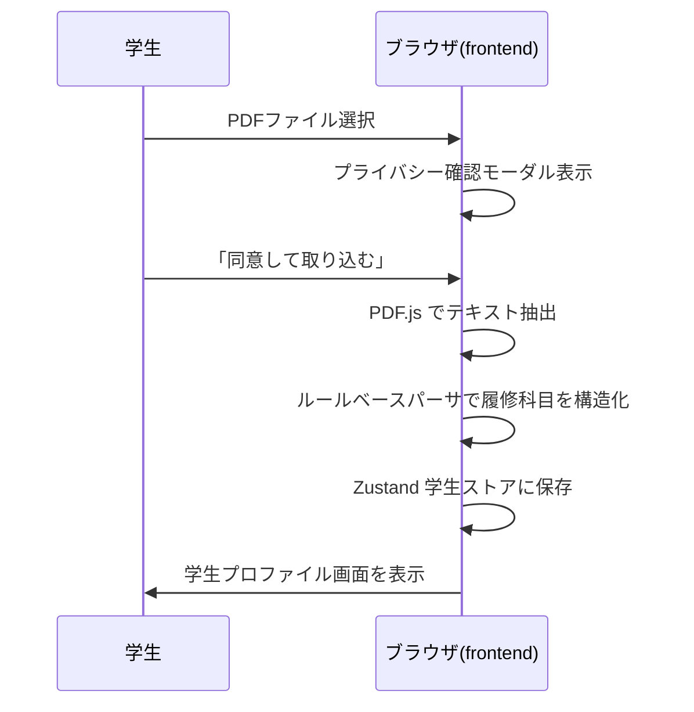
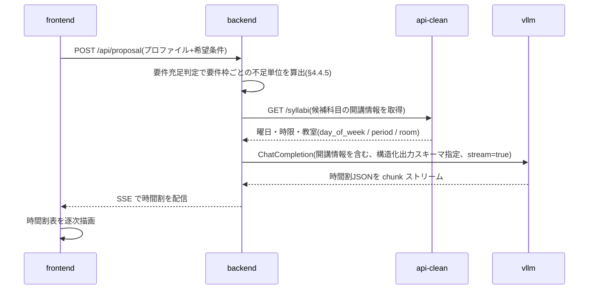
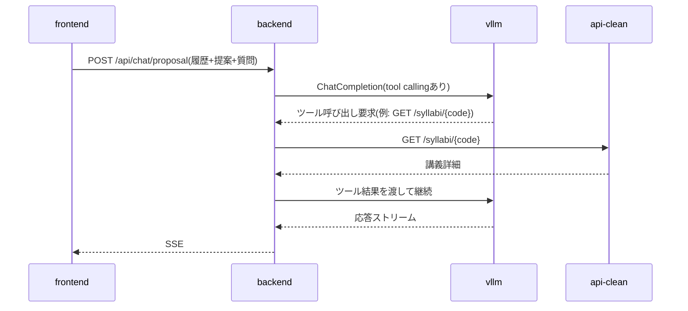
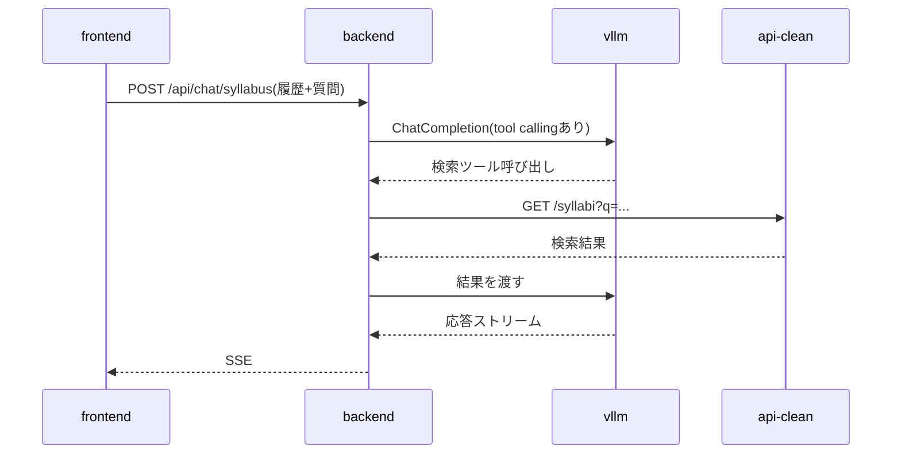

# 履修登録支援AIチャットボット 設計書(v0.9.2)— §6 API設計 / §7 主要シーケンス / §8 画面構成とルーティング

> 本ファイルは [`docs/design.md`](../design.md) の一部である。§番号は設計書全体で通し番号であり、他ファイルの節を `§X.Y` の形で参照する。全ファイルの対応表は [design.md](../design.md) の「0.3 本書の構成」を参照。

---

## 6. API設計

### 6.1 内部 API(frontend ↔ backend)

| メソッド | パス | 用途 | 応答形式 |
|---|---|---|---|
| POST | /api/proposal | 履修提案を生成 | SSE |
| POST | /api/chat/proposal | 履修提案に関するチャット | SSE |
| POST | /api/chat/syllabus | シラバス全体チャット | SSE |
| POST | /api/chat/syllabus/{code} | 講義単位チャット | SSE |
| GET | /api/syllabi | シラバス検索(一覧・絞り込み) | JSON |
| GET | /api/syllabi/{code} | シラバス詳細(講義ページ表示) | JSON |
| GET | /api/masters | 検索絞り込み用の値マスタ | JSON |
| GET | /api/curricula/{program_code}/{admission_year} | 履修要項データ参照(タグ表示用) | JSON |
| POST | /api/requirements | 卒業要件の充足判定(要件枠ごとの不足単位) | JSON |
| GET | /healthz | ヘルスチェック | JSON |

チャット系(SSE)のリクエストには学生プロファイルと対話履歴を毎回含める(サーバ側で永続化しないため)。

`GET /api/syllabi` / `/api/syllabi/{code}` / `/api/masters` は、検索画面(§4.1 の `/syllabus` 一覧・検索および `/syllabus/[code]` 詳細)が使う読み取り専用エンドポイントで、backend は §6.2 の api-clean(`GET /syllabi` / `GET /syllabi/{code}` / `GET /masters`)を中継する。公開経路はゲートウェイの単一オリジンに統一され、`/` は frontend、`/api/*` は backend へ振り分けられる一方、api-clean は公開されない(§1.2)。したがって frontend は api-clean を直接呼べず、検索画面向けにも backend 側の口が必要となる。クエリパラメータは api-clean の `/syllabi`(`q` / `faculty` / `program` / `campus` / `term` / `day` / `period` / `year` / `instructor` / `grade` / `limit` / `offset`)を素通しする。検索結果に付す「必修 / 選択 / 既修得済み」タグ(§8)は、この結果と `GET /api/curricula` の履修要項、ブラウザ内の学生プロファイルを frontend 側で突き合わせて生成する。突合はシラバスコードによる結合を第一とし、履修要項側のコードは開講年度ファイルの `resolved`(科目名 → シラバスコード。§5.1.4)から解決する。`not_offered` / `unresolved` の科目はコードを持たないためタグ付けの対象外とする。

`GET /api/curricula/{program_code}/{admission_year}` は、このタグ付けが必要とする科目レイヤ(§4.4.3)を返す。**backend は次の3点を解決済みの状態で返し、履修要項の構造をクライアントに持ち込まない。**

- **マージ後の `courses` を返す**(教養教育科目ファイルの取り込み、`not_available_to_programs` による除外、他課程からの専門関連科目の導出。§4.4.3)。検索結果には他課程が開講する科目も現れるため、当該課程の設置科目だけを返すとその大半がタグなしになる
- **各科目にシラバスコードを合成して返す。** コードは `curricula/` 側になく開講年度ファイルの `resolved` が持つ(§4.4.2)ため、解決は backend が行う。frontend が `offerings/` を直接参照することはない。`not_offered` / `unresolved` の科目は空配列とする
- **当該課程の設置科目か、他課程から導出した専門関連科目かを区別するフラグ(`own`)を付す。** 他課程の `type: 必修` はその課程の学生にとっての必修であり、区別せずに表示すると誤ったタグになる(導出科目の用途は §4.4.3 のとおり `related` / `free.faculty` スロットの判定に限られる)

あわせて `graduation`(`total_credits` / `excluded_types`)を返す。卒業残り単位の表示(§4.4.5)に必要であり、これを返さないとクライアントは卒業必要単位数を知る手段を持たない。**設置科目の単位数の総和は卒業必要単位数ではない。** 要件枠ごとの不足単位は `POST /api/requirements` で得る。

```json
{
  "programCode": "02", "admissionYear": 2024, "offeringYear": 2026,
  "graduation": { "totalCredits": 124, "excludedTypes": ["随意"] },
  "courses": [
    { "title": "仏教の思想A", "category": "教養教育科目", "subcategory": "「仏教の思想」科目",
      "type": "必修", "credits": 2, "grade": 1, "term": "前期", "quarters": ["1Q", "2Q"],
      "kikan": false, "own": true, "syllabusCodes": ["G260110004", "G260110005"] }
  ]
}
```

`POST /api/requirements` は、学生プロファイル(既修得科目を含む)を本文で受け取り、要件枠ごとの修得済み単位・不足単位を返す。判定規則をクライアントへ渡さないための口であり、その根拠と責務の切り分けは §4.4.5 による。

### 6.2 既存シラバスバックエンド API の利用

backend から `http://api-clean:5000` 経由で以下を主に利用する:

- `GET /syllabi` — 検索(独自シラバス§4.5、シラバスチャット§4.6で使用)
- `GET /syllabi/{code}` — 詳細(講義ページ表示・講義単位チャットで使用)
- `GET /masters` — 値マスタ(検索 UI のドロップダウン候補に利用)

`POST /sql` はエージェントに任意 SQL を書かせるリスクを避けるため使用しない方針とする。

### 6.3 vLLM との連携

- backend は OpenAI 互換クライアント経由で `http://vllm:8000/v1/chat/completions` を呼ぶ
- PydanticAI の `OpenAIChatModel('qwen3.6-27b-fp8', provider=OpenAIProvider(base_url='http://vllm:8000/v1', api_key='EMPTY'))` 形式で設定(base_url / api_key はモデルでなく `OpenAIProvider` に渡す。vllm は認証なしのため api_key はダミー。旧称 `OpenAIModel` は現行 pydantic-ai で `OpenAIChatModel` にリネーム)
- ツール呼び出しは PydanticAI の `@agent.tool` で定義し、内部で api-clean を HTTP で叩く

---

## 7. 主要シーケンス

### 7.1 成績表PDF取り込み



ネットワーク通信は一切発生しない(要件§5.2、§5.3を担保)。

### 7.2 履修提案生成



時間割(曜日×時限)の組み立てに必要な開講曜日・時限は、履修要項 YAML ではなく api-clean が保持する(§5.1)。backend は LLM 呼び出しの前に候補科目の開講情報を api-clean から取得し、コマ重複のない時間割を生成できるようプロンプトに含める。なお、週複数コマ開講の科目が `day_of_week` / `period`(1科目につき1組)でどう表現されるかは実データで確認する。

### 7.3 提案チャット



### 7.4 シラバスチャット(全体)

要件§4.6「シラバス全体に対する質問」。



### 7.5 シラバスチャット(講義ページ単位)

要件§4.6「講義ページ単位の質問」。frontend は現在表示中の `syllabus_code` を含めて送信。backend は最初にその講義詳細を取得し、システムプロンプトの一部としてコンテキストに含めたうえで LLM に渡す。

---

## 8. 画面構成とルーティング

| パス | 画面 | 主な機能 |
|---|---|---|
| / | 学生情報入力 | 手入力フォーム、PDF取り込み、プライバシー確認ダイアログ(要件§5.6) |
| /proposal | 履修提案 | 時間割表示、提案チャット(要件§4.3、§4.4) |
| /syllabus | 独自シラバス一覧 | 検索、タグ表示「必修」「選択」「既修得済み」(要件§4.5) |
| /syllabus/[code] | 講義詳細 | シラバス情報、講義単位チャット(要件§4.6) |
| /privacy | プライバシーポリシー | データの流れの図解、要件§5の規定説明 |

ヘッダーに常にリセットボタン(要件§4.8)を設置する。
