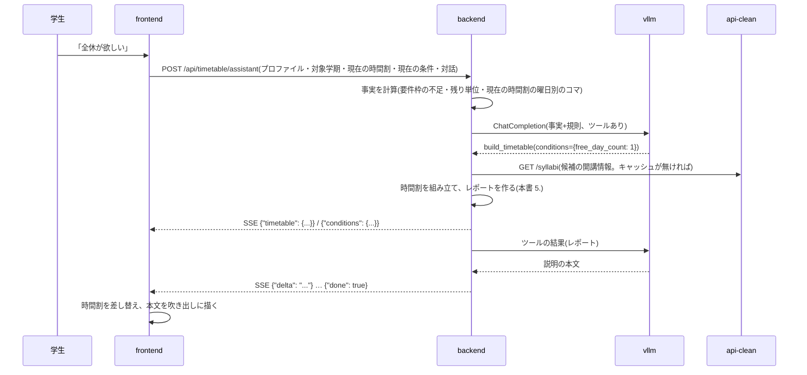

# 履修提案の作り直し 設計案(v0.1)

| 項目 | 内容 |
|---|---|
| 状態 | **検討中**(未採用。実装は始めていない) |
| 起票 | 2026-10-22 |
| 対象の現行版 | 設計書 v0.9.94([design.md](../design.md))・要件定義書 v0.8.8([requirements.md](../requirements.md)) |
| 置き換える節 | §6.1(`POST /api/proposal`・`POST /api/chat/proposal`)・§6.3.1(履修提案の行)・§7.2・§7.3・§8.3.1〜§8.3.3。§7.4・§7.5 はツールだけを置き換える |

> 本書は現行設計への**差分の提案**である。現行の設計書は実装の正本であり続け、本書の内容は採用が決まって実装した時点で設計書の各節へ取り込む。§番号のうち「§7.2」のような裸の番号は現行設計書の節、「本書 2.」のような番号は本書の節を指す。

---

## 1. 背景 — 現行の作りで起きていること

現行の履修提案は「**希望条件の自由文を1回で受け取り、1回のモデル呼び出しで時間割と説明を書かせる**」作りである(§7.2)。提案前の入力はすべて希望条件として `POST /api/proposal` へ送り(§8.3.1)、提案後の入力は時間割を変えられない提案チャット(§7.3)へ送る。

実機と画面で次の問題を確認した。いずれも個別の不具合ではなく、この作りから来ている。

| 観測したこと | 原因(現行の作り) |
|---|---|
| 「あなたは何ができますか?」と送ると、それを希望条件として1分強かけて時間割を作り、質問には答えない | 提案前の入力は**内容を問わず**希望条件として送る(§8.3.1 の表) |
| 「全休が欲しい」と送っても、月〜金のすべてに授業が入る | 曜日・時限の条件を backend が守らない。モデルは数百行の候補一覧(1クラス1行。§7.2.1)からコードを1件ずつ選んで書くだけで、どの曜日が埋まったかを数える仕組みも、書いた後に確かめる仕組みも無い |
| 説明文が「月曜は4・5限にまとめて全休しやすい構成」と事実に反する | 説明文(`summary`)は時間割と同じ出力でモデルが自由に書き、**誰も事実と照合しない**。書き直し(§7.2.2)は科目を外したときだけ走り、希望条件を渡していない |
| 提案チャットで「全休になっていない」と指摘しても、聞き返して終わる | 提案チャットは時間割を差し替えられない(§7.3.1 規則7)。代わりの科目を勧める材料(要件枠の不足・候補・履修可否・残り単位)も持たない |
| 「全休ってどういう意味だと思ってる?」に定義で答える | 提案が希望を満たしていないときの応じ方をどこにも定めていない。誤った説明文を規則5で根拠として扱わせている |
| 必修を「不足を埋める」科目として説明する | 必修を入れるかどうかもモデルの判断に任せており、理由を要件枠の不足で書かせていた(v0.9.93 で文言は直したが、入れるかどうかは依然モデル次第) |

あわせて、シラバス検索のツール(§7.4 の `tool_search_syllabi` / `tool_get_syllabus`)が Qwen にとって使いにくい(本書 7.1)。

---

## 2. 方針

1. **対話はエージェント、時間割は backend。** `/proposal` の入力はすべて1つのエージェント(以下「アシスタント」)が受ける。質問には答え、希望を聞き取り、時間割を作る・変えるときは backend の組み立て処理をツールとして呼ぶ。**時間割の中身(どの科目をどのコマに入れるか)を決めるのは backend の決定的な処理**であり、モデルは決めない。
2. **希望は構造化した条件にする。** 「全休」「1限は避けたい」「必修だけ」のような時間割の形についての希望は、backend が守れる条件(本書 4.)に写す。興味・関心のような柔らかい希望は、検索ツールで科目を探して「優先したい科目」として渡す。
3. **説明は事実から書く。** 組み立ての結果として backend が事実(本書 5.6 のレポート。空いた曜日、満たした条件と満たせなかった条件とその理由、要件枠の増減)を返し、アシスタントはそれだけを根拠に説明する。
4. **学生の手元の時間割を正とする。** 学生は時間割を自分で直せる(§8.3.6)。リクエストのたびに現在の時間割を送り、組み立てはそれを起点にする(学生が自分で入れた科目は外さない)。
5. **モデルに長い出力を書かせない。** 生成は出力トークン数で所要時間がほぼ決まる。現行は数万トークンの候補一覧を読ませ、下書き(コードと理由の並び)を書かせていた(1回1分強)。組み立てを backend に移すと、モデルが書くのはツールの引数と短い説明だけになる。

---

## 3. 全体の流れ



質問だけのとき(「何ができる?」「この科目の評価方法は?」)は、アシスタントは組み立てを呼ばずに答える(必要ならシラバス検索のツールを呼ぶ)。

「希望条件なしで提案する」ボタンは、アシスタントを通さず `POST /api/timetable/build` を直接呼ぶ(本書 3.2)。モデル呼び出しが無いので待ち時間は組み立ての数秒で済む。

### 3.1 エンドポイント

| メソッド | パス | 扱い | 用途 |
|---|---|---|---|
| POST | `/api/timetable/assistant` | **新設** | 時間割の画面の対話のすべて。SSE |
| POST | `/api/timetable/build` | **新設** | 条件から時間割を組み立てる。モデルを呼ばない。JSON |
| POST | `/api/timetable/check` | **新設** | 与えた時間割のレポート(本書 5.6)を返す。学生が手で直した後の事実の更新に使う。JSON |
| POST | `/api/proposal` | **廃止** | `/api/timetable/build` と `/api/timetable/assistant` に分かれる |
| POST | `/api/chat/proposal` | **廃止** | `/api/timetable/assistant` に統合 |
| POST | `/api/chat/syllabus`・`/api/chat/syllabus/{code}` | 残す | ツールを本書 7. のものに替える |
| POST | `/api/requirements` | 残す | 卒業要件の帯(§8.3.5)は従来どおりこれを引く |

`/api/timetable/*` の3本は、同じ「時間割の文脈」(本書 3.3)を受け取る。

### 3.2 `POST /api/timetable/build`

```json
{
  "studentProfile": { "grade": 3, "program": "知能情報メディア課程", "completedCourses": [] },
  "programCode": "02", "admissionYear": 2024,
  "targetTerm": { "year": 2026, "term": "後期", "grade": 3 },
  "timetable": [],
  "conditions": { "freeDayCount": 1 },
  "mode": "rebuild"
}
```

応答は `{"timetable": [...ProposedCourse], "totalCredits": 20, "report": {...}, "conditions": {...}}`。`conditions` は組み立てで実際に使った条件(全休の曜日を backend が選んだときはその曜日が入る)である。

`mode` は2値である。

| `mode` | 意味 |
|---|---|
| `rebuild` | 学生が自分で入れた科目(本書 3.3 の `source: "student"`)だけを残し、残りを組み直す |
| `adjust` | 現在の時間割をすべて残し、条件に反する科目(`source: "assistant"` のもの)を外して空いた分を埋める。「今の時間割で水曜だけ空けたい」に使う |

前提の不足(課程コード・入学年度・学年)と履修要項が無い場合は、現行の `POST /api/proposal` と同じく 400 / 404 を返す。

### 3.3 時間割の文脈と `/api/timetable/assistant`

```json
{
  "studentProfile": { "grade": 3, "program": "知能情報メディア課程", "completedCourses": [] },
  "programCode": "02", "admissionYear": 2024,
  "targetTerm": { "year": 2026, "term": "後期", "grade": 3 },
  "timetable": [ { "syllabusCode": "B12345", "source": "assistant", "...": "§5.3 の ProposedCourse" } ],
  "conditions": { "freeDays": ["水"] },
  "messages": [
    { "role": "user", "content": "全休が欲しい" }
  ]
}
```

- **サーバは状態を持たない**(要件§5.2)。時間割・条件・対話は frontend が持ち、毎回送る。現行の `POST /api/chat/proposal` と同じ考え方である
- **`ProposedCourse` に `source` を足す**(`"assistant"` / `"student"`)。現行は学生が登録した科目を `reason` の文言(「学生が自分で時間割に登録した科目」)で示しているが、組み立てがそれを見分けて残すには値で持つ必要がある。`reason` は表示用に残す
- `timetable` が空でも `messages` だけで成立する(提案前の質問)。現行の「提案が無ければ 422」は無くなる

SSE のイベントは次のとおり(書式は §6.1.1 と同じ `data: <JSON>`)。

| イベント | 内容 |
|---|---|
| `{"delta": "..."}` | 本文の断片 |
| `{"thinking": "..."}` | モデルの思考の断片(出たときだけ。本書 8.1) |
| `{"activity": {"tool": "search_courses", "label": "シラバスを検索しています", "args": {...}}}` | ツールを呼び始めたとき。`label` はツールごとに backend が決めた固定文言で、モデルには書かせない。`args` はモデルが書いた引数(書きかけの間も流す) |
| `{"step": {...}}` | 組み立ての1手(本書 5.7)。組み立てが走ったときに、置いた順に流れる |
| `{"timetable": {"courses": [...], "totalCredits": 20, "report": {...}}}` | 組み立てが終わったとき。frontend は時間割をこれで**差し替える**(`step` で描いた途中の表はこれで確定する) |
| `{"conditions": {...}}` | アシスタントが条件を変えたとき。frontend は保持している条件をこれで差し替える |
| `{"error": "..."}` / `{"done": true}` | 現行と同じ |

組み立ては数秒で終わる決定的な処理なので、現行の `snapshot`(モデルが書きかけの時間割。§6.1.1)は無くなる。その代わりに、組み立ての手順を `step` として流し、frontend が1手ずつ描く(本書 8.1)。

---

## 4. 条件(Conditions)

時間割の形についての希望を、backend が守れる形で表す。アシスタントがツールの引数として書き、frontend が保持して次のリクエストに載せる。

```python
class Conditions(BaseModel):
    scope: Literal["必修のみ", "不足を埋める", "広く"] = "不足を埋める"
    free_days: list[Literal["月", "火", "水", "木", "金"]] = []
    free_day_count: int = Field(0, ge=0, le=3)
    avoid_periods: list[PeriodRule] = []          # 例: 全曜日の1限、金曜の5限
    max_days: int | None = Field(None, ge=1, le=5) # 授業のある平日の数の上限
    max_periods_per_day: int = Field(4, ge=1, le=7) # 1日に入れるコマ数の上限(必修は除く)
    target_credits: int | None = Field(None, ge=1)
    include: list[str] = []                        # 入れたい科目(シラバスコード)
    exclude: list[str] = []                        # 入れたくない科目(科目名)

class PeriodRule(BaseModel):
    day: Literal["月", "火", "水", "木", "金", "土"] | None = None  # None は全曜日
    period: int = Field(ge=1, le=7)
```

- **`scope` は要件§4.3.3 の「提案の粒度」である。** 「必修だけ知りたい」は `必修のみ`、既定は `不足を埋める`(卒業要件の不足を埋める科目を入れる)、`広く` は不足を埋めた後も残り単位の範囲で履修できる科目を足す
- **1日のコマ数は既定で4コマまで。** 選択科目を足して1日5コマ以上にはしない(「金4・金5」のような2コマ続きの科目は2コマと数える)。必修で埋まる場合は上限を超えてよい。学生が「5コマ入っていい」と言えば、アシスタントが `max_periods_per_day` を上げる
- **全休は平日(月〜金)について数える。** 曜日を指定されたら `free_days`、数だけなら `free_day_count`。集中講義(曜日・時限が未定)は曜日を占めないものとして数え、レポートで別に示す
- **興味・関心は条件に入れない。** 「AI に関係する科目を取りたい」はアシスタントが検索ツール(本書 7.)で科目を探し、`include` に入れる。自由文のキーワードを backend が解釈する口は作らない(照合の規則を決められないため)
- 値の範囲はスキーマで縛る。ツールの引数の JSON Schema に `enum` / `minimum` / `maximum` として載るため、vLLM の構造化出力が範囲外の値を書かせない

---

## 5. 時間割の組み立て(backend)

モデルを呼ばない処理である。順位で決まらない同点だけを無作為に選ぶ(本書 5.2 手順5の5)ので、同じ入力でも同点の候補の選び方は回ごとに変わりうる。テストでは乱数の種を固定する。置き場所は `app/timetable/`(現行の `app/agents/proposal_agent.py` から、組み立てに使う関数を移す。本書 10.)。

### 5.1 入力と出力

- **入力** — 履修要項・学生プロファイル・対象学期・現在の時間割・条件・`mode`
- **出力** — 時間割(`ProposedCourse` の列)・合計単位・使った条件・レポート(本書 5.6)

### 5.2 手順

1. **候補のクラスを集める。** 現行の §7.2.1 手順3〜4 と同じである(`select_candidates()` → `attach_offerings()` で履修可否と対象学期で絞る → `check_prerequisites()` で先修条件を満たさない科目を外す)。先修条件が「確認が要る」の科目は残し、レポートに載せる
2. **残す科目を置く。** `rebuild` なら `source: "student"` の科目、`adjust` なら現在の時間割の全科目。`include` の科目もここで置く
3. **必修を置く。** 対象学期に履修できる必修(学生にとっての履修区分。`student_type()`)は、条件より優先して置く。複数クラスがあるときは条件に合うクラスを選び、どのクラスも条件に合わなければ条件を破って置き、レポートに「満たせなかった条件」として理由(「月曜を空けられない: 必修の○○が月2のみ開講」)を残す。必修どうしが重なったときは両方を置かず、レポートの「確認が要ること」に載せる
   - **不合格・履修辞退の必修(再履修)も、対象学期に履修できるなら必ず置く。** 候補には不合格・履修辞退の科目が残る(現行の `_taken_titles()` は合格と登録済みだけを除く)ので、配当年次を過ぎていても手順1の候補に入り、ここで今期の必修と同じ扱いで置かれる。再履修者向けのクラスが別に開講される科目など、例外の扱いは後で足す
4. **全休の曜日を決める。** `free_days` があればそれを使う。`free_day_count` だけのとき(「全休が欲しい」のように曜日を言わなかったとき)は、**学生に聞き返さず backend が曜日を決めて組む**。空けたい曜日が決まっている学生は最初からそれを伝えるので、言わなかったなら曜日は問わないと読む。曜日は手順2・3で埋まっていない平日から選ぶ。候補が複数あるときは、各曜日を空けた場合について手順5を試し、**卒業要件の不足を最も多く埋められる曜日**を選ぶ(同点なら週の後ろの曜日)。選ばなかった候補の曜日はレポートに「ほかに空けられる曜日」として残す
5. **不足を埋める。** `scope` が `必修のみ` なら飛ばす。候補のクラスのうち、条件(全休の曜日・避ける時限・平日の数の上限・1日のコマ数の上限・`exclude`)に反せず、既に置いた科目と重ならないものを、次の順に1件ずつ試し、**どれかの要件枠の不足を減らすものだけ**を置く。単位の上限(本書 5.3)に達したか、不足を減らす候補が無くなったら止める
   1. **溢れの流れの上流の枠を先に、下流の枠(受け皿)を後に埋める。** 要件枠は溢れ(`overflow_to`)でつながっており、下流の枠ほど多くの枠から単位を受ける。2024年度入学の履修要項では、教養が「必修外国語・人文科学系・社会科学系 → 教養教育科目(選択) → オールフリーゾーン」、専攻が「専門基礎(選択)・専門応用(選択)・専門関連 → 学部フリー → オールフリーゾーン」と流れる。受け皿の枠は後から何を取っても埋まりやすいので、単位の上限で埋めきれないときに残すならここがよい。逆に受け皿を先に埋めると、後から上流の枠の科目を取ったときに溢れの行き先が無くなる。段は `overflow_to` を辿った深さで決める(どこからも溢れを受けない枠が最上流)
   2. **同じ段の枠どうしは、不足の大きい順。**
   3. 履修区分の重さ(選択必修 > 選択)。選択必修は枠の中で取るべき科目の候補が限られているため、先に置かないと後でコマが塞がる
   4. **単位が不足にちょうど合う科目。** 不足が2単位のときに4単位の科目を入れると、2単位が下流の枠へ溢れる。上限のある学期の単位を無駄にしない
   5. **既に授業のある曜日に入る科目。** 授業のある日をなるべく詰める(1日のコマ数の上限の範囲で)
   6. ここまでで決まらなければ**無作為に選ぶ**。シラバスコードや配当年次のような、学生にとって意味の無い順では決めない(毎回同じ科目に偏り、選び直しの自由度が減る)

   どの枠に入るかは、現行の `slot_destinations()` と同じく要件充足判定(§4.4.5 の `judge()`)に1科目足して判定し直して決める(割り当て・溢れ・算入上限の規則を二重に実装しない)
6. **`scope` が `広く` なら**、不足が無くなった後も残り単位の範囲で手順5の順に足す(不足を減らすかは問わない)

### 5.3 単位の上限

`target_credits` があればそれ、無ければ**対象学期に登録できる残り単位**(CAP − 対象学期に登録済みの単位。現行の `CreditBudget`)を上限とする。不足を埋める科目だけを入れる(手順5)ので、不足が上限より小さければ不足のぶんで止まる。要件§4.3.2 の「過不足のない分量」はこれで満たす。

### 5.4 満たせない条件

条件を満たせないときに**黙って破らない**。破るのは必修を置くとき(手順3)だけで、それ以外の条件は守り、守った結果として不足を埋めきれなかったことをレポートに残す。どちらの場合も、アシスタントは満たせなかった事実と理由をそのまま学生に伝える(本書 6.3 規則4)。

### 5.5 キャッシュ

候補の開講情報(`fetch_offering_index()`)と履修可否(`fetch_eligibility()`)は、現行では提案のたびに api-clean からページ送りで引いている。いずれも学生データを含まない公開の値なので、**(開講年度)ごとに backend のメモリに置く**(期限つき)。全休の曜日を選ぶ手順4は手順5を曜日の数だけ試すため、組み立て1回のうちに api-clean を引き直さない形にしておく必要がある。シラバス検索のツール(本書 7.)も同じキャッシュを使う。

### 5.6 レポート

組み立て(`/api/timetable/build`)と確認(`/api/timetable/check`)が返す、時間割についての事実である。アシスタントの説明の根拠であり、画面にもそのまま出せる形にする。

```json
{
  "days": { "月": ["音声・音響メディア処理論(2限)", "コラボレーション演習(4・5限)"], "火": [], "水": [], "木": ["心理学入門(4限)"], "金": ["ネットワークシステム・演習(4・5限)"] },
  "freeDays": ["火", "水"],
  "otherFreeDayOptions": ["木"],
  "unscheduled": ["知能情報メディアセミナー"],
  "conditions": [
    { "condition": "全休を1日", "status": "met", "detail": "火曜と水曜が空いている" },
    { "condition": "金曜の5限を避ける", "status": "unmet", "detail": "必修のネットワークシステム・演習が金4・金5のみ開講" }
  ],
  "requirements": [
    { "slot": "専門応用科目(選択)", "before": 14, "after": 22, "required": 22 }
  ],
  "remainingShortfall": [ { "slot": "教養教育科目(選択)", "shortfall": 2, "reason": "条件に合う候補が無い" } ],
  "credits": { "total": 20, "limit": 24 },
  "needsConfirmation": [ "知能情報メディアセミナーは曜日・時限が未定(集中形式)" ]
}
```

- **値はすべて backend が計算する。** 要件枠の値は `placed_slots()` と同じ判定から取る
- `otherFreeDayOptions` は、空けた曜日の**代わりに**空けられた平日(必修と学生が入れた科目の無い平日)である。アシスタントが「木曜を空ける形にもできます」と言える材料になる
- 学生が手で時間割を直した後は、frontend が `/api/timetable/check` を引いてレポートを更新する(モデル呼び出しは無い)。アシスタントはリクエストのたびに backend がレポートを計算し直して受け取るので、手で直した時間割についても事実に基づいて答えられる

### 5.7 組み立ての手順の記録(`step`)

組み立ては、置いた科目と決めたことを1手ずつ記録して返す。frontend はこれを順に描いて、時間割が組み上がっていく様子を見せる(本書 8.1)。記録は本書 5.2 の各手順で次の形をとる。

| `kind` | いつ | 例 |
|---|---|---|
| `keep` | 手順2で学生の科目などを残した | `{"kind": "keep", "course": {...}}` |
| `required` | 手順3で必修を置いた | `{"kind": "required", "course": {...}, "note": "必修"}`(再履修なら `"note": "再履修"`) |
| `free_day` | 手順4で全休の曜日を決めた | `{"kind": "free_day", "day": "水", "others": ["木"]}` |
| `fill` | 手順5・6で科目を置いた | `{"kind": "fill", "course": {...}, "slot": "専門応用科目(選択)", "shortfallAfter": 6}` |
| `unmet` | 条件を破った・埋めきれなかった | `{"kind": "unmet", "condition": "金曜の5限を避ける", "detail": "必修の…が金4・金5のみ開講"}` |

`/api/timetable/build`(JSON)も同じ記録を `steps` として返す。「希望条件なしで提案する」でも同じ描き方ができる。

---

## 6. アシスタント

### 6.1 プロンプトに入れる事実

アシスタントの `instructions` には、規則(本書 6.3)の後に、backend がリクエストごとに計算した事実を入れる。

| 節 | 中身 |
|---|---|
| 【学生】 | 課程・学年・対象学期 |
| 【卒業要件の充足状況】 | 要件枠ごとの不足(現行の `format_requirements()`) |
| 【登録できる単位】 | 対象学期の上限と残り |
| 【未修得の科目】 | 不合格・履修辞退の科目名(再履修の判断材料。要件§5.5) |
| 【現在の時間割】 | 科目ごとの曜日・時限・区分と、レポート(本書 5.6) |
| 【現在の条件】 | 本書 4. の条件 |

**現行の【候補科目】(数百行)は載せない。** 候補はツールで引く。プロンプトが数万トークンから数千トークンに縮み、プリフィルの時間とトークンゲートウェイに記録される量(要件§5.5)がともに減る。修得済み科目の一覧も、組み立てと検索が backend 側で使うので、プロンプトには載せない。

### 6.2 ツール

| ツール | 引数 | 返すもの |
|---|---|---|
| `build_timetable` | `conditions`(本書 4.)、`mode`(`rebuild` / `adjust`) | レポート(本書 5.6)。あわせて SSE の `timetable` と `conditions` を流す |
| `search_courses` | 本書 7.3 | 候補の科目(この学生にとっての区分・入る要件枠・履修可否つき) |
| `get_course` | 本書 7.4 | 1科目のシラバスの必要な節 |

- **時間割を変えるのは `build_timetable` だけである。** 「この科目を外して」「代わりにこれを入れて」は、`conditions` の `exclude` / `include` に足して `adjust` で組み直す。個別の追加・削除のツールは作らない(条件として残らない変更は、次に組み直したときに消えるため)
- ツールの説明文(docstring)はモデルへの指示になる。短く、日本語で、例を1つ添える

### 6.3 規則(案)

```
あなたは龍谷大学先端理工学部の履修登録を支援するAIアシスタントです。
学生と対話しながら、【対象学期】の時間割づくりを手伝ってください。

1. 時間割を作る・変えるときは build_timetable を呼ぶ。自分で科目を並べて時間割として示さない。
2. 学生が時間割を求めたとき、または時間割の形についての希望(全休・避けたい時限・必修だけ等)を述べたときに build_timetable を呼ぶ。使い方の質問・科目についての質問・雑談では呼ばない。
3. 希望は conditions に写す。曖昧な希望(曜日を指定しない全休など)は聞き返さずに既定で組み、結果の otherFreeDayOptions などを示して選び直せることを伝える。
4. 時間割の説明は、build_timetable が返したレポートと【現在の時間割】に書かれた事実だけに基づく。満たせなかった条件は、満たせなかったと理由とともに書く。満たしていない希望を満たしたと書かない。
5. 卒業要件・単位数は【卒業要件の充足状況】とレポートの値を用いる。自分で計算しない。単位数は整数で書き、「2.0単位」のように小数で書かない。
6. 必修の科目(不合格・履修辞退の再履修を含む)は履修できる学期に履修するものであり、不足の確保や補填として書かない。再履修の科目は再履修であることを書く。
7. 科目を勧めるときは search_courses で探し、その結果にある科目だけを勧める。
8. シラバスの事項(内容・評価方法・教科書など)は get_course が返した内容だけを根拠にし、語を言い換えない。
9. 時間割や説明の誤りを指摘されたら、まず【現在の時間割】とレポートで事実を確かめ、事実を答える。言葉の定義の説明から始めない。
10. 推測を述べる場合は推測であることを明示し、情報が無い事項は無いと答える。
```

規則8は現行のシラバスチャットの規則2〜4(§7.4.1)と同じ誤りの型を防ぐもので、採用時には同じ具体例を添える。

### 6.4 推論設定

- 思考の指定は**計測してから決める**(本書 9. の実験 E2)。現行の §6.3.1 の判断は Qwen3.6 での計測に基づき、Qwen3.8 では `enable_thinking` の意味が変わっている(§13)。アシスタントの1ターンはツール呼び出しを挟んでモデル呼び出しが2回以上になるため、1回あたりの時間がそのまま倍になる
- 現行の提案の下書きにあった `max_tokens` 4000 は不要になる。アシスタントの出力はツールの引数と数文の説明である

---

## 7. シラバス検索のツール(Qwen 向け)

アシスタントとシラバスチャット(§7.4・§7.5)の両方で使う。api-clean を引く関数(`app/agents/tools.py` の `search_syllabi()` など)は残し、**モデルに見せるツールを別に作る**。

### 7.1 現行のツールの問題

| 問題 | 何が起きるか |
|---|---|
| `faculty` / `program` / `term` が**名称の完全一致**(§6.2) | モデルは正確な名称(マスタの値)を知らず、「後期」「知能情報」のような書き方で0件になる。0件になった理由も返らない |
| `year` を指定しないと全年度を引く | 同じ科目が年度ぶん重複して返る |
| `period` が文字列、`day` が1文字の自由な文字列 | 型で縛れず、「月曜」「1限」のような値を書く余地がある |
| 返り値が api-clean の JSON そのまま | `grade_min` / `grade_max` / `detail_url` などモデルに要らない項目でトークンを使う。`count` は総件数ではなく返した件数(§6.2)で、続きがあるか分からない |
| 詳細(`get_syllabus`)が全項目をそのまま返す | `grading` は JSON 文字列のまま(§6.2)、授業計画は全回ぶんで、数千トークンになる。履歴に残るため会話が長くなるほど重い |
| 学生の文脈が無い | 履修できるクラスか、修得済みか、どの要件枠に入るかが返らない。モデルは履修できない科目を勧めうる |
| 科目名と教員名の引き方が2通りに分かれている | 科目名は全件を辿って手元で照合、教員名は表記を組み立て直して引き直す(§6.1.4)。ツールの説明からは使い分けが読めない |

### 7.2 設計の原則

1. **引数は少なく、値は列挙で縛る。** 曜日・時限・学期・区分・分野・履修区分は `Literal` / 範囲つきの `int` にし、JSON Schema の `enum` / `minimum` / `maximum` としてモデルに見せる。vLLM の構造化出力が範囲外の値を書かせない
2. **名称の完全一致を求める引数を見せない。** 学部・課程は学生プロファイルから backend が決める(プロファイルが無いシラバスチャットでは先端理工学部全体)。開講年度は backend の設定(`offering_year`)で固定する
3. **返り値は小さく、決まった形にする。** モデルが写すだけで済む値(シラバスコード・曜日時限の表記・単位)を、モデルが読む形(日本語の表記)で返す
4. **0件のときは理由を返す。** どの条件を外せば何件になるかを添える。キャッシュ(本書 5.5)から手元で数えるので、api-clean を引き直さない
5. **失敗を例外にせず、結果として返す。** 存在しないシラバスコードなどは `{"error": "..."}` で返し、モデルが言い直せるようにする(例外にすると応答全体が落ちる)

### 7.3 `search_courses`

```python
async def search_courses(
    keyword: str | None = None,          # 科目名の一部。表記の揺れは吸収する
    topic: str | None = None,            # 講義の内容に含まれる語(講義概要・到達目標・授業計画)。空白区切りは AND
    instructor: str | None = None,       # 教員名(姓だけでも可)
    day: Literal["月", "火", "水", "木", "金", "土"] | None = None,
    period: int | None = None,           # 1〜7
    term: Literal["前期", "後期"] | None = None,
    category: Literal["教養教育", "専門基礎", "専門応用", "専門関連"] | None = None,
    subcategory: Literal["仏教の思想", "必修外国語", "選択外国語", "人文科学系", "社会科学系",
                         "自然科学系", "スポーツ科学系", "教養教育科目特別講義",
                         "学部・センター等提供"] | None = None,
    course_type: Literal["必修", "選択必修", "選択", "随意"] | None = None,
    only_registrable: bool = True,       # 履修できるクラスだけ(プロファイルがあるとき)
    include_taken: bool = False,         # 修得済みの科目も含める
    limit: int = 10,                     # 1〜20
) -> dict
```

```json
{
  "total": 23,
  "shown": 10,
  "courses": [
    {
      "code": "B260230015",
      "title": "知能情報メディア特別講義",
      "when": "後期 金4・金5",
      "credits": 2,
      "type": "専門応用 › 選択",
      "fillsSlot": "専門応用科目(選択)",
      "taken": false
    }
  ],
  "hint": null
}
```

- `subcategory` の値はシラバス一覧のタグの表示名(§8.2.1。frontend の `SUBCATEGORY_LABEL`)と揃え、履修要項の表記への対応は backend が持つ
- `term` は**登録する学期**(前期・後期)で引く。1Q・2Q は前期、3Q・4Q は後期に含める(現行の `registration_half()`)。クォーターは `when` に出す
- `type` / `fillsSlot` / `taken` はプロファイルがあるときだけ付ける(シラバス一覧のタグ §8.2.1 と同じ規則。履修できないクラスには区分を付けない)。`fillsSlot` は現行の「入る枠」(`slot_destinations()`)である
- 科目名の照合は現行の `matches_title()`(§6.1.4)、教員名は `spell_instructor_name()` を内部で使う。モデルからは1つのツールに見える
- 0件のときの `hint` の例: `"day を外すと 12 件、term を外すと 3 件"`
- **api-clean に送るのは検索条件だけで、学生プロファイルは送らない**(§6.2)。学生にとっての区分・履修可否・修得済みの判定は backend の手元で行う

### 7.4 `get_course`

```python
async def get_course(
    code: str,
    sections: list[Literal["概要", "到達目標", "授業計画", "成績評価", "教科書",
                           "授業外学修", "アドバイス", "担当教員"]] = ["概要", "成績評価"],
) -> dict
```

```json
{
  "code": "B260230015",
  "title": "知能情報メディア特別講義",
  "when": "後期 金4・金5",
  "credits": 2,
  "sections": {
    "概要": "...",
    "成績評価": "期末試験 60% / レポート 40%"
  }
}
```

- **頼まれた節だけを返す。** 履歴に残る量を抑える
- `成績評価` は JSON 文字列を項目と割合の行に直す(frontend の `parseGrading()` と同じ規則を backend にも持つ)
- 長い節(授業計画など)は1節あたりの上限文字数で切り、切ったことを書き添える
- 講義単位チャット(§7.5)は従来どおり最初に詳細を取得してプロンプトに入れるが、入れる形をこのツールの返り値と揃える

### 7.5 シラバスチャットへの適用

シラバスチャット(§7.4)と講義単位チャット(§7.5)のツールを `search_courses` / `get_course` に替える。プロンプトの規則(§7.4.1)は、規則5(必修・選択必修の判断はしない)を除いてそのまま使える。**規則5は、`search_courses` が学生にとっての区分を返すようになれば見直せる**(現行の規則5は、api-clean から科目区分が取れないことを理由にしている。区分は履修要項から backend が付ける)。

### 7.6 シラバスデータの実態(syllabus_backend)

api-clean の元データ(`ProjectResearch2026/syllabus_backend`)を確認した。2026年度の科目は xlsx(大学のシラバスシステムの書き出し)から投入されている。設計に効く点は次のとおり。

- **年度ぶんでも小さい。** 2026年度は 1,512 件(先端理工学部の xlsx は教養教育科目を含め 1,278 行)。候補・検索・履修可否を **年度ぶん丸ごと backend のメモリに置ける**(本書 5.5)
- **本文の長さ。** 講義概要は中央値で約200字、9割が430字以内、最長で約1,200字。`get_course` の `概要` は切らずに返してよい。授業計画は最大35回ぶんあり、頼まれたときだけ返し、上限で切る
- **本文は検索できない(今の api-clean では)。** api-clean の `q` は科目名だけに当たり(`sub.title ILIKE`)、講義概要・到達目標は詳細(`GET /syllabi/{code}`)でしか1件ずつ取れない。**「AI に関係する科目」のような興味からの検索のため、api-clean の `GET /syllabi` に本文の検索条件(`text`)を足してもらう**(本書 13.1)。`search_courses` の `topic` はこれに渡す。backend が年度ぶんの詳細を1件ずつ引いて索引を作る案は採らない(毎日1,500回ほどの問い合わせが要る)
  - **古い api-clean は知らない検索条件を黙って無視する**(FastAPI は未定義のクエリを捨てる)。`text` を送っても絞り込まれずに全件が返り、学生には「内容に合う科目」として見えてしまう。backend は api-clean の版(`GET /healthz` が返す `version`)が `text` に対応していることを確かめてから `topic` を使い、対応していなければ `topic` を使えない旨をツールの結果で返す
- **xlsx には api-clean が持たない列がある。** 「系統的履修」(1,278 行のうち 530 行に記載。例: 仏教の思想A の行に「仏教の思想B」)は、次に取る科目の手がかりになる。「先修条件」の列は 2026年度の先端理工学部では空だった。いずれも今の clean スキーマには入っていない
- **科目区分は取れない。** xlsx の「属性名称」は「教養教育科目」「先端理工学部専攻科目」の粒度までで、必修・選択の別は無い。区分は従来どおり履修要項から backend が付ける(§13 の「シラバス DB の科目区分の欠落」と同じ結論)
- **手元で試せる。** 開発環境から api-clean には届かないが、このリポジトリの xlsx から api-clean と同じ形の JSON を作れば、組み立て(E5)と検索のツールを実データで試せる。テスト用の固定データ(フィクスチャ)としても使う

---

## 8. 画面(frontend)

- **入力欄の宛先は1つになる。** `lib/useProposalConversation.ts` の「提案の有無で `/api/proposal` と `/api/chat/proposal` に分ける」分岐(§8.3.1)は無くなり、常に `/api/timetable/assistant` へ送る
- **`timetable` イベントで時間割を差し替える。** 提案の store(§5.2.3)の `courses` をこれで置き換える。学生の手での編集(§8.3.6)は従来どおり store を書き換え、次のリクエストで送る
- **store に `conditions` と `report` を足す。** `conditions` はリクエストに載せ、`conditions` イベントで差し替える。`report` は学生が手で直した後に `/api/timetable/check` で更新する
- **「希望条件なしで提案する」は `/api/timetable/build` を直接引く。** 返ったレポートから backend が作った決まった文言(「火曜と水曜が空いています」など)を吹き出しに出す。モデルを待たない
- **「条件を変えて提案し直す」は要らなくなる。** 会話で条件を変えれば組み直されるためである。会話を最初からやり直す導線(「最近のチャット」への退避。§8.3.3)は残す
- **条件を画面に出す(任意)。** 時間割の上に条件をチップで並べ、×で外すと `/api/timetable/build` で組み直す。会話を経ずに条件を戻せる
- 1通目の案内(§8.3.2)は「何ができるか」も答えられる前提の文言に替える
- `status` の `loading`(§5.2.3)は「アシスタントが応答中」と「組み立て中」を区別しなくてよい(どちらも入力を止める)

### 8.1 考えている様子を見せる

現行は、送ってから本文の最初の文字が届くまで画面が何も変わらない(思考とツール呼び出しはクライアントへ流さない。§6.1.1)。アシスタントの1ターンはモデル呼び出しが2回以上になり、待ちはむしろ長くなるので、**待っている間に何が起きているかを順に見せる**。

| 段階 | 画面 | 元になるイベント |
|---|---|---|
| 送った直後 | 吹き出しに「読んでいます」を出す(応答を待たずに出す) | なし(frontend だけで出す) |
| モデルが考えている | 吹き出しの中に、思考の文章を小さく薄い字で流す。本文が始まったら1行に畳み、押すと開く | `thinking` |
| ツールを呼び始めた | 「シラバスを検索しています」「時間割を組んでいます」と、モデルが書いた引数(検索語・曜日、条件)をチップで出す。引数は書きかけの間から出る | `activity` |
| 時間割を組んでいる | 時間割表に1手ずつ描く。必修が先に入り、全休にした曜日の列が薄くなり、選択科目が「専門応用(選択)を埋める」の札つきで1つずつ入る。卒業要件の帯のバーがそれに合わせて伸びる | `step` |
| 組み終わった | 表を確定させ、満たせなかった条件があれば表の上に出す | `timetable` |
| 説明を書いている | 本文を流す(現行と同じ) | `delta` |

- **組み立ての描画は frontend が間を空けて行う。** 組み立ては数秒で終わり、`step` はほぼ一度に届く。1手ごとに 150ms ほど空けて描けば、組み上がっていく様子が見える。**backend は待たない**(待ちを足すと「希望条件なしで提案する」も遅くなる)
- **思考の表示は実験で決める(E6)。** Qwen3.8 で思考が出るか、`--reasoning-parser qwen3` が本文と分けられるか(§13 で未確認)、思考が日本語で読める内容か、を確かめてから出す。出なければ `activity` と `step` だけでも段階は見える
- **思考に新しい学生データは乗らない。** 思考はプロンプト(本人のデータ)から生まれ、本人のブラウザにだけ流れる。サーバに残さないことは本文と同じ(要件§5.5)
- シラバスチャット(§7.4・§7.5)にも `thinking` と `activity` を流す。検索の引数が見えると、なぜその科目が出てきたかが学生に分かる

---

## 9. 先に確かめる実験

作り直しの成否を左右するのはモデルの側である。実装に入る前に、実機(Qwen3.8 + vLLM、`--tool-call-parser qwen3_coder`)で次を確かめる。

| # | 確かめること | 方法 | 不成立のときの代わり |
|---|---|---|---|
| E1 | ツール呼び出しが安定するか(列挙・入れ子の引数、`conditions` のようなオブジェクト) | 本書 6.2 のツールを持つエージェントに定型の発話を20〜30件送り、呼び出しの成否と引数の正しさを数える | 条件の抽出だけを構造化出力の1回の呼び出しにし、ツール呼び出しを使わない |
| E2 | 1ターンの所要時間(思考の有無・`reasoning_effort` 別) | 同じ発話で `enable_thinking` 既定 / `false` / `reasoning_effort: "low"` を比べ、モデル呼び出しの回数と合計時間を採る | ツールの結果の後の説明をレポートからの定型文にし、モデル呼び出しを1回にする |
| E3 | 意図の判定(質問・希望・指摘を取り違えないか) | 「何ができる?」「全休が欲しい」「必修だけ」「全休ってどういう意味?」などを含む発話セットで、呼ぶべきときだけ `build_timetable` を呼ぶか | 規則2の例を増やす。だめなら意図の判定だけを別の短い呼び出しにする |
| E4 | ツール呼び出しの前の空白だけの本文(§7.4 の実装コメント)が Qwen3.8 でも出るか | E1 のログを見る | 現行の `run_stream_events()` の扱いを引き継ぐ |
| E5 | 組み立ての品質と時間 | ダミー学生48件(§11)で `/api/timetable/build` を回し、所要時間・単位数・不足の埋まり方・全休の可否を現行の提案と比べる。開講情報は syllabus_backend の xlsx から作った固定データを使う(本書 7.6) | 手順5の順位づけを見直す |
| E6 | 思考が出るか、見せられる内容か | E1・E2 のログで、思考の有無・長さ・言語、`--reasoning-parser qwen3` が本文と分けているかを見る | 思考は見せず、`activity` と `step` だけで段階を見せる |

E5 はモデルを使わないので、手元の単体テストとスクリプトで回せる。E1〜E4・E6 は実機が要る。

---

## 10. 既存の実装の扱い

| 現行 | 扱い |
|---|---|
| `resolve_curriculum()` / `judge_requirements()` / `slot_destinations()` / `placed_slots()` | `app/timetable/` へ移して組み立てとレポートで使う |
| `select_candidates()` / `attach_offerings()` / `check_prerequisites()` / `fetch_offering_index()` / `fetch_eligibility()` / `registration_half()` / `semester_cap()` / `CreditBudget` | 同上。取得の2つはキャッシュ(本書 5.5)を挟む |
| `assemble_courses()` の重なりの判定(`course_clash()` / `_weight()`) | 組み立ての手順2〜5 で使う |
| `render_prompt()` / `_format_candidates()` / `proposal_draft_model()` / `build_proposal_agent()` / `_INSTRUCTIONS` | 廃止(【候補科目】の一覧と下書きが無くなる) |
| `build_summary_agent()` / `rewrite_summary()` | 廃止(説明はレポートに基づいてアシスタントが書く) |
| `app/api/proposal.py`(下書きの逐次解析と snapshot) | 廃止 |
| `app/api/chat_proposal.py` | 廃止(`/api/timetable/assistant` に統合) |
| `app/agents/tools.py` の api-clean を引く関数 | 残す。モデルに見せるツールは本書 7. のものを別に置く |
| `app/agents/chat_agent.py` | ツールを本書 7. のものに替える |
| `backend/scripts/smoke_proposal.py` | アシスタント用に作り直す(E1〜E4 の計測にも使う) |

---

## 11. 移行の順序

1. **実験(E1〜E4)。** 結果で本書 6. の形(ツール呼び出しか、構造化出力の1回か)を確定する
2. **組み立てとレポート(本書 5.)。** `app/timetable/` に純粋な関数として作り、`/api/timetable/build`・`/api/timetable/check` を足す。単体テストと E5。現行の `/api/proposal` はまだ残す
3. **検索のツール(本書 7.)。** シラバスチャット(§7.4・§7.5)を先に新しいツールへ替える(提案と独立に確かめられる)
4. **アシスタント(本書 3.3・6.)。** `/api/timetable/assistant` を足し、frontend の宛先を切り替える(本書 8.)
5. **旧い口の削除。** `/api/proposal`・`/api/chat/proposal` と、本書 10. で廃止とした実装を消す
6. **設計書・要件定義書への取り込み。** 本書 12. の各節を書き換え、本書は経緯として残す

各段階で現行の画面が動き続ける順にしてある(2・3 は追加だけ、4 で切り替え、5 で削除)。

---

## 12. 設計書・要件定義書への反映先

| 文書 | 節 | 変更 |
|---|---|---|
| 要件定義書 | §4.3.3 | 粒度の決め方として `scope`(必修のみ・不足を埋める・広く)を例示する |
| 要件定義書 | §4.4 | 「提案内容の一部を変更したい場合の相談」に、会話の中で時間割が組み直されることを加える |
| 要件定義書 | §5.5 | 履修提案のプロンプトに修得済み科目の一覧を載せなくなる(組み立ては backend が行う)。載せるのは未修得の科目名と要件の充足状況。学生への明示(§5.6)の文言は範囲が狭まる方向なので、そのままでも誤りにはならない |
| 設計書 | §5.2.3 / §5.3 | store に `conditions` / `report`、`ProposedCourse` に `source` |
| 設計書 | §6.1 / §6.1.1 | エンドポイントの表と SSE のイベント |
| 設計書 | §6.3.1 | 履修提案の行を、アシスタントの推論設定(E2 の結果)に替える |
| 設計書 | §7.2・§7.3 | 本書 3.・5.・6. に置き換える |
| 設計書 | §7.4・§7.5 | ツールを本書 7. に替える。§7.4.1 規則5の見直し |
| 設計書 | §8.3.1〜§8.3.3 | 本書 8. |
| 設計書 | §13 | 本書 13.2 の未決事項を移す |

---

## 13. 決めたことと決めること

### 13.1 決めたこと

| 項目 | 決定 | 反映先 |
|---|---|---|
| 不合格の必修(再履修) | 対象学期に履修できるなら必ず履修する(組み立てが必ず置く)。再履修クラスが別にある科目などの例外は後で処理を足す | 本書 5.2 手順3、6.3 規則6 |
| 抽選科目・定員 | 考慮しない。本サービスは履修の提案であり、抽選や定員による不成立まで扱う必要はない | — |
| 全休の曜日 | 曜日を言われなければ、backend が曜日を決めて組む(聞き返さない)。選ばなかった曜日はレポートに残し、アシスタントが選び直せることを伝える | 本書 5.2 手順4、6.3 規則3 |
| 同じ枠の候補の選び方(旧 D2) | 単位が不足にちょうど合う科目 → 授業のある日に入る科目 → 無作為。シラバスコードや配当年次では決めない | 本書 5.2 手順5の4〜6 |
| 1日のコマ数(旧 D3) | 授業のある日はなるべく詰めるが、選択科目を足して1日4コマを超えない。必修で超えるのは仕方ない。学生が望めば上限を上げられる(`max_periods_per_day`) | 本書 4.、5.2 手順5 |
| 興味からの検索(旧 D4) | api-clean の `GET /syllabi` に本文の検索条件 `text` を足す(syllabus_backend を改修する) | 本書 7.3、7.6 |
| 不足を埋める枠の順(旧 D1) | 単位の上限で不足を埋めきれないとき、溢れの受け皿(教養教育科目(選択)・学部フリー・オールフリーゾーン)を後回しにし、それ以外は不足の大きい枠から埋める | 本書 5.2 手順5の1・2 |

### 13.2 決めること

| 項目 | 選択肢と考え |
|---|---|
| 卒業までの学期の配分 | 本書 5.3 は「対象学期に入れられるだけ不足を埋める」。卒業研究などで4年次に余裕を残すべきか(学期ごとの目安を設けるか)は、アドバイザー教員に確かめる |
| 条件のチップの表示(本書 8.) | 入れるか。入れれば会話を経ずに条件を戻せるが、画面の要素が増える |
| 混雑時の扱い | アシスタントの1ターンはモデル呼び出しが2回以上になり、同一トークンの同時実行の制約(§13 最優先項目)の影響を長く受ける。ターンの途中で `503 busy` になったときの再試行と見せ方を決める |
